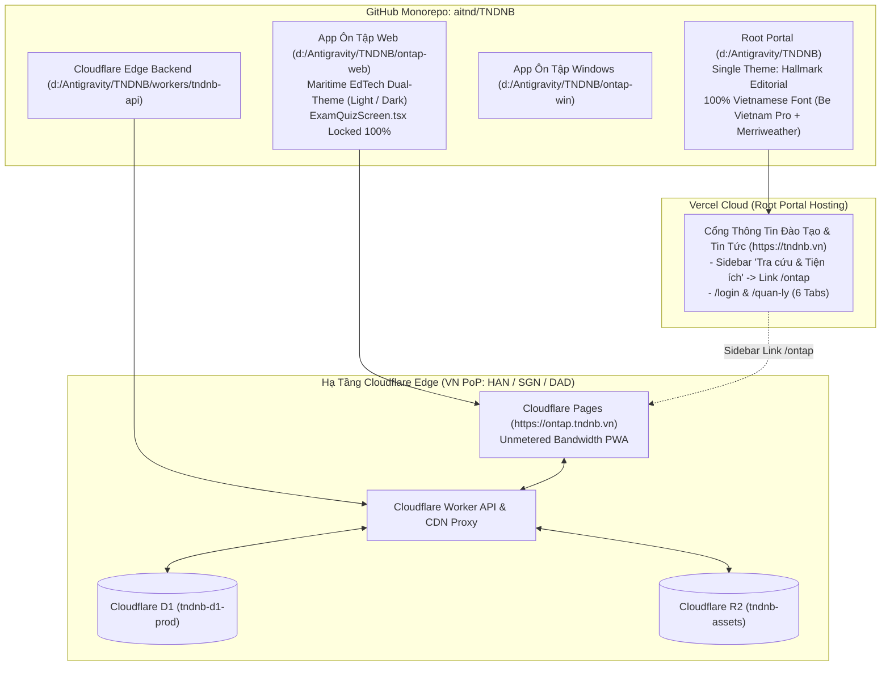

# Tài Liệu Thiết Kế Kỹ Thuật Tổng Thể (Single Source of Truth — SDD & AWF v4.0 Design Specification)
## Dự Án TNDNB: Chuẩn Hóa Giao Diện Hallmark Editorial Toàn Root Portal, Đại Tu `ontap-web` Dual-Theme (`Light` / `Dark`), Sửa Lỗi Font Tiếng Việt, Và Nâng Cấp Hạ Tầng Cloudflare (R2 + D1 + Offline-First)

> **Cập nhật lần cuối:** 10/11/2026  
> **Tiêu chuẩn áp dụng:** `AWF v4.0` + `Impeccable v4.8.0 (62-Rule Craft Floor)` + `Taste-Skill v2.5.0`  
> **Các kế hoạch hợp nhất trong tài liệu Single Source of Truth này:**
> 1. [`261105-1836-ontap-web-ui-overhaul`](file:///d:/Antigravity/TNDNB/docs/plans/261105-1836-ontap-web-ui-overhaul/DESIGN.md) — **(A)** Sửa triệt để lỗi Font Tiếng Việt "Chữ to chữ bé" trên 13 file Root Portal & sửa vòng lặp `--font-sans` trên `ontap-web`, **(B)** Gắn liên kết `/ontap` vào Sidebar Portal, và **(C)** Đại tu toàn diện 30+ màn hình `ontap-web` theo chuẩn **Maritime EdTech Dual-Theme (`light` / `dark`)** (Bảo toàn 100% `ExamQuizScreen.tsx`).
> 2. [`261105-1408-portal-login-dashboard-restore`](file:///d:/Antigravity/TNDNB/docs/plans/261105-1408-portal-login-dashboard-restore/DESIGN.md) — Loại bỏ toàn bộ hệ thống theme cũ trên Root Portal, chuẩn hóa **1 giao diện duy nhất Hallmark Editorial** cho toàn bộ 14 nhóm trang Root Portal (`d:\Antigravity\TNDNB`), khôi phục `/login` & `/quan-ly`.
> 3. [`261104-0856-cloudflare-r2-d1-offline-upgrade`](file:///d:/Antigravity/TNDNB/docs/plans/261104-0856-cloudflare-r2-d1-offline-upgrade/plan.md) — Tách Deployment Monorepo (`ontap-web` lên Cloudflare Pages, Root Portal trên Vercel) & Hạ tầng Cloudflare Worker + D1 + R2 Offline-First.
> 4. [`phase-06-portal-r2-assets-design`](file:///d:/Antigravity/TNDNB/docs/plans/261105-1836-ontap-web-ui-overhaul/phase-06-portal-r2-assets-design.md) — Chuyển đổi dần ảnh bìa, ảnh TinyMCE & giáo trình tài liệu (PDF/Word) của Root Portal sang Cloudflare R2 (`tndnb-assets`) với cơ chế Graceful Fallback 5s sang Supabase Storage và bảo toàn 100% bài viết cũ.
> 5. [`261108-2025-authoritative-changelog-and-recent-plans-sync`](file:///d:/Antigravity/TNDNB/docs/plans/261108-2025-authoritative-changelog-and-recent-plans-sync/DESIGN.md) — Khôi phục bộ parser Markdown raw cục bộ (`parseChangelog.ts` qua Vite `?raw`), thiết lập kiến trúc Dual Changelog (`CHANGELOG.md` cho Người dùng và `CHANGELOG_DEV.md` cho Kỹ thuật Dev) với thanh Tab Switcher, và nâng cấp đồng bộ phiên bản toàn hệ thống Monorepo lên **`v3.22.0`**.
> 6. [`261109-0650-changelog-rbac-and-concise-copy`](file:///d:/Antigravity/TNDNB/docs/plans/261109-0650-changelog-rbac-and-concise-copy/DESIGN.md) — Phân quyền hiển thị tab Kỹ thuật Dev theo RBAC (`admin`, `quan_ly`, `lanh_dao`), viết lại bản tin Người dùng súc tích sạch bóng từ khóa Dev, và render inline markdown `**in đậm**` thành thẻ `<strong>` an toàn.
> 7. [`261110-1015-portal-ad-role-gating-and-management`](file:///d:/Antigravity/TNDNB/docs/plans/261110-1015-portal-ad-role-gating-and-management/DESIGN.md) — Thiết lập chốt chặn quảng cáo 3 khóa (**Route Gate**, **Role Gate RBAC**, **Auth Ready Guard chống FOUA**) kèm động cơ dọn sạch DOM (`purgeAllAdSenseDomAndScripts`) trên Root Portal (`PortalAdLoader.tsx`), xóa lỗi 404 `default_avatar.png` trên `/quan-ly` và triệt tiêu lỗi React Hydration Mismatch `#418`/`#423` trên `Navbar.tsx`.

---

## Design Context

### 1. Phân Loại 4 Chế Độ Giao Diện (`4 Modes Classification` — AWF v4.0)

Toàn bộ các trang thuộc **Root Portal (`d:\Antigravity\TNDNB`)** và **App Ôn Tập Web (`d:\Antigravity\TNDNB\ontap-web`)** được phân bổ chính xác vào 3 chế độ trong mô hình **4 Modes (`Read` · `Operate` · `Persuade` · `Express`)**:

| Chế độ (Mode) | Mục tiêu Trải nghiệm & Thị giác | Các Màn hình Thuộc Root Portal (`Hallmark Editorial`) | Các Màn hình Thuộc `ontap-web` (`Maritime EdTech Dual-Theme`) |
| :--- | :--- | :--- | :--- |
| **`Read` Mode**<br>*(Đọc tin tức, văn bản & chương trình đào tạo)* | Đọc văn bản dài không mỏi mắt, hiển thị đồng đều 100% dấu Tiếng Việt (`U+1EA0–U+1EF9`), chiều rộng dòng đọc `60ch–75ch`. | - **Trang chủ (`/`)**<br>- **Chi tiết Bài viết (`/bai-viet/[postId]`)**<br>- **Danh mục Chuyên mục (`/danh-muc/[categoryId]`)**<br>- **Giới thiệu Đơn vị (`/gioi-thieu`)**<br>- **Chương trình Đào tạo (`/chuong-trinh-dao-tao/*`)**<br>- **Tư vấn Nghề nghiệp (`/tu-van-nghe-nghiep/*`)**<br>- **Thư viện Tư liệu (`/thu-vien`)** | - `AlertMarquee.tsx` (Thông báo học vụ)<br>- `ChangelogModal.tsx`, `ChangelogScreen.tsx`<br>- `EntertainmentScreen.tsx` |
| **`Operate` Mode**<br>*(Học tập, Ôn luyện, Thi sát hạch, Quản trị & Tra cứu)* | Tốc độ thao tác nhanh, biểu mẫu chuẩn mực, hỗ trợ chuyển đổi Sáng/Tối (`light`/`dark`) trên `ontap-web` để ôn luyện ban đêm, số liệu bật `tabular-nums`. | - **Đăng nhập & Đăng ký (`/login`)**<br>- **Bảng điều khiển Trung tâm (`/quan-ly`)**<br>- **Chỉnh sửa Hồ sơ (`/quan-ly/ho-so`)**<br>- **Quản lý Tài khoản & Thiết bị (`/quan-ly/tai-khoan`)**<br>- **Soạn thảo & Đăng bài (`/quan-ly/dang-bai`)**<br>- **Phòng thi (`/quan-ly/[roomId]`)**<br>- **Tra cứu địa chỉ (`/tra-cuu-dia-chi`)**, **Tài liệu (`/tai-lieu`)**, **Tìm kiếm (`/tim-kiem`)**<br>- **Khung "Tra cứu & Tiện ích" (`Sidebar.tsx` $\rightarrow$ `/ontap`)** | - **App Shell:** `TopNavbar`, `MobileHeader`, `MobileBottomNav`, `ThemeSwitcher` (1-click Sun/Moon)<br>- **Bento Dashboard & Auth:** `Dashboard` (12-col), `LoginScreen`, `RegisterScreen`, `WindowsLoginScreen`<br>- **Learning Flow:** `LicenseSelectionScreen`, `NameInputScreen`, `ModeSelectionScreen`, `SubjectSelectionScreen`, `QuizScreen` (2 cột), `ResultsScreen`, `ExamResultsScreen`, Sảnh chờ `ThiTrucTuyenPage`, `GiamKhaoSelectionScreen`<br>- **Exam Simulator (Locked):** `ExamQuizScreen.tsx` *(Giữ nguyên 100%)*<br>- **15 Màn hình Quản lý & Học viên:** `HistoryScreen`, `MyClassScreen`, `AccountScreen`, `LoginHistoryScreen`, `ClassManagementScreen`, `UserManagerScreen`, `OnlineExamManagementScreen`, `NotificationMgmtScreen`, `UsageConfigPanel`, `AnalyticsPage`, `MailboxScreen` |
| **`Persuade` Mode**<br>*(Tuyển sinh, học phí, đón tiếp & tải app)* | Thể hiện uy tín pháp lý của Công ty CP Tư vấn và Giáo dục Ninh Bình, minh bạch hóa biểu mức học phí, dẫn dắt vào ôn tập. | - **Biểu Mức Học Phí (`/hoc-phi`)**<br>- **Liên hệ & Tư vấn Tuyển sinh (`/lien-he`)** | - `WelcomeModal.tsx` (Hero Split Card 2 cột)<br>- `DownloadAppPage.tsx` |

---

### 2. Kiến Trúc Giao Diện Trên Root Portal (`Single Canonical Theme`) & `ontap-web` (`Maritime EdTech Dual-Theme`)

1. **Trên Root Portal (`d:\Antigravity\TNDNB` — Single Canonical Theme `Hallmark Editorial`):**
   - Loại bỏ vĩnh viễn `context/ThemeContext.tsx`, `components/ThemeSwitcher.tsx`, `components/ThemeEffects.tsx`, `components/MusicPlayer.tsx` và 6 chế độ cũ (`dark`, `noel`, `classic`, `modern`, `sunrise`, `tri-an`).
   - Sử dụng 100% biến CSS tĩnh tại `:root` trong [app/globals.css](file:///d:/Antigravity/TNDNB/app/globals.css) (`--color-paper: #FAF9F6`, `--color-surface: #FFFFFF`, `--color-ink: #0B132B`, `--color-accent: #003566`, `--color-gold: #D4AF37`, `--color-signal: #B91C1C`, `--color-rule: #CBD5E1`, `--radius-editorial: 4px`).
2. **Trên App Ôn Tập Web (`d:\Antigravity\TNDNB\ontap-web` — Maritime EdTech Dual-Theme `light` / `dark`):**
   - Loại bỏ 6 theme thừa (`modern`, `classic`, `sunrise`, `tri-an`, `noel`, `premium`) và xóa hẳn file [ontap-web/components/SnowEffect.tsx](file:///d:/Antigravity/TNDNB/ontap-web/components/SnowEffect.tsx).
   - Chỉ giữ đúng **2 chế độ chuẩn mực**: **Chế độ Sáng (`light` — Warm Alabaster & Maritime Navy)** và **Chế độ Tối (`dark` — Deep Nautical Carbon-Slate)** giúp học viên đi tàu hoặc ôn thi ban đêm không bị mỏi mắt, chuyển đổi nhanh 1 chạm bằng nút `Sun` / `Moon` trên `ThemeSwitcher.tsx`.

---

### 3. Kiến Trúc Typography Tiếng Việt Chuẩn Xác (Diệt Tận Gốc Lỗi "Chữ To Chữ Bé" Trên Toàn Hệ Thống)

1. **Tại Root Portal ([app/layout.tsx](file:///d:/Antigravity/TNDNB/app/layout.tsx), [app/globals.css](file:///d:/Antigravity/TNDNB/app/globals.css) & 11 file `.module.css`):**
   - Xóa bỏ hoàn toàn font `Rubik` (vốn chỉ nạp `latin`, `latin-ext`, thiếu `'vietnamese'` khiến các chữ cái có dấu bị trình duyệt fallback sang `Arial` gây hiện tượng chữ cao chữ thấp).
   - Nạp bộ 3 phông chữ Google Fonts qua `next/font/google` với đầy đủ `subsets: ['latin', 'vietnamese']`:
     - `Be_Vietnam_Pro` (`weight: ['300', '400', '500', '600', '700']`, `variable: '--font-sans'`)
     - `Merriweather` (`weight: ['400', '700', '900']`, `variable: '--font-display'`) — bắt buộc `font-style: normal !important` (Gate 38a).
     - `JetBrains_Mono` (`weight: ['400', '600', '700']`, `variable: '--font-mono'`).
   - Xóa dòng `@import url(...)` đặt sai vị trí phía sau `@tailwind` trong `app/globals.css`.
   - Chuẩn hóa **11 file `.module.css`** (`Navbar.module.css`, `app/page.module.css`, `app/bai-viet/[postId]/page.module.css`, `app/danh-muc/[categoryId]/page.module.css`, `app/hoc-phi/page.module.css`, `app/quan-ly/page.module.css`, `app/quan-ly/dang-bai/page.module.css`, `app/quan-ly/tai-khoan/page.module.css`, `app/quan-ly/[roomId]/page.module.css`, `app/tra-cuu-dia-chi/page.module.css`, `components/StudentCard.module.css`): Chuyển toàn bộ nhãn Tiếng Việt có dấu từ `var(--font-mono)` hoặc hardcode `'Segoe UI'` / `'Arial'` sang `var(--font-sans, 'Be Vietnam Pro', sans-serif)` kết hợp `font-variant-numeric: tabular-nums`.
2. **Tại App Ôn Tập Web ([ontap-web/theme.css](file:///d:/Antigravity/TNDNB/ontap-web/theme.css) & [ontap-web/index.html](file:///d:/Antigravity/TNDNB/ontap-web/index.html)):**
   - Sửa lỗi tham chiếu vòng lặp `--font-sans: var(--font-sans), sans-serif;` ở dòng 11 của `ontap-web/theme.css` thành `--font-sans: 'Be Vietnam Pro', system-ui, -apple-system, sans-serif;`.
   - Tinh giản Google Fonts trong `ontap-web/index.html` chỉ nạp `Be Vietnam Pro`.

---

## 1. Kiến Trúc Tổng Thể & Split Deployment (Keep Monorepo)



---

## 2. Thiết Kế Chi Tiết Hạng Mục Nâng Cấp `261105-1836-ontap-web-ui-overhaul`

### 2.1. Gắn Liên Kết `/ontap` Vào Sidebar Trang Chủ Portal (`components/Sidebar.tsx`)
- Trong khung widget **"Tra cứu & Tiện ích"** ([components/Sidebar.tsx](file:///d:/Antigravity/TNDNB/components/Sidebar.tsx#L137-L151)), bổ sung mục đầu tiên:
  ```tsx
  <li>
    <Link href="/ontap">
      <i className="fas fa-graduation-cap" style={{ color: 'var(--color-accent, #003566)' }}></i> Ôn tập &amp; Thi thử Trực tuyến
    </Link>
  </li>
  ```
- Giữ nguyên việc không đặt link `/ontap` tại `Navbar.tsx`, `MobileBottomNav.tsx`, `Footer.tsx` và `app/page.tsx` để bảo toàn tuyệt đối bài test `scripts/portal-navbar-cleanup.test.ts`.

### 2.2. Hệ Thống Maritime EdTech Dual-Theme (`light` / `dark`) Cho `ontap-web`

| Token CSS (`ontap-web/theme.css`) | Chế Độ Sáng (`light`) | Chế Độ Tối (`dark`) | Ý Nghĩa |
| :--- | :--- | :--- | :--- |
| `--background` | `210 40% 98%` (`#F8FAFC`) | `222 47% 8%` (`#0B1120`) | Nền tổng thể dịu mắt. |
| `--card` / `--popover` | `0 0% 100%` (`#FFFFFF`) | `222 47% 11%` (`#111827`) | Nền thẻ Bento, khung câu hỏi, bảng quản lý. |
| `--foreground` | `222 47% 11%` (`#0F172A`) | `210 40% 96%` (`#F1F5F9`) | Chữ chính tương phản AAA. |
| `--primary` | `211 100% 30%` (`#004A99`) | `199 89% 60%` (`#38BDF8`) | Màu chủ đạo Hàng hải / Đường thủy. |
| `--secondary` / `--muted` | `210 40% 94%` (`#F1F5F9`) | `217 33% 17%` (`#1E293B`) | Nền phụ cho badge, ô lưới câu hỏi chưa làm. |
| `--muted-foreground` | `215 16% 42%` (`#475569`) | `215 20% 68%` (`#94A3B8`) | Chữ phụ, chú thích thời gian. |
| `--accent` | `199 95% 39%` (`#0284C7`) | `199 89% 48%` (`#0EA5E9`) | Điểm nhấn Teal Hàng hải. |
| `--border` / `--input` | `214 32% 91%` (`#E2E8F0`) | `217 33% 20%` (`#1E293B`) | Viền `1px solid` sắc nét. |

- **Chuẩn hóa 4 Nhóm Màn Hình `ontap-web` (Bảo toàn 100% `ExamQuizScreen.tsx`):**
  1. **Nhóm 1 (App Shell):** `ThemeSwitcher.tsx` chuyển đổi 1 chạm `Sun`/`Moon`, xóa `SnowEffect.tsx`, chuẩn hóa `TopNavbar`, `MobileHeader`, `MobileBottomNav`, `AlertMarquee`, `Footer`.
  2. **Nhóm 2 (Entry & Bento Dashboard):** Hợp nhất nhánh `premium` và nhánh thường trong `Dashboard.tsx` thành 1 bố cục **Bento Asymmetric 12 cột** duy nhất; làm mới `WelcomeModal.tsx` (Hero Split Card 2 cột không bóng neon blur) và `LoginScreen`, `RegisterScreen`, `WindowsLoginScreen`.
  3. **Nhóm 3 (Learning Flow & Quiz):** Nâng cấp `LicenseSelectionScreen`, `NameInputScreen`, `ModeSelectionScreen`, `SubjectSelectionScreen`, `QuizScreen` (2 cột — sửa dứt điểm lỗi hardcode `bg-gray-50` ở Dark mode), `ResultsScreen`, `ExamResultsScreen`, sảnh chờ `ThiTrucTuyenPage`, `GiamKhaoSelectionScreen`. **Giữ nguyên 100% `ExamQuizScreen.tsx` (`git diff = 0`)**.
  4. **Nhóm 4 (15 Màn hình Quản lý & Tiện ích):** Đồng bộ `HistoryScreen`, `MyClassScreen`, `AccountScreen`, `LoginHistoryScreen`, `ClassManagementScreen`, `UserManagerScreen`, `OnlineExamManagementScreen`, `NotificationMgmtScreen`, `UsageConfigPanel`, `AnalyticsPage`, `MailboxScreen`, `DownloadAppPage`, `ChangelogModal`, `ChangelogScreen`, `EntertainmentScreen`.

### 2.3. Kiến Trúc Authoritative Dual Changelog & Raw Markdown Parser (v3.22.0)
- **Tài liệu đặc tả chi tiết:** [`docs/plans/261108-2025-authoritative-changelog-and-recent-plans-sync/DESIGN.md`](file:///d:/Antigravity/TNDNB/docs/plans/261108-2025-authoritative-changelog-and-recent-plans-sync/DESIGN.md)
- **Khôi phục bộ Parser Markdown Cục Bộ (`parseChangelog.ts`):** Loại bỏ hoàn toàn việc gọi API mạng GitHub Releases (`getGitHubReleases`), nạp trực tiếp qua tính năng build-time của Vite `?raw` (`import changelogUserRaw from '../CHANGELOG.md?raw'`, `import changelogDevRaw from '../../CHANGELOG_DEV.md?raw'`). Đạt **0ms tốc độ hiển thị, 100% Offline-First PWA**, không phụ thuộc mạng hay rate-limit.
- **Smart Regex Classifier:** Nhận diện linh hoạt các nhóm thay đổi bằng Regex:
  - Tính năng mới: `/tính năng|feature|added|mới/i` $\rightarrow$ `Sparkles` (`text-emerald-500`)
  - Giao diện & Trải nghiệm: `/giao diện|ui|ux|hiển thị|trải nghiệm|changed/i` $\rightarrow$ `Rocket` (`text-blue-500`)
  - Sửa lỗi & Khắc phục: `/sửa lỗi|vá lỗi|khắc phục|fix|bug/i` $\rightarrow$ `Wrench` (`text-amber-500`)
  - Bảo mật: `/bảo mật|security/i` $\rightarrow$ `Shield` (`text-red-500`)
  - Kỹ thuật & Hạ tầng: `/kỹ thuật|dev|infra|hạ tầng|database|build|refactor/i` $\rightarrow$ `Code` (`text-purple-500`)
  - Mặc định / Chung: $\rightarrow$ `List` (`text-slate-500`)
- **Kiến Trúc Dual Changelog & Tab Switcher:**
  - `CHANGELOG.md`: Phiên bản hướng tới Người Dùng / Học Viên (ngôn từ dễ hiểu, tập trung công năng).
  - `CHANGELOG_DEV.md`: Phiên bản hướng tới Kỹ Thuật / Lập Trình Viên (chi tiết component, state, refactor, API).
  - Tích hợp thanh Tab Switcher Segmented Control (`[👤 Người dùng]` và `[💻 Kỹ thuật (Dev)]`) trên cả `ChangelogScreen.tsx` và `ChangelogModal.tsx` với phản hồi xúc giác `triggerHaptic('light')`.
- **Đồng Bộ Phiên Bản Toàn Hệ Thống Monorepo:** Nâng đồng loạt lên `v3.22.0` trên 4 gói (`package.json`, `ontap-web/package.json`, `ontap-win/package.json`, `cloudflare-worker/package.json`).

### 2.4. Kiến Trúc Universal PWA Install Banner & Định Danh "Giáo dục Ninh Bình" (Phase 04)
- **Tài liệu đặc tả chi tiết:** [`phase-04-global-pwa-install-banner.md`](file:///d:/Antigravity/TNDNB/docs/plans/261108-2025-authoritative-changelog-and-recent-plans-sync/phase-04-global-pwa-install-banner.md)
- **Chuẩn hóa Định Danh Thương Hiệu PWA ("Giáo dục Ninh Bình"):**
  - Cập nhật cả 2 tệp `manifest.json` (`ontap-web/public/manifest.json` & `public/ontap/manifest.json`) với `"name": "Giáo dục Ninh Bình"` và `"short_name": "Giáo dục Ninh Bình"`.
  - Bổ sung vào `ontap-web/index.html` các thẻ meta iOS WebKit: `apple-mobile-web-app-title="Giáo dục Ninh Bình"`, `application-name="Giáo dục Ninh Bình"`, `apple-mobile-web-app-capable="yes"`, và `apple-touch-icon`.
- **Bắt Sự Kiện Module Top-Level (`window.__deferredPwaPrompt`):**
  - Bắt sự kiện `beforeinstallprompt` ngay ở phạm vi module cấp cao nhất của `PwaInstallBanner.tsx` để giải quyết triệt để tình trạng bỏ lỡ sự kiện do component mount muộn hoặc chuyển trang.
  - Khi học viên bấm nút `[✕]` đóng banner, component lưu timestamp 7 ngày vào `localStorage` và phát CustomEvent `'ontap-pwa-banner-dismissed'` để đồng bộ ẩn ngay lập tức tất cả banner ở các màn hình khác mà không cần reload trang.
- **Điều Hướng Thông Minh 3 Kịch Bản (3-Way Smart Install Routing):**
  1. *Android Chrome/Edge/Samsung Internet:* Kích hoạt Native Install Prompt (`deferredPrompt.prompt()`).
  2. *iOS Safari:* Hiển thị Sheet hướng dẫn trực quan 3 bước (Bấm Chia sẻ ⎋ ➔ Chọn Thêm vào MH chính ➕ ➔ Nhấn Thêm).
  3. *Android Fallback / In-App Browser (Zalo, Messenger, Facebook):* Hiển thị Sheet hướng dẫn 3 bước (Bấm Menu `⋮` góc trên phải ➔ Chọn "Thêm vào màn hình chính" hoặc "Mở bằng Chrome" ➔ Xác nhận Thêm).
- **Quy Tắc Định Vị & Bảo Vệ Tập Trung Thi Cử (Placement & Anti-Distraction Floor):**
  - Hiển thị tại: `WelcomeModal.tsx` (khách vãng lai), `LicenseSelectionScreen.tsx` (chọn hạng bằng), `Dashboard.tsx` (học viên đã đăng nhập).
  - Tự động ẩn trên Desktop (`lg:hidden`) và ẩn khi app đang chạy ở chế độ Standalone (`display-mode: standalone`).
  - **TUYỆT ĐỐI CẤM** nhúng vào `ExamQuizScreen.tsx` và `QuizScreen.tsx` để giữ không gian thi cử yên tĩnh, tập trung 100%.

### 2.5. Phân Quyền Vai Trò (RBAC) Cho Tab Kỹ Thuật & Render Inline Markdown (Kế hoạch 261109-0650)
- **Tài liệu đặc tả chi tiết:** [`docs/plans/261109-0650-changelog-rbac-and-concise-copy/DESIGN.md`](file:///d:/Antigravity/TNDNB/docs/plans/261109-0650-changelog-rbac-and-concise-copy/DESIGN.md)
- **Phân Quyền RBAC Cho Tab Dev:**
  - Định nghĩa nhóm vai trò được phép xem thông tin kỹ thuật hạ tầng (`CHANGELOG_DEV.md`): `DEV_CHANGELOG_ROLES = ['admin', 'quan_ly', 'lanh_dao'] as const;`.
  - Truy xuất `userProfile` từ `useAppStore`, kiểm tra `canViewDevChangelog = Boolean(userProfile?.role && DEV_CHANGELOG_ROLES.includes(userProfile.role as any));`.
  - Khi `canViewDevChangelog === false`: Ẩn hoàn toàn cụm nút chuyển tab `[👤 Người dùng]` / `[💻 Kỹ thuật (Dev)]`, khóa cứng `effectiveTab = 'user'`, bảo đảm an toàn thông tin nội bộ trước học viên, giáo viên và khách vãng lai.
- **Chuẩn Hóa Bản Tin Người Dùng Súc Tích:**
  - Viết lại toàn bộ mục `[3.22.0]` và `[3.21.0]` trong `CHANGELOG.md` theo chuẩn `[3.19.0]`, loại bỏ 100% từ khóa Dev (`WelcomeModal`, `LicenseSelectionScreen`, `Cloudflare`, `Firestore`, `Dexie`, `IndexedDB`, `Monorepo`, `TinyMCE`, `Zero-Noise Console`,...).
  - Mỗi ý là 1 câu tiếng Việt tự nhiên, giải thích rõ ràng lợi ích thực tế cho việc ôn thi của học viên.
- **Render Inline Markdown An Toàn 100% (`renderInlineMarkdown`):**
  - Chuyển đổi cú pháp `**in đậm**` thành thẻ `<strong className="font-bold text-foreground">...</strong>` (trên Windows là `font-semibold text-gray-900 dark:text-white`).
  - Phân tách bằng Regex `text.split(/(\*\*.*?\*\*)/g)`, không dùng `dangerouslySetInnerHTML`, phòng chống triệt để lỗ hổng XSS.

---

## 3. Thiết Kế Cơ Sở Dữ Liệu & Xác Thực (`/login`, `/quan-ly` & Cloudflare D1)

### 3.1. Cơ Sở Dữ Liệu Xác Thực & Quản Trị Trên Root Portal (Firestore & Supabase)
- **Collection `users/{uid}` (Firestore):** `uid`, `username`, `fullName`, `email`, `role` (`'hoc_vien' | 'giao_vien' | 'quan_ly' | 'lanh_dao' | 'admin'`), `class`, `courseId`, `courseName`, `isVerified`, `phoneNumber`, `birthDate`, `cccd`, `cccdDate`, `cccdPlace`, `address`, `photoURL`, `createdAt`.
- **Collection `login_sessions/{sessionId}` (Firestore — `app/services/authSessionService.ts`):** `userId`, `deviceName`, `browser`, `ip`, `userAgent`, `loginAt`, `lastActive`, `status` (`'active' | 'logged_out'`).
- **Đồng bộ Token Kép (`context/AuthContext.tsx`):** `firebaseUser.getIdToken()` $\rightarrow$ `supabase.auth.setSession()` để mở quyền truy vấn `posts`, `categories`, `media_library`.
- **Ma trận 6 Tab tại `/quan-ly` (`app/quan-ly/page.tsx`):** `dashboard` (Tổng quan), `my_class` (Lớp của tôi), `courses` (Quản lý Khóa học), `accounts` (Quản lý Tài khoản $\rightarrow$ `/quan-ly/tai-khoan`), `posts` (Quản lý Bài viết), `reviews` (Kết quả Ôn tập).

### 3.2. Cơ Sở Dữ Liệu Ôn Tập Trên Cloudflare D1 (`tndnb-d1-prod`) & IndexedDB (`ontap_offline_db`)
- **7 Bảng D1:** `sync_meta`, `licenses`, `subjects`, `questions`, `answers`, `usage_config`, `system_alerts`.
- **5 Bảng IndexedDB (Dexie.js):** `meta`, `licenses`, `subjects`, `questions`, `usage_config`.
- **6 Endpoints trên `workers/tndnb-api`:** `GET /api/v1/version`, `GET /api/v1/snapshot`, `GET /api/v1/config`, `PUT /api/v1/admin/questions/:id`, `GET /img/:filename`, `GET /releases/:filename`.

### 3.3. Kiến Trúc Lưu Trữ Media Bài Viết & Giáo Trình PDF/Word (Cloudflare R2 + Graceful Fallback Supabase Storage)
- **Tài liệu đặc tả chi tiết:** [phase-06-portal-r2-assets-design.md](file:///d:/Antigravity/TNDNB/docs/plans/261105-1836-ontap-web-ui-overhaul/phase-06-portal-r2-assets-design.md)
- **Cloudflare R2 (`tndnb-assets`):** Lưu trữ toàn bộ ảnh đại diện (`portal/images/thumbnail_*`), ảnh TinyMCE (`portal/images/content_*`) và tài liệu giáo trình đính kèm PDF/Word (`portal/documents/*`), hưởng **10 GB lưu trữ miễn phí + Zero Egress ($0)**.
- **Worker Endpoints (`tndnb-edge-api`):**
  - `POST /api/v1/portal/upload`: Tiếp nhận `multipart/form-data`, xác thực Header `Authorization: Bearer <token>` (Admin Secret hoặc Firebase ID token), kiểm tra dung lượng (ảnh $\le$ 10MB, tài liệu $\le$ 25MB) và ghi trực tiếp vào `env.ASSETS_BUCKET`.
  - `GET /portal-assets/*`: Đọc file từ `env.ASSETS_BUCKET` kèm `Cache-Control: public, max-age=31536000, immutable` (Edge CDN PoP VN).
- **Client Helper Phía Frontend (`lib/portalMediaService.ts`):**
  - Tích hợp vào [tao-moi/page.tsx](file:///d:/Antigravity/TNDNB/app/quan-ly/dang-bai/tao-moi/page.tsx) và [sua/[postId]/page.tsx](file:///d:/Antigravity/TNDNB/app/quan-ly/dang-bai/sua/%5BpostId%5D/page.tsx).
  - Ưu tiên upload qua Worker `POST /api/v1/portal/upload`.
  - Nếu gặp sự cố mạng hoặc timeout quá 5 giây (`AbortSignal.timeout(5000)`), tự động fallback đẩy về **Supabase Storage** cũ (`post_images` / `post_files`). Đảm bảo trải nghiệm đăng bài của thầy cô/biên tập viên **100% không bao giờ bị đứt gãy**.
- **Bảo toàn 100% bài viết cũ:** Không sửa đổi database cũ; toàn bộ bài viết lịch sử giữ nguyên đường link Supabase Storage ban đầu.

---

## 4. Kịch Bản Kiểm Thử & Nghiệm Thu Tổng Thể (BDD Acceptance Criteria — Given/When/Then)

### Kịch bản 1: Nghiệm thu Sửa Lỗi Font Tiếng Việt "Chữ To Chữ Bé" Trên Toàn Root Portal & `ontap-web`
- **Given:** Người dùng mở trang chủ `/`, thanh điều hướng `Navbar`, trang bài viết `/bai-viet/[postId]`, trang học phí `/hoc-phi`, trang quản lý `/quan-ly` và ứng dụng `/ontap`.
- **When:** Kiểm tra `app/layout.tsx`, `app/globals.css`, 11 file `.module.css` trên Portal và `ontap-web/theme.css`.
- **Then:**
  1. `app/layout.tsx` đã xóa hoàn toàn `Rubik`, nạp đủ `Be_Vietnam_Pro`, `Merriweather`, `JetBrains_Mono` với `subsets: ['latin', 'vietnamese']`.
  2. `app/globals.css` không còn câu lệnh `@import url(...)` đặt sai vị trí sau `@tailwind`.
  3. Toàn bộ chữ Tiếng Việt có dấu trên thanh menu, nhãn `CHUYÊN MỤC:`, thẻ bài viết, bảng quản trị hiển thị bằng `Be Vietnam Pro` đồng nhất 100% chiều cao và độ đậm, không còn bất kỳ ký tự nào bị fallback sang `Arial` hay `Times New Roman`.
  4. `ontap-web/theme.css` đã sửa lỗi vòng lặp `--font-sans: var(--font-sans)` thành `--font-sans: 'Be Vietnam Pro', system-ui, -apple-system, sans-serif;`.

### Kịch bản 2: Nghiệm thu Liên Kết `/ontap` Tại Sidebar & Đại Tu `ontap-web` Dual-Theme (`light` / `dark`)
- **Given:** Người dùng ở trang chủ Root Portal và bấm vào liên kết **"Ôn tập & Thi thử Trực tuyến"** trong hộp **"Tra cứu & Tiện ích"** trên `Sidebar.tsx`.
- **When:** Hệ thống điều hướng sang `/ontap` và người dùng chuyển đổi nút `ThemeSwitcher` (Sun/Moon) qua lại giữa `light` và `dark`.
- **Then:**
  1. `ontap-web` chỉ vận hành đúng 2 chế độ `'light'` và `'dark'`, đã xóa hẳn `SnowEffect.tsx` và 6 theme cũ.
  2. Các màn hình `WelcomeModal`, `Dashboard` (Bento 12 cột), `LicenseSelectionScreen`, `SubjectSelectionScreen`, `QuizScreen` (2 cột), `ResultsScreen` và 15 màn hình quản lý hiển thị sắc nét, không bị chói sáng ở chế độ `dark`.
  3. Trang mô phỏng thi sát hạch `ontap-web/components/ExamQuizScreen.tsx` được bảo toàn nguyên vẹn 100% (`git diff = 0`).

### Kịch bản 3: Nghiệm thu Hệ Thống Đăng Nhập `/login` & Quản Trị `/quan-ly` Trên Root Portal
- **Given:** Người dùng bấm nút **"Đăng nhập"** trên `Navbar.tsx`.
- **When:** Đăng nhập bằng Username/Email hoặc Google tại `/login` và truy cập `/quan-ly`.
- **Then:** Hệ thống tự nối `@gmail.com` cho username, ghi nhận phiên thiết bị qua `recordLoginSession(uid)`, bắt lỗi `auth/unauthorized-domain` bằng tiếng Việt rõ ràng và hiển thị đúng 6 tab trên `/quan-ly` theo vai trò.

### Kịch bản 4: Nghiệm thu Chuyển Đổi Media Bài Viết Sang Cloudflare R2 & Graceful Fallback 5s (Phase 06)
- **Given:** Biên tập viên hoặc giáo viên thực hiện soạn bài viết mới hoặc chỉnh sửa bài viết tại `/quan-ly/dang-bai/tao-moi` và `/quan-ly/dang-bai/sua/[postId]`.
- **When:** Đính kèm ảnh bìa, chèn ảnh nội dung TinyMCE hoặc đính kèm tài liệu giáo trình (PDF/Word).
- **Then:**
  1. Hệ thống ưu tiên đẩy file qua Worker `POST /api/v1/portal/upload` vào R2 `tndnb-assets` theo đúng phân loại (`portal/images/thumbnail_*`, `content_*`, `portal/documents/*`), nhận link công khai `GET /portal-assets/*` với `Cache-Control: immutable`.
  2. Trong trường hợp ngắt kết nối Worker hoặc timeout quá 5000ms, client helper tự động lùi về Supabase Storage (`post_images` / `post_files`), bài viết lưu thành công và không bao giờ báo lỗi gián đoạn.
  3. Toàn bộ các bài viết cũ lưu trên Supabase Storage vẫn nạp ảnh và tài liệu bình thường, đảm bảo tương thích ngược 100%.

### Kịch bản 5: Nghiệm thu Hệ Thống Authoritative Dual Changelog & Nâng Cấp Phiên Bản v3.22.0
- **Given:** Người dùng mở màn hình lịch sử cập nhật tại `/ontap` (`ChangelogScreen.tsx`) hoặc mở popup phiên bản mới (`ChangelogModal.tsx`).
- **When:** Hệ thống khởi tạo component và người dùng bấm chuyển đổi Tab Switcher giữa `[👤 Người dùng]` và `[💻 Kỹ thuật (Dev)]`.
- **Then:**
  1. Header hiển thị đúng phiên bản mới nhất: `Phiên bản hiện tại: v3.22.0` (không còn hiển thị `v3.19.0`).
  2. Tab Switcher phản hồi tức thì (0ms) không cần kết nối mạng hay gọi API bên ngoài.
  3. Tab Người Dùng hiển thị đầy đủ 4 kế hoạch lớn: Màn hình thi Mobile First Fold, Banner làm bài dở có nút đóng `[✕]`, Welcome Modal tối giản, Zero-Noise Console cho khách vãng lai.
  4. Tab Kỹ Thuật (Dev) hiển thị đầy đủ các chi tiết kiến trúc sâu (`ExamQuizScreen.tsx`, responsive `hidden md:flex`/`flex md:hidden`, `resumeSessionAvailable`, `auth?.currentUser`).
  5. Toàn bộ 4 gói Monorepo đồng nhất phiên bản `"3.22.0"` và vượt qua 100% bộ kiểm thử tự động `scripts/version-sync.test.ts` và `scripts/changelog-parser.test.ts`.

### Kịch bản 6: Nghiệm thu Gợi Ý Cài Đặt App PWA "Giáo dục Ninh Bình" Cho Khách & Học Viên Mobile
- **Given:** Người dùng truy cập `/ontap` trên thiết bị di động (cả trường hợp khách chưa đăng nhập ở `WelcomeModal`, chọn hạng bằng ở `LicenseSelectionScreen`, và học viên tại `Dashboard`).
- **When:** Người dùng xem màn hình và thực hiện thao tác bấm `[+ Thêm vào MH chính]` hoặc bấm `[✕]` đóng banner.
- **Then:**
  1. Banner hiển thị tiêu đề chuẩn nhận diện: `"Cài đặt Giáo dục Ninh Bình vào màn hình chính"`.
  2. Khi cài đặt thành công ra màn hình chính điện thoại, biểu tượng ứng dụng mang đúng tên thương hiệu `"Giáo dục Ninh Bình"`.
  3. Trên Android: Kích hoạt prompt cài đặt native. Trên iOS Safari: Hiển thị Sheet hướng dẫn 3 bước trực quan. Trên Android In-App Browser (Zalo, Facebook): Hiển thị hướng dẫn mở qua Chrome/Menu 3 chấm.
  4. Khi bấm `[✕]`, banner ẩn ngay lập tức, lưu cờ 7 ngày và đồng bộ tức thì qua CustomEvent `'ontap-pwa-banner-dismissed'` để ẩn tất cả các banner khác trong phiên làm việc.
  5. Banner tự động ẩn trên Desktop (`lg:hidden`) và ẩn khi app chạy trong chế độ `standalone`.
  6. Trong phòng thi (`ExamQuizScreen.tsx` và `QuizScreen.tsx`), banner TUYỆT ĐỐI không xuất hiện, đảm bảo sự tập trung 100% cho thí sinh.

### Kịch bản 7: Nghiệm thu Phân Quyền RBAC Tab Kỹ Thuật, Bản Tin Súc Tích & Render Inline Markdown (Kế hoạch 261109-0650)
- **Given:** Người dùng mở màn hình Lịch sử cập nhật (`ChangelogScreen.tsx`) hoặc popup phiên bản mới (`ChangelogModal.tsx`).
- **When:** Hệ thống khởi tạo component và kiểm tra `userProfile` từ `useAppStore`.
- **Then:**
  1. Với khách chưa đăng nhập (`userProfile === null`), học viên (`hoc_vien`) và giáo viên (`giao_vien`): Cụm nút chuyển tab `[👤 Người dùng]` / `[💻 Kỹ thuật (Dev)]` hoàn toàn không xuất hiện trên giao diện, chỉ hiển thị bản tin Người dùng (`CHANGELOG.md`).
  2. Với quản trị viên (`admin`), quản lý đào tạo (`quan_ly`) và lãnh đạo (`lanh_dao`): Cụm Tab Switcher hiển thị đầy đủ, cho phép chuyển đổi 0ms sang xem `CHANGELOG_DEV.md`.
  3. Mục `[3.22.0]` và `[3.21.0]` trong `CHANGELOG.md` tuyệt đối không chứa từ khóa Dev nội bộ (`WelcomeModal`, `LicenseSelectionScreen`, `Cloudflare`, `Firestore`, `Dexie`, `IndexedDB`, `Monorepo`, `TinyMCE`, `Zero-Noise Console`,...).
  4. Các đoạn cú pháp `**in đậm**` được hiển thị bằng thẻ `<strong>` trang nhã, không còn ký tự dấu sao thô trên màn hình.
  5. Bảo toàn 100% 2 Ràng buộc Bất biến: `ExamQuizScreen.tsx` đạt `0 bytes diff` và `ontap-win/components/ChangelogModal.tsx` bảo toàn nguyên vẹn dòng 16–287.


---

## 5. Thiết Kế Tinh Gọn TopNavbar & Chốt Chặn AdSense Role Gating (Kế hoạch `261109-0950-remove-navbar-logout-button`)

> **Tài liệu đặc tả chi tiết:** [docs/plans/261109-0950-remove-navbar-logout-button/DESIGN.md](file:///d:/Antigravity/TNDNB/docs/plans/261109-0950-remove-navbar-logout-button/DESIGN.md)
> **Mode vận hành:** `Operate` (SaaS EdTech Dashboard & Exam Platform)

### 5.1. Data & State Contract (`useAppStore.ts`, `adminConfigService.ts`, `usageService.ts`)
- **State Gatekeeper `isAuthReady` ([ontap-web/stores/useAppStore.ts](file:///d:/Antigravity/TNDNB/ontap-web/stores/useAppStore.ts)):**
  - Bổ sung `isAuthReady: boolean` (mặc định `false`) và `setIsAuthReady: (ready: boolean) => void` vào `AppStore`.
  - Trong [useAppInitialization.ts](file:///d:/Antigravity/TNDNB/ontap-web/hooks/useAppInitialization.ts), chỉ gọi `setIsAuthReady(true)` sau khi `onAuthStateChanged` xác định người dùng là Guest (`firebaseUser === null`) hoặc đã nạp xong `userProfile` của người dùng đăng nhập vào store.
- **Ma Trận Phân Loại 8 Nhóm Vai Trò Trong `getUserRoleConfig(config, userProfile)` ([ontap-web/services/usageService.ts](file:///d:/Antigravity/TNDNB/ontap-web/services/usageService.ts)):**
  1. `guest`: `!userProfile` (chỉ hợp lệ khi `isAuthReady === true`) $\rightarrow$ `config.guest` (`type: 'guest'`).
  2. `admin`: `role === 'admin'` $\rightarrow$ `config.admin` (`type: 'admin'`).
  3. `leader`: `role === 'lanh_dao'` $\rightarrow$ `config.leader || config.manager` (`type: 'leader'`).
  4. `manager`: `role === 'quan_ly'` $\rightarrow$ `config.manager` (`type: 'manager'`).
  5. `teacher`: `role === 'giao_vien'` $\rightarrow$ `config.teacher` (`type: 'teacher'`).
  6. `vip_user`: `Boolean(userProfile.isVip)` $\rightarrow$ `config.vip_user` (`type: 'vip'`).
  7. `verified_user`: `(userProfile.class && userProfile.class.length > 0) || Boolean(userProfile.isVerified) || Boolean(userProfile.courseId)` $\rightarrow$ `config.verified_user` (`type: 'verified'`).
  8. `free_user`: Đã đăng nhập nhưng chưa thuộc các nhóm trên $\rightarrow$ `config.free_user` (`type: 'free'`).

### 5.2. Thiết Kế UI `TopNavbar.tsx` & Phòng Thủ Kép Chống AdSense Auto-Ads
- **Tinh gọn vùng bên phải `TopNavbar.tsx` ([ontap-web/components/TopNavbar.tsx](file:///d:/Antigravity/TNDNB/ontap-web/components/TopNavbar.tsx)):**
  - Loại bỏ hoàn toàn vách ngăn dọc (`<div className="h-6 w-[1px] bg-border mx-1 hidden md:block"></div>`) và nút `[Thoát]` màu đỏ nằm lộ thiên trên thanh điều hướng Desktop.
  - Gom duy nhất hành động `Đăng xuất` vào cuối danh sách Hamburger Menu (`showHamburgerMenu`), đồng nhất trải nghiệm giữa Desktop và Mobile.
- **Phòng thủ 2 tầng triệt tiêu Google Auto-Ads (`✕ Ứng dụng ôn tập`) cho tài khoản được miễn quảng cáo:**
  1. **Tầng CSS (`ADSENSE_HIDE_ALL_CSS` trong [adBlockerStyles.ts](file:///d:/Antigravity/TNDNB/ontap-web/services/adBlockerStyles.ts)):** Áp dụng đồng thời `display: none !important`, `visibility: hidden !important`, `opacity: 0 !important`, `pointer-events: none !important`, `max-height: 0 !important`, `max-width: 0 !important`, `transform: scale(0) !important`, `z-index: -9999 !important` lên toàn bộ selector `.adsbygoogle`, `.adsbygoogle-noablate`, `.google-auto-placed`, `[data-ad-client]`, `[data-ad-status]`, `div[id^="google-anno"]`, `div[id^="google_ads"]`, `iframe[id^="google_ads"]`, `iframe[id^="aswift"]`, `#google-vignette` để đánh bại inline `style="display: block !important"` của Google.
  2. **Tầng DOM & Async Guard ([AdSenseLoader.tsx](file:///d:/Antigravity/TNDNB/ontap-web/components/AdSenseLoader.tsx)):**
     - Khi `!isAuthReady`: Gọi `injectHideAdsCompletely()` và dừng ngay, tuyệt đối không gọi `checkConfig()`.
     - Sử dụng cờ `let isCancelled = false` trong `useEffect` để hủy bỏ lượt chạy `async` cũ nếu `userProfile` thay đổi trong lúc chờ `await getUsageConfig()`.
     - Hàm `purgeAllAdSenseDomAndScripts()` xóa sạch thẻ `<script>` và `.remove()` toàn bộ các phần tử DOM Auto-Ads đã chèn vào trang khi `showAdSense === false`.

### 5.3. Kịch Bản Kiểm Thử & Nghiệm Thu Bổ Sung (`TC-32`, `TC-33`, `TC-34`)
- **`TC-32` (TopNavbar Cleanup):** Xác nhận `TopNavbar.tsx` không còn nút `Thoát` độc lập ngoài thanh bar và bảo toàn nút `Đăng xuất` trong Hamburger Menu.
- **`TC-33` (AdSense Auth Gate & DOM Purge):** Xác nhận `AdSenseLoader.tsx` chặn bằng `isAuthReady`, kiểm soát bất đồng bộ bằng `isCancelled`, và gọi `purgeAllAdSenseDomAndScripts()` khi `showAdSense === false`.
- **`TC-34` (CSS Override & Role Mapping):** Xác nhận `ADSENSE_HIDE_ALL_CSS` chứa đủ các thuộc tính khóa hiển thị `.adsbygoogle-noablate` và `getUserRoleConfig` ánh xạ chính xác `lanh_dao` $\rightarrow$ `config.leader` cùng điều kiện `Boolean(userProfile.courseId)` cho `verified_user`.
- **Ràng buộc bất biến:** Bảo toàn 100% `ontap-web/components/ExamQuizScreen.tsx` (`0 bytes diff`).

---

## 6. Thiết Kế Chặn Quảng Cáo Theo Vai Trò (Role Gate) & Tuyến Đường (Route Gate) Trên Root Portal, Dọn Sạch Console & Hydration Mismatch (Kế hoạch `261110-1015-portal-ad-role-gating-and-management`)

> **Tài liệu đặc tả chi tiết:** [`docs/plans/261110-1015-portal-ad-role-gating-and-management/DESIGN.md`](file:///d:/Antigravity/TNDNB/docs/plans/261110-1015-portal-ad-role-gating-and-management/DESIGN.md)
> **Mode vận hành:** `Operate` Mode (`/quan-ly`, `/login`) & `Read` Mode (Editorial Review cho cán bộ trên toàn Portal)

### 6.1. Đại Số Boolean Chốt Chặn 3 Lớp (Triple-Lock Gating) Trong `PortalAdLoader.tsx`
- **Tích hợp Context & Router ([app/components/PortalAdLoader.tsx](file:///d:/Antigravity/TNDNB/app/components/PortalAdLoader.tsx)):**
  - Kết nối `usePathname()` từ `next/navigation` và `useAuth()` từ [`context/AuthContext.tsx`](file:///d:/Antigravity/TNDNB/context/AuthContext.tsx).
  - Áp dụng công thức đại số Boolean quyết định nạp/chặn quảng cáo:
    - `isAdminRoute = Boolean(pathname?.startsWith('/quan-ly') || pathname?.startsWith('/login'))`
    - `isPrivilegedUser = Boolean(user && ['admin', 'quan_ly', 'lanh_dao'].includes(user.role))`
    - `isAuthReady = !authLoading`
    - `shouldAllowAds = isAuthReady && !isAdminRoute && !isPrivilegedUser`
- **Cơ chế Chống FOUA & Động cơ Dọn sạch DOM (`purgeAllAdSenseDomAndScripts`):**
  - Khi `!isAuthReady`: Gọi ngay `injectHideAdSenseCompletely()` gắn `ADSENSE_HIDE_ALL_CSS` từ frame đầu tiên, tạm hoãn tải mọi script quảng cáo cho đến khi xác thực hoàn tất.
  - Khi `!shouldAllowAds` (truy cập `/quan-ly`, `/login` hoặc đăng nhập tài khoản `admin`, `quan_ly`, `lanh_dao`): Kích hoạt `purgeAllAdSenseDomAndScripts()` xóa sạch toàn bộ thẻ `<script>`, phần tử `.adsbygoogle`, `.adsbygoogle-noablate`, `.google-auto-placed`, `iframe[id^="google_ads"]`, `iframe[id^="aswift"]`, `#google-vignette` cũng như các container của Adsterra & Monetag.

### 6.2. Hệ Thống Avatar Fallback 3 Tầng & Chống React Hydration Mismatch (`#418`, `#423`)
- **Phòng thủ 3 tầng chống lỗi 404 `default_avatar.png` trên `/quan-ly` ([app/quan-ly/page.tsx](file:///d:/Antigravity/TNDNB/app/quan-ly/page.tsx)):**
  1. Hàm chuẩn hóa `getValidAvatarUrl(user.photoURL, user.role)` tự động thay thế các chuỗi rỗng hoặc chuỗi legacy lỗi (`default_avatar.png`, `/assets/img/default-avatar.png`) bằng `/assets/img/avatar.webp` (cho cán bộ/giáo viên) hoặc `/assets/img/avatar1.webp` (cho học viên).
  2. Sự kiện `onError` trên thẻ `<Image>` tự động lùi về ảnh mặc định theo vai trò nếu URL ảnh từ xa gặp sự cố.
  3. Cung cấp đủ 3 tệp vật lý dự phòng: [`public/default_avatar.png`](file:///d:/Antigravity/TNDNB/public/default_avatar.png), [`public/assets/img/default-avatar.png`](file:///d:/Antigravity/TNDNB/public/assets/img/default-avatar.png), và [`public/assets/img/default_avatar.png`](file:///d:/Antigravity/TNDNB/public/assets/img/default_avatar.png).
- **Đồng bộ Hydration SSR $\rightarrow$ CSR trên Thanh Điều Hướng ([components/Navbar.tsx](file:///d:/Antigravity/TNDNB/components/Navbar.tsx)):**
  - Bổ sung state `const [isMounted, setIsMounted] = useState(false)` (bật `true` trong `useEffect`).
  - Khi `!isMounted || authLoading`, vùng `styles.metaRight` kết xuất placeholder đồng nhất 100% giữa Server và Client, triệt tiêu hoàn toàn lỗi React `#418` và `#423`.

### 6.3. Bộ Kiểm Thử TDD Tự Động (`scripts/portal-ad-gate.test.ts` — `TC-GATE01` $\rightarrow$ `TC-GATE06`)
- Bao phủ 6 kịch bản kiểm thử tự động: `TC-GATE01` (Route Gate `/quan-ly` & `/login`), `TC-GATE02` (Role Gate `admin`, `quan_ly`, `lanh_dao`), `TC-GATE03` (Auth Ready Guard chống FOUA), `TC-GATE04` (`purgeAllAdSenseDomAndScripts` & `ADSENSE_HIDE_ALL_CSS`), `TC-GATE05` (`getValidAvatarUrl` & 3 tệp ảnh vật lý dự phòng), và `TC-GATE06` (`isMounted` Hydration Guard trên `Navbar.tsx`).

