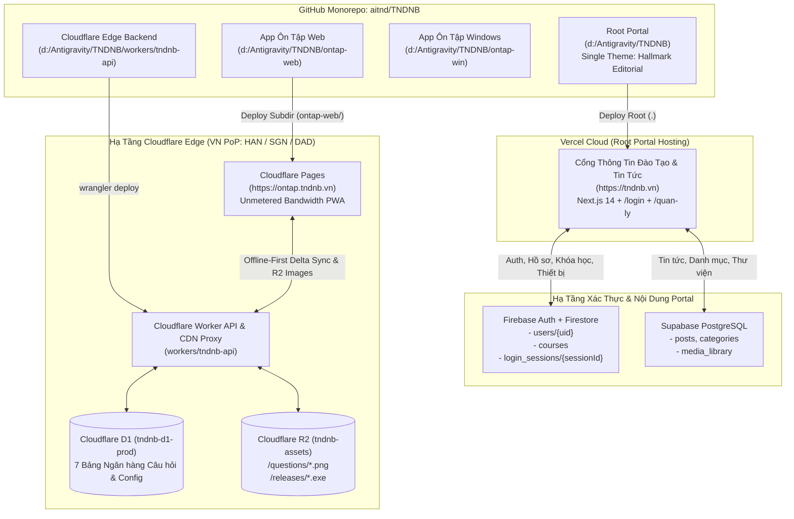

# Tài Liệu Thiết Kế Kỹ Thuật Tổng Thể (Single Source of Truth — SDD & AWF v4.0 Design Specification)
## Dự Án TNDNB: Chuẩn Hóa Giao Diện Duy Nhất Hallmark Editorial Toàn Root Portal, Khôi Phục `/login` & `/quan-ly`, Và Nâng Cấp Hạ Tầng Cloudflare (R2 + D1 + Offline-First)

> **Cập nhật lần cuối:** 05/11/2026  
> **Tiêu chuẩn áp dụng:** `AWF v4.0` + `Impeccable v4.8.0 (62-Rule Craft Floor)` + `Taste-Skill v2.5.0`  
> **Các kế hoạch hợp nhất trong tài liệu này:**
> 1. [`261105-1408-portal-login-dashboard-restore`](file:///d:/Antigravity/TNDNB/docs/plans/261105-1408-portal-login-dashboard-restore/DESIGN.md) — Loại bỏ toàn bộ hệ thống theme cũ, chuẩn hóa **1 giao diện duy nhất Hallmark Editorial** cho toàn bộ các trang Root Portal (`d:\Antigravity\TNDNB`), khôi phục `/login` & `/quan-ly`.
> 2. [`261104-0856-cloudflare-r2-d1-offline-upgrade`](file:///d:/Antigravity/TNDNB/docs/plans/261104-0856-cloudflare-r2-d1-offline-upgrade/plan.md) — Tách Deployment Monorepo (`ontap-web` lên Cloudflare Pages, Root Portal trên Vercel) & Hạ tầng Cloudflare Worker + D1 + R2 Offline-First.

---

## Design Context

### 1. Phân Loại 4 Chế Độ Giao Diện (`4 Modes Classification` — AWF v4.0)

Toàn bộ các trang thuộc **Root Portal (`d:\Antigravity\TNDNB`)** được phân bổ chính xác vào 3 chế độ trong mô hình **4 Modes (`Read` · `Operate` · `Persuade` · `Express`)**:

| Chế độ (Mode) | Mục tiêu Trải nghiệm & Thị giác | Các Màn hình & Route Thuộc Chế Độ | Quy chuẩn Bố cục & Kiểu chữ |
| :--- | :--- | :--- | :--- |
| **`Read` Mode** *(Đọc tin tức, văn bản & chương trình đào tạo)* | Đọc văn bản dài không mỏi mắt trên nền giấy ấm (`#FAF9F6`), phân cấp tiêu đề báo chí chính thống, cấu trúc lưới rõ ràng. | - **Trang chủ (`/`)** - **Chi tiết Bài viết (`/bai-viet/[postId]`)** - **Danh mục Chuyên mục (`/danh-muc/[categoryId]`)** - **Giới thiệu Đơn vị (`/gioi-thieu`)** - **Chương trình Đào tạo (`/chuong-trinh-dao-tao/*`)** - **Tư vấn Nghề nghiệp (`/tu-van-nghe-nghiep/*`)** - **Thư viện Tư liệu (`/thu-vien`)** | - Chiều rộng dòng văn bản bài đọc khóa chặt ở **`60ch–75ch`** (`line-height: 1.75`). - Tiêu đề `Merriweather` đứng thẳng 100% (`font-style: normal`). - Phân tách khối bằng đường kẻ mảnh `1px solid var(--color-rule)`. |
| **`Operate` Mode** *(Đăng nhập, quản trị, hồ sơ, đăng bài & tra cứu)* | Tốc độ thao tác nhanh, biểu mẫu chuẩn mực, bảng quản trị thẳng hàng tuyệt đối, phản hồi trạng thái rõ ràng. | - **Đăng nhập & Đăng ký (`/login`)** - **Bảng điều khiển Trung tâm (`/quan-ly`)** - **Chỉnh sửa Hồ sơ (`/quan-ly/ho-so`)** - **Quản lý Tài khoản & Thiết bị (`/quan-ly/tai-khoan`)** - **Soạn thảo & Đăng bài (`/quan-ly/dang-bai`)** - **Văn bản & Tài liệu (`/tai-lieu`)** - **Tìm kiếm Nội dung (`/tim-kiem`)** | - Mọi ô nhập liệu (`input`, `select`, `textarea`) và nút bấm đạt vùng chạm `>= 44x44px`, bo góc khóa cứng `4px` (`--radius-editorial`). - Bảng dữ liệu và con số thống kê bật `font-variant-numeric: tabular-nums`. |
| **`Persuade` Mode** *(Tuyển sinh, học phí & liên hệ)* | Thể hiện uy tín pháp lý của Công ty CP Tư vấn và Giáo dục Ninh Bình, minh bạch hóa biểu mức học phí, thúc đẩy đăng ký học. | - **Biểu Mức Học Phí (`/hoc-phi`)** - **Liên hệ & Tư vấn Tuyển sinh (`/lien-he`)** | - Bảng học phí kẻ khung sắc nét, mức học phí dùng `--font-mono` + `tabular-nums` màu `--color-signal: #B91C1C`. - Huy hiệu và điểm nhấn danh hiệu dùng `--color-gold: #D4AF37`. |

---

### 2. Kiến Trúc Giao Diện Duy Nhất (`Single Canonical Theme Architecture`)

> [!IMPORTANT]
> **Xóa bỏ hoàn toàn đa giao diện cũ — Duy trì 1 giao diện chuẩn mực duy nhất:**
> Toàn bộ hệ thống chuyển đổi giao diện động (`context/ThemeContext.tsx`, `components/ThemeSwitcher.tsx`, `components/ThemeEffects.tsx`, `components/MusicPlayer.tsx`) cùng 6 chế độ cũ (`dark`, `noel`, `classic`, `modern`, `sunrise`, `tri-an`) bị loại bỏ hoàn toàn khỏi codebase. Root Portal vận hành duy nhất giao diện **Hallmark Editorial — Institutional Maritime Education & News Portal** thông qua các biến CSS tĩnh tại `:root` trong [app/globals.css](file:///d:/Antigravity/TNDNB/app/globals.css).

- **Loại bỏ triệt để:**
  - ❌ `context/ThemeContext.tsx` & mọi lệnh gọi `useTheme()`, `data-theme="..."`.
  - ❌ `components/ThemeSwitcher.tsx` (Menu chọn theme trên thanh điều hướng).
  - ❌ `components/ThemeEffects.tsx` (Hiệu ứng hạt rơi/tuyết rơi gây tốn CPU/GPU).
  - ❌ `components/MusicPlayer.tsx` (Trình phát nhạc nền không phù hợp cổng thông tin cơ quan đào tạo).
- **Cơ chế CSS Custom Properties tĩnh tại `:root`:**
  - Khai báo trực tiếp tại `:root` trong [app/globals.css](file:///d:/Antigravity/TNDNB/app/globals.css), đảm bảo Server-Side Rendering (Next.js 14) trả về giao diện chuẩn ngay lập tức với **0ms độ trễ hydration** và **0% lỗi nhấp nháy giao diện (Zero FOUC)**.

---

### 3. Bảng Màu & Hệ Thống Token Ngữ Nghĩa (`Color Palette & Semantic Tokens`)

| Token CSS (`:root`) | Giá Trị Chuẩn | Ý Nghĩa & Quy Tắc Sử Dụng Bắt Buộc |
| :--- | :---: | :--- |
| `--color-paper` | `#FAF9F6` | **Warm Alabaster Paper:** Nền trang tổng thể (`body`), tạo độ dịu mắt khi đọc tin tức và văn bản pháp quy. |
| `--color-surface` | `#FFFFFF` | **Pure White:** Nền thẻ bài viết, khung đăng nhập (`/login`), hộp thông tin (`/quan-ly`), bảng dữ liệu (`/hoc-phi`). |
| `--color-surface-subtle` | `#F1F5F9` | **Slate 100 Subtle Surface:** Nền phụ cho đầu mục bảng (`thead`), hàng bảng khi `hover`, hộp ghi chú và thanh tab. |
| `--color-ink` | `#0B132B` | **Deep Maritime Ink:** Màu chữ chính và mọi cấp tiêu đề (`h1`–`h6`), đạt chuẩn tương phản AAA (`> 16:1`). |
| `--color-ink-body` | `#334155` | **Slate 700:** Màu chữ nội dung bài đọc dài và đoạn văn mô tả. |
| `--color-ink-muted` | `#475569` | **Slate 600:** Màu chữ phụ đề, ngày tháng đăng bài, chú thích ảnh và nhãn phụ. |
| `--color-accent` | `#003566` | **Institutional Navy:** Màu xanh Hải quân / Đường thủy chủ đạo cho thanh điều hướng, nút chính (`Primary Button`), liên kết và viền nhấn. |
| `--color-accent-hover` | `#002244` | **Deep Navy Hover:** Màu nền khi di chuột qua nút chính và mục menu. |
| `--color-gold` | `#D4AF37` | **Brass Gold:** Điểm nhấn danh hiệu, đường viền trang trọng trên Masthead, nút CTA nổi bật trên nền Navy tối. |
| `--color-signal` | `#B91C1C` | **Editorial Crimson:** Chỉ mục đánh số (`01`–`04`), nhãn tin nóng, mức học phí, cảnh báo lỗi và nút hành động nguy hiểm. |
| `--color-success` | `#15803D` | **Forest Green:** Trạng thái xác thực khóa học thành công, thông báo hoàn tất gửi email/lưu dữ liệu. |
| `--color-rule` | `#CBD5E1` | **1px Hairline Border:** Đường kẻ khung mảnh `1px solid` chia cột báo chí, viền thẻ, viền bảng và ô nhập liệu. |
| `--radius-editorial` | `4px` | **Locked 4px Radius:** Khóa cứng độ bo góc `4px` trên toàn hệ thống (cấm bo tròn `16px`/`999px` cho card và form). |

---

### 4. Hệ Thống Kiểu Chữ & Quy Tắc Chống AI Slop (`Typography System` — Gate 38a)

- **Phông chữ Tiêu đề Báo chí (`--font-display`):** `'Merriweather', Georgia, serif`
  - **Quy tắc Gate 38a (Bắt buộc):** Mọi tiêu đề `h1`–`h6`, `.title`, `.sectionTitle`, `.leadStoryTitle` phải khai báo **`font-style: normal !important`**. Tuyệt đối cấm sử dụng tiêu đề Serif in nghiêng.
- **Phông chữ Giao diện & Bài đọc (`--font-sans`):** `'Be Vietnam Pro', -apple-system, BlinkMacSystemFont, sans-serif`
  - Chiều rộng dòng đọc (`max-width`) của nội dung bài viết khóa trong khoảng **`60ch–75ch`**, chiều cao dòng `1.75`.
- **Phông chữ Số hiệu & Chỉ mục (`--font-mono`):** `'JetBrains Mono', monospace`
  - Kết hợp `font-variant-numeric: tabular-nums` cho mọi bảng học phí (`/hoc-phi`), thống kê (`AnalyticsWidget`), số CCCD, ngày tháng và chỉ mục `01`–`04`.

---

### 5. Danh Sách Đầy Đủ 14 Nhóm Màn Hình Root Portal Được Chuẩn Hóa

1. **Global Shell (`app/layout.tsx`, `components/Navbar.tsx`, `components/Footer.tsx`, `components/Sidebar.tsx`):**
   - Bố cục **`N6 · Newspaper Masthead`**: Tầng Meta Bar (Thứ/Ngày/Tháng, Hotline, Email, nút **`"Đăng nhập"`** `/login` hoặc **`"Quản trị"`** `/quan-ly`), Tầng Masthead Chính thống (`CÔNG TY CỔ PHẦN TƯ VẤN VÀ GIÁO DỤC NINH BÌNH` — `CỔNG THÔNG TIN ĐÀO TẠO & SÁT HẠCH THUYỀN VIÊN - NGƯỜI LÁI PHƯƠNG TIỆN THỦY NỘI ĐỊA`), Tầng Menu Chuyên mục chuẩn mực (đã xóa sạch 5 nút màu vàng `utilityGroup` và `ThemeSwitcher`).
2. **Trang Chủ (`app/page.tsx`, `app/page.module.css`):**
   - Khối Hero **`H2 · Split Diptych` (`7fr / 5fr`)**: Cột trái (7 phần) hiển thị Lead Story với ảnh `16:10` và tiêu đề `Merriweather` đứng; Cột phải (5 phần) hiển thị 4 tin *"BẢN TIN HỌC VỤ & TUYỂN SINH MỚI NHẤT"* đánh số `01`–`04` màu `--color-signal`.
   - Các phân vùng nội dung đánh số lề trái (`S1 · Left margin numbered`): `01 — TIN TỨC & SỰ KIỆN`, `02 — THÔNG BÁO TUYỂN SINH & LỊCH THI`, `03 — VĂN BẢN PHÁP QUY`.
3. **Trang Đăng Nhập & Đăng Ký (`app/login/page.tsx`, `app/login/page.module.css`):**
   - Hộp biểu mẫu đặt trên nền giấy `--color-paper`, khung `--color-surface` viền `1px solid var(--color-rule)`, thanh đỉnh `3px solid var(--color-accent)`, bo góc `4px`.
   - Hỗ trợ: Đăng nhập Email/Username (tự nối `@gmail.com`), Đăng ký tài khoản mới (`role: 'hoc_vien'`), Đăng nhập Google (bắt lỗi `auth/unauthorized-domain`), Quên mật khẩu, gọi `recordLoginSession(uid)` và redirect thông minh (`?redirect=/...` hoặc `/quan-ly`).
4. **Bảng Điều Khiển Quản Trị & Hồ Sơ (`app/quan-ly/page.tsx`, `/quan-ly/ho-so`, `/quan-ly/tai-khoan`, `/quan-ly/dang-bai`):**
   - Bọc trong `ProtectedRoute`, hiển thị 6 Tab (`dashboard`, `my_class`, `courses`, `accounts`, `posts`, `reviews`) theo ma trận 5 vai trò (`hoc_vien`, `giao_vien`, `quan_ly`, `lanh_dao`, `admin`).
   - Toàn bộ thẻ thông tin tài khoản, `AnalyticsWidget`, `CourseManager`, `PostManager`, `ReviewManager`, `StudentCard`, `StudentClassView`, `StudentHistory` dùng bảng màu Hallmark Editorial phẳng, sắc nét, bo góc `4px` (loại bỏ hoàn toàn inline style gradient/bóng đổ cũ).
5. **Chi Tiết Bài Viết (`app/bai-viet/[postId]/page.tsx`, `PostDetail.module.css`):**
   - Bố cục bài báo chính thống, chiều rộng dòng đọc `60ch–75ch`, tiêu đề `Merriweather` đứng, hộp trích dẫn kẻ viền trái `--color-gold`.
6. **Danh Mục Bài Viết (`app/danh-muc/[categoryId]/page.tsx`, `CategoryPage.module.css`):**
   - Lưới bài viết theo chuyên mục phân cách bằng đường kẻ `1px solid var(--color-rule)`.
7. **Giới Thiệu (`app/gioi-thieu/page.tsx`, `page.module.css`):**
   - Trang hồ sơ năng lực & lịch sử đơn vị trình bày theo chuẩn ấn phẩm học thuật.
8. **Học Phí (`app/hoc-phi/page.tsx`, `page.module.css`):**
   - Bảng biểu mức thu học phí và lệ phí sát hạch dùng `JetBrains Mono` + `tabular-nums`, tiêu đề bảng nền `--color-accent`.
9. **Chương Trình Đào Tạo (`app/chuong-trinh-dao-tao/page.tsx` & các trang con):**
   - Chi tiết chương trình đào tạo Thuyền trưởng, Máy trưởng, Chứng chỉ chuyên môn.
10. **Tư Vấn Nghề Nghiệp (`app/tu-van-nghe-nghiep/page.tsx` & các trang con):**
    - Cẩm nang lộ trình nghề nghiệp và điều kiện nâng hạng bằng đường thủy.
11. **Tài Liệu & Văn Bản (`app/tai-lieu/page.tsx`, `page.module.css`):**
    - Kho biểu mẫu đăng ký dự thi, thông tư, nghị định với nút tải về chuẩn `--color-accent`.
12. **Thư Viện (`app/thu-vien/page.tsx`, `page.module.css`):**
    - Lưới hình ảnh/video hoạt động đào tạo và sát hạch thực tế, bo góc `4px`.
13. **Liên Hệ (`app/lien-he/page.tsx`, `page.module.css`):**
    - Thông tin liên hệ Phòng Đào tạo, bản đồ và form gửi yêu cầu tư vấn.
14. **Tìm Kiếm (`app/tim-kiem/page.tsx`, `page.module.css`):**
    - Giao diện tra cứu bài viết và thông báo tuyển sinh nhanh.

---

## 1. Kiến Trúc Tổng Thể & Split Deployment (Keep Monorepo)

### 1.1. Sơ Đồ Kiến Trúc Tổng Thể (Mermaid `flowchart TD`)

---

## 2. Thiết Kế Cơ Sở Dữ Liệu (Database Design)

### 2.1. Cơ Sở Dữ Liệu Xác Thực & Quản Trị Trên Root Portal (Firestore & Supabase)

#### A. Collection `users/{uid}` (Cloud Firestore)
| Trường | Kiểu dữ liệu | Mặc định | Mô tả |
| :--- | :--- | :--- | :--- |
| `uid` | `string` (PK) | `firebaseUser.uid` | Định danh người dùng từ Firebase Auth. |
| `username` | `string` | `email.split('@')[0].toLowerCase()` | Tên đăng nhập viết thường (hỗ trợ đăng nhập không cần gõ `@gmail.com`). |
| `fullName` | `string` | `'Người dùng mới'` | Họ và tên hiển thị trên thẻ thông tin và `Navbar`. |
| `email` | `string \| null` | `firebaseUser.email` | Địa chỉ email đăng nhập. |
| `role` | `'hoc_vien' \| 'giao_vien' \| 'quan_ly' \| 'lanh_dao' \| 'admin'` | `'hoc_vien'` | Vai trò phân quyền 5 cấp độ trên `/quan-ly`. |
| `class` | `string` | `''` | Lớp học do học viên tự điền khi đăng ký. |
| `courseId` / `courseName` | `string` | `undefined` | Mã và tên khóa học chính thức được gán. |
| `isVerified` | `boolean` | `false` | Trạng thái đã được duyệt vào khóa học chính thức. |
| `phoneNumber`, `birthDate`, `cccd`, `cccdDate`, `cccdPlace`, `address`, `photoURL` | `string` | `undefined` | Thông tin hồ sơ cá nhân và ảnh thẻ học viên (cập nhật tại `/quan-ly/ho-so`). |
| `createdAt` | `Timestamp` | `serverTimestamp()` | Thời điểm tạo tài khoản. |

#### B. Collection `login_sessions/{sessionId}` (Cloud Firestore — `app/services/authSessionService.ts`)
- Các trường: `userId`, `deviceName`, `browser`, `ip`, `userAgent`, `loginAt`, `lastActive`, `status` (`'active' | 'logged_out'`).
- Lưu khóa phiên hiện tại tại `localStorage.getItem('ontap_current_session_id')`, cho phép Quản trị viên kiểm soát và đăng xuất thiết bị từ xa tại `/quan-ly/tai-khoan`.

#### C. Đồng Bộ Token Kép (`context/AuthContext.tsx`)
- Khi `onAuthStateChanged` xác nhận có `firebaseUser`, gọi `firebaseUser.getIdToken()` và nạp vào `supabase.auth.setSession({ access_token: token, refresh_token: firebaseUser.refreshToken || token })` để cấp quyền thao tác với các bảng `posts`, `categories`, `media_library` trên Supabase.

#### D. Ma Trận Phân Quyền 6 Tab Tại `/quan-ly` (`app/quan-ly/page.tsx`)
| Tab | Nhãn hiển thị | `hoc_vien` | `giao_vien` | `quan_ly` | `lanh_dao` | `admin` |
| :--- | :--- | :---: | :---: | :---: | :---: | :---: |
| `dashboard` | **Tổng quan** | ✅ (+ `StudentHistory`) | ✅ | ✅ | ✅ (+ `AnalyticsWidget`) | ✅ (+ `AnalyticsWidget`) |
| `my_class` | **Lớp của tôi** | ✅ (`StudentCard` + `StudentClassView`) | ❌ | ❌ | ❌ | ❌ |
| `courses` | **Quản lý Khóa học** (`CourseManager`) | ❌ | ✅ | ✅ | ✅ | ✅ |
| `accounts` | **Quản lý Tài khoản** ($\rightarrow$ `/quan-ly/tai-khoan`) | ❌ | ❌ | ✅ | ✅ | ✅ |
| `posts` | **Quản lý Bài viết** (`PostManager`) | ❌ | ❌ | ✅ | ✅ | ✅ |
| `reviews` | **Kết quả Ôn tập** (`ReviewManager`) | ❌ | ✅ | ✅ | ✅ | ✅ |

---

### 2.2. Cơ Sở Dữ Liệu Ôn Tập & Sát Hạch Trên Cloudflare D1 (`tndnb-d1-prod`) & IndexedDB (`ontap_offline_db`)

Hệ thống `ontap-web` và `ontap-win` sử dụng 7 bảng trên Cloudflare D1 kết hợp 5 bảng IndexedDB (Dexie.js):
1. **`sync_meta`** (`key TEXT PRIMARY KEY`, `version_hash TEXT NOT NULL`, `updated_at INTEGER NOT NULL`)
2. **`licenses`** (`id TEXT PRIMARY KEY`, `name TEXT NOT NULL`, `code TEXT`, `display_order INTEGER DEFAULT 0`, `updated_at INTEGER`)
3. **`subjects`** (`id TEXT PRIMARY KEY`, `license_id TEXT NOT NULL`, `name TEXT NOT NULL`, `time_limit INTEGER DEFAULT 30`, `question_count INTEGER DEFAULT 30`, `pass_score INTEGER DEFAULT 25`, `display_order INTEGER DEFAULT 0`, `updated_at INTEGER`)
4. **`questions`** (`id TEXT PRIMARY KEY`, `subject_id TEXT NOT NULL`, `text TEXT NOT NULL`, `image_url TEXT`, `correct_answer TEXT`, `order_index INTEGER DEFAULT 0`, `updated_at INTEGER`)
5. **`answers`** (`id TEXT PRIMARY KEY`, `question_id TEXT NOT NULL`, `text TEXT NOT NULL`, `is_correct INTEGER DEFAULT 0`, `order_index INTEGER DEFAULT 0`)
6. **`usage_config`** (`role TEXT PRIMARY KEY`, `config_json TEXT NOT NULL`, `updated_at INTEGER NOT NULL`)
7. **`system_alerts`** (`id TEXT PRIMARY KEY`, `title TEXT NOT NULL`, `message TEXT NOT NULL`, `type TEXT DEFAULT 'info'`, `is_active INTEGER DEFAULT 1`, `created_at INTEGER NOT NULL`, `expires_at INTEGER`)

---

## 3. Thiết Kế API & CDN Proxy (`workers/tndnb-api`)

| STT | Endpoint | Phương thức | Cache & Auth | Mô tả |
| :---: | :--- | :---: | :--- | :--- |
| 1 | `/api/v1/version` | `GET` | `public, s-maxage=30` | Trả `version_hash` siêu nhẹ (`< 100 bytes`) để kiểm tra đồng bộ Delta. |
| 2 | `/api/v1/snapshot` | `GET` | `public, s-maxage=3600`, `ETag` | Trả toàn bộ cây bộ đề nén Gzip/Brotli. |
| 3 | `/api/v1/config` | `GET` | `public, s-maxage=30` | Trả cấu hình `usage_config` và danh sách `system_alerts` còn hiệu lực. |
| 4 | `/api/v1/admin/questions/:id` | `PUT` | `Bearer <ADMIN_API_SECRET>` | Cập nhật câu hỏi và tự động xoay `version_hash` mới trong `sync_meta`. |
| 5 | `/img/:filename` | `GET` | `public, max-age=31536000, immutable` | Phục vụ ảnh câu hỏi từ Cloudflare R2 (`tndnb-assets/questions/`) với CORS `*`. |
| 6 | `/releases/:filename` | `GET` | `Range` support (`206`) | CDN Proxy cho `latest.yml`, `*.exe`, `*.blockmap` theo cờ `RELEASE_UPSTREAM_MODE = "github_proxy" \| "r2_direct"`. |

---

## 4. Kịch Bản Kiểm Thử & Nghiệm Thu Tổng Thể (SDD & BDD Acceptance Criteria — Given/When/Then)

### Kịch bản 1: Nghiệm thu Giao diện Duy Nhất Hallmark Editorial & Loại bỏ Theme cũ
- **Given:** Người dùng truy cập bất kỳ trang nào trên Root Portal (`/`, `/login`, `/quan-ly`, `/bai-viet/[postId]`, `/danh-muc/[categoryId]`, `/gioi-thieu`, `/hoc-phi`, `/chuong-trinh-dao-tao/*`, `/tu-van-nghe-nghiep/*`, `/tai-lieu`, `/thu-vien`, `/lien-he`, `/tim-kiem`).
- **When:** Kiểm tra DOM, Computed Styles và `app/globals.css`.
- **Then:**
  1. Không còn `ThemeContext`, `ThemeSwitcher`, `ThemeEffects`, `MusicPlayer` và không còn bất kỳ selector `[data-theme="..."]` nào.
  2. Toàn bộ các trang dùng đúng bảng màu tĩnh tại `:root` (`--color-paper: #FAF9F6`, `--color-surface: #FFFFFF`, `--color-ink: #0B132B`, `--color-accent: #003566`, `--color-gold: #D4AF37`, `--color-signal: #B91C1C`, `--color-rule: #CBD5E1`, `--radius-editorial: 4px`).
  3. Không có bất kỳ tiêu đề nào in nghiêng (`font-style: normal`), dòng đọc bài viết nằm trong khoảng `60ch–75ch`, số liệu bảng bật `tabular-nums`, và không tràn ngang ở `320px`/`375px`.

### Kịch bản 2: Nghiệm thu Khôi phục `/login` & `/quan-ly` trên Root Portal
- **Given:** Người dùng truy cập Root Portal.
- **When:**
  1. Bấm nút **`"Đăng nhập"`** trên `Navbar.tsx`.
  2. Đăng nhập bằng Username/Email, Đăng ký mới hoặc Đăng nhập Google tại `/login`.
  3. Truy cập `/quan-ly` với các vai trò `hoc_vien`, `giao_vien`, `quan_ly`, `lanh_dao`, `admin`.
- **Then:**
  1. Nút trên `Navbar.tsx` hiển thị đúng chữ `"Đăng nhập"` (không còn `"Đăng nhập cán bộ"`).
  2. Trang `/login` hoạt động đầy đủ, bắt lỗi `auth/unauthorized-domain` bằng tiếng Việt rõ ràng, gọi `recordLoginSession(uid)` và chuyển hướng về `/quan-ly` (hoặc `?redirect=/...`).
  3. Trang `/quan-ly` được bảo vệ bởi `ProtectedRoute`, hiển thị đúng 6 tab theo phân quyền và liên kết mượt mà tới `/quan-ly/ho-so` cùng `/quan-ly/tai-khoan`.

### Kịch bản 3: Nghiệm thu Tách Deployment, R2 Images, D1 Offline-First & Auto-Updater
- **Given:** `ontap-web` chạy trên Cloudflare Pages, `workers/tndnb-api` kết nối D1 + R2.
- **When & Then:**
  - Root Portal trên Vercel không còn gánh build của `ontap-web`.
  - Ảnh câu hỏi tải `< 50ms` từ R2 Edge và `0ms` từ `ServiceWorker` (`tndnb-question-images-v1`) khi mất mạng.
  - Bộ đề đồng bộ từ D1 vào IndexedDB (`ontap_offline_db`) giúp làm bài 100% khi Offline và tự động cập nhật khi `version_hash` đổi.
