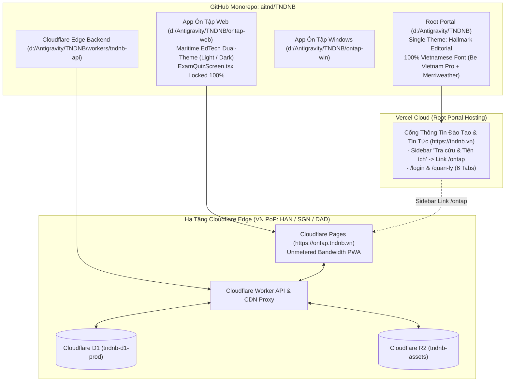

# Tài Liệu Thiết Kế Kỹ Thuật Tổng Thể (Single Source of Truth — SDD & AWF v4.0 Design Specification)
## Dự Án TNDNB: Chuẩn Hóa Giao Diện Hallmark Editorial Toàn Root Portal, Đại Tu `ontap-web` Dual-Theme (`Light` / `Dark`), Sửa Lỗi Font Tiếng Việt, Và Nâng Cấp Hạ Tầng Cloudflare (R2 + D1 + Offline-First)

> **Cập nhật lần cuối:** 06/11/2026  
> **Tiêu chuẩn áp dụng:** `AWF v4.0` + `Impeccable v4.8.0 (62-Rule Craft Floor)` + `Taste-Skill v2.5.0`  
> **Các kế hoạch hợp nhất trong tài liệu Single Source of Truth này:**
> 1. [`261105-1836-ontap-web-ui-overhaul`](file:///d:/Antigravity/TNDNB/docs/plans/261105-1836-ontap-web-ui-overhaul/DESIGN.md) — **(A)** Sửa triệt để lỗi Font Tiếng Việt "Chữ to chữ bé" trên 13 file Root Portal & sửa vòng lặp `--font-sans` trên `ontap-web`, **(B)** Gắn liên kết `/ontap` vào Sidebar Portal, và **(C)** Đại tu toàn diện 30+ màn hình `ontap-web` theo chuẩn **Maritime EdTech Dual-Theme (`light` / `dark`)** (Bảo toàn 100% `ExamQuizScreen.tsx`).
> 2. [`261105-1408-portal-login-dashboard-restore`](file:///d:/Antigravity/TNDNB/docs/plans/261105-1408-portal-login-dashboard-restore/DESIGN.md) — Loại bỏ toàn bộ hệ thống theme cũ trên Root Portal, chuẩn hóa **1 giao diện duy nhất Hallmark Editorial** cho toàn bộ 14 nhóm trang Root Portal (`d:\Antigravity\TNDNB`), khôi phục `/login` & `/quan-ly`.
> 3. [`261104-0856-cloudflare-r2-d1-offline-upgrade`](file:///d:/Antigravity/TNDNB/docs/plans/261104-0856-cloudflare-r2-d1-offline-upgrade/plan.md) — Tách Deployment Monorepo (`ontap-web` lên Cloudflare Pages, Root Portal trên Vercel) & Hạ tầng Cloudflare Worker + D1 + R2 Offline-First.
> 4. [`phase-06-portal-r2-assets-design`](file:///d:/Antigravity/TNDNB/docs/plans/261105-1836-ontap-web-ui-overhaul/phase-06-portal-r2-assets-design.md) — Chuyển đổi dần ảnh bìa, ảnh TinyMCE & giáo trình tài liệu (PDF/Word) của Root Portal sang Cloudflare R2 (`tndnb-assets`) với cơ chế Graceful Fallback 5s sang Supabase Storage và bảo toàn 100% bài viết cũ.

---

## Design Context

### 1. Phân Loại 4 Chế Độ Giao Diện (`4 Modes Classification` — AWF v4.0)

Toàn bộ các trang thuộc **Root Portal (`d:\Antigravity\TNDNB`)** và **App Ôn Tập Web (`d:\Antigravity\TNDNB\ontap-web`)** được phân bổ chính xác vào 3 chế độ trong mô hình **4 Modes (`Read` · `Operate` · `Persuade` · `Express`)**:

| Chế độ (Mode) | Mục tiêu Trải nghiệm & Thị giác | Các Màn hình Thuộc Root Portal (`Hallmark Editorial`) | Các Màn hình Thuộc `ontap-web` (`Maritime EdTech Dual-Theme`) |
| :--- | :--- | :--- | :--- |
| **`Read` Mode**<br>*(Đọc tin tức, văn bản & chương trình đào tạo)* | Đọc văn bản dài không mỏi mắt, hiển thị đồng đều 100% dấu Tiếng Việt (`U+1EA0–U+1EF9`), chiều rộng dòng đọc `60ch–75ch`. | - **Trang chủ (`/`)**<br>- **Chi tiết Bài viết (`/bai-viet/[postId]`)**<br>- **Danh mục Chuyên mục (`/danh-muc/[categoryId]`)**<br>- **Giới thiệu Đơn vị (`/gioi-thieu`)**<br>- **Chương trình Đào tạo (`/chuong-trinh-dao-tao/*`)**<br>- **Tư vấn Nghề nghiệp (`/tu-van-nghe-nghiep/*`)**<br>- **Thư viện Tư liệu (`/thu-vien`)** | - `AlertMarquee.tsx` (Thông báo học vụ)<br>- `ChangelogModal.tsx`, `ChangelogScreen.tsx`<br>- `EntertainmentScreen.tsx` |
| **`Operate` Mode**<br>*(Học tập, Ôn luyện, Thi sát hạch, Quản trị & Tra cứu)* | Tốc độ thao tác nhanh, biểu mẫu chuẩn mực, hỗ trợ chuyển đổi Sáng/Tối (`light`/`dark`) trên `ontap-web` để ôn luyện ban đêm, số liệu bật `tabular-nums`. | - **Đăng nhập & Đăng ký (`/login`)**<br>- **Bảng điều khiển Trung tâm (`/quan-ly`)**<br>- **Chỉnh sửa Hồ sơ (`/quan-ly/ho-so`)**<br>- **Quản lý Tài khoản & Thiết bị (`/quan-ly/tai-khoan`)**<br>- **Soạn thảo & Đăng bài (`/quan-ly/dang-bai`)**<br>- **Phòng thi (`/quan-ly/[roomId]`)**<br>- **Tra cứu địa chỉ (`/tra-cuu-dia-chi`)**, **Tài liệu (`/tai-lieu`)**, **Tìm kiếm (`/tim-kiem`)**<br>- **Khung "Tra cứu & Tiện ích" (`Sidebar.tsx` $\rightarrow$ `/ontap`)** | - **App Shell:** `TopNavbar`, `MobileHeader`, `MobileBottomNav`, `ThemeSwitcher` (1-click Sun/Moon)<br>- **Bento Dashboard & Auth:** `Dashboard` (12-col), `LoginScreen`, `RegisterScreen`, `WindowsLoginScreen`<br>- **Learning Flow:** `LicenseSelectionScreen`, `NameInputScreen`, `ModeSelectionScreen`, `SubjectSelectionScreen`, `QuizScreen` (2 cột), `ResultsScreen`, `ExamResultsScreen`, Sảnh chờ `ThiTrucTuyenPage`, `GiamKhaoSelectionScreen`<br>- **Exam Simulator (Locked):** `ExamQuizScreen.tsx` *(Giữ nguyên 100%)*<br>- **15 Màn hình Quản lý & Học viên:** `HistoryScreen`, `MyClassScreen`, `AccountScreen`, `LoginHistoryScreen`, `ClassManagementScreen`, `UserManagerScreen`, `OnlineExamManagementScreen`, `NotificationMgmtScreen`, `UsageConfigPanel`, `AnalyticsPage`, `MailboxScreen` |
| **`Persuade` Mode**<br>*(Tuyển sinh, học phí, đón tiếp & tải app)* | Thể hiện uy tín pháp lý của Công ty CP Tư vấn và Giáo dục Ninh Bình, minh bạch hóa biểu mức học phí, dẫn dắt vào ôn tập. | - **Biểu Mức Học Phí (`/hoc-phi`)**<br>- **Liên hệ & Tư vấn Tuyển sinh (`/lien-he`)** | - `WelcomeModal.tsx` (Hero Split Card 2 cột)<br>- `DownloadAppPage.tsx` |

---

### 2. Kiến Trúc Giao Diện Trên Root Portal (`Single Canonical Theme`) & `ontap-web` (`Maritime EdTech Dual-Theme`)

1. **Trên Root Portal (`d:\Antigravity\TNDNB` — Single Canonical Theme `Hallmark Editorial`):**
   - Loại bỏ vĩnh viễn `context/ThemeContext.tsx`, `components/ThemeSwitcher.tsx`, `components/ThemeEffects.tsx`, `components/MusicPlayer.tsx` và 6 chế độ cũ (`dark`, `noel`, `classic`, `modern`, `sunrise`, `tri-an`).
   - Sử dụng 100% biến CSS tĩnh tại `:root` trong [app/globals.css](file:///d:/Antigravity/TNDNB/app/globals.css) (`--color-paper: #FAF9F6`, `--color-surface: #FFFFFF`, `--color-ink: #0B132B`, `--color-accent: #003566`, `--color-gold: #D4AF37`, `--color-signal: #B91C1C`, `--color-rule: #CBD5E1`, `--radius-editorial: 4px`).
2. **Trên App Ôn Tập Web (`d:\Antigravity\TNDNB\ontap-web` — Maritime EdTech Dual-Theme `light` / `dark`):**
   - Loại bỏ 6 theme thừa (`modern`, `classic`, `sunrise`, `tri-an`, `noel`, `premium`) và xóa hẳn file [ontap-web/components/SnowEffect.tsx](file:///d:/Antigravity/TNDNB/ontap-web/components/SnowEffect.tsx).
   - Chỉ giữ đúng **2 chế độ chuẩn mực**: **Chế độ Sáng (`light` — Warm Alabaster & Maritime Navy)** và **Chế độ Tối (`dark` — Deep Nautical Carbon-Slate)** giúp học viên đi tàu hoặc ôn thi ban đêm không bị mỏi mắt, chuyển đổi nhanh 1 chạm bằng nút `Sun` / `Moon` trên `ThemeSwitcher.tsx`.

---

### 3. Kiến Trúc Typography Tiếng Việt Chuẩn Xác (Diệt Tận Gốc Lỗi "Chữ To Chữ Bé" Trên Toàn Hệ Thống)

1. **Tại Root Portal ([app/layout.tsx](file:///d:/Antigravity/TNDNB/app/layout.tsx), [app/globals.css](file:///d:/Antigravity/TNDNB/app/globals.css) & 11 file `.module.css`):**
   - Xóa bỏ hoàn toàn font `Rubik` (vốn chỉ nạp `latin`, `latin-ext`, thiếu `'vietnamese'` khiến các chữ cái có dấu bị trình duyệt fallback sang `Arial` gây hiện tượng chữ cao chữ thấp).
   - Nạp bộ 3 phông chữ Google Fonts qua `next/font/google` với đầy đủ `subsets: ['latin', 'vietnamese']`:
     - `Be_Vietnam_Pro` (`weight: ['300', '400', '500', '600', '700']`, `variable: '--font-sans'`)
     - `Merriweather` (`weight: ['400', '700', '900']`, `variable: '--font-display'`) — bắt buộc `font-style: normal !important` (Gate 38a).
     - `JetBrains_Mono` (`weight: ['400', '600', '700']`, `variable: '--font-mono'`).
   - Xóa dòng `@import url(...)` đặt sai vị trí phía sau `@tailwind` trong `app/globals.css`.
   - Chuẩn hóa **11 file `.module.css`** (`Navbar.module.css`, `app/page.module.css`, `app/bai-viet/[postId]/page.module.css`, `app/danh-muc/[categoryId]/page.module.css`, `app/hoc-phi/page.module.css`, `app/quan-ly/page.module.css`, `app/quan-ly/dang-bai/page.module.css`, `app/quan-ly/tai-khoan/page.module.css`, `app/quan-ly/[roomId]/page.module.css`, `app/tra-cuu-dia-chi/page.module.css`, `components/StudentCard.module.css`): Chuyển toàn bộ nhãn Tiếng Việt có dấu từ `var(--font-mono)` hoặc hardcode `'Segoe UI'` / `'Arial'` sang `var(--font-sans, 'Be Vietnam Pro', sans-serif)` kết hợp `font-variant-numeric: tabular-nums`.
2. **Tại App Ôn Tập Web ([ontap-web/theme.css](file:///d:/Antigravity/TNDNB/ontap-web/theme.css) & [ontap-web/index.html](file:///d:/Antigravity/TNDNB/ontap-web/index.html)):**
   - Sửa lỗi tham chiếu vòng lặp `--font-sans: var(--font-sans), sans-serif;` ở dòng 11 của `ontap-web/theme.css` thành `--font-sans: 'Be Vietnam Pro', system-ui, -apple-system, sans-serif;`.
   - Tinh giản Google Fonts trong `ontap-web/index.html` chỉ nạp `Be Vietnam Pro`.

---

## 1. Kiến Trúc Tổng Thể & Split Deployment (Keep Monorepo)



---

## 2. Thiết Kế Chi Tiết Hạng Mục Nâng Cấp `261105-1836-ontap-web-ui-overhaul`

### 2.1. Gắn Liên Kết `/ontap` Vào Sidebar Trang Chủ Portal (`components/Sidebar.tsx`)
- Trong khung widget **"Tra cứu & Tiện ích"** ([components/Sidebar.tsx](file:///d:/Antigravity/TNDNB/components/Sidebar.tsx#L137-L151)), bổ sung mục đầu tiên:
  ```tsx
  <li>
    <Link href="/ontap">
      <i className="fas fa-graduation-cap" style={{ color: 'var(--color-accent, #003566)' }}></i> Ôn tập &amp; Thi thử Trực tuyến
    </Link>
  </li>
  ```
- Giữ nguyên việc không đặt link `/ontap` tại `Navbar.tsx`, `MobileBottomNav.tsx`, `Footer.tsx` và `app/page.tsx` để bảo toàn tuyệt đối bài test `scripts/portal-navbar-cleanup.test.ts`.

### 2.2. Hệ Thống Maritime EdTech Dual-Theme (`light` / `dark`) Cho `ontap-web`

| Token CSS (`ontap-web/theme.css`) | Chế Độ Sáng (`light`) | Chế Độ Tối (`dark`) | Ý Nghĩa |
| :--- | :--- | :--- | :--- |
| `--background` | `210 40% 98%` (`#F8FAFC`) | `222 47% 8%` (`#0B1120`) | Nền tổng thể dịu mắt. |
| `--card` / `--popover` | `0 0% 100%` (`#FFFFFF`) | `222 47% 11%` (`#111827`) | Nền thẻ Bento, khung câu hỏi, bảng quản lý. |
| `--foreground` | `222 47% 11%` (`#0F172A`) | `210 40% 96%` (`#F1F5F9`) | Chữ chính tương phản AAA. |
| `--primary` | `211 100% 30%` (`#004A99`) | `199 89% 60%` (`#38BDF8`) | Màu chủ đạo Hàng hải / Đường thủy. |
| `--secondary` / `--muted` | `210 40% 94%` (`#F1F5F9`) | `217 33% 17%` (`#1E293B`) | Nền phụ cho badge, ô lưới câu hỏi chưa làm. |
| `--muted-foreground` | `215 16% 42%` (`#475569`) | `215 20% 68%` (`#94A3B8`) | Chữ phụ, chú thích thời gian. |
| `--accent` | `199 95% 39%` (`#0284C7`) | `199 89% 48%` (`#0EA5E9`) | Điểm nhấn Teal Hàng hải. |
| `--border` / `--input` | `214 32% 91%` (`#E2E8F0`) | `217 33% 20%` (`#1E293B`) | Viền `1px solid` sắc nét. |

- **Chuẩn hóa 4 Nhóm Màn Hình `ontap-web` (Bảo toàn 100% `ExamQuizScreen.tsx`):**
  1. **Nhóm 1 (App Shell):** `ThemeSwitcher.tsx` chuyển đổi 1 chạm `Sun`/`Moon`, xóa `SnowEffect.tsx`, chuẩn hóa `TopNavbar`, `MobileHeader`, `MobileBottomNav`, `AlertMarquee`, `Footer`.
  2. **Nhóm 2 (Entry & Bento Dashboard):** Hợp nhất nhánh `premium` và nhánh thường trong `Dashboard.tsx` thành 1 bố cục **Bento Asymmetric 12 cột** duy nhất; làm mới `WelcomeModal.tsx` (Hero Split Card 2 cột không bóng neon blur) và `LoginScreen`, `RegisterScreen`, `WindowsLoginScreen`.
  3. **Nhóm 3 (Learning Flow & Quiz):** Nâng cấp `LicenseSelectionScreen`, `NameInputScreen`, `ModeSelectionScreen`, `SubjectSelectionScreen`, `QuizScreen` (2 cột — sửa dứt điểm lỗi hardcode `bg-gray-50` ở Dark mode), `ResultsScreen`, `ExamResultsScreen`, sảnh chờ `ThiTrucTuyenPage`, `GiamKhaoSelectionScreen`. **Giữ nguyên 100% `ExamQuizScreen.tsx` (`git diff = 0`)**.
  4. **Nhóm 4 (15 Màn hình Quản lý & Tiện ích):** Đồng bộ `HistoryScreen`, `MyClassScreen`, `AccountScreen`, `LoginHistoryScreen`, `ClassManagementScreen`, `UserManagerScreen`, `OnlineExamManagementScreen`, `NotificationMgmtScreen`, `UsageConfigPanel`, `AnalyticsPage`, `MailboxScreen`, `DownloadAppPage`, `ChangelogModal`, `ChangelogScreen`, `EntertainmentScreen`.

---

## 3. Thiết Kế Cơ Sở Dữ Liệu & Xác Thực (`/login`, `/quan-ly` & Cloudflare D1)

### 3.1. Cơ Sở Dữ Liệu Xác Thực & Quản Trị Trên Root Portal (Firestore & Supabase)
- **Collection `users/{uid}` (Firestore):** `uid`, `username`, `fullName`, `email`, `role` (`'hoc_vien' | 'giao_vien' | 'quan_ly' | 'lanh_dao' | 'admin'`), `class`, `courseId`, `courseName`, `isVerified`, `phoneNumber`, `birthDate`, `cccd`, `cccdDate`, `cccdPlace`, `address`, `photoURL`, `createdAt`.
- **Collection `login_sessions/{sessionId}` (Firestore — `app/services/authSessionService.ts`):** `userId`, `deviceName`, `browser`, `ip`, `userAgent`, `loginAt`, `lastActive`, `status` (`'active' | 'logged_out'`).
- **Đồng bộ Token Kép (`context/AuthContext.tsx`):** `firebaseUser.getIdToken()` $\rightarrow$ `supabase.auth.setSession()` để mở quyền truy vấn `posts`, `categories`, `media_library`.
- **Ma trận 6 Tab tại `/quan-ly` (`app/quan-ly/page.tsx`):** `dashboard` (Tổng quan), `my_class` (Lớp của tôi), `courses` (Quản lý Khóa học), `accounts` (Quản lý Tài khoản $\rightarrow$ `/quan-ly/tai-khoan`), `posts` (Quản lý Bài viết), `reviews` (Kết quả Ôn tập).

### 3.2. Cơ Sở Dữ Liệu Ôn Tập Trên Cloudflare D1 (`tndnb-d1-prod`) & IndexedDB (`ontap_offline_db`)
- **7 Bảng D1:** `sync_meta`, `licenses`, `subjects`, `questions`, `answers`, `usage_config`, `system_alerts`.
- **5 Bảng IndexedDB (Dexie.js):** `meta`, `licenses`, `subjects`, `questions`, `usage_config`.
- **6 Endpoints trên `workers/tndnb-api`:** `GET /api/v1/version`, `GET /api/v1/snapshot`, `GET /api/v1/config`, `PUT /api/v1/admin/questions/:id`, `GET /img/:filename`, `GET /releases/:filename`.

### 3.3. Kiến Trúc Lưu Trữ Media Bài Viết & Giáo Trình PDF/Word (Cloudflare R2 + Graceful Fallback Supabase Storage)
- **Tài liệu đặc tả chi tiết:** [phase-06-portal-r2-assets-design.md](file:///d:/Antigravity/TNDNB/docs/plans/261105-1836-ontap-web-ui-overhaul/phase-06-portal-r2-assets-design.md)
- **Cloudflare R2 (`tndnb-assets`):** Lưu trữ toàn bộ ảnh đại diện (`portal/images/thumbnail_*`), ảnh TinyMCE (`portal/images/content_*`) và tài liệu giáo trình đính kèm PDF/Word (`portal/documents/*`), hưởng **10 GB lưu trữ miễn phí + Zero Egress ($0)**.
- **Worker Endpoints (`tndnb-edge-api`):**
  - `POST /api/v1/portal/upload`: Tiếp nhận `multipart/form-data`, xác thực Header `Authorization: Bearer <token>` (Admin Secret hoặc Firebase ID token), kiểm tra dung lượng (ảnh $\le$ 10MB, tài liệu $\le$ 25MB) và ghi trực tiếp vào `env.ASSETS_BUCKET`.
  - `GET /portal-assets/*`: Đọc file từ `env.ASSETS_BUCKET` kèm `Cache-Control: public, max-age=31536000, immutable` (Edge CDN PoP VN).
- **Client Helper Phía Frontend (`lib/portalMediaService.ts`):**
  - Tích hợp vào [tao-moi/page.tsx](file:///d:/Antigravity/TNDNB/app/quan-ly/dang-bai/tao-moi/page.tsx) và [sua/[postId]/page.tsx](file:///d:/Antigravity/TNDNB/app/quan-ly/dang-bai/sua/%5BpostId%5D/page.tsx).
  - Ưu tiên upload qua Worker `POST /api/v1/portal/upload`.
  - Nếu gặp sự cố mạng hoặc timeout quá 5 giây (`AbortSignal.timeout(5000)`), tự động fallback đẩy về **Supabase Storage** cũ (`post_images` / `post_files`). Đảm bảo trải nghiệm đăng bài của thầy cô/biên tập viên **100% không bao giờ bị đứt gãy**.
- **Bảo toàn 100% bài viết cũ:** Không sửa đổi database cũ; toàn bộ bài viết lịch sử giữ nguyên đường link Supabase Storage ban đầu.

---

## 4. Kịch Bản Kiểm Thử & Nghiệm Thu Tổng Thể (BDD Acceptance Criteria — Given/When/Then)

### Kịch bản 1: Nghiệm thu Sửa Lỗi Font Tiếng Việt "Chữ To Chữ Bé" Trên Toàn Root Portal & `ontap-web`
- **Given:** Người dùng mở trang chủ `/`, thanh điều hướng `Navbar`, trang bài viết `/bai-viet/[postId]`, trang học phí `/hoc-phi`, trang quản lý `/quan-ly` và ứng dụng `/ontap`.
- **When:** Kiểm tra `app/layout.tsx`, `app/globals.css`, 11 file `.module.css` trên Portal và `ontap-web/theme.css`.
- **Then:**
  1. `app/layout.tsx` đã xóa hoàn toàn `Rubik`, nạp đủ `Be_Vietnam_Pro`, `Merriweather`, `JetBrains_Mono` với `subsets: ['latin', 'vietnamese']`.
  2. `app/globals.css` không còn câu lệnh `@import url(...)` đặt sai vị trí sau `@tailwind`.
  3. Toàn bộ chữ Tiếng Việt có dấu trên thanh menu, nhãn `CHUYÊN MỤC:`, thẻ bài viết, bảng quản trị hiển thị bằng `Be Vietnam Pro` đồng nhất 100% chiều cao và độ đậm, không còn bất kỳ ký tự nào bị fallback sang `Arial` hay `Times New Roman`.
  4. `ontap-web/theme.css` đã sửa lỗi vòng lặp `--font-sans: var(--font-sans)` thành `--font-sans: 'Be Vietnam Pro', system-ui, -apple-system, sans-serif;`.

### Kịch bản 2: Nghiệm thu Liên Kết `/ontap` Tại Sidebar & Đại Tu `ontap-web` Dual-Theme (`light` / `dark`)
- **Given:** Người dùng ở trang chủ Root Portal và bấm vào liên kết **"Ôn tập & Thi thử Trực tuyến"** trong hộp **"Tra cứu & Tiện ích"** trên `Sidebar.tsx`.
- **When:** Hệ thống điều hướng sang `/ontap` và người dùng chuyển đổi nút `ThemeSwitcher` (Sun/Moon) qua lại giữa `light` và `dark`.
- **Then:**
  1. `ontap-web` chỉ vận hành đúng 2 chế độ `'light'` và `'dark'`, đã xóa hẳn `SnowEffect.tsx` và 6 theme cũ.
  2. Các màn hình `WelcomeModal`, `Dashboard` (Bento 12 cột), `LicenseSelectionScreen`, `SubjectSelectionScreen`, `QuizScreen` (2 cột), `ResultsScreen` và 15 màn hình quản lý hiển thị sắc nét, không bị chói sáng ở chế độ `dark`.
  3. Trang mô phỏng thi sát hạch `ontap-web/components/ExamQuizScreen.tsx` được bảo toàn nguyên vẹn 100% (`git diff = 0`).

### Kịch bản 3: Nghiệm thu Hệ Thống Đăng Nhập `/login` & Quản Trị `/quan-ly` Trên Root Portal
- **Given:** Người dùng bấm nút **"Đăng nhập"** trên `Navbar.tsx`.
- **When:** Đăng nhập bằng Username/Email hoặc Google tại `/login` và truy cập `/quan-ly`.
- **Then:** Hệ thống tự nối `@gmail.com` cho username, ghi nhận phiên thiết bị qua `recordLoginSession(uid)`, bắt lỗi `auth/unauthorized-domain` bằng tiếng Việt rõ ràng và hiển thị đúng 6 tab trên `/quan-ly` theo vai trò.

### Kịch bản 4: Nghiệm thu Chuyển Đổi Media Bài Viết Sang Cloudflare R2 & Graceful Fallback 5s (Phase 06)
- **Given:** Biên tập viên hoặc giáo viên thực hiện soạn bài viết mới hoặc chỉnh sửa bài viết tại `/quan-ly/dang-bai/tao-moi` và `/quan-ly/dang-bai/sua/[postId]`.
- **When:** Đính kèm ảnh bìa, chèn ảnh nội dung TinyMCE hoặc đính kèm tài liệu giáo trình (PDF/Word).
- **Then:**
  1. Hệ thống ưu tiên đẩy file qua Worker `POST /api/v1/portal/upload` vào R2 `tndnb-assets` theo đúng phân loại (`portal/images/thumbnail_*`, `content_*`, `portal/documents/*`), nhận link công khai `GET /portal-assets/*` với `Cache-Control: immutable`.
  2. Trong trường hợp ngắt kết nối Worker hoặc timeout quá 5000ms, client helper tự động lùi về Supabase Storage (`post_images` / `post_files`), bài viết lưu thành công và không bao giờ báo lỗi gián đoạn.
  3. Toàn bộ các bài viết cũ lưu trên Supabase Storage vẫn nạp ảnh và tài liệu bình thường, đảm bảo tương thích ngược 100%.
