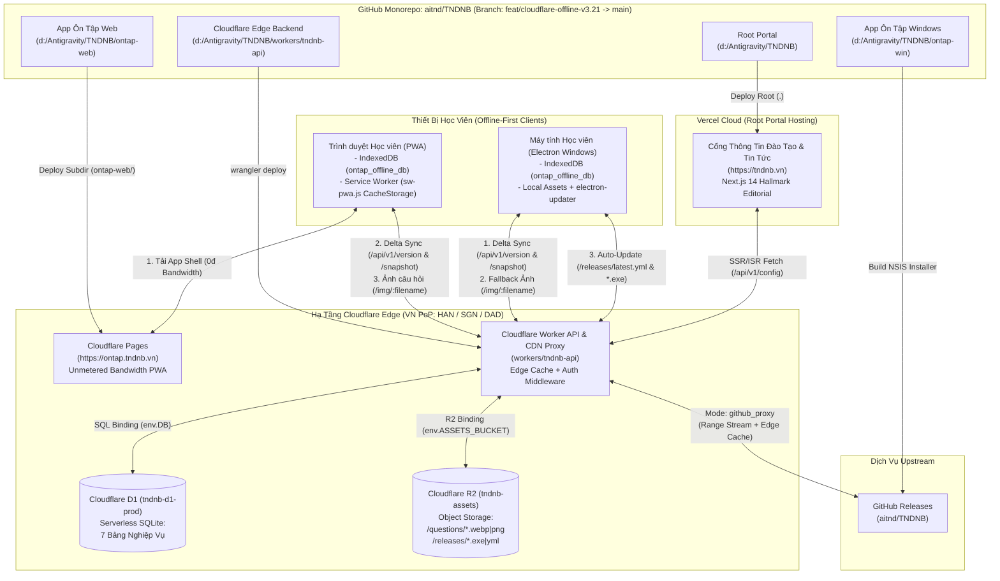
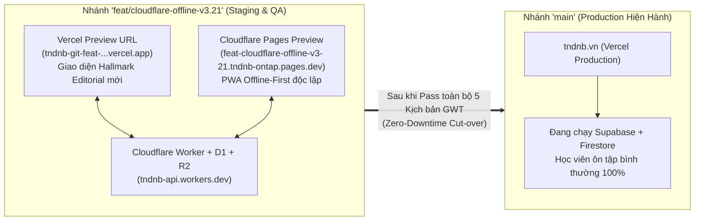
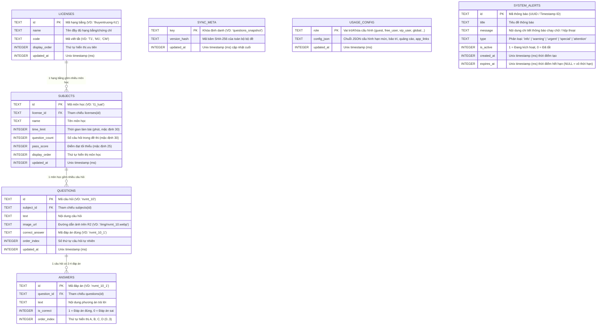
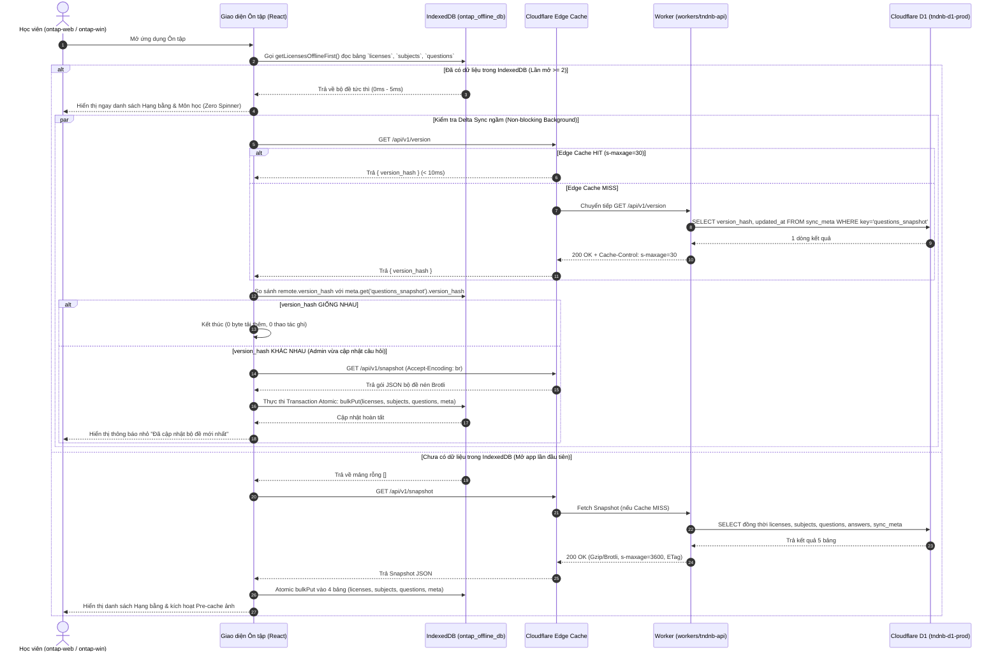
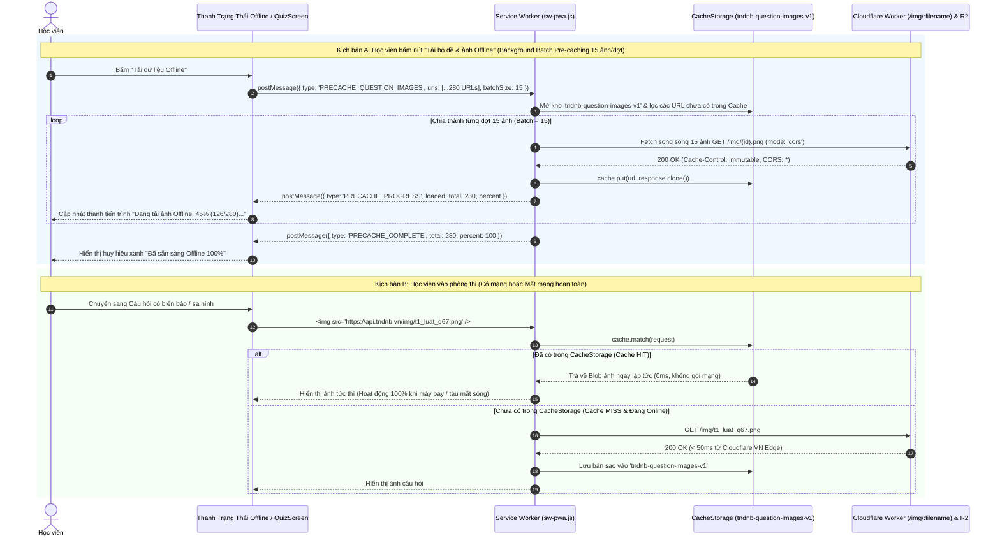
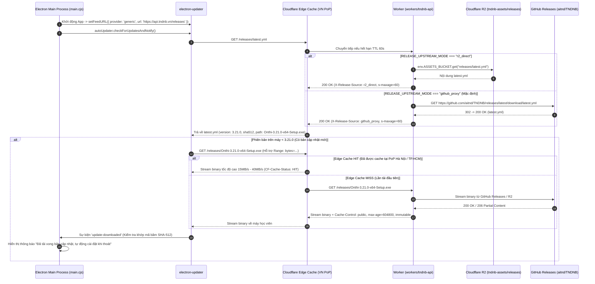

# Tài Liệu Thiết Kế Kỹ Thuật Tổng Thể (SDD Technical Design Specification)
## Dự án: Nâng Cấp Toàn Diện Hạ Tầng Cloudflare (R2 + D1 + Worker CDN Proxy), Offline-First & Tái Thiết Kế Cổng Thông Tin Hallmark Editorial

> **Mã kế hoạch:** `261104-0856-cloudflare-r2-d1-offline-upgrade`  
> **Ngày lập:** 04/11/2026  
> **Nhánh triển khai (Preview Branch):** `feat/cloudflare-offline-v3.21`  
> **Phạm vi tác động:**
> - **Root Portal (`d:\Antigravity\TNDNB`)** — Next.js 14 Portal (Vercel) + Hallmark Editorial UI Redesign
> - **App Ôn Tập Web (`d:\Antigravity\TNDNB\ontap-web`)** — React 19 + Vite PWA Offline-First (Cloudflare Pages)
> - **App Ôn Tập Windows (`d:\Antigravity\TNDNB\ontap-win`)** — Electron Desktop + Cloudflare CDN Auto-Updater
> - **Cloudflare Edge Backend (`d:\Antigravity\TNDNB\workers\tndnb-api` / `cloudflare-worker`)** — Cloudflare Worker + Cloudflare D1 (`tndnb-d1-prod`) + Cloudflare R2 (`tndnb-assets`)

---

## 1. Kiến Trúc Tổng Thể & Split Deployment (Keep Monorepo)

### 1.1. Tầm nhìn kiến trúc "Tách Deployment — Giữ Monorepo"
Hệ thống **TNDNB** giữ nguyên cấu trúc **1 Git Monorepo duy nhất (`aitnd/TNDNB`)** để dùng chung tài liệu thiết kế (`docs/`), kịch bản di trú (`scripts/`) và nguồn dữ liệu gốc (`ontap-win/data/questions_db.json`), nhưng **tách hoàn toàn thành 4 khối triển khai độc lập (Split Deployment Targets)**:

1. **Root Portal (`d:\Antigravity\TNDNB`):**
   - **Nền tảng triển khai:** **Vercel** (`https://tndnb.vn`).
   - **Vai trò:** Cổng thông tin Tin tức, Thông báo Tuyển sinh, Lịch thi và Văn bản Pháp quy chính thống của **Công ty Cổ phần Tư vấn và Giáo dục Ninh Bình**, thiết kế theo chuẩn **Hallmark Editorial (`N6 Masthead` + `H2 Split Diptych`)**.
   - **Tách rời `/ontap`:** Loại bỏ hoàn toàn cơ chế build lồng nhau (`cd ontap-web && npm run build`) khỏi lệnh build của Portal; giải phóng 100% hạn mức 100GB Bandwidth của Vercel Free Tier.
2. **App Ôn Tập Web (`d:\Antigravity\TNDNB\ontap-web`):**
   - **Nền tảng triển khai:** **Cloudflare Pages** (`https://ontap.tndnb.vn` / `*.tndnb-ontap.pages.dev`).
   - **Vai trò:** Ứng dụng Web/PWA Ôn tập & Thi thử Chứng chỉ Chuyên môn Phương tiện Thủy nội địa. Hưởng **băng thông miễn phí không giới hạn (Unmetered Bandwidth)** của Cloudflare Pages, hoạt động **100% Offline-First** với IndexedDB (Dexie.js) và Service Worker (`sw-pwa.js`).
3. **App Ôn Tập Windows (`d:\Antigravity\TNDNB\ontap-win`):**
   - **Nền tảng triển khai:** **Electron Desktop Application (Windows x64 `.exe`)**.
   - **Vai trò:** Ứng dụng ôn tập ngoại tuyến trên máy tính học viên và phòng máy trung tâm, tích hợp `electron-updater` tải bản cập nhật qua **Cloudflare Worker CDN Proxy** (tăng tốc gấp 5–10 lần so với tải trực tiếp từ GitHub Releases).
4. **Cloudflare Edge Backend (`d:\Antigravity\TNDNB\workers\tndnb-api` / `cloudflare-worker`):**
   - **Nền tảng triển khai:** **Cloudflare Workers** (`https://api.tndnb.vn` & `https://cdn.tndnb.vn`).
   - **Vai trò:** Cổng API Siêu tốc tại Edge (PoP Hà Nội `HAN`, TP.HCM `SGN`, Đà Nẵng `DAD`) kết nối trực tiếp với **Cloudflare D1 (`tndnb-d1-prod`)** và **Cloudflare R2 (`tndnb-assets`)**.

### 1.2. Sơ đồ Kiến trúc Tổng thể (Mermaid `flowchart TD`)



### 1.3. Quy trình Branch Preview (`feat/cloudflare-offline-v3.21`) Đảm Bảo Zero-Downtime

> [!IMPORTANT]
> **Nguyên tắc An toàn Tuyệt đối cho Hệ thống Đang Vận hành:** Toàn bộ quá trình nâng cấp hạ tầng D1, R2, tách `/ontap` và tái thiết kế giao diện Hallmark Editorial được thực hiện trên nhánh `feat/cloudflare-offline-v3.21`. Nhánh `main` (đang phục vụ học viên tại `https://tndnb.vn`) không bị tác động cho đến khi nghiệm thu 100% PASS.



---

## 2. Thiết Kế Cơ Sở Dữ Liệu (Database Design — Cloudflare D1 & IndexedDB Dexie)

### 2.1. Sơ đồ Thực thể Liên kết (Mermaid `erDiagram`) trên Cloudflare D1 (`tndnb-d1-prod`)



### 2.2. Đặc tả Chi tiết 7 Bảng trên Cloudflare D1 (`tndnb-d1-prod`)

#### Bảng 1: `sync_meta` (Quản lý Phiên bản & Mã băm Đồng bộ Delta)
| Tên cột | Kiểu dữ liệu | Ràng buộc | Mô tả chi tiết |
| :--- | :--- | :--- | :--- |
| `key` | `TEXT` | `PRIMARY KEY` | Khóa định danh bản ghi đồng bộ (mặc định: `'questions_snapshot'`, `'config_snapshot'`). |
| `version_hash` | `TEXT` | `NOT NULL` | Chuỗi băm SHA-256 (hoặc phiên bản ngữ nghĩa kết hợp hash) đại diện cho trạng thái dữ liệu hiện tại. Tự động xoay mới mỗi khi Admin sửa câu hỏi. |
| `updated_at` | `INTEGER` | `NOT NULL` | Thời điểm cập nhật gần nhất (Unix Epoch milliseconds). |

#### Bảng 2: `licenses` (Danh mục Hạng bằng & Chứng chỉ Chuyên môn)
| Tên cột | Kiểu dữ liệu | Ràng buộc | Mô tả chi tiết |
| :--- | :--- | :--- | :--- |
| `id` | `TEXT` | `PRIMARY KEY` | Mã định danh duy nhất của hạng bằng (VD: `'thuyentruong-h1'`, `'maytruong-h1'`). |
| `name` | `TEXT` | `NOT NULL` | Tên hiển thị đầy đủ (VD: `'Thuyền trưởng hạng nhất - T1'`). |
| `code` | `TEXT` | `NULLABLE` | Mã ký hiệu ngắn gọn phục vụ lọc nhanh (VD: `'T1'`, `'T2'`, `'M1'`). |
| `display_order` | `INTEGER` | `DEFAULT 0` | Thứ tự sắp xếp hiển thị trên giao diện chọn bằng. |
| `updated_at` | `INTEGER` | `NULLABLE` | Thời điểm cập nhật gần nhất (Unix Epoch milliseconds). |

#### Bảng 3: `subjects` (Danh mục Môn học theo Hạng bằng)
| Tên cột | Kiểu dữ liệu | Ràng buộc | Mô tả chi tiết |
| :--- | :--- | :--- | :--- |
| `id` | `TEXT` | `PRIMARY KEY` | Mã định danh môn học (VD: `'nvmt'`, `'t1_luat'`). |
| `license_id` | `TEXT` | `NOT NULL, FK` | Khóa ngoại tham chiếu tới `licenses(id) ON DELETE CASCADE`. |
| `name` | `TEXT` | `NOT NULL` | Tên môn học (VD: `'Pháp luật đường thủy nội địa'`). |
| `time_limit` | `INTEGER` | `DEFAULT 30` | Thời gian làm bài thi tiêu chuẩn tính bằng phút (mặc định 30 phút). |
| `question_count` | `INTEGER` | `DEFAULT 30` | Tổng số câu hỏi trong một đề thi tiêu chuẩn (mặc định 30 câu). |
| `pass_score` | `INTEGER` | `DEFAULT 25` | Số câu trả lời đúng tối thiểu để đạt yêu cầu (mặc định 25/30). |
| `display_order` | `INTEGER` | `DEFAULT 0` | Thứ tự hiển thị môn học trong hạng bằng. |
| `updated_at` | `INTEGER` | `NULLABLE` | Thời điểm cập nhật gần nhất (Unix Epoch milliseconds). |

#### Bảng 4: `questions` (Ngân hàng Câu hỏi Sát hạch)
| Tên cột | Kiểu dữ liệu | Ràng buộc | Mô tả chi tiết |
| :--- | :--- | :--- | :--- |
| `id` | `TEXT` | `PRIMARY KEY` | Mã câu hỏi duy nhất (VD: `'nvmt_10'`, `'t1_luat_q67'`). |
| `subject_id` | `TEXT` | `NOT NULL, FK` | Khóa ngoại tham chiếu tới `subjects(id) ON DELETE CASCADE`. |
| `text` | `TEXT` | `NOT NULL` | Nội dung câu hỏi sát hạch. |
| `image_url` | `TEXT` | `NULLABLE` | URL hoặc đường dẫn ảnh minh họa trên Cloudflare R2 (VD: `'https://api.tndnb.vn/img/nvmt_10.png'` hoặc `NULL` nếu không có ảnh). |
| `correct_answer` | `TEXT` | `NULLABLE` | Mã đáp án đúng (tham chiếu logic tới `answers.id`, VD: `'nvmt_10_1'`). |
| `order_index` | `INTEGER` | `DEFAULT 0` | Chỉ số thứ tự tự nhiên của câu hỏi trong môn học (1, 2, ..., N). |
| `updated_at` | `INTEGER` | `NULLABLE` | Thời điểm cập nhật câu hỏi gần nhất (Unix Epoch milliseconds). |

#### Bảng 5: `answers` (Danh sách Phương án Trả lời)
| Tên cột | Kiểu dữ liệu | Ràng buộc | Mô tả chi tiết |
| :--- | :--- | :--- | :--- |
| `id` | `TEXT` | `PRIMARY KEY` | Mã phương án trả lời (VD: `'nvmt_10_1'`, `'nvmt_10_2'`). |
| `question_id` | `TEXT` | `NOT NULL, FK` | Khóa ngoại tham chiếu tới `questions(id) ON DELETE CASCADE`. |
| `text` | `TEXT` | `NOT NULL` | Nội dung văn bản của phương án trả lời. |
| `is_correct` | `INTEGER` | `DEFAULT 0` | Cờ đánh dấu đáp án đúng (`1` = Đúng, `0` = Sai). |
| `order_index` | `INTEGER` | `DEFAULT 0` | Thứ tự hiển thị phương án A, B, C, D (`0`, `1`, `2`, `3`). |

#### Bảng 6: `usage_config` (Cấu hình Hạn mức Sử dụng & Hệ thống theo Vai trò)
| Tên cột | Kiểu dữ liệu | Ràng buộc | Mô tả chi tiết |
| :--- | :--- | :--- | :--- |
| `role` | `TEXT` | `PRIMARY KEY` | Tên vai trò hoặc khóa cấu hình (`'guest'`, `'free_user'`, `'verified_user'`, `'vip_user'`, `'teacher'`, `'admin'`, `'global_settings'`). |
| `config_json` | `TEXT` | `NOT NULL` | Chuỗi JSON chứa cấu hình chi tiết (số lượt làm bài, cờ bảo trì `isMaintenanceWeb`, `isMaintenanceWin`, `app_links`, cấu hình quảng cáo). |
| `updated_at` | `INTEGER` | `NOT NULL` | Thời điểm cập nhật cấu hình (Unix Epoch milliseconds). |

#### Bảng 7: `system_alerts` (Thông báo Hệ thống & Chạy chữ Marquee)
| Tên cột | Kiểu dữ liệu | Ràng buộc | Mô tả chi tiết |
| :--- | :--- | :--- | :--- |
| `id` | `TEXT` | `PRIMARY KEY` | Mã định danh thông báo. |
| `title` | `TEXT` | `NOT NULL` | Tiêu đề thông báo. |
| `message` | `TEXT` | `NOT NULL` | Nội dung thông báo hiển thị trên thanh chạy chữ (`AlertMarquee`) hoặc hộp thoại. |
| `type` | `TEXT` | `DEFAULT 'info'` | Loại thông báo (`'info'`, `'warning'`, `'urgent'`, `'attention'`, `'special'`). |
| `is_active` | `INTEGER` | `DEFAULT 1` | Trạng thái kích hoạt (`1` = Đang hiển thị, `0` = Đã ẩn). |
| `created_at` | `INTEGER` | `NOT NULL` | Thời điểm tạo thông báo (Unix Epoch milliseconds). |
| `expires_at` | `INTEGER` | `NULLABLE` | Thời điểm hết hạn tự động ẩn thông báo (Unix Epoch milliseconds, `NULL` nếu không giới hạn). |

---

### 2.3. Câu lệnh SQL Khởi tạo Schema & Indexes Bắt buộc (`0001_initial_schema.sql`)

```sql
-- ============================================================================
-- TNDNB Cloudflare D1 Schema (tndnb-d1-prod)
-- Migration: 0001_initial_schema.sql
-- ============================================================================
PRAGMA foreign_keys = ON;

-- 1. Bảng sync_meta
CREATE TABLE IF NOT EXISTS sync_meta (
    key TEXT PRIMARY KEY,
    version_hash TEXT NOT NULL,
    updated_at INTEGER NOT NULL
);

-- 2. Bảng licenses
CREATE TABLE IF NOT EXISTS licenses (
    id TEXT PRIMARY KEY,
    name TEXT NOT NULL,
    code TEXT,
    display_order INTEGER DEFAULT 0,
    updated_at INTEGER
);

-- 3. Bảng subjects
CREATE TABLE IF NOT EXISTS subjects (
    id TEXT PRIMARY KEY,
    license_id TEXT NOT NULL,
    name TEXT NOT NULL,
    time_limit INTEGER DEFAULT 30,
    question_count INTEGER DEFAULT 30,
    pass_score INTEGER DEFAULT 25,
    display_order INTEGER DEFAULT 0,
    updated_at INTEGER,
    FOREIGN KEY (license_id) REFERENCES licenses(id) ON DELETE CASCADE
);

-- 4. Bảng questions
CREATE TABLE IF NOT EXISTS questions (
    id TEXT PRIMARY KEY,
    subject_id TEXT NOT NULL,
    text TEXT NOT NULL,
    image_url TEXT,
    correct_answer TEXT,
    order_index INTEGER DEFAULT 0,
    updated_at INTEGER,
    FOREIGN KEY (subject_id) REFERENCES subjects(id) ON DELETE CASCADE
);

-- 5. Bảng answers
CREATE TABLE IF NOT EXISTS answers (
    id TEXT PRIMARY KEY,
    question_id TEXT NOT NULL,
    text TEXT NOT NULL,
    is_correct INTEGER DEFAULT 0,
    order_index INTEGER DEFAULT 0,
    FOREIGN KEY (question_id) REFERENCES questions(id) ON DELETE CASCADE
);

-- 6. Bảng usage_config
CREATE TABLE IF NOT EXISTS usage_config (
    role TEXT PRIMARY KEY,
    config_json TEXT NOT NULL,
    updated_at INTEGER NOT NULL
);

-- 7. Bảng system_alerts
CREATE TABLE IF NOT EXISTS system_alerts (
    id TEXT PRIMARY KEY,
    title TEXT NOT NULL,
    message TEXT NOT NULL,
    type TEXT DEFAULT 'info',
    is_active INTEGER DEFAULT 1,
    created_at INTEGER NOT NULL,
    expires_at INTEGER
);

-- ============================================================================
-- INDEXES BẮT BUỘC (Tối ưu hóa truy vấn lắp ghép Snapshot < 15ms trên D1)
-- ============================================================================
CREATE INDEX IF NOT EXISTS idx_licenses_order ON licenses(display_order ASC);
CREATE INDEX IF NOT EXISTS idx_subjects_license_order ON subjects(license_id, display_order ASC);
CREATE INDEX IF NOT EXISTS idx_questions_subject_order ON questions(subject_id, order_index ASC);
CREATE INDEX IF NOT EXISTS idx_answers_question_order ON answers(question_id, order_index ASC);
CREATE INDEX IF NOT EXISTS idx_system_alerts_active_expiry ON system_alerts(is_active, expires_at, created_at DESC);
```

---

### 2.4. Thiết kế Schema IndexedDB (Dexie.js) tại Client (`ontap_offline_db`)

Trên cả 2 ứng dụng **`ontap-web`** và **`ontap-win`**, cơ sở dữ liệu cục bộ trên trình duyệt/Electron được chuẩn hóa bằng **Dexie.js v4** với tên database là **`ontap_offline_db`**, gồm **5 bảng (Object Stores)** giúp truy xuất bộ đề và cấu hình trong **0ms–5ms** mà không cần kết nối mạng:

| STT | Tên bảng Dexie | Khóa chính & Chỉ mục (Dexie Store Syntax) | Cấu trúc dữ liệu lưu trữ (TypeScript Interface) | Mục đích sử dụng |
| :---: | :--- | :--- | :--- | :--- |
| **1** | `meta` | `'key'` | `{ key: string; version_hash: string; updated_at: number; synced_at: number }` | Lưu `version_hash` hiện tại của bộ đề dưới máy trạm để so sánh với `/api/v1/version`. |
| **2** | `licenses` | `'id, code, display_order'` | `{ id: string; name: string; code?: string; display_order: number; subjects?: SubjectDTO[] }` | Lưu danh sách hạng bằng và cây bộ đề phục vụ hiển thị tức thì tại màn hình chọn bằng. |
| **3** | `subjects` | `'id, license_id, display_order'` | `{ id: string; license_id: string; name: string; time_limit: number; question_count: number; pass_score: number; display_order: number }` | Tra cứu nhanh danh sách môn học theo `license_id` và cấu hình thời gian/điểm đạt khi tạo đề thi. |
| **4** | `questions` | `'id, subject_id, order_index'` | `{ id: string; subject_id: string; text: string; image_url: string \| null; correct_answer: string; order_index: number; answers: AnswerDTO[] }` | Lưu toàn bộ ngân hàng câu hỏi (kèm mảng `answers` nhúng sẵn) giúp lấy câu hỏi theo `subject_id` trong `< 2ms`. |
| **5** | `usage_config` | `'role'` | `{ role: string; config_json: any; updated_at: number }` | Lưu cấu hình hạn mức (`guest`, `free_user`, `vip_user`, `global_settings`) và danh sách `system_alerts` để kiểm soát quyền sử dụng khi Offline. |

#### Khai báo khởi tạo Dexie (`ontap_offline_db`):
```typescript
import Dexie, { type Table } from 'dexie';

export class OnTapOfflineDatabase extends Dexie {
  meta!: Table<{ key: string; version_hash: string; updated_at: number; synced_at: number }, string>;
  licenses!: Table<any, string>;
  subjects!: Table<any, string>;
  questions!: Table<any, string>;
  usage_config!: Table<{ role: string; config_json: any; updated_at: number }, string>;

  constructor() {
    super('ontap_offline_db');
    this.version(1).stores({
      meta: 'key',
      licenses: 'id, code, display_order',
      subjects: 'id, license_id, display_order',
      questions: 'id, subject_id, order_index',
      usage_config: 'role'
    });
  }
}

export const offlineDb = new OnTapOfflineDatabase();
```

---

### 2.5. Quy tắc Bảo toàn Dữ liệu khi Migrate từ Supabase + Firestore sang D1 & R2

1. **Bảo toàn 100% Khóa chính (`id`) & Quan hệ Khóa ngoại:**
   - Giữ nguyên toàn bộ `licenses.id`, `subjects.id`, `questions.id`, `answers.id` từ Supabase và `ontap-win/data/questions_db.json` để không làm gãy lịch sử làm bài (`exam_history`) và tiến độ học tập đã lưu trên máy học viên.
2. **Quy tắc Ánh xạ Đáp án Đúng Kép (`correct_answer` + `answers.is_correct`):**
   - Khi chạy script di trú (`scripts/migrate-to-d1.mjs`), cột `questions.correct_answer` lưu mã ID của đáp án đúng (VD: `'nvmt_10_1'`), đồng thời trong bảng `answers`, bản ghi có `id === questions.correct_answer` được gán `is_correct = 1` (các phương án còn lại `is_correct = 0`). Đảm bảo tương thích 100% với mọi thuật toán chấm điểm cũ và mới.
3. **Quy tắc Chuẩn hóa Đường dẫn Ảnh sang R2 (`/img/:filename`):**
   - Toàn bộ 280 ảnh câu hỏi trong `ontap-win/public/question_images/` được tải lên bucket Cloudflare R2 `tndnb-assets` dưới tiền tố `questions/{question_id}.png` (hoặc `.webp`).
   - Cột `questions.image_url` trong D1 được chuẩn hóa về định dạng thống nhất: `/img/{question_id}.png` (hoặc URL đầy đủ `https://api.tndnb.vn/img/{question_id}.png`). Các câu hỏi không có ảnh bắt buộc lưu giá trị `NULL` (không lưu chuỗi rỗng `""`).
4. **Quy tắc Tính toán `version_hash` Xác định (Deterministic SHA-256):**
   - Sắp xếp toàn bộ `licenses`, `subjects`, `questions`, `answers` theo `id` tăng dần trước khi băm `SHA-256` để tạo `version_hash` ghi vào `sync_meta` (`key = 'questions_snapshot'`).

---

## 3. Thiết Kế API & CDN Proxy (Cloudflare Worker API Specification)

### 3.1. Bảng Tổng hợp Tất cả Endpoints trên `workers/tndnb-api`

| STT | Phương thức & Đường dẫn (Endpoint) | Xác thực (Auth) | Nguồn Dữ liệu (Binding) | Chiến lược Cache tại Cloudflare Edge | Mô tả Chức năng & Tối ưu hóa |
| :---: | :--- | :---: | :--- | :--- | :--- |
| **1** | `GET /api/v1/version`<br>*(Alias tương thích: `GET /api/v1/meta/version`)* | Công khai (`Public`) | D1: `sync_meta` | `Cache-Control: public, s-maxage=30, stale-while-revalidate=60` | Kiểm tra `version_hash` siêu nhẹ (`< 100 bytes`), thời gian phản hồi `< 10ms`. Giúp Client quyết định có cần tải lại bộ đề hay không. |
| **2** | `GET /api/v1/snapshot`<br>*(Alias tương thích: `GET /api/v1/questions/snapshot`)* | Công khai (`Public`) | D1: `licenses`, `subjects`, `questions`, `answers`, `sync_meta` | `Cache-Control: public, s-maxage=3600, stale-while-revalidate=86400` + `ETag: "<version_hash>"` | Trả toàn bộ cây bộ đề sát hạch nén **Brotli/Gzip** (~180KB sau nén). Hỗ trợ `If-None-Match` trả `304 Not Modified`. |
| **3** | `GET /api/v1/config`<br>*(Hỗ trợ cả `/api/v1/config/:role` & `/api/v1/alerts`)* | Công khai (`Public`) | D1: `usage_config` + `system_alerts` | `Cache-Control: public, s-maxage=30, stale-while-revalidate=120` | Trả cấu hình hạn mức theo vai trò (`usage_config`) và danh sách thông báo đang hoạt động (`system_alerts` còn hạn). |
| **4** | `PUT /api/v1/admin/questions/:id` | `Authorization: Bearer <ADMIN_API_SECRET>` | D1: `questions`, `answers`, `sync_meta` | `Cache-Control: no-store` (Xóa Edge Cache của `/version` & `/snapshot`) | Cập nhật nội dung câu hỏi, ảnh minh họa, đáp án đúng và **tự động xoay (rotate) `version_hash` mới** trong bảng `sync_meta` bằng `DB.batch()`. |
| **5** | `GET /img/:filename`<br>*(Alias: `GET /question-images/:filename`)* | Công khai (`Public`) | R2: `tndnb-assets` (`questions/:filename`) | `Cache-Control: public, max-age=31536000, immutable` + `Access-Control-Allow-Origin: *` | Phục vụ ảnh câu hỏi trực tiếp từ Cloudflare R2 qua Edge CDN với ETag, Zero Egress Fee và độ trễ `< 15ms` tại Việt Nam. |
| **6** | `GET /releases/:filename`<br>*(Alias: `GET /releases/download/:filename`)* | Công khai (`Public`) | `RELEASE_UPSTREAM_MODE`:<br>`github_proxy` hoặc `r2_direct` | File `.yml`: `public, s-maxage=60`<br>File `.exe`/`.blockmap`: `public, max-age=604800, immutable` | CDN Proxy tăng tốc tải `latest.yml`, `*.exe`, `*.blockmap` cho `electron-updater`. Hỗ trợ đầy đủ HTTP `Range: bytes=...` (`206 Partial Content`) để resume download. |

---

### 3.2. Đặc tả Chi tiết Request / Response JSON Mẫu

#### Endpoint 1: `GET /api/v1/version`
- **Request:**
  ```http
  GET /api/v1/version HTTP/1.1
  Host: api.tndnb.vn
  Accept: application/json
  ```
- **Response (`200 OK` — Payload < 100 bytes):**
  ```json
  {
    "key": "questions_snapshot",
    "version_hash": "e3b0c44298fc1c149afbf4c8996fb92427ae41e4649b934ca495991b7852b855",
    "updated_at": 1762243200000
  }
  ```

#### Endpoint 2: `GET /api/v1/snapshot`
- **Request:**
  ```http
  GET /api/v1/snapshot HTTP/1.1
  Host: api.tndnb.vn
  Accept-Encoding: br, gzip
  If-None-Match: "e3b0c44298fc1c149afbf4c8996fb92427ae41e4649b934ca495991b7852b855"
  ```
- **Response (`200 OK` hoặc `304 Not Modified` nếu trùng `ETag`):**
  ```json
  {
    "version_hash": "e3b0c44298fc1c149afbf4c8996fb92427ae41e4649b934ca495991b7852b855",
    "updated_at": 1762243200000,
    "licenses": [
      {
        "id": "thuyentruong-h1",
        "name": "Thuyền trưởng hạng nhất - T1",
        "code": "T1",
        "display_order": 1,
        "subjects": [
          {
            "id": "t1_luat",
            "license_id": "thuyentruong-h1",
            "name": "Pháp luật đường thủy nội địa",
            "time_limit": 30,
            "question_count": 30,
            "pass_score": 25,
            "display_order": 1,
            "questions": [
              {
                "id": "t1_luat_q67",
                "subject_id": "t1_luat",
                "text": "Biển báo nào dưới đây báo hiệu cấm vượt?",
                "image_url": "/img/t1_luat_q67.png",
                "correct_answer": "t1_luat_q67_a",
                "order_index": 67,
                "answers": [
                  {
                    "id": "t1_luat_q67_a",
                    "question_id": "t1_luat_q67",
                    "text": "Biển hình vuông nền trắng, viền đỏ, có hai mũi tên đen song song.",
                    "is_correct": 1,
                    "order_index": 0
                  },
                  {
                    "id": "t1_luat_q67_b",
                    "question_id": "t1_luat_q67",
                    "text": "Biển hình tam giác đều viền đỏ.",
                    "is_correct": 0,
                    "order_index": 1
                  }
                ]
              }
            ]
          }
        ]
      }
    ]
  }
  ```

#### Endpoint 3: `GET /api/v1/config`
- **Response (`200 OK`):**
  ```json
  {
    "usage_config": {
      "guest": { "limit": 10, "allowExam": true },
      "free_user": { "limit": 30, "allowExam": true },
      "vip_user": { "limit": 9999, "allowExam": true },
      "global_settings": {
        "isMaintenancePortal": false,
        "isMaintenanceWeb": false,
        "isMaintenanceWin": false,
        "maintenanceMessage": "",
        "app_links": {
          "version": "3.21.0",
          "windows": "https://api.tndnb.vn/releases/Onthi-3.21.0-x64-Setup.exe"
        }
      }
    },
    "system_alerts": [
      {
        "id": "alert_2026_11",
        "title": "Lịch sát hạch tháng 11/2026",
        "message": "Thông báo lịch thi chứng chỉ Thuyền trưởng, Máy trưởng đợt 2 tháng 11/2026 tại Ninh Bình.",
        "type": "info",
        "is_active": 1,
        "created_at": 1762240000000,
        "expires_at": 1764832000000
      }
    ]
  }
  ```

#### Endpoint 4: `PUT /api/v1/admin/questions/:id`
- **Request:**
  ```http
  PUT /api/v1/admin/questions/t1_luat_q67 HTTP/1.1
  Host: api.tndnb.vn
  Authorization: Bearer <ADMIN_API_SECRET>
  Content-Type: application/json

  {
    "text": "Biển báo nào dưới đây báo hiệu khu vực cấm phương tiện vượt nhau?",
    "image_url": "/img/t1_luat_q67.png",
    "correct_answer": "t1_luat_q67_a",
    "answers": [
      { "id": "t1_luat_q67_a", "text": "Biển A (Nền trắng viền đỏ, 2 mũi tên)", "is_correct": 1, "order_index": 0 },
      { "id": "t1_luat_q67_b", "text": "Biển B", "is_correct": 0, "order_index": 1 }
    ]
  }
  ```
- **Response (`200 OK`):**
  ```json
  {
    "ok": true,
    "question_id": "t1_luat_q67",
    "new_version_hash": "9f86d081884c7d659a2feaa0c55ad015a3bf4f1b2b0b822cd15d6c15b0f00a08",
    "updated_at": 1762246800000
  }
  ```

#### Endpoint 5: `GET /img/:filename`
- **Response Headers (`200 OK`):**
  ```http
  HTTP/1.1 200 OK
  Content-Type: image/png
  Cache-Control: public, max-age=31536000, immutable
  Access-Control-Allow-Origin: *
  ETag: "r2-etag-t1_luat_q67"
  CF-Cache-Status: HIT
  ```

#### Endpoint 6: `GET /releases/:filename`
- **Response Headers (`200 OK` hoặc `206 Partial Content` khi có `Range` header):**
  ```http
  HTTP/1.1 206 Partial Content
  Content-Type: application/octet-stream
  Accept-Ranges: bytes
  Content-Range: bytes 0-1048575/68452110
  Cache-Control: public, max-age=604800, s-maxage=604800, immutable
  X-Release-Source: github_proxy
  CF-Cache-Status: HIT
  ```
  *(Khi bật `RELEASE_UPSTREAM_MODE = "r2_direct"`, header trả về `X-Release-Source: r2_direct` và stream trực tiếp từ bucket R2 `tndnb-assets/releases/:filename`).*

---

### 3.3. Bảng Mã Lỗi Chuẩn (Standardized Error Catalog)

Mọi phản hồi lỗi từ `workers/tndnb-api` đều tuân thủ định dạng JSON đồng nhất và luôn đính kèm đầy đủ CORS headers:

```json
{
  "error": {
    "code": "UNAUTHORIZED",
    "message": "Token xác thực Admin không hợp lệ hoặc bị thiếu.",
    "status": 401,
    "timestamp": 1762246800000
  }
}
```

| HTTP Status | Mã lỗi (`error.code`) | Kịch bản kích hoạt | Hành vi xử lý tại Client (`ontap-web` / `ontap-win`) |
| :---: | :--- | :--- | :--- |
| **`401 Unauthorized`** | `UNAUTHORIZED` | Gọi `PUT /api/v1/admin/questions/:id` hoặc `PUT /api/v1/config` mà thiếu header `Authorization: Bearer <ADMIN_API_SECRET>` hoặc sai khóa bí mật. | Hiển thị thông báo yêu cầu đăng nhập quyền Quản trị viên. |
| **`404 Not Found`** | `RESOURCE_NOT_FOUND` | Câu hỏi `:id` không tồn tại trong D1, ảnh `/img/:filename` không có trong R2 `tndnb-assets/questions/`, hoặc file `/releases/:filename` không tồn tại. | Với ảnh câu hỏi: `imageHelper.ts` tự động ẩn khung ảnh lỗi hoặc chuyển sang ảnh dự phòng cục bộ. |
| **`502 Upstream Error`** | `UPSTREAM_GITHUB_ERROR` | Ở chế độ `github_proxy`, GitHub Releases trả lỗi `5xx` hoặc `429 Rate Limit` khi Worker đang kéo file `.exe` / `latest.yml`. | Worker tự động thử đọc từ R2 (`tndnb-assets/releases/`) nếu có; nếu không, trả `502` để `electron-updater` thử lại sau. |
| **`500 Internal Error`** | `INTERNAL_SERVER_ERROR` | Lỗi truy vấn cú pháp D1 SQLite hoặc ngoại lệ runtime không xác định trong Worker. | Client giữ nguyên dữ liệu đang có trong IndexedDB (`ontap_offline_db`) để học viên tiếp tục làm bài không gián đoạn. |

---

## 4. Thiết Kế Luồng Nghiệp Vụ (Data Flows & Sequence Diagrams)

### 4.1. Luồng 1: Offline-First Delta Sync (`getLicensesOfflineFirst`)

Luồng đồng bộ đảm bảo **thời gian chờ màn hình trắng = 0ms** ở mọi lần mở ứng dụng từ lần thứ 2 trở đi, đồng thời chỉ tiêu tốn đúng **1 lượt đọc siêu nhẹ (`< 100 bytes`)** để kiểm tra `version_hash`.



---

### 4.2. Luồng 2: R2 Image CDN + PWA Service Worker Cache (`sw-pwa.js`)

Khi học viên xem câu hỏi có hình hoặc bấm nút **"Tải dữ liệu Offline"**, `sw-pwa.js` sử dụng chiến lược **Cache-First** với kho `tndnb-question-images-v1` và cơ chế tải ngầm theo từng lô **15 ảnh/đợt (Batch Pre-caching)** kèm tiến trình phần trăm.



---

### 4.3. Luồng 3: Windows Electron Auto-Updater qua Cloudflare CDN

Giải quyết triệt để tình trạng đứt cáp/bóp băng thông GitHub Releases tại Việt Nam bằng cách đặt `electron-updater` trỏ về Cloudflare Worker CDN Proxy (`/releases/*`).



---

## 5. Thiết Kế Giao Diện UI/UX & Hallmark Editorial Redesign (Screen Specifications)

### 5.1. Màn hình 1: Trang chủ & Header App Portal (`d:\Antigravity\TNDNB`) — Hallmark Editorial Redesign (`/ui-ux-pro-max` + `/hallmark`)

Cổng thông tin gốc tại `d:\Antigravity\TNDNB` được định vị lại thành **Cổng Thông Tin Đào Tạo, Sát Hạch & Tin Tức Ngành Đường Thủy Nội Địa chính thống** mang phong cách **Báo chí Học thuật & Cơ quan Đào tạo (Hallmark Editorial Authority)**, tách biệt hoàn toàn khỏi ứng dụng web luyện thi (`ontap-web`).

#### 5.1.1. Danh sách các phần tử bắt buộc loại bỏ (Cleanup Checklist)
1. **Tại `components/Navbar.tsx` & `components/Navbar.module.css`:**
   - **Xóa hoàn toàn khối `div.utilityGroup` chứa 5 nút màu vàng/công cụ:**
     1. ❌ Nút `Giải trí`
     2. ❌ Nút `Ôn tập`
     3. ❌ Nút `Thi trực tuyến`
     4. ❌ Nút `Tải App`
     5. ❌ Nút `Tra cứu ĐC`
2. **Tại `app/page.tsx`:**
   - **Xóa hoàn toàn khối `section.ctaBanner` ("Hệ thống Ôn tập & Thi trực tuyến")** cùng toàn bộ các nút dẫn hướng nội bộ sang `/ontap`.
3. **Tại `components/MobileBottomNav.tsx` & `components/Footer.tsx`:**
   - **Xóa hoàn toàn** các liên kết, biểu tượng điều hướng trỏ về `/ontap` hoặc `/thi-truc-tuyen`. Thay thế bằng các liên kết chuyên mục tin tức, thông báo tuyển sinh, văn bản pháp quy và liên hệ phòng đào tạo.

---

#### 5.1.2. Cấu trúc Giao diện Hallmark Editorial Mới

```
+--------------------------------------------------------------------------------------------------+
| [TẦNG 1: META BAR] Thứ Tư, 04/11/2026 | Hotline: 0229.3xxx.xxx | Email: info@tndnb.vn | [A-] [A+] [☼/☾] |
+--------------------------------------------------------------------------------------------------+
| [TẦNG 2: MASTHEAD CHÍNH THỐNG - N6 · Newspaper Masthead]                                         |
|         [LOGO / BIỂU TRƯNG]                                                                      |
|   CÔNG TY CỔ PHẦN TƯ VẤN VÀ GIÁO DỤC NINH BÌNH                                                   |
|   CỔNG THÔNG TIN ĐÀO TẠO & SÁT HẠCH THUYỀN VIÊN - NGƯỜI LÁI PHƯƠNG TIỆN THỦY NỘI ĐỊA             |
+--------------------------------------------------------------------------------------------------+
| [TẦNG 3: MENU CHUYÊN MỤC KẺ KHUNG MẢNH 1px solid var(--border)]                                  |
|  TRANG CHỦ  |  GIỚI THIỆU  |  TIN TỨC & SỰ KIỆN  |  THÔNG BÁO TUYỂN SINH  |  LỊCH THI  |  VĂN BẢN PHÁP QUY  |  LIÊN HỆ |
+--------------------------------------------------------------------------------------------------+
|                                                                                                  |
| [HERO ARCHETYPE: H2 · Split Diptych — Lưới 12 cột: Trái 7fr (Lead Story) | Phải 5fr (Bản tin)]   |
| +----------------------------------------------------------+-----------------------------------+ |
| | [Ảnh Tiêu điểm Tỷ lệ 16:10 - Bo góc 0px/2px, Kẻ viền]    | BẢN TIN HỌC VỤ & TUYỂN SINH MỚI NHẤT| |
| |                                                          | --------------------------------- | |
| | [CHUYÊN MỤC ĐỎ #B91C1C] · 04/11/2026                     | 01  Thông báo chiêu sinh lớp      | |
| | Tiêu đề Bài viết Tiêu điểm Lớn (Font Serif               |     Thuyền trưởng hạng Nhất K12   | |
| | Merriweather / Newsreader, font-style: normal, Đứng)     | --------------------------------- | |
| |                                                          | 02  Kế hoạch sát hạch chứng chỉ   | |
| | Đoạn trích dẫn (Excerpt) ngắn gọn 3 dòng trình bày rõ    |     chuyên môn quý IV/2026        | |
| | ràng nội dung cốt lõi của thông báo hoặc tin tức...      | --------------------------------- | |
| |                                                          | 03  Hướng dẫn hồ sơ đổi giấy      | |
| |                                                          |     chứng nhận khả năng chuyên môn| |
| |                                                          | --------------------------------- | |
| |                                                          | 04  Danh sách thí sinh đủ điều    | |
| |                                                          |     kiện dự thi đợt tháng 11/2026 | |
| +----------------------------------------------------------+-----------------------------------+ |
|                                                                                                  |
| 01 — TIN TỨC & SỰ KIỆN                                                                           |
| +----------------------------------------------------------------------------------------------+ |
| | Lưới bài viết báo chí chính thống (Editorial Grid)                                            | |
| +----------------------------------------------------------------------------------------------+ |
|                                                                                                  |
| 02 — THÔNG BÁO TUYỂN SINH & LỊCH THI                                                             |
| +----------------------------------------------------------------------------------------------+ |
| | Bảng thông báo học vụ kèm nhãn trạng thái [ĐANG NHẬN HỒ SƠ] (#B91C1C)                         | |
| +----------------------------------------------------------------------------------------------+ |
|                                                                                                  |
| 03 — VĂN BẢN PHÁP QUY                                                                            |
| +----------------------------------------------------------------------------------------------+ |
| | Danh mục Thông tư, Nghị định, Quy chuẩn kỹ thuật đường thủy nội địa                           | |
| +----------------------------------------------------------------------------------------------+ |
+--------------------------------------------------------------------------------------------------+
```

1. **Nav Archetype (`N6 · Newspaper Masthead`):**
   - **Tầng 1 — Meta Bar:** Chiều cao `36px`, nền `--color-paper`, kẻ viền dưới `1px solid var(--border)`. Bên trái hiển thị Thứ/Ngày/Tháng/Năm tiếng Việt theo thời gian thực; bên phải hiển thị Hotline, Email hỗ trợ, bộ nút tăng/giảm cỡ chữ bài đọc **`A-` / `A+`** và nút chuyển đổi giao diện **`Theme Switcher` (Sáng/Tối)**.
   - **Tầng 2 — Masthead Chính thống:** Căn giữa trang trọng hoặc bố cục chuẩn cơ quan đào tạo, gồm Quốc huy / Logo đơn vị, tên đơn vị in hoa đậm:
     - Dòng chính: **`CÔNG TY CỔ PHẦN TƯ VẤN VÀ GIÁO DỤC NINH BÌNH`** (`font-family: var(--font-display)`, `font-weight: 800`, `color: var(--color-ink)`).
     - Phụ đề: **`CỔNG THÔNG TIN ĐÀO TẠO & SÁT HẠCH THUYỀN VIÊN - NGƯỜI LÁI PHƯƠNG TIỆN THỦY NỘI ĐỊA`** (`font-family: var(--font-sans)`, `letter-spacing: 0.08em`, `color: var(--color-accent)`).
   - **Tầng 3 — Menu Chuyên mục:** Kẻ khung mảnh trên và dưới `1px solid var(--border)`, không sử dụng các nút màu vàng lòe loẹt, chỉ gồm các mục điều hướng báo chí & đào tạo.
2. **Hero Archetype (`H2 · Split Diptych` — Tỷ lệ `7fr / 5fr`):**
   - **Cột trái (`7fr` — Lead Story):** Hiển thị bài viết tiêu điểm lớn nhất với khung ảnh tỷ lệ chuẩn **`16:10`**, tiêu đề dùng phông chữ có chân **`Merriweather` / `Newsreader` (`var(--font-display)`)**, **bắt buộc `font-style: normal` (tuyệt đối không in nghiêng)**, độ đậm `700`, kích thước `clamp(1.5rem, 2.4vw, 2.25rem)`, chiều cao dòng `1.25`.
   - **Cột phải (`5fr` — Bản tin Học vụ):** Kẻ vạch ngăn cách dọc `1px solid var(--border)` với cột trái. Tiêu đề khối: **`BẢN TIN HỌC VỤ & TUYỂN SINH MỚI NHẤT`**. Bên dưới gồm **4 tin tiêu điểm** đánh số thứ tự bằng phông моно (`var(--font-mono)`): **`01`**, **`02`**, **`03`**, **`04`** (màu `--color-signal: #B91C1C` hoặc `--color-accent: #003566`), ngăn cách nhau bằng đường kẻ ngang mảnh `1px solid var(--border)`.
3. **Section Headers (`S1 · Left margin numbered`):**
   - Tất cả các phân vùng nội dung bên dưới đều tuân thủ định dạng đánh số lề trái kèm gạch ngang dài:
     - **`01 — TIN TỨC & SỰ KIỆN`**
     - **`02 — THÔNG BÁO TUYỂN SINH & LỊCH THI`**
     - **`03 — VĂN BẢN PHÁP QUY`**

---

#### 5.1.3. Hallmark Token Lock (`app/globals.css`)

```css
:root {
  /* Bảng màu Hallmark Editorial (High-Craft Light Mode Default) */
  --color-paper: #FAF9F6;          /* Nền giấy báo ấm (Warm Editorial Paper) */
  --color-surface: #FFFFFF;        /* Nền thẻ nội dung nổi bật */
  --color-ink: #0B132B;            /* Màu mực chính thống (Deep Maritime Navy Ink) */
  --color-ink-muted: #475569;      /* Màu chữ phụ / trích dẫn */
  --color-accent: #003566;         /* Xanh hàng hải / đường thủy (Maritime Authority Blue) */
  --color-signal: #B91C1C;         /* Đỏ con dấu / thông báo khẩn (Editorial Crimson Signal) */
  --border: #E2E0D8;               /* Đường kẻ khung báo chí mảnh 1px */

  /* Hệ thống Phông chữ (Typography Lock) */
  --font-display: 'Merriweather', 'Newsreader', Georgia, serif;
  --font-sans: 'Plus Jakarta Sans', 'Inter', -apple-system, BlinkMacSystemFont, sans-serif;
  --font-mono: 'JetBrains Mono', monospace;
}

/* Quy tắc khóa cứng: Không bao giờ in nghiêng tiêu đề Serif */
h1, h2, h3, .editorialTitle, .leadStoryTitle {
  font-family: var(--font-display);
  font-style: normal !important;
}
```

#### 5.1.4. Quy chuẩn Đáp ứng Đa thiết bị (Responsive Breakpoints & Anti-Overflow Rules)

| Breakpoint | Thiết bị đại diện | Quy tắc Bố cục & Chống Tràn Ngang (`overflow-x: clip`) |
| :---: | :--- | :--- |
| **`320px`** | Điện thoại màn hình nhỏ (iPhone SE 1st gen) | Toàn bộ lưới chuyển về 1 cột `grid-template-columns: minmax(0, 1fr)`. Ẩn text phụ trên Meta Bar, giữ nút `A-/A+` và Hamburger Menu kích thước chạm tối thiểu `44x44px`. Không tràn ngang哪怕 1px. |
| **`375px`** | iPhone 12/13/14 Mini, chuẩn Mobile phổ biến | Masthead thu gọn cỡ chữ `clamp(1.05rem, 4.5vw, 1.35rem)`, `word-break: break-word`. Khối `H2 Split Diptych` xếp chồng dọc (Lead Story ở trên, 4 tin `01`–`04` ở dưới). |
| **`414px`** | iPhone Plus / Pro Max, Android phổ thông | Tối ưu khoảng cách đệm `padding: 0 16px`, ảnh Lead Story giữ nguyên tỷ lệ `16:10`. |
| **`768px`** | Máy tính bảng (iPad Mini / Air Portrait) | Lưới bài viết chuyên mục `01`, `02` hiển thị 2 cột `repeat(2, minmax(0, 1fr))`. Menu chuyên mục cho phép cuộn ngang mượt hoặc gói dòng chuẩn. |
| **`1280px+`** | Desktop / Laptop tiêu chuẩn | Kích hoạt đầy đủ bố cục `H2 · Split Diptych` (`grid-template-columns: minmax(0, 7fr) minmax(0, 5fr)`), khung chứa tối đa `max-width: 1280px`, căn giữa. |

---

### 5.2. Màn hình 2: Thanh Trạng Thái Đồng Bộ Ngoại Tuyến trên `ontap-web` & `ontap-win`

Tại đầu màn hình chọn bằng (`Dashboard` / `Header`) của `ontap-web` và `ontap-win`, bổ sung **Thanh trạng thái Đồng bộ Ngoại tuyến (`OfflineSyncStatusBar`)**:

```
+--------------------------------------------------------------------------------------------------+
| [Trạng thái 1: Chưa tải đủ ảnh Offline]                                                          |
| (↓) Dữ liệu bộ đề đã lưu (v3.21). Để làm bài khi không có mạng: [ Tải bộ đề & ảnh Offline (0%) ] |
+--------------------------------------------------------------------------------------------------+
| [Trạng thái 2: Đang tải Batch 15 ảnh/đợt vào CacheStorage]                                       |
| (⟳) Đang tải bộ đề & ảnh Offline... [████████████░░░░░░░░] 65% (182/280 ảnh)                     |
+--------------------------------------------------------------------------------------------------+
| [Trạng thái 3: Hoàn tất 100% hoặc Đang ở chế độ Offline]                                         |
| (✓) Tải bộ đề & ảnh Offline (100%) — Sẵn sàng làm bài không cần Internet                         |
+--------------------------------------------------------------------------------------------------+
```

- **Trạng thái hiển thị:**
  1. **Khi chưa tải đủ 280 ảnh R2 vào `CacheStorage`:** Hiển thị nút bấm rõ ràng **`"Tải bộ đề & ảnh Offline"`** (kích thước tối thiểu `44px` chiều cao).
  2. **Khi đang tải:** Hiển thị thanh tiến trình (Progress Bar) cập nhật theo thời gian thực từ sự kiện `message` (`PRECACHE_PROGRESS`) của `sw-pwa.js`: **`"Đang tải bộ đề & ảnh Offline (X%)"`**.
  3. **Khi đạt 100%:** Hiển thị nhãn xác nhận màu xanh lá **`"Tải bộ đề & ảnh Offline (100%)"`** và lưu trạng thái vào `ontap_offline_db.meta`.

---

## 6. Kịch Bản Kiểm Thử & Nghiệm Thu (SDD Acceptance Criteria — Given/When/Then)

### Kịch bản 1: Nghiệm thu Tách Deployment (Portal trên Vercel & `ontap-web` trên Cloudflare Pages)
- **Given (Giả định):**
  - Nhánh `feat/cloudflare-offline-v3.21` đã được triển khai tách biệt: Root Portal (`d:\Antigravity\TNDNB`) chạy trên Vercel (không còn thư mục tĩnh `public/ontap/` và không đặt rewrite về `/ontap/index.html`), còn `ontap-web` được triển khai độc lập trên Cloudflare Pages (`*.tndnb-ontap.pages.dev` / `https://ontap.tndnb.vn`).
- **When (Khi):**
  1. Người dùng truy cập đường dẫn `https://<vercel-portal-domain>/ontap` trực tiếp trên Root Portal.
  2. Học viên truy cập ứng dụng `ontap-web` trên tên miền Cloudflare Pages độc lập.
- **Then (Thì):**
  1. Root Portal trên Vercel trả về mã trạng thái **`404 Not Found`** cho đường dẫn `/ontap` (xác nhận đã gỡ bỏ hoàn toàn bản build lồng nhau của `ontap-web` khỏi Vercel).
  2. Ứng dụng `ontap-web` trên Cloudflare Pages tải thành công `200 OK`, đăng ký đúng Service Worker `/sw-pwa.js` với `Service-Worker-Allowed: /`, và hoạt động hoàn toàn độc lập không tiêu tốn bất kỳ byte băng thông nào của Vercel.

---

### Kịch bản 2: Nghiệm thu Tốc độ Tải Ảnh R2 & Khả năng Hiển thị 0ms khi Mất Mạng
- **Given (Giả định):**
  - Toàn bộ 280 ảnh câu hỏi đã được đẩy lên Cloudflare R2 (`tndnb-assets/questions/`) và phục vụ qua Worker endpoint `GET /img/:filename` với header `Cache-Control: public, max-age=31536000, immutable`.
  - Học viên đã bấm nút **"Tải bộ đề & ảnh Offline (100%)"** trên `ontap-web`.
- **When (Khi):**
  1. Học viên mở câu hỏi có hình minh họa lần đầu tiên khi có mạng (Edge Cache HIT tại PoP Việt Nam).
  2. Học viên bật chế độ Máy bay (Airplane Mode / DevTools `Offline`) và chuyển qua lại giữa các câu hỏi có hình biển báo, đèn hiệu đường thủy.
- **Then (Thì):**
  1. Ở lần tải đầu tiên từ Cloudflare Edge, thời gian phản hồi ảnh `GET /img/:filename` đạt **`< 50ms`** và có header `Access-Control-Allow-Origin: *`.
  2. Khi tắt mạng hoàn toàn (`Offline`), 100% ảnh câu hỏi vẫn hiển thị tức thì trong **`0ms`** trực tiếp từ `ServiceWorker` (`CacheStorage: tndnb-question-images-v1`), không có bất kỳ thẻ `` nào bị vỡ ảnh (`naturalWidth > 0`).

---

### Kịch bản 3: Nghiệm thu Đồng bộ D1 + IndexedDB Offline-First & Tự động Cập nhật Delta
- **Given (Giả định):**
  - Máy học viên đã mở ứng dụng 1 lần và lưu bộ đề vào IndexedDB (`ontap_offline_db`) với `version_hash = "hash_v1"`.
- **When (Khi):**
  1. Học viên ngắt kết nối Internet và bấm F5 tải lại trang hoặc mở lại ứng dụng `ontap-win` / `ontap-web` để làm bài thi thử 30 câu.
  2. Học viên kết nối lại Internet; trong lúc đó Admin gọi `PUT /api/v1/admin/questions/t1_luat_q67` với Bearer Token hợp lệ để sửa nội dung câu hỏi (làm `version_hash` trong bảng `sync_meta` trên D1 xoay sang `"hash_v2"`).
- **Then (Thì):**
  1. Khi mất mạng, ứng dụng nạp toàn bộ hạng bằng, môn học, câu hỏi và cấu hình từ `ontap_offline_db` trong **`< 10ms`**, cho phép học viên làm bài và chấm điểm bình thường 100% mà không hiện màn hình lỗi mạng.
  2. Khi có mạng trở lại, hàm `getLicensesOfflineFirst` gọi ngầm `GET /api/v1/version`, phát hiện `"hash_v2" !== "hash_v1"`, tự động tải gói `GET /api/v1/snapshot` mới và thực hiện `bulkPut` nguyên tử vào `ontap_offline_db` mà không làm gián đoạn thao tác của học viên.

---

### Kịch bản 4: Nghiệm thu Tải Bản Cập nhật `.exe` qua Cloudflare CDN Proxy (`github_proxy` & `r2_direct`)
- **Given (Giả định):**
  - Ứng dụng `ontap-win` được cấu hình `autoUpdater.setFeedURL({ provider: 'generic', url: 'https://api.tndnb.vn/releases' })`.
- **When (Khi):**
  1. Worker chạy với cấu hình `RELEASE_UPSTREAM_MODE = "github_proxy"` và `electron-updater` gửi yêu cầu `GET /releases/latest.yml` cùng `GET /releases/Onthi-3.21.0-x64-Setup.exe` (kèm header `Range: bytes=0-1048575`).
  2. Quản trị viên chuyển biến môi trường sang `RELEASE_UPSTREAM_MODE = "r2_direct"`.
- **Then (Thì):**
  1. Ở chế độ `github_proxy`, Worker trả về mã `200 OK` / `206 Partial Content`, đính kèm header **`X-Release-Source: github_proxy`**, hỗ trợ resume download qua `Accept-Ranges: bytes` và lưu bản cài đặt vào Cloudflare Edge Cache.
  2. Ở chế độ `r2_direct`, Worker đọc trực tiếp từ R2 Bucket `tndnb-assets/releases/` và trả về header **`X-Release-Source: r2_direct`** mà không cần thay đổi bất kỳ dòng code nào phía client `ontap-win`.

---

### Kịch bản 5: Nghiệm thu Giao diện Portal Mới Đạt Chuẩn Hallmark Editorial
- **Given (Giả định):**
  - Người dùng truy cập trang chủ Cổng thông tin `d:\Antigravity\TNDNB` trên các độ phân giải màn hình `320px`, `375px`, `414px`, `768px` và `1280px`.
- **When (Khi):**
  - Kiểm tra DOM, Computed Styles và bố cục hiển thị của `Navbar.tsx`, `app/page.tsx`, `MobileBottomNav.tsx` và `Footer.tsx`.
- **Then (Thì):**
  1. **Tuyệt đối không còn 5 nút màu vàng trong `div.utilityGroup`** (`Giải trí`, `Ôn tập`, `Thi trực tuyến`, `Tải App`, `Tra cứu ĐC`) trên Header và không còn khối `section.ctaBanner` ("Hệ thống Ôn tập & Thi trực tuyến") trên trang chủ.
  2. Header hiển thị đúng cấu trúc **`N6 · Newspaper Masthead`** (Meta Bar có Thứ/Ngày/Tháng + `A-/A+` + Theme Switcher; Masthead có Quốc huy/Logo + tên đầy đủ `"CÔNG TY CỔ PHẦN TƯ VẤN VÀ GIÁO DỤC NINH BÌNH"` + phụ đề `"CỔNG THÔNG TIN ĐÀO TẠO & SÁT HẠCH THUYỀN VIÊN - NGƯỜI LÁI PHƯƠNG TIỆN THỦY NỘI ĐỊA"`).
  3. Khối Hero hiển thị đúng bố cục **`H2 · Split Diptych` (`7fr / 5fr`)** trên Desktop (`1280px`) với ảnh Lead Story tỷ lệ `16:10`, cột phải hiển thị 4 tin đánh số mono `01`–`04`, và 3 Section Headers đánh số lề trái (`01 — TIN TỨC & SỰ KIỆN`, `02 — THÔNG BÁO TUYỂN SINH & LỊCH THI`, `03 — VĂN BẢN PHÁP QUY`).
  4. **Không sử dụng chữ in nghiêng cho bất kỳ tiêu đề nào** (`getComputedStyle(heading).fontStyle === 'normal'`).
  5. **Không xảy ra lỗi tràn ngang** ở các khung nhìn hẹp `320px` và `375px` (`document.documentElement.scrollWidth <= document.documentElement.clientWidth`), và mọi nút tương tác đều đạt kích thước vùng chạm tối thiểu `>= 44x44px`.
