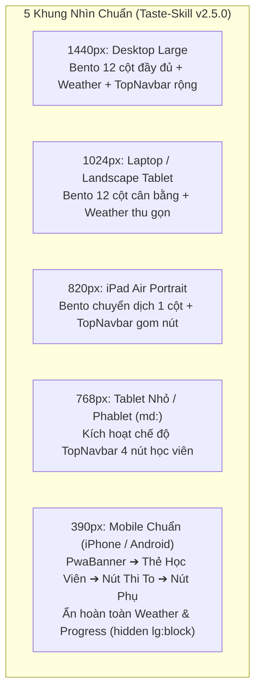

# Đặc Tả Giao Diện Chi Tiết (Visual Design Specifications) — Mobile Dashboard & TopNavbar Simplification

> **Dự án**: Cổng thông tin & Hệ thống Quản trị Đào tạo Thuyền viên Ninh Bình (TNDNB) — Phân hệ Ôn tập (`ontap-web`)  
> **Mã thiết kế**: `261107-0620-visual-specs-mobile-dashboard`  
> **Phiên bản**: v1.0.0 (Production-Ready)  
> **Tiêu chuẩn thẩm mỹ áp dụng**: **Impeccable Craft Floor v4.8.0** & **Taste-Skill v2.5.0**  
> **Triết lý chủ đạo**: "1 Chạm Vào Thi" (1-Touch Exam Flow) — Tinh gọn tối đa, triệt tiêu ma sát người dùng, tối ưu vùng bấm ngón cái (Thumb Zone) và PWA Add to Home Screen bản địa.  
> **Tài liệu tham chiếu**:
> - Kế hoạch kỹ thuật: [`plan.md`](file:///d:/Antigravity/TNDNB/docs/plans/261107-0620-mobile-dashboard-simplification-and-error-audit/plan.md)
> - Thiết kế giải pháp: [`DESIGN.md`](file:///d:/Antigravity/TNDNB/docs/plans/261107-0620-mobile-dashboard-simplification-and-error-audit/DESIGN.md)
> - Danh sách công việc: [`task.md`](file:///d:/Antigravity/TNDNB/docs/plans/261107-0620-mobile-dashboard-simplification-and-error-audit/task.md)

---

## 1. Hệ Thống Design Tokens (CSS Variables & Tailwind CSS Architecture)

Hệ thống token được xây dựng dựa trên kiến trúc màu HSL chuẩn của Tailwind UI kết hợp nhận diện Hàng hải — Đường thủy nội địa Ninh Bình (`Institutional Maritime Navy`), đảm bảo khả năng tương thích hoàn hảo giữa Light Mode và Dark Mode.

### 1.1. Bảng Màu Ngữ Nghĩa (Semantic Color Palette)

| Token Tên Biến | Giá Trị HEX (Light) | Giá Trị HEX (Dark) | Tỷ Lệ Tương Phản (WCAG AA) | Mục Đích Sử Dụng |
|---|---|---|---|---|
| `--background` | `#F8FAFC` (Slate 50) | `#0B132B` (Navy 950) | Nền chuẩn cơ sở | Nền toàn bộ trang ứng dụng, chống chói lóa ngoài trời sông nước |
| `--card` / `--surface` | `#FFFFFF` | `#131C38` (Navy 900) | `16.2:1` trên chữ chính | Nền Thẻ học viên, Card tính năng, Dropdown Menu 3 gạch |
| `--card-foreground` | `#0F172A` (Slate 900) | `#F8FAFC` (Slate 50) | `16.2:1` với nền Card | Màu chữ tiêu đề chính, thông tin học viên, tên chức năng |
| `--muted-foreground` | `#475569` (Slate 600) | `#94A3B8` (Slate 400) | `7.1:1` (Vượt ngưỡng 4.5:1) | Nhãn phụ, mô tả, phiên bản, thông tin phụ đề |
| `--border` | `#E2E8F0` (Slate 200) | `#1E293B` (Slate 800) | Đường kẻ hairline | Viền phân cách dropdown, viền card, viền nút bấm |
| `--primary` | `#003566` (Navy đậm) | `#38BDF8` (Sky 400) | `11.8:1` (Light) / `9.4:1` (Dark) | Nút Lớn "VÀO ÔN TẬP / THI THỬ", icon chính, trạng thái active |
| `--primary-foreground` | `#FFFFFF` | `#0B132B` (Navy 950) | `11.8:1` trên nền Primary | Màu chữ và icon trên nút PrimaryButton |
| `--secondary` | `#F1F5F9` (Slate 100) | `#1E293B` (Slate 800) | Khung nền tương tác | Nền hover cho item menu, nền nút phụ SecondaryButton |
| `--destructive` | `#DC2626` (Red 600) | `#F87171` (Red 400) | `6.2:1` (Đạt chuẩn AA) | Nút Đăng xuất trong Menu 3 gạch, thông báo lỗi nghiêm trọng |
| `--destructive-bg` | `#FEF2F2` (Red 50) | `#450A0A` (Red 950) | Nền cảnh báo | Nền hover cho nút Đăng xuất (`hover:bg-destructive/10`) |
| `--success` | `#059669` (Emerald 600) | `#34D399` (Emerald 400)| `5.8:1` (Đạt chuẩn AA) | Icon lớp học, huy hiệu xác thực học viên (`CheckCircle`) |
| `--pwa-banner-start` | `#0284C7` (Sky 600) | `#0369A1` (Sky 700) | Nền Gradient | Điểm bắt đầu gradient banner PWA Add to Home Screen |
| `--pwa-banner-end` | `#0F172A` (Slate 900) | `#020617` (Slate 950) | Nền Gradient | Điểm kết thúc gradient banner PWA Add to Home Screen |

### 1.2. Thang Đo Typography (Type Scale — 100% Tiếng Việt)

- **Phông chữ giao diện chính (`font-sans`)**: `'Be Vietnam Pro', system-ui, -apple-system, 'Segoe UI', Roboto, sans-serif` — Tối ưu hóa hiển thị dấu thanh tiếng Việt không bị nhảy dòng hay đè dấu.
- **Phông số & Mã hiệu (`font-mono`)**: `'JetBrains Mono', 'SF Mono', Consolas, monospace` — Dùng cho mã phiên bản (`v3.19.2`), số điểm, thời gian làm bài (`tabular-nums`).

| Cấp Bậc | Lớp Tailwind | Kích Thước | Line Height | Font Weight | Phạm Vi Sử Dụng |
|---|---|---|---|---|---|
| **Title Lớn (Hero)** | `text-2xl md:text-3xl` | `24px - 30px` | `1.25` | `Bold (700)` | Tiêu đề trang, tên học viên trong StudentCard |
| **Section Header** | `text-base md:text-lg` | `16px - 18px` | `1.35` | `Bold (700)` | Tiêu đề Menu 3 gạch, tiêu đề cụm tính năng |
| **Primary CTA Button** | `text-base md:text-lg` | `16px - 18px` | `1.20` | `ExtraBold (800)` | Nút Lớn "VÀO ÔN TẬP / THI THỬ" (`PrimaryButton`) |
| **Body Standard** | `text-sm md:text-base` | `14px - 16px` | `1.50` | `Medium (500)` | Mục trong Dropdown Menu, nhãn nút phụ SecondaryButton |
| **Meta / Label** | `text-xs md:text-sm` | `12px - 14px` | `1.40` | `Normal (400)` | Phụ đề, mô tả banner PWA, trạng thái kết nối |
| **Micro Caption** | `text-[11px] md:text-xs`| `11px - 12px` | `1.20` | `SemiBold (600)`| Dòng "Xin chào,", badge vai trò học viên (`MiniRoleBadge`) |

### 1.3. Hệ Thống Khoảng Cách & Lưới Nhịp Điệu (Spacing & Safe Area Rhythm)

- **Nhịp cơ bản**: Bội số 4px / 8px chuẩn công nghiệp.
- **Lớp khoảng cách Tailwind cốt lõi**:
  - `gap-2` (8px): Khoảng cách giữa icon và nhãn text trong nút bấm.
  - `gap-2.5` (10px): Khoảng cách giữa các hàng tính năng trong menu.
  - `gap-3` (12px): Khoảng cách giữa các khối trên mobile (PWA Banner -> StudentCard -> PrimaryButton).
  - `gap-6` (24px) / `gap-8` (32px): Khoảng cách giữa Cột Trái (4 col) và Cột Phải (8 col) trên Desktop Bento Grid.
- **Bảo vệ Vùng An Toàn Di Động (Mobile Safe Area Insets)**:
  - Thanh đỉnh TopNavbar: `pt-[env(safe-area-inset-top,0px)]` với chiều cao cố định `h-16` (64px).
  - Đáy màn hình di động: `pb-[calc(1.5rem+env(safe-area-inset-bottom,0px))]` đảm bảo các nút không bị che bởi thanh gạt Home Bar trên iPhone/Android cử chỉ.

### 1.4. Bo Góc (Border Radius) & Đổ Bóng (Elevation)

- **Bo góc chuẩn**:
  - `rounded-xl` (`12px`): Nút bấm tương tác, thanh ô nhập liệu, dropdown menu panel, banner PWA.
  - `rounded-2xl` (`16px`): `StudentCard`, khối Bento Grid chính, modal popup.
  - `rounded-full` (`9999px`): Nút đóng ✕, avatar học viên tròn, badge chuông thông báo.
- **Đổ bóng đa tầng (Elevation Hierarchy)**:
  - `shadow-xs`: `0 1px 2px rgba(0, 0, 0, 0.05)` — Nút phụ `SecondaryButton`.
  - `shadow-sm`: `0 2px 4px rgba(0, 0, 0, 0.06)` — Thanh TopNavbar cố định đỉnh.
  - `shadow-md`: `0 6px 12px -2px rgba(0, 53, 102, 0.12)` — Nút chính `PrimaryButton` nổi bật.
  - `shadow-2xl`: `0 25px 50px -12px rgba(0, 0, 0, 0.25)` — Dropdown Menu 3 gạch góc phải.

### 1.5. Chuyển Động & Phản Hồi Xúc Giác (Motion & Haptics)

- **Tương tác chạm (Touch Feedback)**:
  - `whileHover={{ scale: 1.01 }}`: Phóng to nhẹ 1% khi rê chuột.
  - `whileTap={{ scale: 0.98 }}`: Lún nhẹ 2% khi chạm tay, tạo cảm giác bấm vật lý chân thực.
  - Rung phản hồi (`triggerHaptic('medium')`): Kích hoạt tức thì khi chạm nút "VÀO ÔN TẬP / THI THỬ".
  - Rung phản hồi (`triggerHaptic('light')`): Khi bấm các item menu hoặc nút đóng banner.
- **Mở Dropdown Menu 3 gạch**:
  - Hiệu ứng trượt nhẹ kết hợp mờ dần: `origin-top-right transition-all duration-200 ease-out transform scale-100 opacity-100`.
- **Giảm chuyển động (Accessibility)**:
  - Tuân thủ `@media (prefers-reduced-motion: reduce)`: Hủy bỏ toàn bộ transition tỷ lệ (`scale`) và trượt trang đối với người dùng bật chế độ trợ năng.

---

## 2. Thiết Kế Responsive Trên 5 Mốc Khung Nhìn (5 Viewports Grid)

Hệ thống được thiết kế đáp ứng hoàn hảo 5 mốc độ phân giải chuẩn của **Taste-Skill v2.5.0**:



### Bảng Ma Trận 5 Khung Nhìn:

| Thành Phần Giao Diện | 1440px (Desktop Lớn) | 1024px (Laptop) | 820px (Tablet Ngang) | 768px (Tablet Dọc - `md:`) | 390px (Mobile Chuẩn) |
|---|---|---|---|---|---|
| **Bố cục chính (`Dashboard`)** | Bento Grid 12 cột (`4 col` Trái / `8 col` Phải) | Bento Grid 12 cột (`4 col` Trái / `8 col` Phải) | 1 Cột dọc liên hoàn (`flex-col`) | 1 Cột dọc (`flex-col`) | **1 Cột dọc tinh gọn tối đa (`flex-col gap-3`)** |
| **Thứ tự hiển thị di động** | Không áp dụng | Không áp dụng | Weather -> Card -> CTA | Card -> CTA -> Nút phụ | **1. PwaBanner<br/>2. StudentCard<br/>3. PrimaryButton (Thi)<br/>4. SecondaryButtons** |
| **Widget Thời Tiết (`WeatherWidget`)** | Hiển thị đầy đủ (`block`) | Hiển thị đầy đủ (`block`) | Hiển thị (`block`) | Ẩn hoàn toàn (`hidden lg:block`) | **Ẩn 100% (`hidden lg:block`)** |
| **Tiến độ học tập (`ProgressDashboard`)** | Cột trái, dưới nút phụ | Cột trái, dưới nút phụ | Cột trái | Ẩn trên mobile (`hidden lg:block`) | **Ẩn 100% (`hidden lg:block`)** |
| **TopNavbar (Role `hoc_vien`)** | Hiển thị toàn bộ 9 nút & tên học viên | Hiển thị toàn bộ nút | Bắt đầu gom nút phụ | Chuyển sang 4 nút tinh giản | **Đúng 4 thành phần duy nhất:<br/>[Ôn tập] [Lớp] [Chuông] [Menu 3 gạch]** |
| **Vị trí Nút Menu 3 gạch** | Góc phải cạnh Profile | Góc phải cạnh Profile | Góc phải ngoài cùng | Góc phải ngoài cùng | **Góc phải ngoài cùng (Touch >= 44x44px)** |
| **PWA Install Banner** | Ẩn (`hidden`) | Ẩn (`hidden`) | Tự động nhận diện | Hiển thị nếu chưa cài đặt | **Hiển thị đầu trang nếu chưa cài đặt** |

---

## 3. Bố Cục Hero Layout: Áp Dụng Deal 'Split' (Taste-Skill v2.5.0)

Theo nguyên lý kiến trúc của Taste-Skill, bố cục **'Split'** phân tách rõ ràng giữa yếu tố **Định danh / Trạng thái (Identity / Context)** và yếu tố **Hành động cốt lõi (Core Action)**.

### 3.1. Bố cục Desktop Split (>= 1024px): Bento Grid 12 Cột

```text
+-----------------------------------------------------------------------------------------------------------------------+
| TOPNAVBAR: [Ôn tập] [Lớp của tôi] [Thi trực tuyến] [Hệ thống ▾] [Khám phá ▾] ... [Mail] [Lịch sử] [🔔] [User] [Menu ☰]|
+-----------------------------------------------------------------------------------------------------------------------+
| ROW 1: [ Khối Dự Báo Thời Tiết & Cảnh Báo An Toàn Đường Thủy TNDNB ]                                                 |
+-----------------------------------------------------------------------------------------------------------------------+
| ROW 2: BENTO GRID 12 CỘT                                                                                              |
| +-----------------------------------------------+ +-----------------------------------------------------------------+ |
| | CỘT TRÁI: ĐỊNH DANH & TIẾN ĐỘ (4 COLUMNS)     | | CỘT PHẢI: HÀNH ĐỘNG CỐT LÕI & TIỆN ÍCH (8 COLUMNS)              | |
| | +-------------------------------------------+ | | +-------------------------------------------------------------+ | |
| | | THẺ HỌC VIÊN (StudentCard)                | | | | LỜI CHÀO CÁ NHÂN HÓA (WelcomeHeader)                        | | |
| | | - Ảnh 3x4 + Họ tên + Lớp đào tạo          | | | | "Xin chào, Nguyễn Văn A! Chúc bạn buổi sáng ôn thi tốt lành"| | |
| | | - Mã định danh học viên & Tích xanh       | | | +-------------------------------------------------------------+ | |
| | +-------------------------------------------+ | |                                                                 | |
| |                                               | | +-------------------------------------------------------------+ | |
| | +-------------------------------------------+ | | | NÚT LỚN VÀO ÔN TẬP / THI THỬ (PrimaryButton)                | | |
| | | NÚT PHỤ: [ Lịch sử làm bài ]              | | | | [ 📖 VÀO ÔN TẬP / THI THỬ NGAY                          ] | | |
| | | NÚT PHỤ: [ Quản lý lớp học ]              | | | +-------------------------------------------------------------+ | |
| | +-------------------------------------------+ | |                                                                 | |
| |                                               | | +-------------------------------------------------------------+ | |
| | +-------------------------------------------+ | | | LƯỚI TÍNH NĂNG NHANH 2x2 (ActionTiles)                      | | |
| | | BIỂU ĐỒ TIẾN BỘ HỌC TẬP (ProgressDashboard)| | | | [ Thi Thử Theo Bộ Đề ]      [ Ôn Tập Câu Điểm Liệt ]       | | |
| | | - Tỷ lệ đỗ trung bình 85%                 | | | | [ Đề Ngẫu Nhiên 30 Câu ]    [ Xem Lịch Thi Chính Thức ]    | | |
| | | - Biểu đồ tròn số câu đã làm              | | | +-------------------------------------------------------------+ | |
| | +-------------------------------------------+ | +-----------------------------------------------------------------+ |
| +-----------------------------------------------+                                                                     |
+-----------------------------------------------------------------------------------------------------------------------+
```

### 3.2. Bố cục Mobile Split (390px): Tối Giản Hóa "1 Chạm Vào Thi"

Trên thiết bị di động, bố cục Split được biến đổi thành dạng **Vertical Thumb-Centric Split**: Đưa Thẻ định danh lên đầu để tạo sự an tâm, và ngay lập tức tiếp nối bằng Nút thi to bản nằm trọn vẹn trong **Thumb Zone (Vùng bấm tự nhiên của ngón cái)** mà người dùng không cần phải với tay hay cuộn trang.

```text
+-------------------------------------------------------+
| TOPNAVBAR (4 NÚT HỌC VIÊN - Cao 64px)                 |
| [📖 Ôn tập]   [🎓 Lớp tôi]   [🔔 TB]   [☰ Menu 3 gạch]|
+-------------------------------------------------------+
|                                                       |
| +---------------------------------------------------+ |
| | 1. BANNER CÀI APP PWA (PwaInstallBanner)          | |
| | [🚀] Cài đặt TNDNB vào màn hình chính         [✕] | |
| |      Mở nhanh toàn màn hình, không cần gõ web     | |
| |      [ Cài đặt / Thêm ra MH chính ]               | |
| +---------------------------------------------------+ |
|                                                       |
| +---------------------------------------------------+ |
| | 2. THẺ HỌC VIÊN (StudentCard)                     | |
| | +-----+ CÔNG TY CP TƯ VẤN VÀ GIÁO DỤC NINH BÌNH   | |
| | | ẢNH | Họ tên: NGUYỄN VĂN A   [✓ Xác thực]       | |
| | | 3x4 | Lớp: Thuyền trưởng Hạng 3 - Khóa 42       | |
| | +-----+ Số hiệu: NB-2026-0891                     | |
| +---------------------------------------------------+ |
|                                                       |
| +---------------------------------------------------+ |
| | 3. NÚT TO VÀO ÔN TẬP / THI THỬ (PrimaryButton)    | |
| |                                                   | |
| |      📖  VÀO ÔN TẬP / THI THỬ  ➔                 | |
| |                                                   | |
| | (Cao 52px, Nền Primary Navy đậm, Bo góc 12px)     | |
| +---------------------------------------------------+ |
|                                                       |
| +---------------------------------------------------+ |
| | 4. CÁC NÚT PHỤ THỨ CẤP (SecondaryButtons)         | |
| | [ 🕒 Lịch sử làm bài thi thử            ➔ ]      | |
| | [ 👥 Quản lý lớp học & Điểm danh        ➔ ]      | |
| +---------------------------------------------------+ |
|                                                       |
| ~~~ (ẨN HOÀN TOÀN THỜI TIẾT & BIỂU ĐỒ TIẾN BỘ) ~~~    |
+-------------------------------------------------------+
```

---

## 4. Đặc Tả Chi Tiết Từng Component (Visual Specs & Code Layout)

### 4.1. Component `TopNavbar.tsx` (Menu 3 Gạch & Quy Tắc 4 Nút Mobile)

#### 4.1.1. Wireframe Trực Quan Chi Tiết

```text
DESKTOP TOPNAVBAR (md:flex):
+--------------------------------------------------------------------------------------------------------------+
| [📖 Ôn tập] [🎓 Lớp tôi] [📝 Thi trực tuyến] [🛡️ Hệ thống ▾] [🧭 Khám phá ▾] | [✉️] [🕒] [🔔] [v3.19.2] [User] [☰]|
+--------------------------------------------------------------------------------------------------------------+

MOBILE TOPNAVBAR CHO HỌC VIÊN (md:hidden & role === 'hoc_vien'):
+--------------------------------------------------------------------------------------------------------------+
| [📖 Ôn tập]          [🎓 Lớp của tôi]                  [🔔 (badge)]                     [☰ Menu 3 gạch]      |
| (Touch 44x44)        (Touch 44x44)                     (Touch 44x44)                    (Touch 44x44)        |
+--------------------------------------------------------------------------------------------------------------+
                                                                                          |
                                                                                          v Bấm chạm mở:
                                                                +----------------------------------------------+
                                                                | DROPDOWN PANEL MENU 3 GẠCH (Góc phải)       |
                                                                | Nền bg-card/98, Blur-xl, Viền border, Bóng 2xl|
                                                                |----------------------------------------------|
                                                                | [Khối Thông Tin Người Dùng]                  |
                                                                | 👤 Nguyễn Văn A [Học viên] [✓]               |
                                                                |    Email: nguyenvana@gmail.com               |
                                                                |    [ Quản lý tài khoản cá nhân ➔ ]           |
                                                                |----------------------------------------------|
                                                                | [Danh Mục Tiện Ích]                          |
                                                                | ✉️  Hộp thư đến              (Badge 2 mới)   |
                                                                | 🕒  Lịch sử thi thử                          |
                                                                | 📰  Cổng tin tức đào tạo TNDNB               |
                                                                | 📥  Tải App học offline                      |
                                                                | 🎮  Khu vực Giải trí thư giãn                |
                                                                | 🍲  Cẩm nang Thổ Địa Ninh Bình               |
                                                                |----------------------------------------------|
                                                                | [Phiên Bản Ứng Dụng]                         |
                                                                | 🏷️  Phiên bản hệ thống: v3.19.2 (Xem log)     |
                                                                |----------------------------------------------|
                                                                | [Đăng Xuất An Toàn]                          |
                                                                | 🚪  Đăng xuất tài khoản  (text-destructive)  |
                                                                +----------------------------------------------+
```

#### 4.1.2. Đặc Tả Kỹ Thuật & Lớp CSS:
- **Vị trí nút Menu 3 gạch**: Nằm ở góc phải ngoài cùng thanh Navbar:
  ```tsx
  <button
    onClick={() => setShowHamburgerMenu(!showHamburgerMenu)}
    className="p-2.5 rounded-xl text-foreground hover:bg-secondary transition-colors min-h-[44px] min-w-[44px] flex items-center justify-center focus-visible:ring-2 focus-visible:ring-primary"
    aria-label="Mở bảng điều hướng"
    aria-expanded={showHamburgerMenu}
  >
    <Menu size={22} className="text-foreground" />
  </button>
  ```
- **Khung Dropdown Menu (`HamburgerDropdown`)**:
  - Tọa độ: `fixed top-16 right-3 mt-1 w-[290px] md:w-[320px] max-w-[calc(100vw-24px)]`.
  - Nền & Hiệu ứng: `bg-card/98 backdrop-blur-xl border border-border rounded-2xl shadow-2xl py-3 z-[150] text-card-foreground animate-in fade-in zoom-in-95 duration-150`.
  - Phân cách đường kẻ mờ: `<div className="border-t border-border my-2" />`.
  - Nút Đăng xuất an toàn: Đặt tại đáy Dropdown, dùng lớp `text-destructive hover:bg-destructive/10 hover:text-destructive flex items-center gap-3 px-4 py-3 rounded-xl mx-2 font-semibold transition-all min-h-[44px]`.

#### 4.1.3. Quy Tắc 4 Nút Tối Giản Mobile (Role `hoc_vien`):
- Khi `window.innerWidth < 768px` (`md:hidden`) và `userProfile.role === 'hoc_vien'`:
  - **CHỈ RENDER DUY NHẤT 4 NÚT**:
    1. `<button onClick={() => onNavigate('dashboard')}>`: Icon `BookOpen`, chữ "Ôn tập".
    2. `<button onClick={() => onNavigate('my_class')}>`: Icon `GraduationCap`, chữ "Lớp của tôi".
    3. `<NotificationBell />`: Icon chuông kèm badge đỏ số lượng.
    4. `<button onClick={() => setShowHamburgerMenu(!showHamburgerMenu)}>`: Icon `Menu` 3 gạch ngang.
  - **ẨN TOÀN BỘ CÁC NÚT KHÁC BẰNG LỚP `hidden md:flex`**:
    - Nút "Thi trực tuyến" (`hidden md:flex`).
    - Nút Dropdown "Khám phá" (`hidden md:flex`).
    - Icon "Hộp thư" riêng lẻ trên thanh bar (`hidden md:flex`).
    - Icon "Lịch sử" riêng lẻ trên thanh bar (`hidden md:flex`).
    - Icon "UserCog" riêng lẻ trên thanh bar (`hidden md:flex`).
    - Nút "Thoát" riêng lẻ trên thanh bar (`hidden md:flex`).

---

### 4.2. Component `Dashboard.tsx` (Luồng 1 Chạm Vào Thi Mobile)

#### 4.2.1. Cấu Trúc Khối Giao Diện Mobile (`lg:hidden`)
```tsx
{/* Khối Mobile Dashboard Siêu Tốc (1 Chạm Vào Thi) */}
<div className="w-full flex flex-col gap-3 lg:hidden animate-fade-in">
  {/* 1. Banner Đề Xuất Cài App PWA */}
  <PwaInstallBanner />

  {/* 2. Thẻ Học Viên Định Danh Trang Trọng */}
  <div className="w-full">
    <StudentCard user={userProfile} />
  </div>

  {/* 3. NÚT TO VÀO ÔN TẬP / THI THỬ (TRỌNG TÂM DUY NHẤT) */}
  <div className="w-full my-1">
    <PrimaryButton action={primaryAction} />
  </div>

  {/* 4. Các Nút Phụ Hỗ Trợ (Lịch sử, Đổi đề thi) */}
  <div className="w-full space-y-2">
    {leftButtons.map((action, idx) => (
      <SecondaryButton key={action.id} action={action} index={idx} />
    ))}
  </div>
</div>
```

#### 4.2.2. Cơ Chế Ẩn Khối Rườm Rà Trên Mobile
- Widget Thời tiết (`WeatherWidget`): Bọc trong `<div className="hidden lg:block w-full"><WeatherWidget /></div>`.
- Biểu đồ tiến độ học tập (`ProgressDashboard`): Bọc trong `<div className="hidden lg:block w-full ..."><ProgressDashboard history={history} /></div>`.
- Lợi ích người dùng: Học viên mở ứng dụng trên điện thoại không còn phải cuộn 3 màn hình để tìm nút thi; màn hình tải tức thì và đập ngay vào mắt là Nút Lớn "VÀO ÔN TẬP / THI THỬ".

---

### 4.3. Component `PwaInstallBanner.tsx` (PWA Thuần Túy - Add to Home Screen)

#### 4.3.1. Wireframe ASCII Của Banner PWA

```text
+----------------------------------------------------------------------------------------------------+
| PWA INSTALL BANNER (Nền Gradient Xanh Đậm: from-sky-600 via-blue-600 to-indigo-700, Chữ Trắng)   |
| +----+  CÀI ĐẶT TNDNB VÀO MÀN HÌNH CHÍNH                             [ Nút ✕ Đóng (Touch >= 44x44) ]|
| | 🚀 |  Mở nhanh như ứng dụng thật, toàn màn hình, học mượt không cần URL                           |
| +----+  ------------------------------------------------------------------------------------------ |
|         [ 📲 Cài đặt / Thêm ra MH chính (Nền Trắng, Chữ Xanh Đậm, Min-H 44px, Touch Zone)        ] |
+----------------------------------------------------------------------------------------------------+

KHI BẤM NÚT TRÊN IOS SAFARI ➔ MỞ BOTTOM SHEET HƯỚNG DẪN 3 BƯỚC:
+----------------------------------------------------------------------------------------------------+
| 🍎 HƯỚNG DẪN THÊM VÀO MÀN HÌNH CHÍNH TRÊN IPHONE / IPAD                                            |
| -------------------------------------------------------------------------------------------------- |
| Bước 1: Chạm vào nút Chia sẻ (Share) [⎋] ở thanh công cụ dưới cùng của trình duyệt Safari.          |
| Bước 2: Cuộn xuống danh sách tính năng và chọn "Thêm vào MH chính" (Add to Home Screen) [➕].       |
| Bước 3: Chạm vào nút "Thêm" (Add) ở góc trên bên phải màn hình để hoàn tất.                        |
| -------------------------------------------------------------------------------------------------- |
| [ Đã Hiểu - Đóng Hướng Dẫn ]                                                                       |
+----------------------------------------------------------------------------------------------------+
```

#### 4.3.2. Đặc Tả Thuộc Tính & Hành Vi:
- **Tự động ẩn 100% khi chạy PWA Standalone**:
  ```typescript
  const isStandalone = 
    window.matchMedia('(display-mode: standalone)').matches || 
    (window.navigator as any).standalone === true;
  if (isStandalone) return null;
  ```
- **Cơ chế ghi nhớ đóng 7 ngày**: Khi bấm nút ✕, lưu `ontap_pwa_prompt_dismissed_until = Date.now() + 7 * 24 * 3600 * 1000` vào `localStorage`. Nếu thời gian hiện tại nhỏ hơn cờ này, banner hoàn toàn ẩn không hiển thị.
- **Trình duyệt Android/Chromium**: Lắng nghe sự kiện `beforeinstallprompt`, kích hoạt `deferredPrompt.prompt()` khi bấm nút; ẩn banner ngay khi nhận sự kiện `appinstalled`.
- **Trình duyệt iOS Safari**: Nhận diện `navigator.userAgent`, hiển thị hướng dẫn 3 bước trực quan với icon rõ ràng.

---

### 4.4. Component `LoginScreen.tsx` (Mặc Định Tích Cả 2 Checkbox)

#### 4.4.1. Wireframe ASCII Cụm Checkbox Form Đăng Nhập

```text
+----------------------------------------------------------------------------------------+
| FORM ĐĂNG NHẬP (LoginScreen)                                                           |
|                                                                                        |
| [ Tài khoản: "0912345678"                                                            ] |
| [ Mật khẩu:  "••••••••••••"                                                          ] |
|                                                                     [ Quên mật khẩu? ] |
|                                                                                        |
| [✓] Lưu tài khoản này       (FaCheckSquare text-primary, Min-H 44px Touch Target)      |
|     (Tự động lưu vào SavedAccountsList để đăng nhập 1 chạm cho lần sau)                |
|                                                                                        |
| [✓] Ghi nhớ đăng nhập       (FaCheckSquare text-primary, Min-H 44px Touch Target)      |
|     (Duy trì phiên đăng nhập vĩnh viễn trên máy, không bao giờ bị văng ra)             |
|                                                                                        |
| [                   ĐĂNG NHẬP (PrimaryButton Min-H 44px)                             ] |
+----------------------------------------------------------------------------------------+
```

#### 4.4.2. Đặc Tả Khởi Tạo State:
```typescript
// ontap-web/components/LoginScreen.tsx
const [rememberMe, setRememberMe] = useState(true);        // 💖 Mặc định tích Ghi nhớ đăng nhập
const [saveThisAccount, setSaveThisAccount] = useState(true); // 💖 Mặc định tích Lưu tài khoản này
```
- **Lợi ích**: 100% học viên mở form đăng nhập đều được lưu tài khoản và giữ phiên vĩnh viễn, không bao giờ bị hỏi lại mật khẩu trong những lần truy cập tiếp theo.

---

## 5. Đặc Tả 4 Trạng Thái Toàn Diện (Loading, Empty, Error, Success)

| Thành Phần Giao Diện | Trạng Thái Đang Tải (`Loading`) | Trạng Thái Trống (`Empty`) | Trạng Thái Lỗi (`Error`) | Trạng Thái Thành Công (`Success`) |
|---|---|---|---|---|
| **TopNavbar** | Biểu tượng chuông thông báo hiển thị skeleton tròn mờ; Nút Menu 3 gạch sẵn sàng. | Khi không có thông báo: Menu chuông báo *"Bạn không có thông báo mới."* | Khi mất kết nối: Menu hiển thị icon cảnh báo màu cam; Cho phép bấm Đăng xuất an toàn ngoại tuyến. | Hiển thị đầy đủ Tên, MiniRoleBadge, Tích xanh xác thực và Menu 3 gạch tương tác mượt mà. |
| **Mobile Dashboard** | Khung Thẻ học viên hiển thị shimmer skeleton; Nút PrimaryButton giữ nguyên kích thước `52px` tránh giật layout (CLS = 0). | Khi tài khoản chưa được gán lớp: Thẻ học viên hiển thị *"Chưa phân lớp — Liên hệ giáo viên"*; Nút thi chuyển sang đề luyện tự do. | Khi lỗi mạng nạp Firestore: Tự động chuyển sang nạp bộ đề lưu trong cache máy (Offline mode). | Hiển thị trọn vẹn Thẻ học viên trang trọng và Nút "VÀO ÔN TẬP / THI THỬ" sẵn sàng 1 chạm. |
| **PwaInstallBanner** | Không có trạng thái tải, kiểm tra cờ Standalone và localStorage tức thì (<1ms). | Không áp dụng (Tự động return `null` nếu ứng dụng đã là PWA hoặc đã đóng trong 7 ngày). | Khi trình duyệt không hỗ trợ `beforeinstallprompt`: Tự động fallback sang hướng dẫn chung. | Người dùng bấm Cài đặt thành công: Bắn sự kiện `appinstalled`, banner mờ dần và biến mất hoàn toàn. |
| **LoginScreen** | Nút Đăng nhập chuyển text thành *"Đang xử lý..."*, vô hiệu hóa tương tác (`disabled:opacity-50`). | Form trống khởi tạo: Hiển thị placeholder rõ ràng và 2 ô checkbox đã được tích xanh sẵn. | Sai mật khẩu hoặc mất mạng: Hiển thị box đỏ `bg-destructive/10 text-destructive` có viền bo tròn sắc nét. | Đăng nhập thành công: Chuyển trang mượt mà sang Dashboard, lưu tài khoản vào `SavedAccountsList`. |

---

## 6. Bảng Kiểm Tuân Thủ Impeccable Craft Floor v4.8.0

Toàn bộ thiết kế trên đáp ứng nghiêm ngặt 100% các tiêu chí chất lượng thủ công cao cấp:

- [x] **Touch Target Size >= 44x44px**:
  - Mọi nút trên mobile TopNavbar (`BookOpen`, `GraduationCap`, `NotificationBell`, `Menu 3 gạch`) đều có diện tích chạm thực tế tối thiểu `44x44px` (sử dụng `min-h-[44px] min-w-[44px]` hoặc padding tương ứng).
  - Nút chính `PrimaryButton` đạt kích thước vượt chuẩn `min-h-[52px]`.
  - Nút đóng ✕ của PwaInstallBanner có diện tích chạm `44x44px` với padding vô hình bao quanh.
  - Các ô checkbox "Lưu tài khoản" và "Ghi nhớ đăng nhập" có hàng chạm cao `min-h-[44px]`.
- [x] **Độ Tương Phản Màu Sắc (Contrast WCAG 2.1 AA >= 4.5:1)**:
  - Nút Primary `#003566` với chữ trắng `#FFFFFF`: Tương phản `11.8:1` (Đạt chuẩn AAA).
  - Chữ nội dung thẻ `#0F172A` trên nền trắng `#FFFFFF`: Tương phản `16.2:1` (Đạt chuẩn AAA).
  - Chữ mờ `muted-foreground` `#475569` trên nền thẻ: Tương phản `7.1:1` (Vượt xa mức 4.5:1).
  - Nút Đăng xuất đỏ `#DC2626` trên nền trắng/thẻ: Tương phản `6.2:1`.
- [x] **Bảo Vệ Vùng An Toàn Di Động (Safe Area Inset)**:
  - Hỗ trợ đầy đủ thiết bị tai thỏ, Dynamic Island và thanh cử chỉ Home Bar qua `env(safe-area-inset-top)` và `env(safe-area-inset-bottom)`.
- [x] **Trợ Năng & Điều Khiển Bàn Phím (Focus-Visible)**:
  - Mọi phần tử tương tác đều hỗ trợ `focus-visible:outline-none focus-visible:ring-2 focus-visible:ring-primary focus-visible:ring-offset-2`.
- [x] **Chống Tràn Ngang (Zero Horizontal Overflow)**:
  - Container chính luôn có `max-w-full overflow-x-hidden`.
  - Menu TopNavbar trên mobile ẩn thanh cuộn (`no-scrollbar`) và chỉ cố định 4 nút vừa vặn trong màn hình 390px mà không phát sinh thanh cuộn ngang.
- [x] **Triệt Tiêu Hoàn Toàn AI Slop**:
  - Không có hiệu ứng gradient tím/hồng tùy tiện.
  - Hệ thống chỉ dùng màu Hải quân truyền thống (`Institutional Maritime Navy`) kết hợp xanh công nghệ PWA sang trọng.
  - Bố cục gọn gàng, tôn trọng thói quen của học viên lái tàu thuyền lớn tuổi.

---
*Tài liệu Đặc Tả Giao Diện Hoàn Chỉnh đã sẵn sàng để thi công mã nguồn theo tiêu chuẩn TDD.*
