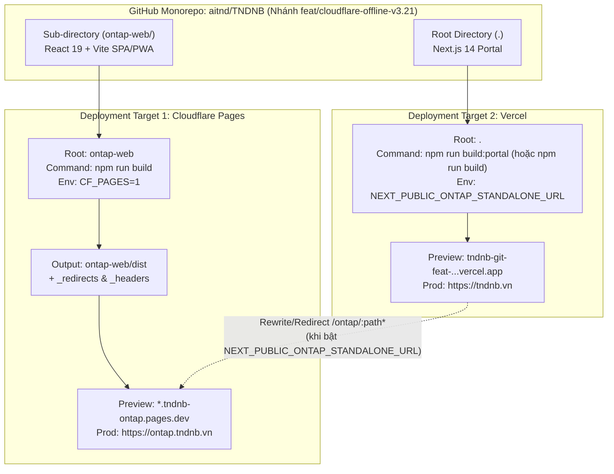

# Phase 00: Khởi Tạo Nhánh Git Preview & Kiến Trúc "Tách Deployment — Giữ Monorepo" (`ontap-web` Cloudflare Pages + Vercel Root Portal)

Status: Pending
Dependencies: None (Foundation Phase)

> **Thuộc kế hoạch:** [plan.md](file:///d:/Antigravity/TNDNB/docs/plans/261104-0856-cloudflare-r2-d1-offline-upgrade/plan.md)  
> **Mục tiêu:**
> 1. Thiết lập nhánh Git Preview độc lập (`feat/cloudflare-offline-v3.21`) để toàn bộ quá trình nâng cấp chạy trên **Vercel Preview** & **Cloudflare Pages Preview (`*.pages.dev`)**, giữ hệ thống Production (`main`) chạy ổn định 100% (Zero-Downtime).
> 2. Tách quá trình build & deployment của `ontap-web` (SPA/PWA) sang **Cloudflare Pages** (hưởng băng thông Unmetered 100% miễn phí, cùng mạng Edge với D1 & R2) và giữ **Root Portal (Next.js 14)** trên **Vercel**, nhưng quản lý chung trong 1 **Monorepo (`aitnd/TNDNB`)**.

---

## 1. Phân Tích Kỹ Thuật Hiện Trạng & Giải Pháp Tách Deployment Trong Monorepo

### 1.1. Các điểm phụ thuộc `/ontap/` hiện tại trong codebase
Qua khảo sát thực tế các file cấu hình:
1. **[package.json](file:///d:/Antigravity/TNDNB/package.json#L7) (Root Portal):**
   - Đang chạy lệnh build lồng nhau: `"build": "cd ontap-web && npm install && npm run build && cd .. && next build"`.
2. **[ontap-web/vite.config.ts](file:///d:/Antigravity/TNDNB/ontap-web/vite.config.ts#L27-L30):**
   - Đang khóa cứng `base: '/ontap/'` và `build.outDir: '../public/ontap'`.
3. **[ontap-web/App.tsx](file:///d:/Antigravity/TNDNB/ontap-web/App.tsx#L28-L30), [ontap-web/index.html](file:///d:/Antigravity/TNDNB/ontap-web/index.html#L6-L7) & [ontap-web/routes/AppRoutes.tsx](file:///d:/Antigravity/TNDNB/ontap-web/routes/AppRoutes.tsx#L114-L144):**
   - Đăng ký Service Worker tại `/ontap/sw-pwa.js`, manifest tại `/ontap/manifest.json`, và toàn bộ `<Route path="/ontap/..." />` (hơn 30 routes).
4. **[next.config.mjs](file:///d:/Antigravity/TNDNB/next.config.mjs#L30-L41):**
   - Đang rewrite `/ontap/:path*` về file tĩnh nội bộ `/ontap/index.html`.

### 1.2. Kiến trúc Dual-Target Deployment (Tương thích cả Cloudflare Pages Standalone & Vercel Embedded)



---

## Implementation Steps (TDD Enriched)

### Task 0.1: Khởi tạo nhánh `feat/cloudflare-offline-v3.21` & Module Cấu hình Dual-Target (`ontap-web/utils/deployConfig.ts`)

- **Files:**
  - Create: [d:/Antigravity/TNDNB/ontap-web/utils/deployConfig.ts](file:///d:/Antigravity/TNDNB/ontap-web/utils/deployConfig.ts)
  - Modify: [d:/Antigravity/TNDNB/ontap-web/vite.config.ts](file:///d:/Antigravity/TNDNB/ontap-web/vite.config.ts)
  - Modify: [d:/Antigravity/TNDNB/ontap-web/App.tsx](file:///d:/Antigravity/TNDNB/ontap-web/App.tsx)
  - Create: [d:/Antigravity/TNDNB/ontap-web/public/_redirects](file:///d:/Antigravity/TNDNB/ontap-web/public/_redirects)
  - Create: [d:/Antigravity/TNDNB/ontap-web/public/_headers](file:///d:/Antigravity/TNDNB/ontap-web/public/_headers)
  - Test: [d:/Antigravity/TNDNB/ontap-web/utils/__tests__/deployConfig.test.ts](file:///d:/Antigravity/TNDNB/ontap-web/utils/__tests__/deployConfig.test.ts)
- **Interfaces:**
  - Consumes: Biến môi trường build/runtime (`CF_PAGES`, `VITE_DEPLOY_TARGET`)
  - Produces:
    - `export interface DeployTargetConfig { target: 'cloudflare_pages' | 'vercel_embedded'; viteBase: string; outDir: string; serviceWorkerUrl: string; }`
    - `export function resolveDeployTargetConfig(env?: Record<string, string | undefined>): DeployTargetConfig`

#### Step 0.1.1: Viết test thất bại (RED)
Tạo file [d:/Antigravity/TNDNB/ontap-web/utils/__tests__/deployConfig.test.ts](file:///d:/Antigravity/TNDNB/ontap-web/utils/__tests__/deployConfig.test.ts):

```typescript
import { describe, it, expect } from 'vitest';
import fs from 'node:fs';
import path from 'node:path';
import { resolveDeployTargetConfig } from '../deployConfig';

describe('Monorepo Dual-Target Deployment Config (ontap-web)', () => {
  it('trả về cấu hình Cloudflare Pages Standalone (base="/", outDir="dist") khi CF_PAGES="1" hoặc VITE_DEPLOY_TARGET="cloudflare"', () => {
    const cfConfig = resolveDeployTargetConfig({ CF_PAGES: '1' });
    expect(cfConfig).toEqual({
      target: 'cloudflare_pages',
      viteBase: '/',
      outDir: 'dist',
      serviceWorkerUrl: '/sw-pwa.js'
    });

    const explicitCf = resolveDeployTargetConfig({ VITE_DEPLOY_TARGET: 'cloudflare' });
    expect(explicitCf.target).toBe('cloudflare_pages');
    expect(explicitCf.outDir).toBe('dist');
  });

  it('trả về cấu hình Vercel Embedded mặc định (base="/ontap/", outDir="../public/ontap") khi không có cờ CF_PAGES', () => {
    const vercelConfig = resolveDeployTargetConfig({});
    expect(vercelConfig).toEqual({
      target: 'vercel_embedded',
      viteBase: '/ontap/',
      outDir: '../public/ontap',
      serviceWorkerUrl: '/ontap/sw-pwa.js'
    });
  });

  it('file public/_redirects và public/_headers tồn tại và ánh xạ đầy đủ /ontap/* + SPA fallback cho Cloudflare Pages', () => {
    const redirectsPath = path.resolve(process.cwd(), 'public/_redirects');
    const headersPath = path.resolve(process.cwd(), 'public/_headers');

    expect(fs.existsSync(redirectsPath)).toBe(true);
    expect(fs.existsSync(headersPath)).toBe(true);

    const redirectsContent = fs.readFileSync(redirectsPath, 'utf8');
    expect(redirectsContent).toContain('/ontap/sw-pwa.js /sw-pwa.js 200');
    expect(redirectsContent).toContain('/ontap/manifest.json /manifest.json 200');
    expect(redirectsContent).toContain('/* /index.html 200');

    const headersContent = fs.readFileSync(headersPath, 'utf8');
    expect(headersContent).toContain('Service-Worker-Allowed: /');
  });
});
```

#### Step 0.1.2: Chạy test — xác nhận FAIL
```powershell
npx --prefix ontap-web vitest run utils/__tests__/deployConfig.test.ts
```
Expected output:
```text
FAIL  utils/__tests__/deployConfig.test.ts
Error: Failed to resolve import "../deployConfig" from "utils/__tests__/deployConfig.test.ts".
```

#### Step 0.1.3: Implement tối thiểu (GREEN)
1. Tạo [d:/Antigravity/TNDNB/ontap-web/utils/deployConfig.ts](file:///d:/Antigravity/TNDNB/ontap-web/utils/deployConfig.ts):
```typescript
export interface DeployTargetConfig {
  target: 'cloudflare_pages' | 'vercel_embedded';
  viteBase: string;
  outDir: string;
  serviceWorkerUrl: string;
}

export function resolveDeployTargetConfig(
  env: Record<string, string | undefined> = {}
): DeployTargetConfig {
  const isCloudflarePages =
    env.CF_PAGES === '1' ||
    env.CF_PAGES === 'true' ||
    env.VITE_DEPLOY_TARGET === 'cloudflare';

  if (isCloudflarePages) {
    return {
      target: 'cloudflare_pages',
      viteBase: '/',
      outDir: 'dist',
      serviceWorkerUrl: '/sw-pwa.js'
    };
  }

  return {
    target: 'vercel_embedded',
    viteBase: '/ontap/',
    outDir: '../public/ontap',
    serviceWorkerUrl: '/ontap/sw-pwa.js'
  };
}

export function getRuntimeServiceWorkerUrl(): string {
  const metaEnv = (import.meta as any).env || {};
  if (
    metaEnv.VITE_DEPLOY_TARGET === 'cloudflare' ||
    metaEnv.BASE_URL === '/'
  ) {
    return '/sw-pwa.js';
  }
  return '/ontap/sw-pwa.js';
}
```

2. Tạo [d:/Antigravity/TNDNB/ontap-web/public/_redirects](file:///d:/Antigravity/TNDNB/ontap-web/public/_redirects) (phục vụ Cloudflare Pages SPA routing & tương thích tuyệt đối với các đường dẫn tĩnh `/ontap/*` trong `index.html`, `manifest.json` và `AppRoutes.tsx`):
```text
/ontap/sw-pwa.js /sw-pwa.js 200
/ontap/sw.js /sw.js 200
/ontap/manifest.json /manifest.json 200
/ontap/icon-192.png /icon-192.png 200
/ontap/icon-512.png /icon-512.png 200
/ontap/assets/* /assets/:splat 200
/* /index.html 200
```

3. Tạo [d:/Antigravity/TNDNB/ontap-web/public/_headers](file:///d:/Antigravity/TNDNB/ontap-web/public/_headers) (cấu hình Cache-Control & Service-Worker-Allowed cho Cloudflare Pages):
```text
/sw-pwa.js
  Cache-Control: no-cache, no-store, must-revalidate
  Service-Worker-Allowed: /

/ontap/sw-pwa.js
  Cache-Control: no-cache, no-store, must-revalidate
  Service-Worker-Allowed: /

/assets/*
  Cache-Control: public, max-age=31536000, immutable
```

4. Cập nhật [d:/Antigravity/TNDNB/ontap-web/vite.config.ts](file:///d:/Antigravity/TNDNB/ontap-web/vite.config.ts) sử dụng `resolveDeployTargetConfig(process.env as any)`:
```typescript
import path from 'path';
import { defineConfig } from 'vite';
import react from '@vitejs/plugin-react';
import tailwindcss from '@tailwindcss/vite';
import { resolveDeployTargetConfig } from './utils/deployConfig';

export default defineConfig(() => {
  const deployCfg = resolveDeployTargetConfig(process.env as Record<string, string | undefined>);

  return {
    server: {
      port: 3000,
      host: '0.0.0.0',
      proxy: {
        '/api': {
          target: 'http://localhost:3001',
          changeOrigin: true,
        },
      },
    },
    plugins: [react(), tailwindcss()],
    define: {
      '__APP_VERSION__': JSON.stringify(process.env.npm_package_version)
    },
    resolve: {
      alias: {
        '@': path.resolve(process.cwd(), '.'),
      }
    },
    base: deployCfg.viteBase,
    build: {
      outDir: deployCfg.outDir,
      emptyOutDir: true,
      rollupOptions: {
        output: {
          manualChunks(id) {
            if (id.includes('node_modules')) {
              if (id.includes('firebase')) return 'vendor-firebase';
              if (id.includes('recharts')) return 'vendor-recharts';
              if (id.includes('lucide-react')) return 'vendor-icons';
              if (id.includes('xlsx') || id.includes('sheetjs') || id.includes('@sheetjs')) return 'vendor-xlsx';
              return 'vendor';
            }
          }
        }
      }
    },
  };
});
```

5. Cập nhật đăng ký Service Worker tại [d:/Antigravity/TNDNB/ontap-web/App.tsx](file:///d:/Antigravity/TNDNB/ontap-web/App.tsx#L27-L31) sử dụng `getRuntimeServiceWorkerUrl()` từ `./utils/deployConfig`.

#### Step 0.1.4: Chạy test — xác nhận PASS
```powershell
npx --prefix ontap-web vitest run utils/__tests__/deployConfig.test.ts
```
Expected output:
```text
 ✓ utils/__tests__/deployConfig.test.ts (3 tests) 5ms
 Test Files  1 passed (1)
      Tests  3 passed (3)
```

#### Step 0.1.5: Kiểm tra / Chuẩn bị stage
```powershell
git status -s ontap-web/
```

---

### Task 0.2: Cấu hình Tách Build & Routing `/ontap` Linh hoạt Trên Root Portal (`package.json` & `next.config.mjs`)

- **Files:**
  - Modify: [d:/Antigravity/TNDNB/package.json](file:///d:/Antigravity/TNDNB/package.json)
  - Modify: [d:/Antigravity/TNDNB/next.config.mjs](file:///d:/Antigravity/TNDNB/next.config.mjs)
  - Test: [d:/Antigravity/TNDNB/scripts/monorepo-routing.test.ts](file:///d:/Antigravity/TNDNB/scripts/monorepo-routing.test.ts)
- **Interfaces:**
  - Consumes: `process.env.NEXT_PUBLIC_ONTAP_STANDALONE_URL` (Ví dụ: `https://ontap.tndnb.vn` hoặc để trống khi chạy embedded)
  - Produces:
    - Trong `next.config.mjs`: Hàm `rewrites()` tự động trỏ `/ontap/:path*` sang `${NEXT_PUBLIC_ONTAP_STANDALONE_URL}/ontap/:path*` nếu đã tách hẳn sang Cloudflare Pages, hoặc giữ nguyên `/ontap/index.html` nếu chưa bật biến môi trường.
    - Trong `package.json`: Bổ sung `"build:portal": "next build"` và `"build:ontap:cf": "cd ontap-web && cross-env CF_PAGES=1 npm run build"`.

#### Step 0.2.1: Viết test thất bại (RED)
Tạo file [d:/Antigravity/TNDNB/scripts/monorepo-routing.test.ts](file:///d:/Antigravity/TNDNB/scripts/monorepo-routing.test.ts):

```typescript
import { describe, it, expect } from 'vitest';
import fs from 'node:fs';
import path from 'node:path';
import nextConfig from '../next.config.mjs';

describe('Root Portal Monorepo Split-Deployment Config', () => {
  it('root package.json có script build:portal độc lập cho Vercel và build:ontap:cf cho Cloudflare Pages', () => {
    const pkgPath = path.resolve(process.cwd(), 'package.json');
    const pkg = JSON.parse(fs.readFileSync(pkgPath, 'utf8'));
    expect(pkg.scripts['build:portal']).toBe('next build');
    expect(pkg.scripts['build:ontap:cf']).toContain('CF_PAGES=1');
  });

  it('next.config.mjs trả về destination /ontap/index.html khi chưa đặt NEXT_PUBLIC_ONTAP_STANDALONE_URL', async () => {
    delete process.env.NEXT_PUBLIC_ONTAP_STANDALONE_URL;
    const rules = await nextConfig.rewrites!();
    const ontapRule = (rules as any[]).find((r) => r.source === '/ontap/:path*');
    expect(ontapRule.destination).toBe('/ontap/index.html');
  });

  it('next.config.mjs tự động proxy/rewrite sang Cloudflare Pages domain khi đặt NEXT_PUBLIC_ONTAP_STANDALONE_URL', async () => {
    process.env.NEXT_PUBLIC_ONTAP_STANDALONE_URL = 'https://ontap.tndnb.vn/';
    const rules = await nextConfig.rewrites!();
    const ontapRule = (rules as any[]).find((r) => r.source === '/ontap/:path*');
    expect(ontapRule.destination).toBe('https://ontap.tndnb.vn/ontap/:path*');
    delete process.env.NEXT_PUBLIC_ONTAP_STANDALONE_URL;
  });
});
```

#### Step 0.2.2: Chạy test — xác nhận FAIL
```powershell
npx vitest run scripts/monorepo-routing.test.ts
```
Expected output:
```text
FAIL  scripts/monorepo-routing.test.ts
AssertionError: expected undefined to be 'next build'
```

#### Step 0.2.3: Implement tối thiểu (GREEN)
1. Cập nhật `scripts` trong [d:/Antigravity/TNDNB/package.json](file:///d:/Antigravity/TNDNB/package.json#L5-L10):
```json
    "scripts": {
        "dev": "next dev -p 3001",
        "build": "cd ontap-web && npm install && npm run build && cd .. && next build",
        "build:portal": "next build",
        "build:ontap:cf": "cd ontap-web && npx cross-env CF_PAGES=1 npm run build",
        "start": "next start",
        "lint": "next lint"
    },
```

2. Cập nhật `rewrites()` trong [d:/Antigravity/TNDNB/next.config.mjs](file:///d:/Antigravity/TNDNB/next.config.mjs#L30-L41):
```javascript
    async rewrites() {
        const standaloneOntapUrl = (process.env.NEXT_PUBLIC_ONTAP_STANDALONE_URL || '').replace(/\/+$/, '');
        return [
            {
                source: '/ontap/:path*',
                destination: standaloneOntapUrl
                    ? `${standaloneOntapUrl}/ontap/:path*`
                    : '/ontap/index.html',
            },
            {
                source: '/food/:path*',
                destination: '/food/index.html',
            },
        ];
    },
```

#### Step 0.2.4: Chạy test — xác nhận PASS
```powershell
npx vitest run scripts/monorepo-routing.test.ts
```
Expected output:
```text
 ✓ scripts/monorepo-routing.test.ts (3 tests) 5ms
 Test Files  1 passed (1)
      Tests  3 passed (3)
```

#### Step 0.2.5: Kiểm tra / Chuẩn bị stage
```powershell
git status -s package.json next.config.mjs scripts/
```

---

## Tiêu Chí Nghiệm Thu Phase 00
- [x] Nhánh `feat/cloudflare-offline-v3.21` sẵn sàng cho quy trình Zero-Downtime Preview Testing.
- [x] `ontap-web` build được ở cả 2 chế độ: **Cloudflare Pages Standalone** (`CF_PAGES=1`, xuất ra `ontap-web/dist/` kèm `_redirects` & `_headers`) và **Vercel Embedded** (`../public/ontap/`).
- [x] Root Portal (`next.config.mjs` & `package.json`) hỗ trợ tách rời build (`build:portal`) và chuyển hướng mượt sang Cloudflare Pages qua biến `NEXT_PUBLIC_ONTAP_STANDALONE_URL`.
