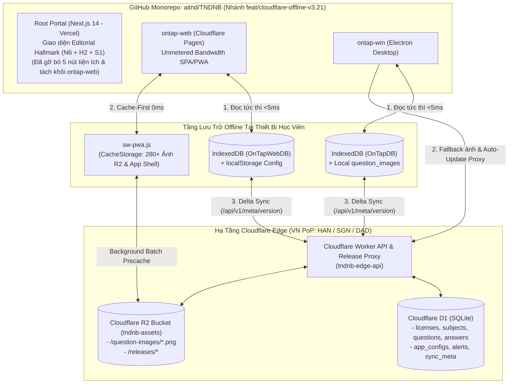

# Kế Hoạch Nâng Cấp Toàn Diện Hạ Tầng Cloudflare (R2 + D1 + Worker CDN Proxy), Offline-First & Tái Thiết Kế Giao Diện Portal Editorial

> **Mã kế hoạch:** `261104-0856-cloudflare-r2-d1-offline-upgrade`  
> **Ngày lập:** 04/11/2026  
> **Nhánh triển khai (Preview Branch):** `feat/cloudflare-offline-v3.21`  
> **Phạm vi tác động:** `cloudflare-worker/` (Mới), `ontap-web/`, `ontap-win/`, và Root Portal (`app/`, `components/`, `next.config.mjs`)  
> **Trạng thái:** Sẵn sàng thi công (Ready for Implementation - TDD Enriched across 8 Phases: Phase 00 -> Phase 07)

---

## 1. Tầm Nhìn Sản Phẩm & Mục Tiêu Kinh Doanh (PRD Overview)

Dự án **TNDNB (Đào tạo & Ôn thi Chứng chỉ Chuyên môn Phương tiện Thủy nội địa — Công ty Cổ phần Tư vấn và Giáo dục Ninh Bình)** gồm 3 thành phần: **Cổng thông tin nhà trường (`app/` - Next.js 14)**, **Web/PWA Ôn tập (`ontap-web` - React 19 + Vite)** và **Desktop App (`ontap-win` - Electron)**. Kế hoạch này giải quyết triệt để 6 mục tiêu cốt lõi:

1. **Tách Deployment — Giữ Monorepo (Phase 00):**
   - Tách `ontap-web` (SPA/PWA) sang **Cloudflare Pages** (`ontap.tndnb.vn`) để hưởng **băng thông vô hạn 100% miễn phí (Unmetered Bandwidth)** và nằm cùng mạng nội bộ Cloudflare Edge với D1 & R2.
   - Giữ **Root Portal (Next.js 14)** trên **Vercel** (`tndnb.vn`) phục vụ SEO tin tức, thông báo tuyển sinh và văn bản pháp quy, nhưng quản lý chung trong 1 Git Monorepo (`aitnd/TNDNB`).
   - Toàn bộ quá trình nâng cấp thực hiện trên nhánh Preview `feat/cloudflare-offline-v3.21` để hệ thống Production (`main`) chạy bình thường 100% không gián đoạn.
2. **Hạ tầng Cloudflare Worker + D1 + R2 (Phase 01 & Phase 02):**
   - Chuyển CSDL câu hỏi (`licenses`, `subjects`, `questions`, `answers`) từ Supabase và cấu hình/thông báo (`usage_config`, `alerts`) từ Firebase sang **Cloudflare D1 (Serverless SQLite) + Cloudflare Worker API**.
3. **Đồng bộ Offline-First cho cả `ontap-web` và `ontap-win` (Phase 03):**
   - Tích hợp Dexie IndexedDB (`OnTapWebDB` / `OnTapDB`) kết hợp kiểm tra `version`/`content_hash` SHA-256 trên D1 để học viên mở app lần thứ 2 trở đi nạp đề trong **< 5ms**, mất mạng hoàn toàn vẫn ôn tập & thi thử bình thường.
4. **Tối ưu 280+ Ảnh Câu Hỏi với Cloudflare R2 CDN + PWA Offline Cache (Phase 04):**
   - Đẩy toàn bộ ảnh câu hỏi lên **Cloudflare R2** (Zero Egress, tốc độ CDN <10ms tại VN) và nâng cấp [ontap-web/public/sw-pwa.js](file:///d:/Antigravity/TNDNB/ontap-web/public/sw-pwa.js) để tự động pre-cache ngầm toàn bộ ảnh câu hỏi vào `CacheStorage` (`tndnb-question-images-v1`), đảm bảo mất mạng giữa phòng thi vẫn hiển thị 100% hình ảnh.
5. **Tăng tốc Auto-Update `.exe` cho `ontap-win` (Phase 05):**
   - Dùng **Cloudflare Worker làm CDN Proxy cho GitHub Releases** để cache file `.exe`, `latest.yml`, `.blockmap` tại Cloudflare VN Edge, kèm công tắc chuyển đổi 1 chạm sang **Cloudflare R2 (`r2_direct`)**.
6. **Tái thiết kế Giao diện Root Portal theo chuẩn Editorial `/ui-ux-pro-max` + `/hallmark` (Phase 06):**
   - Sau khi tách `ontap-web` ra riêng, **xóa bỏ hoàn toàn 5 nút tiện ích màu vàng** (`Giải trí`, `Ôn tập`, `Thi trực tuyến`, `Tải App`, `Tra cứu ĐC`) trên thanh điều hướng [components/Navbar.tsx](file:///d:/Antigravity/TNDNB/components/Navbar.tsx), xóa bỏ banner CTA `/ontap` tại [app/page.tsx](file:///d:/Antigravity/TNDNB/app/page.tsx), và thiết kế lại trang chủ Cổng thông tin **Công ty Cổ phần Tư vấn và Giáo dục Ninh Bình** theo kiến trúc **`N6 · Newspaper Masthead` + `H2 · Split Diptych` + `S1 · Left margin numbered`** chuẩn mực, chính thống, không còn bất kỳ dấu vết AI slop nào.

---

## 2. Sơ Đồ Kiến Trúc Tổng Thể (Mermaid Architecture)

---

## 3. Bảng Theo Dõi Tiến Độ Các Giai Đoạn (Phases Overview)

| Phase | Tên Giai Đoạn | Tài Liệu Chi Tiết (TDD Enriched) | Trọng Tâm Kỹ Thuật | Trạng Thái |
| :--- | :--- | :--- | :--- | :---: |
| **Phase 00** | Nhánh Git Preview & Tách Deployment Monorepo | [phase-00-split-deployment-monorepo.md](file:///d:/Antigravity/TNDNB/docs/plans/261104-0856-cloudflare-r2-d1-offline-upgrade/phase-00-split-deployment-monorepo.md) | Tạo nhánh `feat/cloudflare-offline-v3.21`, xây dựng `deployConfig.ts`, `_redirects`, `_headers` cho Cloudflare Pages và `next.config.mjs` cho Vercel. | `Completed` |
| **Phase 01** | Hạ tầng Cloudflare (Worker, D1, R2) | [phase-01-cloudflare-infra.md](file:///d:/Antigravity/TNDNB/docs/plans/261104-0856-cloudflare-r2-d1-offline-upgrade/phase-01-cloudflare-infra.md) | Khởi tạo `cloudflare-worker/`, cấu hình `wrangler.toml`, D1 binding, R2 bucket & CORS. | `Completed` |
| **Phase 02** | Thiết kế Schema D1 & Migrate Dữ Liệu | [phase-02-d1-schema-migration.md](file:///d:/Antigravity/TNDNB/docs/plans/261104-0856-cloudflare-r2-d1-offline-upgrade/phase-02-d1-schema-migration.md) | Tạo SQL schema cho D1, viết script migrate từ Supabase/Firebase/JSON sang D1 và upload 280 ảnh lên R2. | `Completed` |
| **Phase 03** | Đồng bộ Offline-First (`ontap-web` & `ontap-win`) | [phase-03-offline-first-data-sync.md](file:///d:/Antigravity/TNDNB/docs/plans/261104-0856-cloudflare-r2-d1-offline-upgrade/phase-03-offline-first-data-sync.md) | Tích hợp Dexie IndexedDB cho `ontap-web`, nâng cấp `dataService.ts`, `syncService.ts`, `adminConfigService.ts`, `notificationService.ts` dùng D1 API. | `Pending` |
| **Phase 04** | Tối ưu Ảnh R2 CDN & PWA Offline Cache | [phase-04-r2-images-pwa-cache.md](file:///d:/Antigravity/TNDNB/docs/plans/261104-0856-cloudflare-r2-d1-offline-upgrade/phase-04-r2-images-pwa-cache.md) | Nâng cấp `sw-pwa.js` (Cache-First + Precache ảnh câu hỏi từ R2), cập nhật `imageHelper.ts` trên `ontap-win`. | `Pending` |
| **Phase 05** | Tăng tốc Auto-Update `.exe` qua Worker CDN Proxy | [phase-05-win-updater-cdn-proxy.md](file:///d:/Antigravity/TNDNB/docs/plans/261104-0856-cloudflare-r2-d1-offline-upgrade/phase-05-win-updater-cdn-proxy.md) | Xây dựng route proxy GitHub Releases trên Worker, cấu hình `electron/main.cjs`, `UpdateService.ts` & công tắc chuyển đổi R2 `generic`. | `Pending` |
| **Phase 06** | Tái thiết kế Giao diện Root Portal (`Editorial Hallmark`) | [phase-06-portal-editorial-redesign.md](file:///d:/Antigravity/TNDNB/docs/plans/261104-0856-cloudflare-r2-d1-offline-upgrade/phase-06-portal-editorial-redesign.md) | Xóa bỏ 5 nút tiện ích màu vàng trên `Navbar.tsx` & CTA `/ontap` trên `app/page.tsx`; nâng cấp giao diện Portal theo chuẩn `/hallmark` (`N6 Masthead` + `H2 Split Diptych` + `S1 Header`). | `Completed` |
| **Phase 07** | Kiểm thử Preview, Benchmark & Merge Cut-over | [phase-07-testing-verification.md](file:///d:/Antigravity/TNDNB/docs/plans/261104-0856-cloudflare-r2-d1-offline-upgrade/phase-07-testing-verification.md) | Chạy toàn bộ 17 file test (43 kịch bản Vitest), kiểm thử thực tế trên link Preview (`vercel.app` & `pages.dev`) và merge vào `main`. | `Pending` |

---

## 4. Danh Sách Kiểm Tra Quản Lý Sản Phẩm (PM Checklist)

- [x] **Trải nghiệm người dùng (User Value):** Học viên vào `ontap-web` / `ontap-win` tải đề <1s lần đầu, 0ms các lần sau, rớt mạng vẫn hiển thị 100% ảnh câu hỏi; khách truy cập Cổng thông tin `tndnb.vn` trải nghiệm giao diện báo chí/đào tạo chính quy, trang trọng, không còn các nút tiện ích dư thừa.
- [x] **Tác động kinh doanh (Business Impact):** Giải phóng 100GB Bandwidth của Vercel, loại bỏ rủi ro pause project của Supabase Free Tier, cắt giảm >90% lượng đọc Firestore.
- [x] **An toàn chuyển đổi (Zero-Downtime Preview Workflow):** Phát triển và kiểm thử hoàn toàn trên nhánh `feat/cloudflare-offline-v3.21` (link Preview riêng), giữ hệ thống Production (`main`) chạy ổn định 100% cho đến khi nghiệm thu xong.
- [x] **Danh sách công việc chi tiết:** Được đồng bộ đầy đủ tại [task.md](file:///d:/Antigravity/TNDNB/docs/plans/261104-0856-cloudflare-r2-d1-offline-upgrade/task.md).
