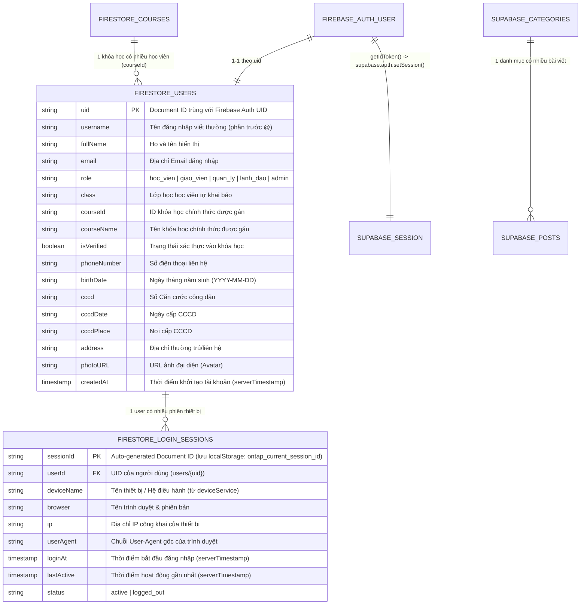
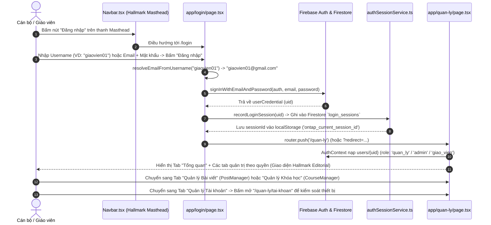
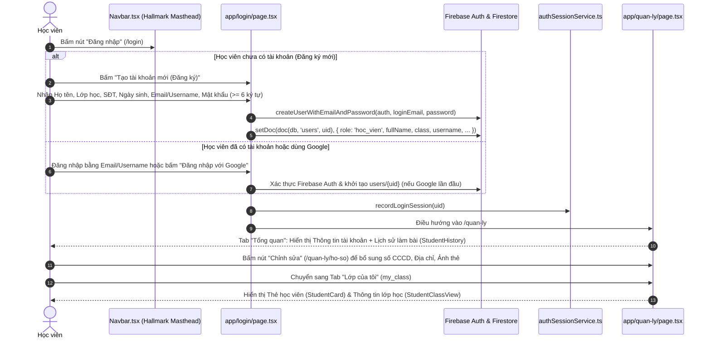

# Tài Liệu Thiết Kế Kỹ Thuật & Hệ Thống Giao Diện Chuẩn Mực (AWF v4.0 `/design` Specification)
## Dự Án: Chuẩn Hóa Giao Diện Duy Nhất Hallmark Editorial Toàn Root Portal & Khôi Phục Hệ Thống Đăng Nhập (`/login`), Quản Trị (`/quan-ly`)

> **Mã kế hoạch:** `261105-1408-portal-login-dashboard-restore`  
> **Ngày cập nhật:** 05/11/2026  
> **Tiêu chuẩn thiết kế áp dụng:** `AWF v4.0` + `Impeccable v4.8.0 (62-Rule Craft Floor)` + `Taste-Skill v2.5.0`  
> **Định hướng giao diện (Single Canonical Theme):** **Hallmark Editorial — Institutional Maritime Education & News Portal** (Xóa bỏ hoàn toàn đa giao diện cũ `dark`, `noel`, `classic`, `modern`, `sunrise`, `tri-an`).

---

## Design Context

### 1. Phân Loại Chế Độ Giao Diện 4 Modes (`4 Modes Classification` — AWF v4.0)

Toàn bộ các trang trên **Root Portal (`d:\Antigravity\TNDNB`)** được phân bổ vào 3 chế độ trọng tâm trong mô hình **4 Modes Classification (`Read` · `Operate` · `Persuade` · `Express`)** để tối ưu hóa mật độ thông tin, kiểu chữ và hành vi tương tác:

| Chế độ (Mode) | Mục tiêu Trải nghiệm Cốt lõi | Danh sách Màn hình & Route Áp dụng | Quy chuẩn Thiết kế Đặc thù |
| :--- | :--- | :--- | :--- |
| **`Read` Mode**<br>*(Đọc báo chí, học thuật & tra cứu thông tin)* | Tối đa hóa độ rõ nét khi đọc văn bản dài, phân cấp tiêu đề báo chí trang trọng, không gây mỏi mắt trên nền giấy ấm (`#FAF9F6`). | - **Trang chủ (`/`)**<br>- **Chi tiết Bài viết (`/bai-viet/[postId]`)**<br>- **Danh mục Tin tức (`/danh-muc/[categoryId]`)**<br>- **Giới thiệu Đơn vị (`/gioi-thieu`)**<br>- **Chương trình Đào tạo (`/chuong-trinh-dao-tao/*`)**<br>- **Tư vấn Nghề nghiệp (`/tu-van-nghe-nghiep/*`)**<br>- **Thư viện Ảnh & Video (`/thu-vien`)** | - Chiều rộng dòng văn bản bài đọc khóa chặt trong khoảng **`60ch–75ch`**.<br>- Tiêu đề Serif (`Merriweather`) đứng thẳng 100% (`font-style: normal`).<br>- Phân vùng nội dung bằng đường kẻ mảnh `1px solid var(--color-rule)` thay vì lạm dụng đổ bóng. |
| **`Operate` Mode**<br>*(Tác nghiệp, xác thực, quản trị & công cụ)* | Tốc độ thao tác nhanh, biểu mẫu rõ ràng, bảng dữ liệu thẳng hàng tuyệt đối, trạng thái lỗi/thành công tức thì. | - **Đăng nhập & Đăng ký (`/login`)**<br>- **Bảng điều khiển Trung tâm (`/quan-ly`)**<br>- **Chỉnh sửa Hồ sơ (`/quan-ly/ho-so`)**<br>- **Quản lý Tài khoản & Thiết bị (`/quan-ly/tai-khoan`)**<br>- **Soạn thảo & Đăng bài (`/quan-ly/dang-bai`)**<br>- **Tra cứu Văn bản & Tài liệu (`/tai-lieu`)**<br>- **Tìm kiếm Nội dung (`/tim-kiem`)** | - Mọi ô nhập liệu (`input`, `select`, `textarea`) và nút bấm có vùng chạm tối thiểu `>= 44x44px`, bo góc chuẩn `4px` (`--radius-editorial`).<br>- Các con số thống kê, ngày tháng, điểm thi bắt buộc bật `font-variant-numeric: tabular-nums`. |
| **`Persuade` Mode**<br>*(Thuyết phục tuyển sinh & minh bạch học phí)* | Xây dựng niềm tin pháp lý và uy tín cơ quan đào tạo, trình bày biểu phí minh bạch, dẫn dắt đăng ký nhập học. | - **Biểu Mức Học Phí & Lệ Phí (`/hoc-phi`)**<br>- **Thông báo Tuyển sinh & Liên hệ (`/lien-he`)** | - Bảng học phí kẻ khung chuẩn mực, số tiền dùng phông `JetBrains Mono` + `tabular-nums` màu nhấn `--color-signal: #B91C1C`.<br>- Điểm nhấn danh hiệu/chứng chỉ dùng viền hoặc huy hiệu `--color-gold: #D4AF37`. |

---

### 2. Kiến Trúc Giao Diện Duy Nhất (`Single Canonical Theme Architecture`)

> [!IMPORTANT]
> **Quyết định Kiến trúc Giao diện:** Loại bỏ vĩnh viễn toàn bộ hệ thống đa chủ đề (Multi-Theme) và hiệu ứng trang trí mùa vụ từng gây nặng trang, lệch màu và thiếu tính chính thống của cơ quan đào tạo.

#### 2.1. Các Thành Phần & Chế Độ Cũ Bị Loại Bỏ Hoàn Toàn (Deprecated & Removed)
1. **Xóa bỏ các file điều khiển theme & hiệu ứng phụ:**
   - ❌ [context/ThemeContext.tsx](file:///d:/Antigravity/TNDNB/context/ThemeContext.tsx) (Context quản lý state theme & đọc/ghi `localStorage`)
   - ❌ [components/ThemeSwitcher.tsx](file:///d:/Antigravity/TNDNB/components/ThemeSwitcher.tsx) (Nút/Menu đổi giao diện trên Header)
   - ❌ [components/ThemeEffects.tsx](file:///d:/Antigravity/TNDNB/components/ThemeEffects.tsx) (Hiệu ứng tuyết rơi, hoa rơi, pháo hoa...)
   - ❌ [components/MusicPlayer.tsx](file:///d:/Antigravity/TNDNB/components/MusicPlayer.tsx) (Trình phát nhạc nền tự động trên cổng thông tin)
2. **Xóa bỏ toàn bộ các khối CSS `[data-theme="..."]` trong `app/globals.css`:**
   - ❌ Mode `dark` (Giao diện tối)
   - ❌ Mode `noel` (Giao diện Giáng sinh)
   - ❌ Mode `classic` (Giao diện cổ điển cũ)
   - ❌ Mode `modern` (Giao diện hiện đại cũ)
   - ❌ Mode `sunrise` (Giao diện bình minh)
   - ❌ Mode `tri-an` (Giao diện tri ân 20/11)

#### 2.2. Kiến Trúc CSS Custom Properties Tĩnh Tại `:root` (`app/globals.css`)
- Chuyển 100% sang **Single Canonical Theme** được khai báo tĩnh tại `:root` trong [app/globals.css](file:///d:/Antigravity/TNDNB/app/globals.css).
- **Lợi ích kỹ thuật:**
  - **Zero Flash of Unstyled/Wrong Theme Content (Zero FOUC):** Trình duyệt áp dụng bảng màu **Hallmark Editorial** ngay từ byte HTML đầu tiên từ Server (SSR/ISR) mà không cần chờ JavaScript đọc `localStorage` hay gán thuộc tính `data-theme`.
  - **Giảm kích thước JS Bundle & Tác vụ Main Thread:** Loại bỏ hoàn toàn React Re-render toàn cây DOM do `ThemeProvider`, xóa bỏ các vòng lặp `requestAnimationFrame` của `ThemeEffects` và `MusicPlayer`.
  - **Đồng nhất Nhận diện Thương hiệu:** Mọi trang từ Trang chủ (`/`), Bài viết (`/bai-viet/[postId]`), Học phí (`/hoc-phi`) đến Đăng nhập (`/login`) và Quản trị (`/quan-ly`) đều dùng chung một hệ quy chiếu màu sắc và phông chữ duy nhất.

---

### 3. Bảng Màu & Hệ Thống Token Ngữ Nghĩa (`Color Palette & Semantic Tokens`)

Toàn bộ file CSS Modules (`*.module.css`) và `app/globals.css` trên Root Portal bắt buộc tham chiếu tới bộ **13 Semantic Tokens chuẩn mực** dưới đây:

| Token CSS (`:root`) | Mã Màu Hex | Tên Ngữ Nghĩa (Semantic Name) | Vai Trò & Phạm Vi Áp Dụng Trên Toàn Portal |
| :--- | :---: | :--- | :--- |
| `--color-paper` | `#FAF9F6` | **Warm Alabaster Paper** | Màu nền tổng thể của toàn bộ trang (`body`), tạo cảm giác giấy in báo chí & ấn phẩm học thuật cao cấp, chống chói mắt. |
| `--color-surface` | `#FFFFFF` | **Pure Editorial White** | Màu nền của các thẻ bài viết (Cards), khung biểu mẫu (`/login`), bảng dữ liệu (`/quan-ly`, `/hoc-phi`) và thanh Masthead. |
| `--color-surface-subtle` | `#F1F5F9` | **Subtle Slate Surface** | Màu nền phụ cho tiêu đề bảng (`thead`), trạng thái `hover` của hàng trong bảng, hộp trích dẫn, và thanh tab không hoạt động. |
| `--color-ink` | `#0B132B` | **Deep Maritime Ink** | Màu chữ chính cho toàn bộ tiêu đề (`h1`–`h6`), tên đơn vị trên Masthead và nhãn quan trọng. Độ tương phản AAA (`> 16:1`). |
| `--color-ink-body` | `#334155` | **Slate 700 Body Ink** | Màu chữ tiêu chuẩn cho nội dung bài viết dài, văn bản pháp quy và mô tả khóa học. |
| `--color-ink-muted` | `#475569` | **Slate 600 Muted Ink** | Màu chữ phụ cho ngày đăng, tác giả, chú thích ảnh, nhãn phụ và placeholder. |
| `--color-accent` | `#003566` | **Institutional Navy** | Màu xanh Hải quân / Đường thủy chính thống: dùng cho thanh điều hướng chuyên mục, nút bấm chính (`Primary Button`), tab đang chọn và liên kết. |
| `--color-accent-hover` | `#002244` | **Deep Navy Hover** | Màu nền khi di chuột (`:hover`) hoặc nhấn (`:active`) vào các nút bấm và liên kết chính. |
| `--color-gold` | `#D4AF37` | **Maritime Brass Gold** | Màu vàng đồng hàng hải: dùng làm đường viền trang trọng (`2px`), huy hiệu chứng chỉ, biểu tượng ngôi sao và nút CTA nổi bật trên nền Navy tối. |
| `--color-signal` | `#B91C1C` | **Editorial Crimson Signal** | Màu đỏ con dấu báo chí: dùng cho chỉ mục đánh số (`01`, `02`), nhãn chuyên mục nóng, mức học phí, thông báo lỗi và nút hành động nguy hiểm (`Đăng xuất`, `Xóa`). |
| `--color-success` | `#15803D` | **Forest Verification Green** | Màu xanh lá xác thực: dùng cho trạng thái `"Đã vào khóa"`, thông báo gửi email/lưu dữ liệu thành công. |
| `--color-rule` | `#CBD5E1` | **1px Hairline Rule** | Đường kẻ khung báo chí mảnh `1px solid` phân tách các cột bài viết, hàng bảng và viền ô nhập liệu. |
| `--radius-editorial` | `4px` | **Locked Editorial Radius** | **Khóa cứng độ bo góc `4px` trên toàn hệ thống** (tuyệt đối cấm dùng bo tròn kiểu `16px`, `24px` hay `9999px` cho Card, Input, Button). |

#### Khai báo chuẩn trong `app/globals.css`:
```css
:root {
  /* Semantic Color Tokens — Hallmark Editorial Single Canonical Theme */
  --color-paper: #FAF9F6;
  --color-surface: #FFFFFF;
  --color-surface-subtle: #F1F5F9;
  --color-ink: #0B132B;
  --color-ink-body: #334155;
  --color-ink-muted: #475569;
  --color-accent: #003566;
  --color-accent-hover: #002244;
  --color-gold: #D4AF37;
  --color-signal: #B91C1C;
  --color-success: #15803D;
  --color-rule: #CBD5E1;

  /* Geometry & Hairline Tokens */
  --radius-editorial: 4px;
  --border-hairline: 1px solid var(--color-rule);
  --shadow-editorial: 0 1px 3px rgba(11, 19, 43, 0.06);

  /* Typography Tokens */
  --font-display: 'Merriweather', Georgia, 'Times New Roman', serif;
  --font-sans: 'Be Vietnam Pro', -apple-system, BlinkMacSystemFont, 'Segoe UI', sans-serif;
  --font-mono: 'JetBrains Mono', 'Fira Code', monospace;
}
```

---

### 4. Hệ Thống Kiểu Chữ & Quy Tắc Chống AI Slop (`Typography System & Impeccable Gate 38a`)

1. **Bộ 3 Phông Chữ Chuẩn Mực (Hỗ trợ 100% Dấu Tiếng Việt):**
   - **Display / Editorial Headings (`--font-display: 'Merriweather', serif`):** Dùng cho tên đơn vị trên Masthead, tiêu đề bài viết tiêu điểm (`h1`, `h2`), tiêu đề trang (`/login`, `/quan-ly`, `/gioi-thieu`, `/hoc-phi`).
   - **UI & Body Copy (`--font-sans: 'Be Vietnam Pro', sans-serif`):** Thiết kế chuyên biệt cho tiếng Việt, dùng cho thanh điều hướng, nội dung bài đọc, nhãn biểu mẫu, nút bấm và bảng quản trị.
   - **Numeric, Index & Technical Data (`--font-mono: 'JetBrains Mono', monospace`):** Dùng cho số thứ tự chỉ mục (`01`–`04`), mã hạng bằng (`T1`, `M1`), ngày giờ phát hành, số CCCD và mức học phí.
2. **Các Quy Tắc Bắt Buộc Chống AI Slop (`Impeccable v4.8.0` & `Taste-Skill v2.5.0`):**
   - **Gate 38a (Cấm In Nghiêng Tiêu Đề Serif):** Mọi thẻ `h1, h2, h3, h4` và các class tiêu đề bắt buộc khai báo `font-style: normal !important`. Tuyệt đối không dùng chữ Serif in nghiêng.
   - **Chiều Rộng Dòng Đọc Chuẩn Báo Chí (`Measure Lock`):** Khối văn bản bài viết tại `/bai-viet/[postId]`, `/gioi-thieu`, `/chuong-trinh-dao-tao/*`, `/tu-van-nghe-nghiep/*` bắt buộc giới hạn `max-width: 68ch` (nằm trong dải vàng **`60ch–75ch`**) với `line-height: 1.75`.
   - **Thẳng Hàng Số Liệu (`Tabular Numerals`):** Mọi bảng biểu (bảng học phí `/hoc-phi`, bảng khóa học, bảng tài khoản, bộ đếm `AnalyticsWidget`) bắt buộc áp dụng `font-variant-numeric: tabular-nums`.
   - **Cấm Lạm Dụng Gradient Lòe Loẹt & Bo Tròn Quá Đà:** Không dùng chữ chuyển màu (`background-clip: text`), không dùng bóng đổ neon, không bo góc card quá `4px` (`var(--radius-editorial)`).

---

## 1. Cách Lưu Thông Tin (Database Schema & Data Contract)

### 1.1. Kiến Trúc Dữ Liệu Lai (Firebase Auth + Firestore + Supabase)

Hệ thống Root Portal duy trì kiến trúc dữ liệu rõ ràng theo đúng chức năng nghiệp vụ:
- **Firebase Authentication:** Quản lý định danh người dùng (Email/Password, Username tự nối `@gmail.com`, Google OAuth Popup, Quên mật khẩu).
- **Cloud Firestore:** Lưu trữ hồ sơ người dùng (`users/{uid}`), danh mục khóa học/lớp học (`courses`), và phiên thiết bị đăng nhập (`login_sessions/{sessionId}`).
- **Supabase (PostgreSQL):** Lưu trữ nội dung cổng thông tin báo chí gồm bài viết (`posts`), chuyên mục (`categories`), thư viện đa phương tiện (`media_library`) và đánh giá/kết quả ôn tập.



### 1.2. Đặc Tả Chi Tiết Collection `users/{uid}` (Cloud Firestore)

| STT | Tên trường (Field) | Kiểu dữ liệu (Type) | Bắt buộc | Giá trị mặc định (Default) | Mô tả & Quy tắc nghiệp vụ |
| :---: | :--- | :--- | :---: | :--- | :--- |
| 1 | `uid` | `string` | Có (PK) | `firebaseUser.uid` | Khóa chính (Document ID trên Firestore), ánh xạ 1-1 với UID của Firebase Authentication. |
| 2 | `username` | `string` | Có | `email.split('@')[0].toLowerCase()` | Tên đăng nhập ngắn gọn giúp học viên/cán bộ có thể gõ `username` thay vì phải gõ đầy đủ `@gmail.com`. |
| 3 | `fullName` | `string` | Có | `'Người dùng mới'` / `'Người dùng Google'` | Họ và tên đầy đủ của học viên hoặc cán bộ. Bắt buộc `>= 3` ký tự khi đăng ký. |
| 4 | `email` | `string \| null` | Có | `firebaseUser.email` | Địa chỉ email xác thực trên Firebase Auth. |
| 5 | `role` | `'hoc_vien' \| 'giao_vien' \| 'quan_ly' \| 'lanh_dao' \| 'admin'` | Có | `'hoc_vien'` | Vai trò phân quyền trên toàn cổng thông tin (5 vai trò chuẩn). |
| 6 | `class` | `string` | Tùy chọn | `''` / `undefined` | Tên lớp học do học viên tự điền lúc đăng ký (VD: `"Thuyền trưởng Hạng Nhất"`). |
| 7 | `courseId` | `string` | Tùy chọn | `undefined` | Mã khóa học chính thức sau khi được Quản lý / Giáo viên duyệt gán vào lớp. |
| 8 | `courseName` | `string` | Tùy chọn | `undefined` | Tên khóa học chính thức hiển thị kèm biểu tượng tích xanh (`--color-success`) trên Bảng điều khiển. |
| 9 | `isVerified` | `boolean` | Tùy chọn | `false` | Cờ xác nhận học viên đã được duyệt vào danh sách lớp chính thức hay chưa. |
| 10 | `phoneNumber` | `string` | Tùy chọn | `''` / `undefined` | Số điện thoại liên hệ của người dùng. |
| 11 | `birthDate` | `string` | Tùy chọn | `''` / `undefined` | Ngày sinh định dạng `YYYY-MM-DD`. |
| 12 | `cccd` | `string` | Tùy chọn | `undefined` | Số Căn cước công dân (cập nhật tại `/quan-ly/ho-so`). |
| 13 | `cccdDate` | `string` | Tùy chọn | `undefined` | Ngày cấp Căn cước công dân. |
| 14 | `cccdPlace` | `string` | Tùy chọn | `undefined` | Nơi cấp Căn cước công dân. |
| 15 | `address` | `string` | Tùy chọn | `undefined` | Địa chỉ thường trú / nơi ở hiện tại. |
| 16 | `photoURL` | `string` | Tùy chọn | `undefined` | Đường dẫn ảnh thẻ / ảnh đại diện (hiển thị khung ảnh thẻ `3:4` hoặc tròn viền `--color-rule`). |
| 17 | `createdAt` | `Timestamp` | Có | `serverTimestamp()` | Dấu thời gian tạo hồ sơ trên máy chủ Firestore. |

### 1.3. Đặc Tả Chi Tiết Collection `login_sessions/{sessionId}` (Cloud Firestore)

Được quản lý qua [app/services/authSessionService.ts](file:///d:/Antigravity/TNDNB/app/services/authSessionService.ts) (`recordLoginSession(userId)`):

| STT | Tên trường (Field) | Kiểu dữ liệu (Type) | Bắt buộc | Giá trị mặc định (Default) | Mô tả & Quy tắc nghiệp vụ |
| :---: | :--- | :--- | :---: | :--- | :--- |
| 1 | `userId` | `string` | Có | `user.uid` | UID của người dùng vừa đăng nhập (`users/{uid}`). |
| 2 | `deviceName` | `string` | Có | Từ `getDeviceInfo()` | Tên thiết bị và hệ điều hành. |
| 3 | `browser` | `string` | Có | Từ `getDeviceInfo()` | Tên trình duyệt và phiên bản. |
| 4 | `ip` | `string` | Có | Từ `getDeviceInfo()` | Địa chỉ IP công khai tại thời điểm đăng nhập. |
| 5 | `userAgent` | `string` | Có | `navigator.userAgent` | Chuỗi User-Agent gốc của trình duyệt. |
| 6 | `loginAt` | `Timestamp` | Có | `serverTimestamp()` | Thời điểm bắt đầu phiên đăng nhập. |
| 7 | `lastActive` | `Timestamp` | Có | `serverTimestamp()` | Thời điểm hoạt động gần nhất. |
| 8 | `status` | `'active' \| 'logged_out'` | Có | `'active'` | Trạng thái phiên làm việc (`'active'` hoặc `'logged_out'`). |

### 1.4. Cơ Chế Đồng Bộ Token Kép (`context/AuthContext.tsx`)
- Khi `onAuthStateChanged` nhận `firebaseUser`: lấy `token = await firebaseUser.getIdToken()` và gọi `supabase.auth.setSession({ access_token: token, refresh_token: firebaseUser.refreshToken || token })` để mở quyền thao tác trên các bảng Supabase (`posts`, `categories`, `media_library`), sau đó đọc `users/{uid}` từ Firestore.
- Khi đăng xuất (`firebaseUser === null`): đặt `setUser(null)` và gọi `await supabase.auth.signOut()`.

---

## 2. Danh Sách Đầy Đủ Các Màn Hình Portal Được Chuẩn Hóa & Ma Trận Phân Quyền

### 2.1. Danh Mục Toàn Bộ Các Màn Hình Root Portal Chuẩn Hóa Sang Hallmark Editorial

| STT | Nhóm / Màn Hình | Đường dẫn (Route) | File Mã Nguồn & CSS Modules | Chế độ (Mode) | Quy Chuẩn Thiết Kế Hallmark Editorial Áp Dụng |
| :---: | :--- | :--- | :--- | :---: | :--- |
| **1** | **Global Shell (Khung Toàn Cục)** | Toàn bộ các trang | - [app/layout.tsx](file:///d:/Antigravity/TNDNB/app/layout.tsx)<br>- [components/Navbar.tsx](file:///d:/Antigravity/TNDNB/components/Navbar.tsx)<br>- [components/Footer.tsx](file:///d:/Antigravity/TNDNB/components/Footer.tsx)<br>- [components/Sidebar.tsx](file:///d:/Antigravity/TNDNB/components/Sidebar.tsx) | `Read` / `Operate` | - Gỡ bỏ `ThemeProvider`, `ThemeSwitcher`, `ThemeEffects`, `MusicPlayer`.<br>- `Navbar.tsx` theo mẫu **`N6 · Newspaper Masthead`**: Tầng Meta Bar (Ngày tháng, Hotline, Email, Nút **`"Đăng nhập"`** trỏ tới `/login` hoặc `"Quản trị"` `/quan-ly`), Tầng Masthead Chính thống (`CÔNG TY CỔ PHẦN TƯ VẤN VÀ GIÁO DỤC NINH BÌNH`), Tầng Menu Chuyên mục nền `--color-accent: #003566` hoặc kẻ viền `1px solid var(--color-rule)`. |
| **2** | **Trang Chủ Báo Chí & Đào Tạo** | `/` | - [app/page.tsx](file:///d:/Antigravity/TNDNB/app/page.tsx)<br>- [app/page.module.css](file:///d:/Antigravity/TNDNB/app/page.module.css) | `Read` | - Khối Hero **`H2 · Split Diptych` (`7fr / 5fr`)**: Cột trái là Bài viết Tiêu điểm lớn (ảnh `16:10`, tiêu đề `Merriweather` đứng); Cột phải là 4 Bản tin Học vụ & Tuyển sinh đánh số mono `01`–`04` màu `--color-signal`.<br>- Các Section Headers đánh số lề trái (`01 — TIN TỨC & SỰ KIỆN`, `02 — THÔNG BÁO TUYỂN SINH & LỊCH THI`, `03 — VĂN BẢN PHÁP QUY`). |
| **3** | **Trang Đăng Nhập & Đăng Ký** | `/login` | - [app/login/page.tsx](file:///d:/Antigravity/TNDNB/app/login/page.tsx)<br>- [app/login/page.module.css](file:///d:/Antigravity/TNDNB/app/login/page.module.css) | `Operate` | - Nền trang `--color-paper`, hộp biểu mẫu `--color-surface`, viền `1px solid var(--color-rule)`, thanh nhấn đỉnh hộp `3px solid var(--color-accent)`, bo góc `4px`.<br>- Tiêu đề `"Đăng nhập Hệ thống"` / `"Đăng ký Tài khoản"` dùng `--font-display`, `font-style: normal`.<br>- Nút chính nền `--color-accent` (`#003566`), thông báo lỗi viền trái `3px solid var(--color-signal)`. |
| **4** | **Bảng Điều Khiển Trung Tâm & Các Trang Quản Trị Con** | `/quan-ly`<br>`/quan-ly/ho-so`<br>`/quan-ly/tai-khoan`<br>`/quan-ly/dang-bai` | - [app/quan-ly/page.tsx](file:///d:/Antigravity/TNDNB/app/quan-ly/page.tsx)<br>- [app/quan-ly/page.module.css](file:///d:/Antigravity/TNDNB/app/quan-ly/page.module.css)<br>- [app/quan-ly/ho-so/page.tsx](file:///d:/Antigravity/TNDNB/app/quan-ly/ho-so/page.tsx)<br>- [app/quan-ly/tai-khoan/page.tsx](file:///d:/Antigravity/TNDNB/app/quan-ly/tai-khoan/page.tsx)<br>- [app/quan-ly/dang-bai/page.tsx](file:///d:/Antigravity/TNDNB/app/quan-ly/dang-bai/page.tsx) | `Operate` | - Không dùng nền gradient bóng bẩy; chuyển sang thẻ `--color-surface` viền `1px solid var(--color-rule)`, bo góc `4px`.<br>- Thanh 6 Tab kẻ chỉ dưới `2px solid var(--color-accent)` cho tab đang mở.<br>- Thẻ **Thông tin tài khoản** bố cục chuẩn hồ sơ cán bộ/học viên (Huy hiệu vai trò nền `--color-accent` chữ trắng hoặc viền `--color-gold`, số CCCD/SĐT dùng `--font-mono`). |
| **5** | **Chi Tiết Bài Viết** | `/bai-viet/[postId]` | - [app/bai-viet/[postId]/page.tsx](file:///d:/Antigravity/TNDNB/app/bai-viet/%5BpostId%5D/page.tsx)<br>- [app/bai-viet/[postId]/PostDetail.module.css](file:///d:/Antigravity/TNDNB/app/bai-viet/%5BpostId%5D/PostDetail.module.css) | `Read` | - Tiêu đề bài viết `Merriweather` cỡ lớn (`clamp(1.75rem, 3vw, 2.5rem)`), `font-style: normal`.<br>- Khung nội dung bài đọc giới hạn chiều rộng dòng **`60ch–75ch`**, chữ `--color-ink-body` (`#334155`), trích dẫn kẻ viền trái `3px solid var(--color-gold)`. |
| **6** | **Danh Mục Chuyên Mục** | `/danh-muc/[categoryId]` | - [app/danh-muc/[categoryId]/page.tsx](file:///d:/Antigravity/TNDNB/app/danh-muc/%5BcategoryId%5D/page.tsx)<br>- [app/danh-muc/[categoryId]/CategoryPage.module.css](file:///d:/Antigravity/TNDNB/app/danh-muc/%5BcategoryId%5D/CategoryPage.module.css) | `Read` | - Đầu mục chuyên mục kẻ viền kép kiểu báo chí, danh sách bài viết chia lưới 2–3 cột ngăn cách bằng đường kẻ mảnh `1px solid var(--color-rule)`. |
| **7** | **Giới Thiệu Đơn Vị** | `/gioi-thieu` | - [app/gioi-thieu/page.tsx](file:///d:/Antigravity/TNDNB/app/gioi-thieu/page.tsx)<br>- [app/gioi-thieu/page.module.css](file:///d:/Antigravity/TNDNB/app/gioi-thieu/page.module.css) | `Read` | - Trình bày lịch sử hình thành, sứ mệnh và năng lực pháp lý của Công ty CP Tư vấn và Giáo dục Ninh Bình theo bố cục ấn phẩm giới thiệu cơ quan đào tạo. |
| **8** | **Biểu Mức Học Phí** | `/hoc-phi` | - [app/hoc-phi/page.tsx](file:///d:/Antigravity/TNDNB/app/hoc-phi/page.tsx)<br>- [app/hoc-phi/page.module.css](file:///d:/Antigravity/TNDNB/app/hoc-phi/page.module.css) | `Persuade` | - Bảng học phí kẻ khung `1px solid var(--color-rule)`, tiêu đề bảng nền `--color-accent` chữ trắng, cột mức thu dùng `--font-mono` + `tabular-nums` màu `--color-signal`. |
| **9** | **Chương Trình Đào Tạo** | `/chuong-trinh-dao-tao/*` | - [app/chuong-trinh-dao-tao/page.tsx](file:///d:/Antigravity/TNDNB/app/chuong-trinh-dao-tao/page.tsx) & các trang con | `Read` / `Persuade` | - Danh mục các hạng bằng Thuyền trưởng (`T1`, `T2`, `T3`), Máy trưởng (`M1`, `M2`, `M3`) và Chứng chỉ chuyên môn trình bày rõ điều kiện dự thi, thời lượng và lộ trình học. |
| **10** | **Tư Vấn Nghề Nghiệp** | `/tu-van-nghe-nghiep/*` | - [app/tu-van-nghe-nghiep/page.tsx](file:///d:/Antigravity/TNDNB/app/tu-van-nghe-nghiep/page.tsx) & các trang con | `Read` | - Bố cục cẩm nang hướng nghiệp đường thủy nội địa, chiều rộng dòng đọc `65ch`, hộp lưu ý pháp lý kẻ viền `--color-accent`. |
| **11** | **Văn Bản & Tài Liệu** | `/tai-lieu` | - [app/tai-lieu/page.tsx](file:///d:/Antigravity/TNDNB/app/tai-lieu/page.tsx)<br>- [app/tai-lieu/page.module.css](file:///d:/Antigravity/TNDNB/app/tai-lieu/page.module.css) | `Operate` | - Danh mục biểu mẫu, văn bản pháp quy có số hiệu văn bản dùng `--font-mono`, nút tải về bo góc `4px` chuẩn `--color-accent`. |
| **12** | **Thư Viện Hình Ảnh / Video** | `/thu-vien` | - [app/thu-vien/page.tsx](file:///d:/Antigravity/TNDNB/app/thu-vien/page.tsx)<br>- [app/thu-vien/page.module.css](file:///d:/Antigravity/TNDNB/app/thu-vien/page.module.css) | `Read` | - Lưới ảnh tư liệu lễ khai giảng, lớp học và kỳ sát hạch thực tế với khung ảnh tỷ lệ cố định (`16:10` / `4:3`), bo góc `4px`, chú thích ảnh dùng `--color-ink-muted`. |
| **13** | **Liên Hệ & Tuyển Sinh** | `/lien-he` | - [app/lien-he/page.tsx](file:///d:/Antigravity/TNDNB/app/lien-he/page.tsx)<br>- [app/lien-he/page.module.css](file:///d:/Antigravity/TNDNB/app/lien-he/page.module.css) | `Persuade` | - Thông tin trụ sở, số điện thoại phòng đào tạo, bản đồ và biểu mẫu gửi câu hỏi tư vấn bo góc `4px`. |
| **14** | **Tìm Kiếm Nội Dung** | `/tim-kiem` | - [app/tim-kiem/page.tsx](file:///d:/Antigravity/TNDNB/app/tim-kiem/page.tsx)<br>- [app/tim-kiem/page.module.css](file:///d:/Antigravity/TNDNB/app/tim-kiem/page.module.css) | `Operate` | - Thanh tìm kiếm lớn và danh sách kết quả phân tách bằng đường kẻ ngang `1px solid var(--color-rule)`. |

---

### 2.2. Ma Trận Phân Quyền Hiển Thị 6 Tab Tại `/quan-ly` (`app/quan-ly/page.tsx`)

| Mã Tab (`activeTab`) | Nhãn Hiển Thị Trên UI | Component / Đích Điều Hướng | `hoc_vien`<br>(Học viên) | `giao_vien`<br>(Giáo viên) | `quan_ly`<br>(Quản lý) | `lanh_dao`<br>(Lãnh đạo) | `admin`<br>(Quản trị viên) |
| :--- | :--- | :--- | :---: | :---: | :---: | :---: | :---: |
| **`dashboard`** | **Tổng quan** | - Thẻ **Thông tin tài khoản** + Nút sửa `/quan-ly/ho-so` + Đổi mật khẩu (Tất cả)<br>- [`AnalyticsWidget`](file:///d:/Antigravity/TNDNB/components/AnalyticsWidget.tsx) (Chỉ `admin`, `lanh_dao`)<br>- [`StudentHistory`](file:///d:/Antigravity/TNDNB/components/StudentHistory.tsx) (Chỉ `hoc_vien`) | ✅ Hiển thị<br>*(Kèm `StudentHistory`)* | ✅ Hiển thị<br>*(Thông tin cá nhân)* | ✅ Hiển thị<br>*(Thông tin cá nhân)* | ✅ Hiển thị<br>*(Kèm `AnalyticsWidget`)* | ✅ Hiển thị<br>*(Kèm `AnalyticsWidget`)* |
| **`my_class`** | **Lớp của tôi** | [`StudentCard`](file:///d:/Antigravity/TNDNB/components/StudentCard.tsx) + [`StudentClassView`](file:///d:/Antigravity/TNDNB/components/StudentClassView.tsx) | ✅ Hiển thị | ❌ Ẩn | ❌ Ẩn | ❌ Ẩn | ❌ Ẩn |
| **`courses`** | **Quản lý Khóa học** | [`CourseManager`](file:///d:/Antigravity/TNDNB/components/CourseManager.tsx) | ❌ Ẩn | ✅ Hiển thị | ✅ Hiển thị | ✅ Hiển thị | ✅ Hiển thị |
| **`accounts`** | **Quản lý Tài khoản** | Khối điều hướng sang trang chuyên sâu `/quan-ly/tai-khoan` ([app/quan-ly/tai-khoan/page.tsx](file:///d:/Antigravity/TNDNB/app/quan-ly/tai-khoan/page.tsx)) | ❌ Ẩn | ❌ Ẩn | ✅ Hiển thị | ✅ Hiển thị | ✅ Hiển thị |
| **`posts`** | **Quản lý Bài viết** | [`PostManager`](file:///d:/Antigravity/TNDNB/components/PostManager.tsx) | ❌ Ẩn | ❌ Ẩn | ✅ Hiển thị | ✅ Hiển thị | ✅ Hiển thị |
| **`reviews`** | **Kết quả Ôn tập** | [`ReviewManager`](file:///d:/Antigravity/TNDNB/components/ReviewManager.tsx) | ❌ Ẩn | ✅ Hiển thị | ✅ Hiển thị | ✅ Hiển thị | ✅ Hiển thị |

---

## 3. Luồng Hoạt Động (User Journeys)

### 3.1. Hành Trình 1: Cán Bộ / Giáo Viên Đăng Nhập & Quản Trị Bài Viết, Khóa Học



### 3.2. Hành Trình 2: Học Viên Đăng Ký / Đăng Nhập Xem Thẻ Học Viên, Lớp Học & Lịch Sử Thi



---

## 4. Checklist Kiểm Tra (Acceptance Criteria)

### 4.1. Hạng Mục Kiến Trúc Giao Diện Duy Nhất (Single Canonical Theme)
- [x] **Loại bỏ hoàn toàn hệ thống đa giao diện cũ:** Đã gỡ bỏ hoàn toàn `ThemeContext.tsx`, `ThemeSwitcher.tsx`, `ThemeEffects.tsx`, `MusicPlayer.tsx` khỏi `app/layout.tsx` và `components/Navbar.tsx`; xóa sạch các khối `[data-theme="dark" | "noel" | "classic" | "modern" | "sunrise" | "tri-an"]` trong `app/globals.css`.
- [x] **Áp dụng đồng bộ 13 Semantic Tokens Hallmark Editorial:** Mọi trang trên Root Portal dùng nền `--color-paper: #FAF9F6`, bề mặt `--color-surface: #FFFFFF`, mực chính `--color-ink: #0B132B`, xanh hàng hải `--color-accent: #003566`, vàng đồng `--color-gold: #D4AF37`, đỏ tín hiệu `--color-signal: #B91C1C`, kẻ khung `1px solid var(--color-rule)` và bo góc khóa cứng `--radius-editorial: 4px`.
- [x] **Tuân thủ Typography & Gate 38a:** Sử dụng bộ 3 phông chữ `Merriweather` + `Be Vietnam Pro` + `JetBrains Mono`; không có bất kỳ tiêu đề nào in nghiêng (`font-style: normal`); chiều rộng dòng bài đọc đạt `60ch–75ch`; bảng số liệu bật `tabular-nums`.

### 4.2. Hạng Mục Chức Năng Đăng Nhập (`/login`) & Quản Trị (`/quan-ly`)
- [x] **Navbar (`components/Navbar.tsx`):** Nhãn nút đăng nhập hiển thị chính xác chuỗi `"Đăng nhập"` (đổi từ `"Đăng nhập cán bộ"`), dẫn đúng về `/login`.
- [x] **Route `/login` (`app/login/page.tsx`):** Hỗ trợ đăng nhập Email/Username (tự nối `@gmail.com`), Đăng ký tài khoản mới (`role: 'hoc_vien'`), Đăng nhập Google (bắt lỗi `auth/unauthorized-domain`), Quên mật khẩu, gọi `recordLoginSession(uid)` và điều hướng `?redirect=/...` hoặc `/quan-ly`.
- [x] **Route `/quan-ly` (`app/quan-ly/page.tsx`):** Bọc trong `ProtectedRoute`, hiển thị đúng 6 tab theo phân quyền (`dashboard`, `my_class`, `courses`, `accounts` $\rightarrow$ `/quan-ly/tai-khoan`, `posts`, `reviews`) với thiết kế Hallmark Editorial chuẩn mực (không còn inline style bóng bẩy/gradient cũ).

---

## 5. Kịch Bản Kiểm Thử (BDD Test Cases: Given - When - Then)

### TC-01: Kiểm tra loại bỏ Theme cũ & hiển thị nút `"Đăng nhập"` trên Navbar
- **Given (Giả định):** Người dùng chưa đăng nhập (`user === null`) và truy cập trang chủ `/` trên Root Portal.
- **When (Khi):** Trang chủ và thanh điều hướng [`Navbar`](file:///d:/Antigravity/TNDNB/components/Navbar.tsx) được render.
- **Then (Thì):**
  - Không còn nút chuyển đổi giao diện (`ThemeSwitcher`), không còn nhạc nền (`MusicPlayer`) hay hiệu ứng tuyết rơi (`ThemeEffects`).
  - Biến CSS tại `:root` trả về `--color-paper: #FAF9F6`, `--color-ink: #0B132B`, `--color-accent: #003566`, `--radius-editorial: 4px`.
  - Nút đăng nhập trên Masthead hiển thị chính xác chuỗi **`"Đăng nhập"`** và dẫn tới `/login`.

### TC-02: Đăng nhập bằng Username (tự động nối `@gmail.com`) và ghi nhận phiên thiết bị
- **Given (Giả định):** Người dùng đang ở trang `/login` ở chế độ `"Đăng nhập Hệ thống"`.
- **When (Khi):** Người dùng nhập `"canbo_daotao"` (không có `@`) vào ô *"Email hoặc Tên đăng nhập"*, nhập mật khẩu hợp lệ và bấm `"Đăng nhập"`.
- **Then (Thì):**
  - Hàm `resolveEmailFromUsername` tự động chuyển đổi chuỗi nhập thành `"canbo_daotao@gmail.com"`.
  - Gọi `signInWithEmailAndPassword(auth, "canbo_daotao@gmail.com", password)` thành công.
  - Gọi `recordLoginSession(user.uid)` tạo bản ghi `active` trong collection `login_sessions` và lưu `ontap_current_session_id` vào `localStorage`.
  - Điều hướng người dùng tới `/quan-ly` (hoặc giá trị của `?redirect=/...` nếu có).

### TC-03: Học viên Đăng ký tài khoản mới tại `/login`
- **Given (Giả định):** Học viên đang ở trang `/login` và bấm nút `"Tạo tài khoản mới (Đăng ký)"`.
- **When (Khi):** Học viên nhập đầy đủ Họ và Tên (`"Nguyễn Văn Hải"`), Lớp học (`"Thuyền trưởng Hạng Nhất"`), Số điện thoại, Ngày sinh, Email/Username và Mật khẩu (`>= 6` ký tự), sau đó bấm `"Đăng ký"`.
- **Then (Thì):**
  - Tài khoản mới được tạo trên Firebase Auth qua `createUserWithEmailAndPassword`.
  - Hồ sơ mới được ghi vào Firestore tại `users/{uid}` với `role: 'hoc_vien'`, `fullName: 'Nguyễn Văn Hải'`, `class: 'Thuyền trưởng Hạng Nhất'`, `username` viết thường và `createdAt: serverTimestamp()`.
  - Phiên thiết bị được ghi nhận qua `recordLoginSession(uid)` và học viên được chuyển thẳng vào `/quan-ly`.

### TC-04: Bắt lỗi `auth/unauthorized-domain` khi Đăng nhập Google trên Domain Preview
- **Given (Giả định):** Người dùng truy cập trang `/login` thông qua đường dẫn Preview (`.vercel.app`) chưa nằm trong danh sách Authorized Domains của Firebase Console.
- **When (Khi):** Người dùng bấm nút `"Đăng nhập với Google"` và Firebase ném ra ngoại lệ `{ code: 'auth/unauthorized-domain' }`.
- **Then (Thì):**
  - Trang `/login` không bị crash, trạng thái `loading` được trả về `false`.
  - Khối thông báo lỗi (`styles.error`) hiển thị đúng chuỗi tiếng Việt: *"Tên miền hiện tại chưa được cấp phép đăng nhập Google trên Firebase. Vui lòng đăng nhập bằng Email/Mật khẩu hoặc truy cập tên miền chính thức."*

### TC-05: Bảo vệ Route `/quan-ly` bằng `ProtectedRoute`
- **Given (Giả định):** Người dùng chưa đăng nhập (`user === null`, `loading === false` trong `AuthContext`).
- **When (Khi):** Người dùng truy cập trực tiếp URL `/quan-ly`.
- **Then (Thì):** Component [`ProtectedRoute`](file:///d:/Antigravity/TNDNB/components/ProtectedRoute.tsx) chặn việc hiển thị nội dung `QuanLyDashboard` và tự động điều hướng trình duyệt về trang `/login`.

### TC-06: Hiển thị đúng các Tab trên `/quan-ly` theo từng Vai trò (`role`) & Chuẩn giao diện Hallmark Editorial
- **Given (Giả định):** Người dùng đã đăng nhập thành công và đang ở trang `/quan-ly`.
- **When & Then (Khi & Thì):**
  1. **Nếu `user.role === 'hoc_vien'`:** Chỉ hiển thị **2 Tab**: `Tổng quan` (`dashboard` kèm `StudentHistory`) và `Lớp của tôi` (`my_class` gồm `StudentCard` + `StudentClassView`).
  2. **Nếu `user.role === 'giao_vien'`:** Hiển thị **3 Tab**: `Tổng quan`, `Quản lý Khóa học` (`courses`), và `Kết quả Ôn tập` (`reviews`).
  3. **Nếu `user.role === 'quan_ly'`:** Hiển thị **5 Tab**: `Tổng quan`, `Quản lý Khóa học`, `Quản lý Tài khoản` (liên kết sang `/quan-ly/tai-khoan`), `Quản lý Bài viết`, và `Kết quả Ôn tập`.
  4. **Nếu `user.role === 'lanh_dao'` hoặc `user.role === 'admin'`:** Hiển thị đầy đủ **5 Tab quản trị** và hiển thị thêm [`AnalyticsWidget`](file:///d:/Antigravity/TNDNB/components/AnalyticsWidget.tsx) ngay đầu Tab `Tổng quan`.
  5. Toàn bộ thẻ thông tin, nút bấm và bảng trên `/quan-ly` tuân thủ tokens `--color-surface`, `--color-rule`, `--color-accent`, `--radius-editorial: 4px`, không dùng chữ tiêu đề in nghiêng.
