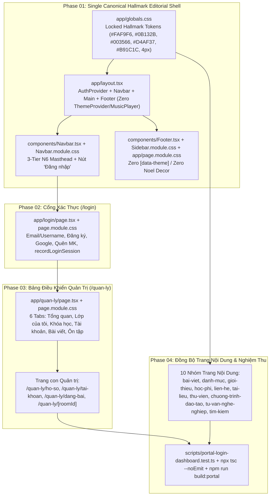

# Kế Hoạch Tổng Thể (`/plan` + `/design` + `/visualize`): Loại Bỏ Đa Theme Cũ, Khóa Chuẩn Hallmark Editorial Duy Nhất & Khôi Phục Toàn Diện `/login`, `/quan-ly` Trên Root Portal

**Ngày cập nhật:** 2026-11-05
**Thư mục kế hoạch:** [docs/plans/261105-1408-portal-login-dashboard-restore](file:///d:/Antigravity/TNDNB/docs/plans/261105-1408-portal-login-dashboard-restore)
**Trạng thái:** Ready for Implementation (Double-Sync Plan & Task Protocol + Single Canonical Hallmark Editorial Theme)

---

## 1. Tầm Nhìn Sản Phẩm & Yêu Cầu Cốt Lõi (PRD & Design System Vision)

### 1.1. Loại bỏ hoàn toàn hệ thống Đa Theme cũ (Legacy Multi-Theme Removal)
Xóa bỏ triệt để cơ chế chuyển đổi 7 theme cũ (`light`, `dark`, `noel`, `modern`, `classic`, `sunrise`, `tri-an`), hiệu ứng tuyết rơi Noel và trình phát nhạc nền để làm sạch codebase, tăng tốc độ tải trang và giữ vững tính trang trọng của cổng thông tin cơ quan đào tạo – sát hạch thuyền viên:
- **Các file cần xóa bỏ hoàn toàn:**
  1. [context/ThemeContext.tsx](file:///d:/Antigravity/TNDNB/context/ThemeContext.tsx)
  2. [components/ThemeSwitcher.tsx](file:///d:/Antigravity/TNDNB/components/ThemeSwitcher.tsx)
  3. [components/ThemeSwitcher.module.css](file:///d:/Antigravity/TNDNB/components/ThemeSwitcher.module.css)
  4. [components/ThemeEffects.tsx](file:///d:/Antigravity/TNDNB/components/ThemeEffects.tsx)
  5. [components/MusicPlayer.tsx](file:///d:/Antigravity/TNDNB/components/MusicPlayer.tsx)
- **Các khối CSS & JSX thừa cần gỡ bỏ:**
  - Xóa toàn bộ selector `[data-theme='dark' | 'noel' | 'classic' | 'modern' | 'sunrise' | 'tri-an']` và `:global([data-theme=...])` trong [app/globals.css](file:///d:/Antigravity/TNDNB/app/globals.css), [components/Navbar.module.css](file:///d:/Antigravity/TNDNB/components/Navbar.module.css), [components/Sidebar.module.css](file:///d:/Antigravity/TNDNB/components/Sidebar.module.css), và [app/page.module.css](file:///d:/Antigravity/TNDNB/app/page.module.css).
  - Xóa toàn bộ hiệu ứng tuyết rơi `.snowflakes`, `.snowflake` và ảnh trang trí Noel `.decor-img`, `nav-light.png`, `footer1.png`, `footer2.png` trong [app/globals.css](file:///d:/Antigravity/TNDNB/app/globals.css), [components/Navbar.tsx](file:///d:/Antigravity/TNDNB/components/Navbar.tsx), và [components/Footer.tsx](file:///d:/Antigravity/TNDNB/components/Footer.tsx).

### 1.2. Khóa 1 Giao Diện Duy Nhất (Single Canonical Hallmark Editorial Theme)
Toàn bộ Root Portal sử dụng **duy nhất một hệ thống Design Tokens chuẩn Hallmark Editorial — Institutional Maritime Education & News Portal**:
- **Bảng màu (Color Tokens):**
  - `--color-paper: #FAF9F6` (Nền giấy báo chí ấm áp)
  - `--color-surface: #FFFFFF` (Bề mặt thẻ nội dung / khung biểu mẫu)
  - `--color-ink: #0B132B` (Mực tiêu đề chính Navy đậm)
  - `--color-ink-muted: #475569` (Mực phụ / chú thích)
  - `--color-accent: #003566` (Xanh Hải quân chủ đạo)
  - `--color-gold: #D4AF37` (Vàng đồng điểm nhấn thể chế)
  - `--color-signal: #B91C1C` (Đỏ tín hiệu báo chí / cảnh báo)
  - `--color-rule: #CBD5E1` (Đường kẻ mảnh phân tách `1px solid`)
- **Hệ chữ (Typography Tokens):**
  - `--font-display: 'Merriweather', Georgia, serif` (Tiêu đề chữ đứng `font-style: normal` theo Hallmark Gate 38a)
  - `--font-sans: 'Be Vietnam Pro', system-ui, -apple-system, sans-serif` (Văn bản nội dung & điều hướng)
  - `--font-mono: 'JetBrains Mono', Consolas, monospace` (Mã hiệu, ngày tháng, chỉ mục số)
- **Hình học & Viền (Geometry Tokens):**
  - `--radius-editorial: 4px` (Bo góc chuẩn biên tập, không lạm dụng bo tròn lớn)
  - `--shadow-soft: 0 1px 3px rgba(11, 19, 43, 0.05)`

### 1.3. Khôi phục `/login`, `/quan-ly` & Đồng bộ toàn diện các trang Portal
1. Đổi nhãn nút `"Đăng nhập cán bộ"` thành `"Đăng nhập"` và gỡ `<ThemeSwitcher />` trên [components/Navbar.tsx](file:///d:/Antigravity/TNDNB/components/Navbar.tsx).
2. Khôi phục [app/login/page.tsx](file:///d:/Antigravity/TNDNB/app/login/page.tsx) và thiết kế lại [app/login/page.module.css](file:///d:/Antigravity/TNDNB/app/login/page.module.css) theo chuẩn Hallmark Editorial.
3. Khôi phục [app/quan-ly/page.tsx](file:///d:/Antigravity/TNDNB/app/quan-ly/page.tsx) và thiết kế lại [app/quan-ly/page.module.css](file:///d:/Antigravity/TNDNB/app/quan-ly/page.module.css) cùng các trang con quản trị ([app/quan-ly/ho-so/page.module.css](file:///d:/Antigravity/TNDNB/app/quan-ly/ho-so/page.module.css), [app/quan-ly/tai-khoan/page.module.css](file:///d:/Antigravity/TNDNB/app/quan-ly/tai-khoan/page.module.css), [app/quan-ly/dang-bai/page.module.css](file:///d:/Antigravity/TNDNB/app/quan-ly/dang-bai/page.module.css), [app/quan-ly/[roomId]/page.module.css](file:///d:/Antigravity/TNDNB/app/quan-ly/%5BroomId%5D/page.module.css)).
4. Đồng bộ toàn bộ 10 nhóm trang nội dung Portal (`bai-viet/[postId]`, `danh-muc/[categoryId]`, `gioi-thieu`, `hoc-phi`, `lien-he`, `tai-lieu`, `thu-vien`, `chuong-trinh-dao-tao`, `tu-van-nghe-nghiep`, `tim-kiem`) về cùng hệ thống CSS Tokens Hallmark Editorial.

---

## 2. Sơ Đồ Kiến Trúc Tổng Thể (`/visualize`)

---

## 3. Lộ Trình 4 Giai Đoạn Triển Khai (Phases Overview)

| Phase | Tên Giai Đoạn | File Chi Tiết | Hạng Mục Trọng Tâm | Effort | Trạng Thái |
| :--- | :--- | :--- | :--- | :---: | :---: |
| **Phase 01** | **Xóa Bỏ Hệ Thống Theme Cũ & Chuẩn Hóa Global Shell** | [phase-01-navbar-and-login.md](file:///d:/Antigravity/TNDNB/docs/plans/261105-1408-portal-login-dashboard-restore/phase-01-navbar-and-login.md) | Xóa 5 file `ThemeContext`, `ThemeSwitcher`, `ThemeEffects`, `MusicPlayer`; làm sạch `app/globals.css`, `app/layout.tsx`, `components/Navbar.tsx` (đổi nút `"Đăng nhập"`), `components/Navbar.module.css`, `components/Footer.tsx`, `components/Footer.module.css`, `components/Sidebar.module.css`, `app/page.module.css`. | 1.5h | `[x]` Complete (100%) |
| **Phase 02** | **Khôi Phục & Thiết Kế Mới Trang `/login` Chuẩn Hallmark Editorial** | [phase-02-quan-ly-dashboard.md](file:///d:/Antigravity/TNDNB/docs/plans/261105-1408-portal-login-dashboard-restore/phase-02-quan-ly-dashboard.md) | Khôi phục [app/login/page.tsx](file:///d:/Antigravity/TNDNB/app/login/page.tsx) (Email/Username, Đăng ký, Google, Quên MK, `recordLoginSession`, redirect) và thiết kế mới [app/login/page.module.css](file:///d:/Antigravity/TNDNB/app/login/page.module.css) theo chuẩn Hallmark Editorial. | 1.5h | `[x]` Complete (100%) |
| **Phase 03** | **Khôi Phục & Thiết Kế Mới `/quan-ly` Cùng Các Trang Con Quản Trị** | [phase-02-quan-ly-dashboard.md](file:///d:/Antigravity/TNDNB/docs/plans/261105-1408-portal-login-dashboard-restore/phase-02-quan-ly-dashboard.md) | Khôi phục [app/quan-ly/page.tsx](file:///d:/Antigravity/TNDNB/app/quan-ly/page.tsx), thiết kế mới [app/quan-ly/page.module.css](file:///d:/Antigravity/TNDNB/app/quan-ly/page.module.css) và đồng bộ CSS các trang con `ho-so`, `tai-khoan`, `dang-bai`, `[roomId]`. | 2.0h | `[x]` Complete (100%) |
| **Phase 04** | **Chuẩn Hóa Toàn Bộ Trang Nội Dung Portal & Kiểm Thử Nghiệm Thu** | [phase-03-testing-verification.md](file:///d:/Antigravity/TNDNB/docs/plans/261105-1408-portal-login-dashboard-restore/phase-03-testing-verification.md) | Đồng bộ CSS 10 nhóm trang nội dung (`bai-viet`, `danh-muc`, `gioi-thieu`, `hoc-phi`, `lien-he`, `tai-lieu`, `thu-vien`, `chuong-trinh-dao-tao`, `tu-van-nghe-nghiep`, `tim-kiem`) về Hallmark Tokens; viết unit test [scripts/portal-login-dashboard.test.ts](file:///d:/Antigravity/TNDNB/scripts/portal-login-dashboard.test.ts), chạy `npx tsc --noEmit` & `npm run build:portal`. | 2.0h | `[x]` Complete (100%) |

---

## 4. Tiêu Chí Nghiệm Thu Tổng Thể (Definition of Done)

- [x] 5 file `context/ThemeContext.tsx`, `components/ThemeSwitcher.tsx`, `components/ThemeSwitcher.module.css`, `components/ThemeEffects.tsx`, `components/MusicPlayer.tsx` đã được xóa hoàn toàn khỏi dự án.
- [x] Không còn bất kỳ selector `[data-theme=...]` hay hiệu ứng Noel/tuyết rơi nào trong [app/globals.css](file:///d:/Antigravity/TNDNB/app/globals.css), [components/Navbar.module.css](file:///d:/Antigravity/TNDNB/components/Navbar.module.css), [components/Sidebar.module.css](file:///d:/Antigravity/TNDNB/components/Sidebar.module.css), [app/page.module.css](file:///d:/Antigravity/TNDNB/app/page.module.css).
- [x] [components/Navbar.tsx](file:///d:/Antigravity/TNDNB/components/Navbar.tsx) hiển thị nút `"Đăng nhập"` và không còn import `ThemeSwitcher` hay `useTheme`.
- [x] Trang `/login` ([app/login/page.tsx](file:///d:/Antigravity/TNDNB/app/login/page.tsx), [app/login/page.module.css](file:///d:/Antigravity/TNDNB/app/login/page.module.css)) và `/quan-ly` ([app/quan-ly/page.tsx](file:///d:/Antigravity/TNDNB/app/quan-ly/page.tsx), [app/quan-ly/page.module.css](file:///d:/Antigravity/TNDNB/app/quan-ly/page.module.css)) hoạt động đầy đủ và đồng bộ chuẩn Hallmark Editorial.
- [x] Toàn bộ các trang con quản trị và 10 nhóm trang nội dung Portal sử dụng thống nhất hệ biến CSS Hallmark Editorial (`--color-paper`, `--color-surface`, `--color-ink`, `--color-accent`, `--color-gold`, `--color-signal`, `--color-rule`, `--radius-editorial`).
- [x] Bộ kiểm thử [scripts/portal-login-dashboard.test.ts](file:///d:/Antigravity/TNDNB/scripts/portal-login-dashboard.test.ts) đạt 100% `PASS`, `npx tsc --noEmit` và `npm run build:portal` hoàn tất với `exit code 0`.
