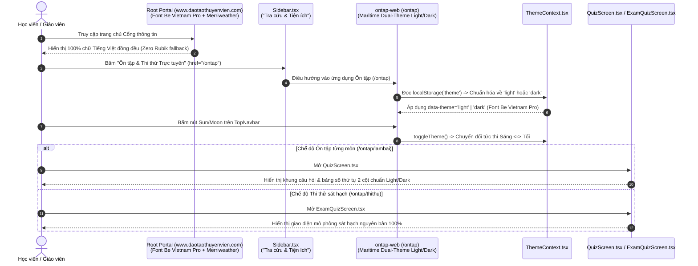

# Tài Liệu Thiết Kế Kỹ Thuật & Kiến Trúc Giao Diện (AWF v4.0 `/design` Specification)
## Dự Án: Xử Lý Triệt Để Lỗi Font Tiếng Việt "Chữ To Chữ Bé" Toàn Trang Portal, Gắn Liên Kết `/ontap` Vào Sidebar & Đại Tu Giao Diện `ontap-web` Chuẩn Dual-Theme (`light` / `dark`)

> **Mã kế hoạch:** `261105-1836-ontap-web-ui-overhaul`  
> **Ngày lập:** 05/11/2026  
> **Tiêu chuẩn thiết kế áp dụng:** `AWF v4.0` + `Impeccable v4.8.0 (62-Rule Craft Floor)` + `Taste-Skill v2.5.0`  
> **Phạm vi tác động:**
> - **Root Portal (`d:\Antigravity\TNDNB`):** 13 file Typography (`app/layout.tsx`, `app/globals.css`, 11 file `.module.css`) + [components/Sidebar.tsx](file:///d:/Antigravity/TNDNB/components/Sidebar.tsx) (gắn liên kết `/ontap`).
> - **App Ôn Tập Web (`d:\Antigravity\TNDNB\ontap-web`):** Hệ thống **Maritime EdTech High-Craft Dual-Theme (`light` / `dark`)** trên toàn bộ 30+ màn hình, loại bỏ 6 theme thừa (`modern`, `classic`, `sunrise`, `tri-an`, `noel`, `premium`) và xóa `SnowEffect.tsx`.
> - **Ràng buộc bất di bất dịch:** Bảo toàn 100% (`git diff = 0`) đối với trang mô phỏng sát hạch [ontap-web/components/ExamQuizScreen.tsx](file:///d:/Antigravity/TNDNB/ontap-web/components/ExamQuizScreen.tsx).

---

## Design Context

### 1. Phân Loại 4 Chế Độ Giao Diện (`4 Modes Classification` — `Impeccable v4.8.0` + `Taste-Skill v2.5.0`)

Toàn bộ các màn hình của **Root Portal** và **30+ màn hình của `ontap-web`** được phân loại vào 3 chế độ thiết kế trọng tâm để kiểm soát mật độ thông tin, độ tương phản và hành vi tương tác:

| Chế độ (Mode) | Mục tiêu Trải nghiệm & Thị giác | Màn hình thuộc Root Portal | Màn hình thuộc `ontap-web` (30+ Screens) |
| :--- | :--- | :--- | :--- |
| **`Operate` Mode**<br>*(Học tập, Ôn luyện, Thi sát hạch & Quản trị)* | Tương phản cao (WCAG AAA), không mỏi mắt khi làm bài nhiều giờ trên cả nền Sáng (`light`) và Tối (`dark`), vùng chạm `>= 44x44px`, con số thống kê thẳng hàng `tabular-nums`. | - `/login`, `/quan-ly`, `/quan-ly/ho-so`, `/quan-ly/tai-khoan`, `/quan-ly/dang-bai`, `/quan-ly/[roomId]`<br>- `/tra-cuu-dia-chi`, `/tai-lieu`, `/tim-kiem`<br>- Khung **"Tra cứu & Tiện ích"** trên `Sidebar.tsx` | - **App Shell:** `TopNavbar`, `MobileHeader`, `MobileBottomNav`, `ThemeSwitcher` (1-click Sun/Moon)<br>- **Dashboard & Auth:** `Dashboard` (Bento 12-col), `LoginScreen`, `RegisterScreen`, `WindowsLoginScreen`<br>- **Learning & Quiz Flow:** `LicenseSelectionScreen`, `NameInputScreen`, `ModeSelectionScreen`, `SubjectSelectionScreen`, `QuizScreen` (2 cột), `ResultsScreen`, `ExamResultsScreen`, Sảnh chờ `ThiTrucTuyenPage`, `GiamKhaoSelectionScreen`<br>- **Exam Simulator (Locked):** `ExamQuizScreen.tsx` *(Giữ nguyên 100%)*<br>- **Management & Student Portal:** `HistoryScreen`, `MyClassScreen`, `AccountScreen`, `LoginHistoryScreen`, `ClassManagementScreen`, `UserManagerScreen`, `OnlineExamManagementScreen`, `NotificationMgmtScreen`, `UsageConfigPanel`, `AnalyticsPage`, `MailboxScreen` |
| **`Read` Mode**<br>*(Đọc tin tức, văn bản, thông báo & nhật ký)* | Hiển thị chuẩn xác 100% dấu Tiếng Việt (`U+1EA0–U+1EF9`) đồng nhất chiều cao `x-height`, chiều rộng dòng đọc `60ch–75ch`, tiêu đề không in nghiêng. | - `/`, `/bai-viet/[postId]`, `/danh-muc/[categoryId]`, `/gioi-thieu`, `/chuong-trinh-dao-tao/*`, `/tu-van-nghe-nghiep/*`, `/thu-vien` | - `AlertMarquee.tsx`, `ChangelogModal.tsx`, `ChangelogScreen.tsx`, `EntertainmentScreen.tsx` |
| **`Persuade` Mode**<br>*(Giới thiệu tính năng, tuyển sinh, tải ứng dụng)* | Truyền tải uy tín của Công ty CP Tư vấn và Giáo dục Ninh Bình, CTA rõ ràng, không dùng hiệu ứng quả cầu neon blur hay tuyết rơi gây rối mắt. | - `/hoc-phi`, `/lien-he` | - `WelcomeModal.tsx` (Hero Split Card / Bento Editorial 2 cột)<br>- `DownloadAppPage.tsx` |

---

### 2. Kiến Trúc Typography Tiếng Việt Chuẩn Xác (Diệt Tận Gốc Lỗi "Chữ To Chữ Bé")

#### 2.1. Phân Tích Nguyên Nhân Gốc Rễ & Giải Pháp Tại Root Portal (`app/layout.tsx` & `app/globals.css`)
1. **Loại bỏ hoàn toàn font `Rubik` thiếu dấu Tiếng Việt trong [app/layout.tsx](file:///d:/Antigravity/TNDNB/app/layout.tsx):**
   - Trước đây `Rubik({ subsets: ['latin', 'latin-ext'] })` thiếu subset `'vietnamese'`, khiến các ký tự không dấu hiển thị bằng `Rubik` còn các ký tự có dấu (`Ủ, Ớ, Ệ, Ư, Ấ, Đ, Ạ, Ọ, Ể...`) bị trình duyệt ép fallback sang `Arial` / `Times New Roman` $\rightarrow$ sinh ra lỗi **"chữ to chữ bé"**.
   - **Cấu hình chuẩn mới trong [app/layout.tsx](file:///d:/Antigravity/TNDNB/app/layout.tsx) bằng `next/font/google`:**
     ```tsx
     import { Be_Vietnam_Pro, Merriweather, JetBrains_Mono } from 'next/font/google'

     const beVietnamPro = Be_Vietnam_Pro({
       subsets: ['latin', 'vietnamese'],
       weight: ['300', '400', '500', '600', '700'],
       variable: '--font-sans',
       display: 'swap',
     })

     const merriweather = Merriweather({
       subsets: ['latin', 'vietnamese'],
       weight: ['400', '700', '900'],
       variable: '--font-display',
       display: 'swap',
     })

     const jetbrainsMono = JetBrains_Mono({
       subsets: ['latin', 'vietnamese'],
       weight: ['400', '600', '700'],
       variable: '--font-mono',
       display: 'swap',
     })
     ```
   - Gắn biến CSS vào `<html lang="vi" className={`${beVietnamPro.variable} ${merriweather.variable} ${jetbrainsMono.variable}`}>` và gắn `<body className={beVietnamPro.className} suppressHydrationWarning={true}>`.
2. **Xóa `@import url(...)` sai vị trí trong [app/globals.css](file:///d:/Antigravity/TNDNB/app/globals.css):**
   - Xóa câu lệnh `@import url('https://fonts.googleapis.com/css2?...')` đặt sau `@tailwind` (bị W3C CSS parser bỏ qua).
   - Đặt quy tắc gốc:
     ```css
     body {
       font-family: var(--font-sans), 'Be Vietnam Pro', system-ui, -apple-system, sans-serif;
     }
     h1, h2, h3, h4, h5, h6 {
       font-family: var(--font-display), 'Merriweather', Georgia, serif;
       font-style: normal !important;
     }
     ```

#### 2.2. Bảng Ánh Xạ Chi Tiết 11 File `.module.css` Trên Root Portal Chuyển Chữ Tiếng Việt Sang `var(--font-sans)` + `tabular-nums`

> [!WARNING]
> **Quy tắc Typography Tiếng Việt:** Tuyệt đối không dùng `var(--font-mono)` (`JetBrains Mono`) cho chuỗi văn bản Tiếng Việt có dấu (như `CHUYÊN MỤC:`, `TIN TỨC`, `ĐANG MỞ`, `Họ và tên`, `Quản trị viên`) vì dấu thanh Tiếng Việt trong font monospace có kerning/line-box khác biệt. Chỉ dùng `var(--font-mono)` cho con số thuần túy (`01 —`, mã số, giá tiền). Mọi nhãn Tiếng Việt kèm ngày giờ chuyển sang `var(--font-sans)` kết hợp `font-variant-numeric: tabular-nums`.

| STT | File CSS Module trên Root Portal | Các Selector Bị Lỗi Font Cũ | Cấu Hình Chuẩn Hóa Mới |
| :---: | :--- | :--- | :--- |
| **1** | [components/Navbar.module.css](file:///d:/Antigravity/TNDNB/components/Navbar.module.css) | `.metaBadge`, `.categoryLabel` (`CHUYÊN MỤC:`), `.navRow1 a`, `.categoryGroup a` (đang dùng `--font-mono`) | `font-family: var(--font-sans, 'Be Vietnam Pro', sans-serif);` |
| **2** | [app/page.module.css](file:///d:/Antigravity/TNDNB/app/page.module.css) | `.leadBadge`/`.kickerTag`, `.leadMeta`/`.metaDate`, `.briefingHeader`/`.briefingCode`, `.briefingTime`/`.briefingDate`, `.cardCategory`, `.feedDate`/`.postDate` | `font-family: var(--font-sans, 'Be Vietnam Pro', sans-serif);`<br>`font-variant-numeric: tabular-nums;`<br>*(Giữ `var(--font-mono)` cho `.sectionIndex` & `.briefingIndex` `01..04`)* |
| **3** | [app/bai-viet/[postId]/page.module.css](file:///d:/Antigravity/TNDNB/app/bai-viet/%5BpostId%5D/page.module.css) | `.meta` / `.postMeta` | `font-family: var(--font-sans, 'Be Vietnam Pro', sans-serif);`<br>`font-variant-numeric: tabular-nums;` |
| **4** | [app/danh-muc/[categoryId]/page.module.css](file:///d:/Antigravity/TNDNB/app/danh-muc/%5BcategoryId%5D/page.module.css) | `.postDate` | `font-family: var(--font-sans, 'Be Vietnam Pro', sans-serif);`<br>`font-variant-numeric: tabular-nums;` |
| **5** | [app/hoc-phi/page.module.css](file:///d:/Antigravity/TNDNB/app/hoc-phi/page.module.css) | `.table th` | `font-family: var(--font-sans, 'Be Vietnam Pro', sans-serif);`<br>*(Giữ `var(--font-mono)` + `tabular-nums` cho cột giá tiền)* |
| **6** | [app/quan-ly/page.module.css](file:///d:/Antigravity/TNDNB/app/quan-ly/page.module.css) | `.roleTag` / `.roleBadge`, `.table th` | `font-family: var(--font-sans, 'Be Vietnam Pro', sans-serif);` |
| **7** | [app/quan-ly/dang-bai/page.module.css](file:///d:/Antigravity/TNDNB/app/quan-ly/dang-bai/page.module.css) | `.userTable th` / `.table th`, `.dateCell` | `font-family: var(--font-sans, 'Be Vietnam Pro', sans-serif);`<br>`font-variant-numeric: tabular-nums;` |
| **8** | [app/quan-ly/tai-khoan/page.module.css](file:///d:/Antigravity/TNDNB/app/quan-ly/tai-khoan/page.module.css) | `.userTable th` / `.table th`, `.rolePill` / `.roleBadge` | `font-family: var(--font-sans, 'Be Vietnam Pro', sans-serif);` |
| **9** | [app/quan-ly/[roomId]/page.module.css](file:///d:/Antigravity/TNDNB/app/quan-ly/%5BroomId%5D/page.module.css) | `.statusBadge` / `.roomBadge`, `.table th`, `.dateCell` | `font-family: var(--font-sans, 'Be Vietnam Pro', sans-serif);`<br>`font-variant-numeric: tabular-nums;` |
| **10** | [app/tra-cuu-dia-chi/page.module.css](file:///d:/Antigravity/TNDNB/app/tra-cuu-dia-chi/page.module.css) | Dòng 7 hardcode `'Segoe UI', Tahoma, Geneva, Verdana, sans-serif` | `font-family: var(--font-sans, 'Be Vietnam Pro', sans-serif);` |
| **11** | [components/StudentCard.module.css](file:///d:/Antigravity/TNDNB/components/StudentCard.module.css) | Dòng 14 hardcode `'Arial', sans-serif` | `font-family: var(--font-sans, 'Be Vietnam Pro', sans-serif);` |

#### 2.3. Sửa Lỗi Tham Chiếu Vòng Lặp `--font-sans` Trong `ontap-web`
1. **Tại [ontap-web/theme.css](file:///d:/Antigravity/TNDNB/ontap-web/theme.css#L10-L12):**
   - **Lỗi hiện tại:** Trong khối `@theme`, dòng 11 khai báo `--font-sans: var(--font-sans), sans-serif;` (tự tham chiếu chính nó gây vòng lặp vô hạn trong Tailwind v4 CSS variable resolution, làm mất font `'Be Vietnam Pro'`).
   - **Bản sửa chuẩn xác:**
     ```css
     @theme {
       --font-sans: 'Be Vietnam Pro', system-ui, -apple-system, sans-serif;
       /* ... */
     }
     ```
2. **Tại [ontap-web/index.html](file:///d:/Antigravity/TNDNB/ontap-web/index.html#L14):**
   - Tinh giản thẻ `<link>` Google Fonts chỉ tải duy nhất `Be+Vietnam+Pro:wght@400;500;600;700;800&display=swap` (loại bỏ `Playfair Display`, `Nunito`, `Inter` dư thừa của các theme cũ).

---

## 1. Thiết Kế Data & State Contract (`ThemeContext` & `localStorage` Normalization)

### 1.1. Hợp Đồng Kiểu Dữ Liệu (`ontap-web/types.ts`)
Thu gọn kiểu `Theme` từ 8 giá trị xuống đúng **2 chế độ chuẩn mực**:
```ts
// ontap-web/types.ts
export type Theme = 'light' | 'dark';
```

### 1.2. Cơ Chế Chuẩn Hóa Trạng Thái & Chuyển Đổi (`ontap-web/contexts/ThemeContext.tsx`)
Mọi máy học viên từng lưu các giá trị cũ trong `localStorage.getItem('theme')` (`'modern' | 'classic' | 'sunrise' | 'tri-an' | 'noel' | 'premium'`) sẽ được tự động chuẩn hóa an toàn về `'light'`, chỉ giữ lại `'dark'` nếu người dùng đang chọn chế độ Tối:

```tsx
// ontap-web/contexts/ThemeContext.tsx
import React, { createContext, useContext, useState, useEffect, ReactNode } from 'react';
import type { Theme } from '../types';

export interface ThemeContextType {
  theme: Theme;
  setTheme: (theme: Theme) => void;
  toggleTheme: () => void;
}

const VALID_THEMES: ReadonlySet<string> = new Set(['light', 'dark']);

export const normalizeStoredTheme = (raw: string | null): Theme => {
  if (raw && VALID_THEMES.has(raw)) {
    return raw as Theme;
  }
  return 'light';
};
```
- Khi khởi tạo `useEffect`:
  - Đọc `const normalized = normalizeStoredTheme(localStorage.getItem('theme'))`.
  - Ghi đè lại `localStorage.setItem('theme', normalized)` nếu giá trị cũ không hợp lệ.
  - Gán `document.documentElement.setAttribute('data-theme', normalized)` và đồng bộ class `.dark` (`document.documentElement.classList.toggle('dark', normalized === 'dark')`).
- Hàm `toggleTheme()`:
  - Chuyển đổi tức thì `theme === 'light' ? 'dark' : 'light'` chỉ với 1 cú nhấp chuột.

### 1.3. Bảng Token CSS Đầy Đủ Của `light` Và `dark` Trong `ontap-web/theme.css`

Chỉ định nghĩa `:root, [data-theme='light']` và `[data-theme='dark']` cùng `@custom-variant dark (&:where([data-theme='dark'], [data-theme='dark'] *));` (xóa sạch toàn bộ selector `modern`, `classic`, `sunrise`, `tri-an`, `noel`, `premium`):

| Token CSS (`ontap-web/theme.css`) | Chế Độ Sáng (`:root, [data-theme='light']`) | Chế Độ Tối (`[data-theme='dark']`) | Vai Trò Ngữ Nghĩa |
| :--- | :--- | :--- | :--- |
| `--font-sans` | `'Be Vietnam Pro', system-ui, -apple-system, sans-serif` | `'Be Vietnam Pro', system-ui, -apple-system, sans-serif` | Phông chữ giao diện & câu hỏi hỗ trợ 100% Tiếng Việt. |
| `--background` | `210 40% 98%` (`#F8FAFC`) | `222 47% 8%` (`#0B1120`) | Nền tổng thể ứng dụng (Warm Alabaster / Deep Nautical Carbon). |
| `--foreground` | `222 47% 11%` (`#0F172A`) | `210 40% 96%` (`#F1F5F9`) | Màu chữ chính đạt chuẩn tương phản WCAG AAA. |
| `--card` / `--popover` | `0 0% 100%` (`#FFFFFF`) | `222 47% 11%` (`#111827`) | Nền thẻ Bento, khung câu hỏi, hộp thoại. |
| `--card-foreground` / `--popover-foreground` | `222 47% 11%` (`#0F172A`) | `210 40% 96%` (`#F1F5F9`) | Màu chữ trên bề mặt thẻ và hộp thoại. |
| `--primary` | `211 100% 30%` (`#004A99`) | `199 89% 60%` (`#38BDF8`) | Màu chủ đạo Hàng hải / Đường thủy cho nút chính, tiến độ. |
| `--primary-foreground` | `0 0% 100%` (`#FFFFFF`) | `222 47% 8%` (`#0B1120`) | Màu chữ trên nền nút `--primary`. |
| `--secondary` / `--muted` | `210 40% 94%` (`#F1F5F9`) | `217 33% 17%` (`#1E293B`) | Nền phụ cho badge, ô số thứ tự câu hỏi chưa làm, thanh tab. |
| `--secondary-foreground` | `222 47% 11%` (`#0F172A`) | `210 40% 96%` (`#F1F5F9`) | Màu chữ trên nền `--secondary`. |
| `--muted-foreground` | `215 16% 42%` (`#475569`) | `215 20% 68%` (`#94A3B8`) | Màu chữ chú thích, thời gian, mô tả phụ. |
| `--accent` | `199 95% 39%` (`#0284C7`) | `199 89% 48%` (`#0EA5E9`) | Điểm nhấn Teal Hàng hải cho huy hiệu, thông báo học vụ. |
| `--accent-foreground` | `0 0% 100%` (`#FFFFFF`) | `0 0% 100%` (`#FFFFFF`) | Màu chữ trên nền `--accent`. |
| `--destructive` | `0 84% 60%` (`#EF4444`) | `0 72% 58%` (`#F87171`) | Màu cảnh báo câu trả lời sai / hành động xóa. |
| `--success` | `142 76% 36%` (`#16A34A`) | `142 70% 45%` (`#22C55E`) | Màu xác nhận câu trả lời đúng / đạt yêu cầu. |
| `--border` / `--input` | `214 32% 91%` (`#E2E8F0`) | `217 33% 20%` (`#1E293B`) | Đường viền `1px solid` sắc nét (`Hairline Border`). |
| `--ring` | `211 100% 30%` (`#004A99`) | `199 89% 60%` (`#38BDF8`) | Viền focus khả năng tiếp cận (Accessibility Focus Ring). |
| `--radius` | `0.75rem` (`12px`) | `0.75rem` (`12px`) | Bo góc tiêu chuẩn của thẻ EdTech (`rounded-xl`). |

---

## 2. Thiết Kế Chi Tiết Màn Hình & Component Contracts

### 2.1. Root Portal Sidebar (`components/Sidebar.tsx`) — Điểm Truy Cập `/ontap` Chính Thức
Tại khối widget **"Tra cứu & Tiện ích"** ([components/Sidebar.tsx](file:///d:/Antigravity/TNDNB/components/Sidebar.tsx#L137-L151)), bổ sung mục đầu tiên dẫn thẳng tới `/ontap`:

```tsx
{/* HỘP "TRA CỨU & TIỆN ÍCH" */}
<div className={`${styles.widgetBox} ${styles.sidebarWidget}`}>
  <h3 className={styles.sidebarTitle}>Tra cứu &amp; Tiện ích</h3>
  <ul className={styles.linkList}>
    <li>
      <Link href="/ontap">
        <i className="fas fa-graduation-cap" style={{ color: 'var(--color-accent, #003566)' }}></i> Ôn tập &amp; Thi thử Trực tuyến
      </Link>
    </li>
    <li>
      <Link href="https://nguoidieukhien-v2-viwa.fds.vn/tra_cuu_thuyen_vien_tnd" target="_blank">
        <i className="fas fa-search" style={{ color: '#004a99' }}></i> Tra cứu Văn bằng
      </Link>
    </li>
    <li>
      <a href="https://thodia.hlstudio.top" target="_blank" rel="noopener noreferrer">
        <i className="fas fa-utensils" style={{ color: '#ff6b6b' }}></i> Thổ Địa Ninh Bình
      </a>
    </li>
  </ul>
</div>
```
- ** Đảm bảo tương thích:** Giữ nguyên `Navbar.tsx`, `MobileBottomNav.tsx`, `Footer.tsx` và `app/page.tsx` không có link `/ontap` để vượt qua 100% bài kiểm thử [scripts/portal-navbar-cleanup.test.ts](file:///d:/Antigravity/TNDNB/scripts/portal-navbar-cleanup.test.ts).

---

### 2.2. Ràng Buộc Bất Di Bất Dịch: Bảo Toàn 100% `ExamQuizScreen.tsx`
> [!CAUTION]
> **KHÔNG CHẠM VÀO [ontap-web/components/ExamQuizScreen.tsx](file:///d:/Antigravity/TNDNB/ontap-web/components/ExamQuizScreen.tsx):**
> - Màn hình thi thử sát hạch (`ExamQuizScreen.tsx` — sử dụng tại `/ontap/thithu`, `/ontap/giamkhao/thithu` và khi vào làm bài trong `ThiTrucTuyenPage.tsx`) mô phỏng chính xác giao diện phần mềm sát hạch của Cục Đường thủy nội địa Việt Nam.
> - Yêu cầu kiểm định tự động: `git diff ontap-web/components/ExamQuizScreen.tsx` bắt buộc trả về chuỗi rỗng (`""`).

---

### 2.3. Thiết Kế 4 Nhóm Màn Hình `ontap-web` (30+ Screens)

#### Nhóm 1: App Shell & Điều Hướng Toàn Cục
1. **Xóa bỏ `SnowEffect.tsx` & nhánh theme mùa vụ:**
   - Xóa hẳn file [ontap-web/components/SnowEffect.tsx](file:///d:/Antigravity/TNDNB/ontap-web/components/SnowEffect.tsx) và gỡ khỏi [ontap-web/App.tsx](file:///d:/Antigravity/TNDNB/ontap-web/App.tsx).
   - Xóa các nhánh `if (theme === 'tri-an')` và `if (theme === 'noel')` trong [ontap-web/components/icons.tsx](file:///d:/Antigravity/TNDNB/ontap-web/components/icons.tsx) và [ontap-web/components/Footer.tsx](file:///d:/Antigravity/TNDNB/ontap-web/components/Footer.tsx).
2. **`ThemeSwitcher.tsx` (1-Click Sun/Moon Toggle):**
   - Thay thế dropdown 8 chủ đề cũ bằng nút bấm đơn 1 chạm (`<button onClick={toggleTheme} aria-label="Chuyển đổi chế độ Sáng/Tối">`) kích thước chuẩn `40x40px` (`min-h-[40px] min-w-[40px] rounded-lg border border-border bg-secondary/60 hover:bg-secondary text-foreground transition-colors`), hiển thị biểu tượng Mặt trời (`Sun`) khi đang ở `dark` và Mặt trăng (`Moon`) khi đang ở `light`.
3. **`TopNavbar.tsx`, `MobileHeader.tsx`, `MobileBottomNav.tsx`, `AlertMarquee.tsx`:**
   - `TopNavbar.tsx`: Thanh điều hướng cố định đỉnh trang (`sticky top-0 z-40 bg-card/90 backdrop-blur-md border-b border-border`), gom nhóm rõ Logo + Tên hệ thống, các nút điều hướng, chuông thông báo, `ThemeSwitcher` và menu người dùng.
   - `MobileHeader.tsx` & `MobileBottomNav.tsx`: Dùng token `bg-card/95 border-border text-foreground`, tab đang chọn tô màu `text-primary font-semibold`, vùng chạm `>= 44x44px`.
   - `AlertMarquee.tsx`: Thanh thông báo chạy chữ mảnh, trang nhã (`bg-primary/10 text-primary border-b border-primary/20`).

#### Nhóm 2: Cổng Đón Tiếp (`WelcomeModal`), Bảng Điều Khiển (`Dashboard` Bento 12 Cột) & Xác Thực (`Auth`)
1. **`WelcomeModal.tsx`:**
   - Xóa bỏ toàn bộ nhánh `if (theme === 'premium' | 'tri-an' | 'noel')` và các khối `blur-[120px]`.
   - Thiết kế bố cục **Hero Split Card 2 cột** (`max-w-4xl bg-card text-card-foreground border border-border rounded-2xl shadow-xl overflow-hidden`):
     - **Cột trái (7 phần):** Huy hiệu đơn vị đào tạo, tiêu đề lớn, 3 lợi ích cốt lõi (Ngân hàng câu hỏi chuẩn Cục ĐTNĐ, Thi thử sát hạch như thật, Lưu tiến độ Offline 100%).
     - **Cột phải (5 phần):** Khung hành động nhanh với 2 nút CTA rõ ràng: **"Vào ôn tập ngay (Khách)"** (`bg-primary text-primary-foreground`) và **"Đăng nhập Học viên / Giáo viên"** (`bg-secondary text-secondary-foreground border border-border`).
2. **`Dashboard.tsx` & Hệ sinh thái Widget (`WelcomeHeader`, `QuickActionsGrid`, `StudentCard`, `WeatherWidget`, `AdminStatsBar`, `ProgressDashboard`):**
   - **Hợp nhất 2 nhánh giao diện:** Xóa bỏ nhánh `if (theme === 'premium')` trong `Dashboard.tsx`, hợp nhất thành **1 lưới Bento Asymmetric 12 cột duy nhất** (`grid grid-cols-1 lg:grid-cols-12 gap-6`):
     - Hàng 1: `WelcomeHeader` + `AdminStatsBar` (dành cho giáo viên/quản lý, bật `tabular-nums`).
     - Hàng 2 (Bento 8 / 4): Cột chính 8 phần chứa `QuickActionsGrid` & `ProgressDashboard`; Cột phụ 4 phần chứa `StudentCard` & `WeatherWidget` (tương thích hoàn hảo với `theme === 'dark'`).
3. **`LoginScreen.tsx`, `RegisterScreen.tsx`, `WindowsLoginScreen.tsx`:**
   - Khung biểu mẫu đồng nhất `bg-card text-card-foreground border border-border rounded-2xl p-6 sm:p-8 shadow-sm`, ô nhập liệu `bg-background border-input focus:ring-2 focus:ring-primary/30 focus:border-primary`.

#### Nhóm 3: Luồng Học Tập, Ôn Tập Từng Môn (`QuizScreen`) & Kết Quả (Bảo Toàn `ExamQuizScreen.tsx`)
1. **`LicenseSelectionScreen.tsx`:**
   - Xóa sạch nhánh `noel` / `tri-an`.
   - Hiển thị danh sách hạng bằng/chứng chỉ theo lưới **Bento License Cards** (`grid-cols-1 sm:grid-cols-2 lg:grid-cols-3 gap-5`), mỗi thẻ có viền `border-border hover:border-primary/60 bg-card rounded-xl p-5`, huy hiệu số môn và số câu hỏi dùng `tabular-nums`.
2. **`NameInputScreen.tsx`, `ModeSelectionScreen.tsx`, `SubjectSelectionScreen.tsx`, `GiamKhaoSelectionScreen.tsx`:**
   - `ModeSelectionScreen.tsx`: 2 thẻ lựa chọn rõ ràng giữa **"Ôn tập theo môn"** (border/icon `primary`) và **"Thi thử tổng hợp"** (border/icon `accent`).
   - `SubjectSelectionScreen.tsx`: Thanh tìm kiếm câu hỏi trực tiếp có nền `bg-card border-border text-foreground`, thẻ **"Câu hỏi hay sai"** dùng `bg-destructive/10 border-destructive/30 text-destructive`, danh sách môn học hiển thị tiến độ và điểm số `tabular-nums`.
3. **`QuizScreen.tsx` (`/ontap/lambai` — Bố cục 2 cột Sáng/Tối chuẩn mực):**
   - **Sửa triệt để lỗi Dark Mode:** Thay thế toàn bộ các class hardcode `bg-gray-50`, `bg-white`, `text-gray-700`, `border-gray-200` ở khung điều hướng câu hỏi bên phải bằng semantic tokens (`bg-card`, `bg-secondary/60`, `text-card-foreground`, `text-muted-foreground`, `border-border`).
   - **Cột trái (Khung Câu hỏi & Đáp án — 8/12 cột):**
     - Câu hỏi hiển thị chữ `text-lg font-semibold text-foreground leading-relaxed`, hình minh họa R2 đặt trong khung `bg-secondary/40 border border-border rounded-lg p-3`.
     - Các phương án trả lời có vùng chạm tối thiểu `48px`, phản hồi trạng thái rõ ràng trên cả Light và Dark mode:
       - Đáp án đúng: `border-emerald-500/60 bg-emerald-500/10 text-emerald-700 dark:text-emerald-300`
       - Đáp án sai: `border-rose-500/60 bg-rose-500/10 text-rose-700 dark:text-rose-300`
   - **Cột phải (Bảng Lưới Câu hỏi & Thống kê — 4/12 cột):**
     - Khung `bg-card border border-border rounded-xl p-5 sticky top-20`, các ô số thứ tự câu hỏi dùng `tabular-nums` kích thước `40x40px`.
4. **`ResultsScreen.tsx`, `ExamResultsScreen.tsx` & Sảnh chờ `ThiTrucTuyenPage.tsx`:**
   - Thẻ tổng kết điểm số lớn (`tabular-nums`), huy hiệu **ĐẠT / CHƯA ĐẠT** sắc nét, danh sách xem lại câu trả lời đồng bộ Light/Dark.
   - `ThiTrucTuyenPage.tsx`: Chỉ chuẩn hóa giao diện phần Sảnh chờ / Chọn phòng thi / Nhập Số báo danh; **khi vào thi vẫn render nguyên vẹn `<ExamQuizScreen />`**.

#### Nhóm 4: 15 Màn Hình Quản Lý Lớp Học, Tài Khoản, Lịch Sử & Tiện Ích
Đồng bộ toàn bộ 15 màn hình sang hệ token `bg-card`, `bg-secondary/50`, `text-foreground`, `text-muted-foreground`, `border-border`, `tabular-nums` cho bảng biểu:
1. [HistoryScreen.tsx](file:///d:/Antigravity/TNDNB/ontap-web/components/HistoryScreen.tsx) (Lịch sử ôn tập & thi thử của học viên)
2. [MyClassScreen.tsx](file:///d:/Antigravity/TNDNB/ontap-web/components/MyClassScreen.tsx) (Thông tin lớp học của tôi)
3. [AccountScreen.tsx](file:///d:/Antigravity/TNDNB/ontap-web/components/AccountScreen.tsx) (Hồ sơ cá nhân học viên/giáo viên)
4. [LoginHistoryScreen.tsx](file:///d:/Antigravity/TNDNB/ontap-web/components/LoginHistoryScreen.tsx) (Lịch sử thiết bị đăng nhập)
5. [ClassManagementScreen.tsx](file:///d:/Antigravity/TNDNB/ontap-web/components/ClassManagementScreen.tsx) (Quản lý lớp đào tạo)
6. [UserManagerScreen.tsx](file:///d:/Antigravity/TNDNB/ontap-web/components/UserManagerScreen.tsx) (Quản lý danh sách tài khoản)
7. [OnlineExamManagementScreen.tsx](file:///d:/Antigravity/TNDNB/ontap-web/components/OnlineExamManagementScreen.tsx) (Quản lý phòng thi trực tuyến)
8. [NotificationMgmtScreen.tsx](file:///d:/Antigravity/TNDNB/ontap-web/components/NotificationMgmtScreen.tsx) (Quản lý thông báo học vụ)
9. [UsageConfigPanel.tsx](file:///d:/Antigravity/TNDNB/ontap-web/components/UsageConfigPanel.tsx) (Cấu hình hạn mức hệ thống)
10. [AnalyticsPage.tsx](file:///d:/Antigravity/TNDNB/ontap-web/components/AnalyticsPage.tsx) (Thống kê truy cập & kết quả học tập)
11. [MailboxScreen.tsx](file:///d:/Antigravity/TNDNB/ontap-web/components/MailboxScreen.tsx) (Hộp thư thông báo)
12. [DownloadAppPage.tsx](file:///d:/Antigravity/TNDNB/ontap-web/components/DownloadAppPage.tsx) (Trang tải ứng dụng Windows / PWA)
13. [ChangelogModal.tsx](file:///d:/Antigravity/TNDNB/ontap-web/components/ChangelogModal.tsx) (Hộp thoại thông tin phiên bản mới)
14. [ChangelogScreen.tsx](file:///d:/Antigravity/TNDNB/ontap-web/components/ChangelogScreen.tsx) (Trang lịch sử cập nhật)
15. [EntertainmentScreen.tsx](file:///d:/Antigravity/TNDNB/ontap-web/components/EntertainmentScreen.tsx) (Góc thư giãn sau giờ học)

---

## 3. Luồng Hoạt Động (User Journeys) & Sơ Đồ Mermaid



---

## 4. Checklist Nghiệm Thu (Acceptance Criteria)

- [x] **AC-01 (Diệt tận gốc lỗi "Chữ to chữ bé" trên Root Portal):** [app/layout.tsx](file:///d:/Antigravity/TNDNB/app/layout.tsx) không còn `Rubik`; nạp đủ `Be_Vietnam_Pro`, `Merriweather`, `JetBrains_Mono` với `subsets: ['latin', 'vietnamese']`; [app/globals.css](file:///d:/Antigravity/TNDNB/app/globals.css) không còn `@import` đặt sau `@tailwind`; 11 file `.module.css` trên Portal dùng `var(--font-sans)` cho chữ Tiếng Việt có dấu.
- [x] **AC-02 (Sửa lỗi vòng lặp `--font-sans` trên `ontap-web`):** [ontap-web/theme.css](file:///d:/Antigravity/TNDNB/ontap-web/theme.css) khai báo `--font-sans: 'Be Vietnam Pro', system-ui, -apple-system, sans-serif;` trong `@theme`.
- [x] **AC-03 (Liên kết `/ontap` tại Sidebar Portal):** Khung **"Tra cứu & Tiện ích"** trong [components/Sidebar.tsx](file:///d:/Antigravity/TNDNB/components/Sidebar.tsx) có mục `<Link href="/ontap">` và vẫn vượt qua 100% bài test `scripts/portal-navbar-cleanup.test.ts`.
- [x] **AC-04 (Dual-Theme `light` / `dark` Tinh Gọn):** `Theme = 'light' | 'dark'`, tự động chuẩn hóa giá trị cũ trong `localStorage`, xóa hẳn `SnowEffect.tsx` và 6 theme thừa.
- [x] **AC-05 (Bảo toàn tuyệt đối `ExamQuizScreen.tsx`):** `git diff ontap-web/components/ExamQuizScreen.tsx` bằng `0`.

---

## 5. Kịch Bản Kiểm Thử Tự Động TDD (`TC-01` ➔ `TC-08` trong `scripts/ontap-dual-theme-and-sidebar.test.ts`)

### TC-01: Kiểm tra `app/layout.tsx` & `app/globals.css` đã xóa `Rubik` và nạp subset `'vietnamese'`
- **Given:** File [app/layout.tsx](file:///d:/Antigravity/TNDNB/app/layout.tsx) và [app/globals.css](file:///d:/Antigravity/TNDNB/app/globals.css).
- **When:** Đọc nội dung mã nguồn tĩnh của 2 file.
- **Then:** `app/layout.tsx` không chứa `'Rubik'`, chứa `'Be_Vietnam_Pro'`, `'Merriweather'`, `'JetBrains_Mono'` kèm `'vietnamese'`; `app/globals.css` không còn dòng `@import url('https://fonts.googleapis.com` đặt sai vị trí.

### TC-02: Kiểm tra 11 file CSS Module trên Root Portal không dùng `--font-mono` hay hardcode `Arial`/`Segoe UI` cho chữ Tiếng Việt
- **Given:** Các file `components/Navbar.module.css`, `app/page.module.css`, `app/tra-cuu-dia-chi/page.module.css`, `components/StudentCard.module.css` và các file `.module.css` liên quan.
- **When:** Phân tích thuộc tính `font-family` của các class hiển thị chữ Tiếng Việt có dấu.
- **Then:** Toàn bộ đã chuyển sang `var(--font-sans, 'Be Vietnam Pro', sans-serif)` kết hợp `tabular-nums`, không còn hardcode `'Segoe UI'` hay `'Arial'`.

### TC-03: Kiểm tra liên kết `/ontap` trong widget `"Tra cứu & Tiện ích"` của `components/Sidebar.tsx`
- **Given:** File [components/Sidebar.tsx](file:///d:/Antigravity/TNDNB/components/Sidebar.tsx).
- **When:** Kiểm tra danh sách liên kết trong khối `"Tra cứu & Tiện ích"`.
- **Then:** Có chứa `<Link href="/ontap">` với nhãn `"Ôn tập & Thi thử Trực tuyến"`, đồng thời `scripts/portal-navbar-cleanup.test.ts` vẫn PASS 100%.

### TC-04: Kiểm tra hợp đồng `Theme = 'light' | 'dark'` và chuẩn hóa `ThemeContext.tsx`
- **Given:** File [ontap-web/types.ts](file:///d:/Antigravity/TNDNB/ontap-web/types.ts) và [ontap-web/contexts/ThemeContext.tsx](file:///d:/Antigravity/TNDNB/ontap-web/contexts/ThemeContext.tsx).
- **When:** Người dùng có `localStorage.getItem('theme')` là `'noel'`, `'premium'`, `'tri-an'`, `'sunrise'`, `'modern'`, hoặc `'classic'`.
- **Then:** `ThemeContext` tự động chuẩn hóa về `'light'`, cung cấp hàm `toggleTheme()` chuyển đổi giữa `'light'` và `'dark'`.

### TC-05: Kiểm tra xóa bỏ `SnowEffect.tsx` và dọn sạch 6 theme cũ trong `ontap-web/theme.css`
- **Given:** Thư mục `ontap-web/`.
- **When:** Kiểm tra sự tồn tại của `ontap-web/components/SnowEffect.tsx` và nội dung `ontap-web/theme.css`.
- **Then:** File `SnowEffect.tsx` không còn tồn tại; `theme.css` không còn vòng lặp `--font-sans: var(--font-sans)` và không còn chứa `[data-theme='noel' | 'tri-an' | 'premium' | 'sunrise' | 'classic' | 'modern']`.

### TC-06: Kiểm tra `ThemeSwitcher.tsx`, `WelcomeModal.tsx`, `Dashboard.tsx` và `LicenseSelectionScreen.tsx`
- **Given:** Các component chính của `ontap-web`.
- **When:** Kiểm tra mã nguồn `ThemeSwitcher.tsx`, `WelcomeModal.tsx`, `Dashboard.tsx`, `LicenseSelectionScreen.tsx`.
- **Then:** Không còn nhánh rẽ `theme === 'premium'`, `theme === 'noel'`, `theme === 'tri-an'`; `ThemeSwitcher.tsx` sử dụng `toggleTheme` 1 chạm.

### TC-07: Kiểm tra `QuizScreen.tsx` tương thích hoàn toàn với chế độ `dark`
- **Given:** File [ontap-web/components/QuizScreen.tsx](file:///d:/Antigravity/TNDNB/ontap-web/components/QuizScreen.tsx).
- **When:** Kiểm tra các class màu nền và chữ của khung câu hỏi và bảng điều hướng câu hỏi.
- **Then:** Sử dụng semantic tokens (`bg-card`, `border-border`, `text-foreground`, `tabular-nums`), không còn vùng nền trắng/xám cố định gây chói mắt ở chế độ `dark`.

### TC-08: Kiểm tra ràng buộc bất di bất dịch — Bảo toàn 100% `ExamQuizScreen.tsx`
- **Given:** File [ontap-web/components/ExamQuizScreen.tsx](file:///d:/Antigravity/TNDNB/ontap-web/components/ExamQuizScreen.tsx).
- **When:** Thực thi lệnh `git diff ontap-web/components/ExamQuizScreen.tsx`.
- **Then:** Kết quả trả về rỗng tuyệt đối (`diff.trim() === ''`).
