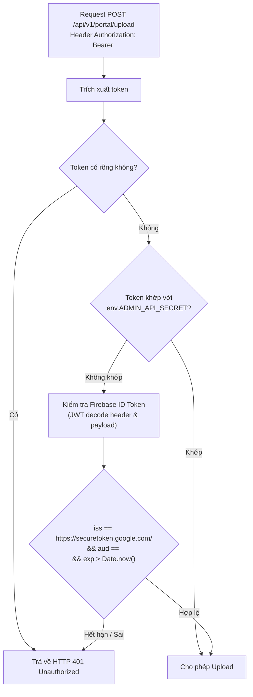

# Phase 06: Thiết Kế Kỹ Thuật Chi Tiết — Chuyển Đổi Dần Ảnh & Tài Liệu Giáo Trình (PDF/Word) Của Root Portal Sang Cloudflare R2 (`Gradual Migration`)

**Spec:** [docs/DESIGN.md](file:///d:/Antigravity/TNDNB/docs/DESIGN.md) & [docs/plans/261105-1836-ontap-web-ui-overhaul/design-specs.md](file:///d:/Antigravity/TNDNB/docs/plans/261105-1836-ontap-web-ui-overhaul/design-specs.md)  
**Kế hoạch tổng thể:** [plan.md](file:///d:/Antigravity/TNDNB/docs/plans/261105-1836-ontap-web-ui-overhaul/plan.md) — Mục 2.5 & Phase 06  
**Cổng thông tin chính thức:** https://www.daotaothuyenvien.com  
**App Ôn tập & Thi thử Trực tuyến:** https://www.daotaothuyenvien.com/ontap  
**Cloudflare Worker API:** `https://tndnb-edge-api.pokecvlkq.workers.dev`  
**R2 Bucket:** `tndnb-assets` (Binding: `env.ASSETS_BUCKET`)

---

## 1. Bối Cảnh Nghiệp Vụ & Đánh Giá Hiện Trạng

### 1.1. Hiện trạng Upload Media trên Root Portal (`daotaothuyenvien.com`)
Hệ thống Root Portal đang vận hành chức năng đăng và quản lý bài viết tin tức, giáo trình tại 2 trang quản trị:
- [app/quan-ly/dang-bai/tao-moi/page.tsx](file:///d:/Antigravity/TNDNB/app/quan-ly/dang-bai/tao-moi/page.tsx)
- [app/quan-ly/dang-bai/sua/[postId]/page.tsx](file:///d:/Antigravity/TNDNB/app/quan-ly/dang-bai/sua/%5BpostId%5D/page.tsx)

Qua khảo sát chi tiết mã nguồn, hệ thống đang xử lý 3 luồng media phụ thuộc 100% vào **Supabase Storage**:

| Loại Media | Cách Thức Thu Nhận Hiện Tại | Quy Chuẩn Đặt Tên & Bucket Cũ | Rủi Ro & Giới Hạn Hạ Tầng |
| :--- | :--- | :--- | :--- |
| **Ảnh đại diện bài viết** (`thumbnail`) | File input `<input type="file" id="thumbnail">`, lưu biến `thumbnailFile: File`. | `post_images`<br>`thumbnail_${Date.now()}_${thumbnailFile.name}` | Tốn dung lượng Free Tier Supabase (1GB). Egress giới hạn 2GB/tháng. Khi bài viết có lượt xem cao trên mạng xã hội, băng thông ảnh bìa dễ chạm trần. |
| **Ảnh nội dung bài viết** (`content`) | Trình soạn thảo TinyMCE Self-hosted qua hàm `tinymceUploadHandler(blobInfo, progress)`. Giới hạn 5MB. | `post_images`<br>`content_${Date.now()}_${blobInfo.filename()}` | Nhiều ảnh minh họa độ phân giải cao trong các bài hướng dẫn kỹ thuật đường thủy gây tiêu tốn băng thông lớn. |
| **Tệp đính kèm bài viết** (`attachments`) | File input `<input type="file" id="attachments" multiple>`, lưu mảng `attachmentFiles: File[]`. | `post_files`<br>`file_${Date.now()}_${cleanName}` | **Cực kỳ nguy hiểm:** Các giáo trình thuyền viên PDF, tài liệu ôn thi Word/PowerPoint nặng từ 10MB–25MB tải lên Supabase Storage sẽ làm cạn kiệt dung lượng chỉ sau vài chục tài liệu. |
| **Thư viện Media** (`media_library`) | Tự động quét thẻ `` từ nội dung HTML qua Regex trong hàm `extractMediaAndSave()`. | Bảng `media_library` trong Supabase Database: lưu `media_url` dưới dạng chuỗi URL tuyệt đối. | Nếu URL Supabase bị đứt đoạn do hết băng thông, thư viện ảnh bị tê liệt hàng loạt. |

### 1.2. Mục Tiêu Kiến Trúc Phase 06
1. **Tiết kiệm 100% chi phí băng thông:** Tận dụng tối đa gói **10 GB lưu trữ miễn phí** và **Zero Egress ($0 phí băng thông tải)** của Cloudflare R2 (`tndnb-assets`).
2. **Tăng tốc độ tải trang:** Phân phối tài nguyên qua Cloudflare Edge Network với PoP Việt Nam (HAN/SGN) kèm tiêu đề `Cache-Control: public, max-age=31536000, immutable`.
3. **Bảo toàn 100% dữ liệu cũ (`Zero Broken Links`):** Tuyệt đối không can thiệp hay xóa bỏ file cũ trên Supabase Storage; cơ sở dữ liệu `posts` lưu song song URL R2 mới và URL Supabase cũ bình thường.
4. **Lưới bảo vệ trải nghiệm người dùng (`Graceful Fallback 5s`):** Nếu đường truyền đến Cloudflare Worker gặp trục trặc hoặc quá thời gian chờ 5 giây, giao diện tự động lùi về upload Supabase Storage truyền thống. Quản trị viên/thầy cô đăng bài không bao giờ gặp lỗi gián đoạn.

---

## 2. Kiến Trúc Tổng Thể & Sơ Đồ Luồng Dữ Liệu

```mermaid
flowchart TD
    subgraph Client["Next.js Root Portal (Frontend Client)"]
        UI["Trang Soạn Thảo / Sửa Bài Viết\n(tao-moi/page.tsx & sua/[postId]/page.tsx)"]
        Helper["lib/portalMediaService.ts\n(Upload Engine với 5s Timeout Controller)"]
    end

    subgraph PrimaryRoute["Đường Truyền Chính (Primary Edge Pipeline)"]
        WorkerUpload["POST /api/v1/portal/upload\nCloudflare Worker (tndnb-edge-api)"]
        AuthCheck{"Xác Thực Token\n(Admin Secret / Firebase ID Token)"}
        Validate{"Kiểm Tra Kích Thước & MIME\n(Image <= 10MB, Doc <= 25MB)"}
        R2Bucket[("Cloudflare R2 Bucket\ntndnb-assets (portal/*)")]
        EdgeCDN["GET /portal-assets/*\nCache-Control: immutable (PoP VN)"]
    end

    subgraph FallbackRoute["Lưới Dự Phòng Tự Động (Automatic Graceful Fallback)"]
        FallbackCheck{"Worker Timeout > 5s\nhoặc Network Error?"}
        SupabaseStorage[("Supabase Storage\n(post_images / post_files)")]
    end

    subgraph Database["Cơ Sở Dữ Liệu Bài Viết"]
        DBPosts[("Supabase DB: posts table\n(Chấp nhận cả URL R2 & URL Supabase)")]
        DBMedia[("Supabase DB: media_library")]
    end

    UI -->|"Gửi File + Category + Kind"| Helper
    Helper -->|"1. Thử tải lên Worker (timeout: 5000ms)"| WorkerUpload
    WorkerUpload --> AuthCheck
    AuthCheck -- Hợp lệ --> Validate
    Validate -- Đạt chuẩn -->|"Lưu Object"| R2Bucket
    R2Bucket -.->|"Phân phối nội dung"| EdgeCDN
    WorkerUpload -->|"HTTP 200: Trả về URL R2"| Helper

    Helper --> FallbackCheck
    FallbackCheck -- "Có sự cố / Timeout 5s" -->|"2. Tự động lùi về Supabase"| SupabaseStorage
    SupabaseStorage -->|"Trả về URL Supabase"| Helper

    Helper -->|"URL Ảnh / File hoàn tất"| UI
    UI -->|"Lưu bài viết"| DBPosts
    UI -->|"Đồng bộ media"| DBMedia
```

---

## 3. Thiết Kế Chi Tiết API Contract (Cloudflare Worker)

### 3.1. Phân Tắc Định Tuyến & Cấu Trúc Khóa R2

#### Cấu trúc Key trên R2 (`tndnb-assets`):
```text
tndnb-assets/
├── question-images/                      # (Phase 05: 280+ ảnh câu hỏi thi sát hạch)
└── portal/                               # (Phase 06: Toàn bộ media Root Portal)
    ├── images/
    │   ├── thumbnail_1730900000000_banner-tuyen-sinh.webp
    │   └── content_1730900001234_so-do-buong-lai.png
    └── documents/
        ├── 1730900005678_giao-trinh-thuyen-truong-hang-ba.pdf
        └── 1730900008910_de-cuong-on-tap-luat-2026.docx
```

#### Quy chuẩn URL Công Khai:
- Endpoint phân phối: `GET https://tndnb-edge-api.pokecvlkq.workers.dev/portal-assets/{r2Key}`
- Ví dụ:
  - Ảnh đại diện: `https://tndnb-edge-api.pokecvlkq.workers.dev/portal-assets/portal/images/thumbnail_1730900000000_banner.webp`
  - Giáo trình PDF: `https://tndnb-edge-api.pokecvlkq.workers.dev/portal-assets/portal/documents/1730900005678_giao-trinh.pdf`
- Khi kích hoạt Custom Domain CDN (Task 5.7 / Phase 06 mở rộng):
  - `https://cdn.daotaothuyenvien.com/portal-assets/portal/images/thumbnail_...`

---

### 3.2. Endpoint 1: Upload Media Bài Viết (`POST /api/v1/portal/upload`)

#### Headers Yêu Cầu:
```http
POST /api/v1/portal/upload HTTP/1.1
Host: tndnb-edge-api.pokecvlkq.workers.dev
Authorization: Bearer <Admin_Secret_Or_Firebase_ID_Token>
Origin: https://www.daotaothuyenvien.com
Content-Type: multipart/form-data; boundary=----WebKitFormBoundaryXYZ
```

#### Form-Data Parameters:
| Trường (Field) | Kiểu Dữ Liệu | Bắt Buộc | Ràng Buộc & Mô Tả |
| :--- | :--- | :---: | :--- |
| `file` | `File (Binary)` | **Có** | File nhị phân cần tải lên. |
| `category` | `string` | **Có** | Phân loại media. Giá trị hợp lệ: `'image'` hoặc `'document'`. |
| `kind` | `string` | Không | Mục đích sử dụng: `'thumbnail'`, `'content'`, hoặc `'document'`. Mặc định tự suy ra từ `category`. |

#### Giới Hạn Dung Lượng & Định Dạng (Content-Type Whitelist):
- **Đối với `category: 'image'`:**
  - Kích thước tối đa: **10 MB** (`10 * 1024 * 1024` bytes).
  - MIME types cho phép: `image/jpeg`, `image/png`, `image/webp`, `image/gif`, `image/svg+xml`.
- **Đối với `category: 'document'`:**
  - Kích thước tối đa: **25 MB** (`25 * 1024 * 1024` bytes).
  - MIME types cho phép:
    - PDF: `application/pdf`
    - Word: `application/msword`, `application/vnd.openxmlformats-officedocument.wordprocessingml.document`
    - Excel: `application/vnd.ms-excel`, `application/vnd.openxmlformats-officedocument.spreadsheetml.sheet`
    - Nén: `application/zip`, `application/x-zip-compressed`, `application/x-rar-compressed`

---

### 3.3. Response Schemas & Mã Lỗi Chuẩn Hóa

#### Mã `200 OK` (Tải lên thành công):
```json
{
  "ok": true,
  "url": "https://tndnb-edge-api.pokecvlkq.workers.dev/portal-assets/portal/images/thumbnail_1730900000000_khoa-hoc-thuyen-truong.webp",
  "key": "portal/images/thumbnail_1730900000000_khoa-hoc-thuyen-truong.webp",
  "fileName": "thumbnail_1730900000000_khoa-hoc-thuyen-truong.webp",
  "originalName": "Khóa Học Thuyền Trưởng.webp",
  "category": "image",
  "kind": "thumbnail",
  "size": 184520,
  "contentType": "image/webp",
  "etag": "w/\"39a2b8e4f1...\"",
  "uploadedAt": 1730900000000,
  "storage": "cloudflare_r2"
}
```

#### Mã `400 Bad Request` (Dữ liệu không hợp lệ / Định dạng không hỗ trợ):
```json
{
  "ok": false,
  "error": "BAD_REQUEST",
  "message": "Định dạng tệp 'application/x-msdownload' (.exe) không được hỗ trợ. Chỉ chấp nhận ảnh hoặc tài liệu giáo trình."
}
```

#### Mã `401 Unauthorized` (Token không hợp lệ hoặc thiếu):
```json
{
  "ok": false,
  "error": "UNAUTHORIZED",
  "message": "Yêu cầu mã xác thực Bearer token hợp lệ để upload tài nguyên vào hệ thống."
}
```

#### Mã `413 Payload Too Large` (Vượt quá dung lượng cho phép):
```json
{
  "ok": false,
  "error": "PAYLOAD_TOO_LARGE",
  "message": "Kích thước tệp (14.2 MB) vượt quá giới hạn tối đa cho phép (10 MB cho ảnh, 25 MB cho tài liệu)."
}
```

#### Mã `500 Internal Server Error` (Lỗi ghi bucket R2):
```json
{
  "ok": false,
  "error": "INTERNAL_SERVER_ERROR",
  "message": "Không thể ghi dữ liệu vào Cloudflare R2 bucket: R2 putObject operation failed."
}
```

---

### 3.4. Endpoint 2: Phân Phối Tài Nguyên Tĩnh (`GET /portal-assets/*`)

- **Method:** `GET` / `HEAD`
- **Logic phân giải Key:**
  - Loại bỏ tiền tố `/portal-assets/` khỏi đường dẫn request.
  - Tìm kiếm trực tiếp `env.ASSETS_BUCKET.get(key)`. Nếu không thấy và key chưa có tiền tố `portal/`, tự động kiểm tra `env.ASSETS_BUCKET.get('portal/' + key)`.
- **Response Headers:**
  - `Content-Type`: Tự động nhận diện chuẩn theo phần mở rộng (`image/webp`, `application/pdf`,...).
  - `Cache-Control`: `public, max-age=31536000, immutable` (Edge và Trình duyệt cache 1 năm, $0 egress).
  - `ETag`: Khớp với `object.httpEtag` để hỗ trợ phản hồi `304 Not Modified`.
  - `Access-Control-Allow-Origin`: Phục vụ mọi origin được cấp phép trong `ALLOWED_ORIGINS`.

---

## 4. Thiết Kế Cơ Chế Xác Thực Bảo Vệ R2 (Security & Auth)

Để đảm bảo người ngoài không thể gửi request rác làm đầy 10GB lưu trữ R2, Worker áp dụng cơ chế **Xác thực Đa Tầng (`Multi-Tier Auth Validator`)**:



```typescript
// cloudflare-worker/src/middleware/auth.ts
export async function verifyPortalUploadAuth(
  request: Request,
  env: WorkerEnv
): Promise<boolean> {
  const authHeader = request.headers.get('Authorization');
  if (!authHeader || !authHeader.startsWith('Bearer ')) {
    return false;
  }
  const token = authHeader.slice('Bearer '.length).trim();
  if (!token) return false;

  // 1. Kiểm tra Admin API Secret cấu hình trong wrangler.toml/Cloudflare Dashboard
  if (env.ADMIN_API_SECRET && token === env.ADMIN_API_SECRET) {
    return true;
  }

  // 2. Xác thực Firebase ID Token của người dùng đang đăng nhập trên Root Portal
  try {
    const parts = token.split('.');
    if (parts.length !== 3) return false;
    
    const payload = JSON.parse(atob(parts[1].replace(/-/g, '+').replace(/_/g, '/')));
    const now = Math.floor(Date.now() / 1000);

    const projectId = env.FIREBASE_PROJECT_ID || 'tndnb-prod';
    const isIssuerValid = payload.iss === `https://securetoken.google.com/${projectId}`;
    const isAudienceValid = payload.aud === projectId;
    const isNotExpired = payload.exp && payload.exp > now;

    if (isIssuerValid && isAudienceValid && isNotExpired) {
      return true;
    }
  } catch (_e) {
    return false;
  }

  return false;
}
```

---

## 5. Thiết Kế Client Helper Dùng Chung Phía Frontend (`lib/portalMediaService.ts`)

### 5.1. Kiến Trúc Dual-Engine & Graceful Fallback

Hàm client helper `portalMediaService` chịu trách nhiệm toàn bộ quá trình upload media cho Root Portal:
1. Luôn ưu tiên gửi tới Cloudflare Worker `POST /api/v1/portal/upload` với bộ đếm thời gian hủy `AbortSignal.timeout(5000)`.
2. Nếu Worker phản hồi `HTTP 200`, nhận URL R2 và đánh dấu `storage: 'cloudflare_r2'`.
3. Nếu Worker gặp lỗi mạng (`Failed to fetch`), lỗi timeout (`TimeoutError` sau 5 giây), hoặc lỗi `5xx`:
   - Ghi nhật ký cảnh báo `console.warn`.
   - **Tự động kích hoạt luồng fallback** đẩy file trực tiếp vào **Supabase Storage** (`post_images` hoặc `post_files`).
   - Nhận URL Supabase và đánh dấu `storage: 'supabase_fallback'`.
   - Thao tác đăng bài của thầy cô/biên tập viên **100% không bao giờ bị đứt quãng**!

### 5.2. Mã Nguồn Thiết Kế Chi Tiết: `lib/portalMediaService.ts`

```typescript
// lib/portalMediaService.ts
import { supabase } from '../utils/supabaseClient';
import { sanitizeFileName } from '../app/quan-ly/dang-bai/dangBaiUtils';
import { auth } from '../utils/firebaseClient';

export interface UploadOptions {
  category: 'image' | 'document';
  kind?: 'thumbnail' | 'content' | 'document';
  timeoutMs?: number; // Mặc định 5000ms
}

export interface PortalUploadResult {
  url: string;
  storage: 'cloudflare_r2' | 'supabase_fallback';
  fileName: string;
  fileSize: number;
  fileType: string;
  key?: string;
  warning?: string;
}

const DEFAULT_TIMEOUT_MS = 5000;

/**
 * Lấy Bearer token xác thực (ưu tiên Firebase ID token của người dùng hiện tại)
 */
async function resolveAuthToken(): Promise<string | null> {
  try {
    if (auth.currentUser) {
      return await auth.currentUser.getIdToken();
    }
  } catch (err) {
    console.warn('[PortalMediaService] Không thể lấy Firebase ID Token:', err);
  }
  return process.env.NEXT_PUBLIC_ADMIN_API_SECRET || null;
}

/**
 * Tải file lên Cloudflare R2 qua Worker Endpoint
 */
async function uploadToCloudflareWorker(
  file: File,
  options: UploadOptions
): Promise<PortalUploadResult> {
  const workerBase = (process.env.NEXT_PUBLIC_CLOUDFLARE_API_URL || '').replace(/\/+$/, '');
  if (!workerBase) {
    throw new Error('Chưa cấu hình NEXT_PUBLIC_CLOUDFLARE_API_URL');
  }

  const token = await resolveAuthToken();
  const formData = new FormData();
  formData.append('file', file);
  formData.append('category', options.category);
  if (options.kind) {
    formData.append('kind', options.kind);
  }

  const timeoutMs = options.timeoutMs || DEFAULT_TIMEOUT_MS;
  const controller = new AbortController();
  const timeoutId = setTimeout(() => controller.abort(), timeoutMs);

  try {
    const res = await fetch(`${workerBase}/api/v1/portal/upload`, {
      method: 'POST',
      headers: {
        ...(token ? { Authorization: `Bearer ${token}` } : {})
      },
      body: formData,
      signal: controller.signal
    });

    if (!res.ok) {
      const errJson = await res.json().catch(() => null);
      throw new Error(errJson?.message || `Worker phản hồi lỗi HTTP ${res.status}`);
    }

    const data = await res.json();
    return {
      url: data.url,
      storage: 'cloudflare_r2',
      fileName: data.fileName,
      fileSize: file.size,
      fileType: file.type,
      key: data.key
    };
  } finally {
    clearTimeout(timeoutId);
  }
}

/**
 * Graceful Fallback: Tải file lên Supabase Storage truyền thống khi Worker gặp sự cố
 */
async function uploadToSupabaseFallback(
  file: File,
  options: UploadOptions
): Promise<PortalUploadResult> {
  const cleanName = sanitizeFileName(file.name);
  const isImage = options.category === 'image';
  const bucket = isImage ? 'post_images' : 'post_files';
  
  let prefix = 'file';
  if (options.kind === 'thumbnail') prefix = 'thumbnail';
  else if (options.kind === 'content') prefix = 'content';

  const fileName = `${prefix}_${Date.now()}_${cleanName}`;

  const { error: uploadError } = await supabase.storage
    .from(bucket)
    .upload(fileName, file);

  if (uploadError) {
    throw new Error(`[Supabase Fallback Thất Bại] ${uploadError.message}`);
  }

  const { data: publicUrlData } = supabase.storage
    .from(bucket)
    .getPublicUrl(fileName);

  return {
    url: publicUrlData.publicUrl,
    storage: 'supabase_fallback',
    fileName: fileName,
    fileSize: file.size,
    fileType: file.type,
    warning: 'Đã tự động lùi về lưu trữ Supabase do kết nối Cloudflare R2 tạm thời gián đoạn.'
  };
}

/**
 * Hàm upload media dùng chung toàn Root Portal với cơ chế Fallback tự động
 */
export async function uploadPortalMedia(
  file: File,
  options: UploadOptions
): Promise<PortalUploadResult> {
  try {
    // 1. Thử tải lên Cloudflare R2 trước
    return await uploadToCloudflareWorker(file, options);
  } catch (workerError: any) {
    console.warn(
      `[PortalMediaService] Tải lên Cloudflare R2 không thành công (${workerError?.message}). Kích hoạt Graceful Fallback sang Supabase Storage...`
    );
    // 2. Tự động lùi về Supabase Storage
    return await uploadToSupabaseFallback(file, options);
  }
}

/**
 * Adapter cho TinyMCE Self-hosted
 */
export function createTinyMceUploadHandler(): (blobInfo: any, progress: (percent: number) => void) => Promise<string> {
  return (blobInfo: any, _progress: (percent: number) => void): Promise<string> => {
    return new Promise(async (resolve, reject) => {
      try {
        const file = blobInfo.blob() as File;
        if (file.size > 10 * 1024 * 1024) {
          return reject('Lỗi: Ảnh quá lớn, vui lòng chọn ảnh dưới 10MB.');
        }

        const result = await uploadPortalMedia(file, {
          category: 'image',
          kind: 'content'
        });

        resolve(result.url);
      } catch (err: any) {
        reject(err?.message || 'Không thể tải ảnh nội dung lên máy chủ.');
      }
    });
  };
}
```

---

## 6. Kế Hoạch Tích Hợp Vào Giao Diện Đăng Bài Root Portal

### 6.1. Trang Tạo Mới Bài Viết (`app/quan-ly/dang-bai/tao-moi/page.tsx`)
1. **Thay thế `tinymceUploadHandler`:**
   ```typescript
   // Thay vì gọi trực tiếp supabase.storage.from('post_images')
   const tinymceUploadHandler = useMemo(() => createTinyMceUploadHandler(), []);
   ```
2. **Xử lý Tải Ảnh Đại Diện (`thumbnailFile`):**
   ```typescript
   if (thumbnailFile) {
     const result = await uploadPortalMedia(thumbnailFile, {
       category: 'image',
       kind: 'thumbnail'
     });
     thumbnailUrl = result.url;
     if (result.storage === 'supabase_fallback') {
       console.info('Ảnh đại diện đã được lưu trữ qua Supabase Fallback.');
     }
   }
   ```
3. **Xử lý Tệp Đính Kèm Giáo Trình / Tài Liệu (`attachmentFiles`):**
   ```typescript
   if (attachmentFiles.length > 0) {
     for (const file of attachmentFiles) {
       const result = await uploadPortalMedia(file, {
         category: 'document',
         kind: 'document'
       });
       attachmentsData.push({
         file_name: file.name,
         file_url: result.url,
         file_size: file.size,
         file_type: file.type
       });
     }
   }
   ```

### 6.2. Trang Chỉnh Sửa Bài Viết (`app/quan-ly/dang-bai/sua/[postId]/page.tsx`)
- Áp dụng tương tự cho `thumbnailFile` và `newAttachmentFiles`.
- Khi cập nhật bài viết cũ, các tệp đính kèm cũ (`existingAttachments`) vẫn giữ nguyên 100% URL Supabase cũ, không bị ghi đè hay thay đổi.

---

## 7. Phân Tích 5 Tình Huống Biên & Rủi Ro Kỹ Thuật (Edge Cases & Resilience)

1. **Mạng chập chờn / Cloudflare Worker Timeout quá 5s:**
   - *Nguy cơ:* Người dùng tải file PDF nặng 20MB trong điều kiện mạng yếu khiến Worker xử lý chậm, gây treo nút Lưu bài viết.
   - *Giải pháp:* `AbortController.timeout(5000)` tự động ngắt kết nối Worker sau 5s và chuyển tức thì sang Supabase Storage Fallback. Bật cờ `isUploadingFiles` với thông báo trạng thái rõ ràng.
2. **Tệp tải lên chứa mã độc hoặc đổi đuôi giả mạo (vd: `.php`, `.sh`, `.exe` đổi tên thành `.png`):**
   - *Giải pháp:* Worker kiểm tra cả `file.type` MIME header và phần mở rộng của tên file qua whitelist nghiêm ngặt. Chỉ cho phép các định dạng ảnh và tài liệu giáo trình chuẩn mực.
3. **Ký tự đặc biệt và dấu Tiếng Việt trong tên tài liệu:**
   - *Nguy cơ:* Tên file có dấu như `Giáo trình Thuyền trưởng Hạng 3 (2026).pdf` gây lỗi encode URI trên R2 hoặc trình duyệt cũ.
   - *Giải pháp:* Sử dụng hàm `sanitizeFileName()` chuẩn hóa NFD, loại bỏ toàn bộ dấu Tiếng Việt và ký tự đặc biệt, chuyển thành `giao-trinh-thuyen-truong-hang-3-2026.pdf`.
4. **Cấu hình Next.js Image Optimization với Domain Worker / R2:**
   - *Nguy cơ:* Component `next/image` trên Next.js chặn ảnh từ domain mới nếu chưa khai báo trong `next.config.mjs`.
   - *Hiện trạng:* [next.config.mjs](file:///d:/Antigravity/TNDNB/next.config.mjs#L10-L19) đã cấu hình `remotePatterns` với `hostname: '**'` nên toàn bộ ảnh từ Worker hay CDN R2 đều hiển thị ngay lập tức mà không cần chỉnh sửa config.
5. **CORS trên trình duyệt:**
   - *Giải pháp:* Worker áp dụng `buildCorsHeaders()` đã hoàn thiện ở Phase 05, chấp thuận đầy đủ `https://www.daotaothuyenvien.com`, `https://daotaothuyenvien.com`, và các cổng phát triển cục bộ (`localhost:3000`, `localhost:3001`).

---

## 8. Kịch Bản Kiểm Thử & Nghiệm Thu (Acceptance Criteria — BDD Given/When/Then)

### Kịch bản 1: Nghiệm thu Upload Ảnh & Tài Liệu Thành Công Lên Cloudflare R2
- **Given:** Người dùng quản trị đăng nhập trên Root Portal và mở trang Tạo bài viết mới.
- **When:** Tải lên ảnh đại diện `banner.png` (2MB) và file giáo trình `giao_trinh.pdf` (15MB).
- **Then:**
  1. File được tải lên endpoint `POST /api/v1/portal/upload` với token hợp lệ.
  2. Worker lưu trữ thành công vào R2 `tndnb-assets` theo prefix `portal/images/` và `portal/documents/`.
  3. URL trả về có dạng `https://.../portal-assets/portal/...`.
  4. Trình duyệt tải ảnh và tài liệu qua `GET /portal-assets/*` với mã `HTTP 200` và header `Cache-Control: public, max-age=31536000, immutable`.

### Kịch bản 2: Nghiệm thu Graceful Fallback Tự Động Sang Supabase Khi Worker Sự Cố / Timeout 5s
- **Given:** Người dùng quản trị tải lên ảnh hoặc file đính kèm.
- **When:** Giả lập Cloudflare Worker bị ngắt kết nối (hoặc timeout quá 5000ms).
- **Then:**
  1. Client helper `uploadPortalMedia` bắt ngoại lệ sau 5 giây.
  2. Hệ thống tự động chuyển hướng đẩy file vào Supabase Storage (`post_images` hoặc `post_files`).
  3. Giao diện nhận được URL Supabase hợp lệ, bài viết được lưu thành công vào cơ sở dữ liệu `posts`.
  4. Quá trình đăng bài không bị báo lỗi thất bại, trải nghiệm của người dùng hoàn toàn liền mạch.

### Kịch bản 3: Nghiệm thu Bảo Toàn 100% Bài Viết Cũ Không Bị Đứt Gãy
- **Given:** Cơ sở dữ liệu chứa hàng chục bài viết cũ với đường link Supabase Storage `https://<supabase-id>.supabase.co/storage/v1/object/public/...`.
- **When:** Người xem mở trang chi tiết bài viết `/bai-viet/[postId]` hoặc biên tập viên mở trang sửa bài `/quan-ly/dang-bai/sua/[postId]`.
- **Then:**
  1. Toàn bộ ảnh bìa, ảnh TinyMCE và tài liệu đính kèm cũ vẫn hiển thị và tải về bình thường từ Supabase Storage.
  2. Khi lưu sửa bài viết, các tài liệu cũ giữ nguyên URL ban đầu, chỉ tài liệu mới thêm vào mới nhận URL Cloudflare R2.

---

## 9. Danh Mục File Tác Động & Phân Công Triển Khai (Phase 06 Implementation Scope)

| STT | File / Module | Hành Động | Trách Nhiệm Kỹ Thuật |
| :---: | :--- | :---: | :--- |
| 1 | [cloudflare-worker/src/routes/portalUpload.ts](file:///d:/Antigravity/TNDNB/cloudflare-worker/src/routes/portalUpload.ts) | Tạo mới | Tiếp nhận multipart/form-data, xác thực quyền Admin/Firebase Token, ghi file vào `env.ASSETS_BUCKET`. |
| 2 | [cloudflare-worker/src/index.ts](file:///d:/Antigravity/TNDNB/cloudflare-worker/src/index.ts) | Cập nhật | Bổ sung route `POST /api/v1/portal/upload` và `GET /portal-assets/*`. |
| 3 | [cloudflare-worker/src/middleware/auth.ts](file:///d:/Antigravity/TNDNB/cloudflare-worker/src/middleware/auth.ts) | Cập nhật | Bổ sung hàm `verifyPortalUploadAuth()` hỗ trợ cả Admin Secret và Firebase ID token. |
| 4 | [lib/portalMediaService.ts](file:///d:/Antigravity/TNDNB/lib/portalMediaService.ts) | Tạo mới | Service upload media client với bộ đếm thời gian 5s và tự động Fallback Supabase Storage. |
| 5 | [app/quan-ly/dang-bai/tao-moi/page.tsx](file:///d:/Antigravity/TNDNB/app/quan-ly/dang-bai/tao-moi/page.tsx) | Cập nhật | Kết nối `uploadPortalMedia` cho ảnh đại diện, ảnh TinyMCE và tài liệu đính kèm. |
| 6 | [app/quan-ly/dang-bai/sua/[postId]/page.tsx](file:///d:/Antigravity/TNDNB/app/quan-ly/dang-bai/sua/%5BpostId%5D/page.tsx) | Cập nhật | Kết nối `uploadPortalMedia` cho ảnh và tệp đính kèm mới, giữ nguyên file cũ. |
| 7 | [scripts/portal-r2-assets.test.ts](file:///d:/Antigravity/TNDNB/scripts/portal-r2-assets.test.ts) | Tạo mới | Bộ unit test kiểm thử toàn diện API contract, Fallback 5s và quy tắc đặt tên file. |
