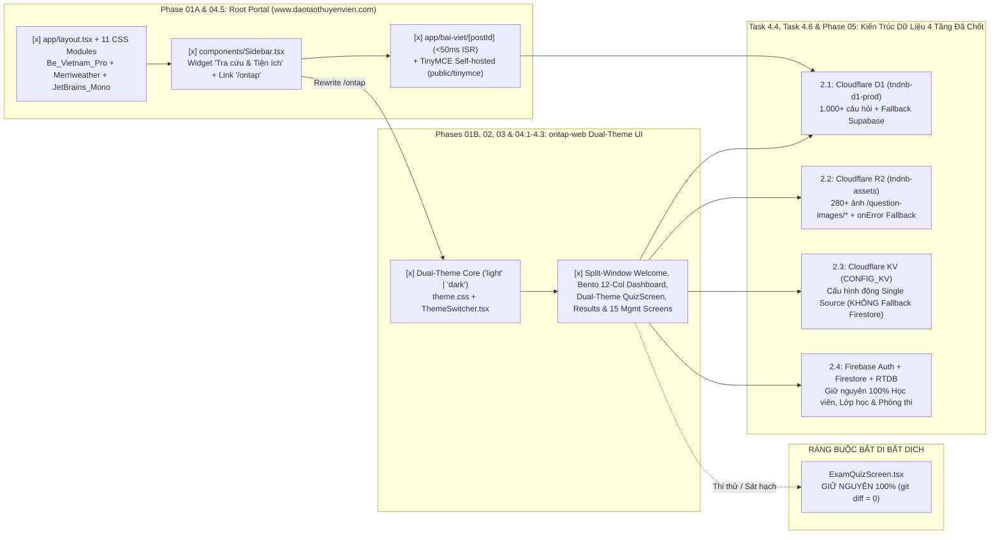

# Kế Hoạch Tổng Thể (`/plan` — Double-Sync Plan & Task Protocol): Sửa Lỗi Font Tiếng Việt "Chữ To Chữ Bé" Toàn Trang Portal, Gắn Liên Kết `/ontap` Vào Sidebar, Tối Ưu Tốc Độ Bài Viết `< 50ms`, Đại Tu Giao Diện `ontap-web` Chuẩn Dual-Theme (`Light` / `Dark`) & Triển Khai Hạ Tầng Cloudflare Edge (`D1` + `R2` + `KV`)

**Ngày cập nhật:** 2026-11-06  
**Thư mục kế hoạch:** [docs/plans/261105-1836-ontap-web-ui-overhaul](file:///d:/Antigravity/TNDNB/docs/plans/261105-1836-ontap-web-ui-overhaul)  
**Tiêu chuẩn thiết kế:** `Impeccable v4.8.0 (62-Rule Craft Floor)` + `Taste-Skill v2.5.0`  
**Cổng thông tin chính thức:** https://www.daotaothuyenvien.com  
**App Ôn tập & Thi thử Trực tuyến:** https://www.daotaothuyenvien.com/ontap  
*(Lưu ý định danh hệ thống: Dự án chạy chính thức trên domain `www.daotaothuyenvien.com`, không dùng domain tndnb.vn)*  
**Trạng thái:** Phases 01, 02, 03, 04, 05 `[x]` Completed & Verified | Phase 06 Ready in Backlog

---

## 1. Bối Cảnh & Mục Tiêu Sản Phẩm (PRD Overview)

### 1.1. Xử lý triệt để lỗi "Chữ to chữ bé" (Vietnamese Font Fallback) trên toàn bộ Root Portal & `ontap-web` *(Đã hoàn thành `[x]`)*
Qua quá trình điều tra nguyên nhân gốc rễ (`systematic-debugging`) từ ảnh chụp thực tế của người dùng trên trang chủ Portal, hệ thống đã xử lý triệt để **3 Nguyên Nhân Gốc Rễ trên Root Portal** và **1 lỗi tham chiếu vòng lặp biến CSS bên `ontap-web`**:

1. **Nguyên nhân Gốc rễ #1 ([app/layout.tsx](file:///d:/Antigravity/TNDNB/app/layout.tsx) ép dùng font `Rubik` thiếu bộ ký tự Tiếng Việt):**
   - Đã xóa bỏ hoàn toàn `Rubik` và sử dụng `next/font/google` để self-host bộ 3 font hỗ trợ 100% Tiếng Việt (`subsets: ['latin', 'vietnamese']`): `Be_Vietnam_Pro` (`--font-sans`), `Merriweather` (`--font-display`), `JetBrains_Mono` (`--font-mono`).
2. **Nguyên nhân Gốc rễ #2 (Lỗi vị trí `@import url(...)` trong [app/globals.css](file:///d:/Antigravity/TNDNB/app/globals.css)):**
   - Đã xóa dòng `@import url(...)` đặt sai vị trí sau `@tailwind` và chuẩn hóa `body { font-family: var(--font-sans), 'Be Vietnam Pro', system-ui, sans-serif; }`.
3. **Nguyên nhân Gốc rễ #3 (11 file CSS Module trên Portal dùng `--font-mono` cho chữ Tiếng Việt có dấu hoặc hardcode font hệ thống):**
   - Đã chuẩn hóa toàn bộ 13 file trên Root Portal ([app/layout.tsx](file:///d:/Antigravity/TNDNB/app/layout.tsx), [app/globals.css](file:///d:/Antigravity/TNDNB/app/globals.css), [components/Navbar.module.css](file:///d:/Antigravity/TNDNB/components/Navbar.module.css), [app/page.module.css](file:///d:/Antigravity/TNDNB/app/page.module.css), [app/bai-viet/[postId]/page.module.css](file:///d:/Antigravity/TNDNB/app/bai-viet/%5BpostId%5D/page.module.css), [app/danh-muc/[categoryId]/page.module.css](file:///d:/Antigravity/TNDNB/app/danh-muc/%5BcategoryId%5D/page.module.css), [app/hoc-phi/page.module.css](file:///d:/Antigravity/TNDNB/app/hoc-phi/page.module.css), [app/quan-ly/page.module.css](file:///d:/Antigravity/TNDNB/app/quan-ly/page.module.css), [app/quan-ly/dang-bai/page.module.css](file:///d:/Antigravity/TNDNB/app/quan-ly/dang-bai/page.module.css), [app/quan-ly/tai-khoan/page.module.css](file:///d:/Antigravity/TNDNB/app/quan-ly/tai-khoan/page.module.css), [app/quan-ly/[roomId]/page.module.css](file:///d:/Antigravity/TNDNB/app/quan-ly/%5BroomId%5D/page.module.css), [app/tra-cuu-dia-chi/page.module.css](file:///d:/Antigravity/TNDNB/app/tra-cuu-dia-chi/page.module.css), [components/StudentCard.module.css](file:///d:/Antigravity/TNDNB/components/StudentCard.module.css)) và sửa vòng lặp `--font-sans` trong [ontap-web/theme.css](file:///d:/Antigravity/TNDNB/ontap-web/theme.css).

---

### 1.2. Tích hợp điểm truy cập App Ôn Tập tại Sidebar Trang Chủ Portal *(Đã hoàn thành `[x]`)*
- Trên trang chủ Root Portal ([components/Sidebar.tsx](file:///d:/Antigravity/TNDNB/components/Sidebar.tsx#L137-L151)), đã bổ sung mục đầu tiên trong khung widget **"Tra cứu & Tiện ích"** dẫn trực tiếp tới **Ôn tập & Thi thử Trực tuyến** (`/ontap`), bảo toàn 100% bài test [scripts/portal-navbar-cleanup.test.ts](file:///d:/Antigravity/TNDNB/scripts/portal-navbar-cleanup.test.ts).

---

### 1.3. Đại tu toàn diện giao diện `ontap-web` theo chuẩn Maritime EdTech Dual-Theme (`light` / `dark`) *(Đã hoàn thành `[x]` tại Phases 01 – 04.3)*
- **Dual-Theme Core (`[x]` Phase 01):**
  - Chỉ giữ đúng 2 chế độ Sáng (`light`) và Tối (`dark`) trong [ontap-web/types.ts](file:///d:/Antigravity/TNDNB/ontap-web/types.ts), [ontap-web/contexts/ThemeContext.tsx](file:///d:/Antigravity/TNDNB/ontap-web/contexts/ThemeContext.tsx), [ontap-web/theme.css](file:///d:/Antigravity/TNDNB/ontap-web/theme.css), [ontap-web/components/ThemeSwitcher.tsx](file:///d:/Antigravity/TNDNB/ontap-web/components/ThemeSwitcher.tsx), [ontap-web/components/icons.tsx](file:///d:/Antigravity/TNDNB/ontap-web/components/icons.tsx), [ontap-web/components/Footer.tsx](file:///d:/Antigravity/TNDNB/ontap-web/components/Footer.tsx), và đã xóa bỏ `SnowEffect.tsx`.
- **Nâng cấp toàn bộ màn hình ứng dụng (`[x]` Phases 02 – 04.3):**
  - Đã nâng cấp `WelcomeModal.tsx` theo bố cục **Split Window Card (`7fr / 5fr`)**, chuẩn hóa `Dashboard.tsx` theo **Bento Asymmetric 12-Col** (xóa sạch neon blur `blur-[120px]` / `blur-[100px]` và `glass-premium`), đại tu `QuizScreen.tsx` (`/ontap/lambai`) và đồng bộ 15 màn hình quản lý / học viên / tiện ích cùng bộ soạn thảo **TinyMCE Self-hosted Local** ([public/tinymce/](file:///d:/Antigravity/TNDNB/public/tinymce/)).

---

### 1.4. Ràng Buộc Bất Di Bất Dịch (Strict Constraint — Bảo Toàn 100% `ExamQuizScreen.tsx`)
> [!IMPORTANT]
> **TUYỆT ĐỐI KHÔNG THAY ĐỔI** bố cục hay giao diện của trang làm bài thi thử sát hạch [ontap-web/components/ExamQuizScreen.tsx](file:///d:/Antigravity/TNDNB/ontap-web/components/ExamQuizScreen.tsx) (`git diff` phải bằng `0`).

---

### 1.5. Khắc Phục Triệt Để Hiệu Năng & Chuẩn Hóa 4 Quyết Định Kiến Trúc Mới Nhất (User Rulings 2.1 – 2.4)

1. **Tối ưu tốc độ bài viết `< 50ms` & TinyMCE Self-hosted trên Root Portal *(Đã hoàn thành `[x]` tại `Task 1.5` & `Task 4.5`)*:**
   - [app/bai-viet/[postId]/page.tsx](file:///d:/Antigravity/TNDNB/app/bai-viet/%5BpostId%5D/page.tsx) & [app/bai-viet/[postId]/loading.tsx](file:///d:/Antigravity/TNDNB/app/bai-viet/%5BpostId%5D/loading.tsx): Bật ISR `revalidate = 60`, `authorCache` + `Promise.race` timeout `1500ms` + `Promise.all` + Editorial Skeleton `0ms`.
   - [public/tinymce/tinymce.min.js](file:///d:/Antigravity/TNDNB/public/tinymce/tinymce.min.js): Chuyển trình soạn thảo tin tức tại [app/quan-ly/dang-bai/tao-moi/page.tsx](file:///d:/Antigravity/TNDNB/app/quan-ly/dang-bai/tao-moi/page.tsx) và [app/quan-ly/dang-bai/sua/[postId]/page.tsx](file:///d:/Antigravity/TNDNB/app/quan-ly/dang-bai/sua/%5BpostId%5D/page.tsx) sang Self-hosted Local, chấm dứt vĩnh viễn cảnh báo API Key.
2. **Quyết định 2.1 — Ngân hàng 1.000+ câu hỏi & bài thi (`Cloudflare D1 + Fallback Supabase`):**
   - Đọc chính từ **Cloudflare D1 (`tndnb-d1-prod`)** qua Worker `tndnb-edge-api` (`/api/v1/questions/snapshot` & `/api/v1/licenses/:id`), kết hợp lưu Offline IndexedDB (`Dexie`).
   - **Giữ & Bổ sung Dự phòng (Graceful Fallback):** Khi chưa kết nối được D1 / Worker hoặc gặp sự cố mạng, tự động gọi dự phòng về **Supabase cũ** (`supabase.from('licenses')`) trong [ontap-web/services/dataService.ts](file:///d:/Antigravity/TNDNB/ontap-web/services/dataService.ts) và [app/api/thi/[licenseId]/route.ts](file:///d:/Antigravity/TNDNB/app/api/thi/%5BlicenseId%5D/route.ts).
3. **Quyết định 2.2 — Kho 280+ ảnh biển báo / sa hình câu hỏi (`Cloudflare R2 + Fallback Ảnh Gốc Supabase/Firebase/Local`):**
   - Tải chính từ **Cloudflare R2 (`tndnb-assets`)** qua route Worker `/question-images/*` (hoặc URL R2 public).
   - **Bổ sung Dự phòng Ảnh (`Task 4.6`):** Bổ sung `resolveQuestionImageFallbackUrl(question)` trong [ontap-web/utils/imageHelper.ts](file:///d:/Antigravity/TNDNB/ontap-web/utils/imageHelper.ts) trả về link ảnh gốc trên Supabase/Firebase (nếu `question.image` là URL `https://...` gốc) hoặc đường dẫn tĩnh `/ontap/question_images/${question.id}.png`, đồng thời gắn `onError` tự động chuyển sang ảnh dự phòng trên thẻ `` tại [ontap-web/components/QuizScreen.tsx](file:///d:/Antigravity/TNDNB/ontap-web/components/QuizScreen.tsx), [ontap-web/components/ResultsScreen.tsx](file:///d:/Antigravity/TNDNB/ontap-web/components/ResultsScreen.tsx), [ontap-web/components/ExamResultsScreen.tsx](file:///d:/Antigravity/TNDNB/ontap-web/components/ExamResultsScreen.tsx) (**không chạm vào `ExamQuizScreen.tsx`**). Xóa sạch mọi chuỗi URL giả định cũ khỏi [ontap-web/utils/imageHelper.ts](file:///d:/Antigravity/TNDNB/ontap-web/utils/imageHelper.ts) và [scripts/migrate-to-d1.mjs](file:///d:/Antigravity/TNDNB/scripts/migrate-to-d1.mjs).
4. **Quyết định 2.3 — Cấu hình hệ thống động & Cờ bảo trì (`CHUYỂN HẲN SANG CLOUDFLARE KV — KHÔNG FALLBACK FIRESTORE`):**
   - Vì cấu hình động (`usage_config`, `github_config`, cờ bảo trì, cấu hình khẩn tại `/ontap/settings`) thường xuyên thay đổi nên **chuyển hẳn 100% sang Cloudflare KV (`TNDNB_CONFIG_KV`, binding `CONFIG_KV`)**, **TUYỆT ĐỐI KHÔNG DÙNG FALLBACK VỀ FIRESTORE/SUPABASE CŨ** để ngăn chặn triệt để rủi ro đọc nhầm cấu hình cũ (split-brain / sai lệch cấu hình).
   - Triển khai tại `Task 4.6` & `Task 5.2`: chuyển [cloudflare-worker/src/routes/config.ts](file:///d:/Antigravity/TNDNB/cloudflare-worker/src/routes/config.ts) sang đọc/ghi trực tiếp `env.CONFIG_KV` (`< 5ms` tại Edge), và refactor [ontap-web/services/adminConfigService.ts](file:///d:/Antigravity/TNDNB/ontap-web/services/adminConfigService.ts) + [ontap-web/services/d1Client.ts](file:///d:/Antigravity/TNDNB/ontap-web/services/d1Client.ts) chỉ đọc/ghi qua `/api/v1/config/*` (chỉ giữ schema `DEFAULT_CONFIG` an toàn trong RAM khi chưa có mạng, và báo lỗi rõ ràng nếu bấm Lưu khi chưa kết nối được Cloudflare KV API).
5. **Quyết định 2.4 — Đăng nhập, Hồ sơ Học viên, Điểm danh, Quản lý Lớp học & Phòng thi Online (`Giữ nguyên 100% Firebase`):**
   - Giữ nguyên 100% trên **Firebase Authentication + Cloud Firestore + Realtime Database** (kèm cơ chế bảo vệ quyền `BadgeListener` đã hoàn thành tại `Task 4.4`) để bảo toàn tuyệt đối tài khoản học viên cũ, đồng bộ thời gian thực và App Android/Windows.

---

## 2. Kiến Trúc Hạ Tầng Lai Đã Chốt (`Finalized Hybrid Edge + Cloud Architecture`)

| Phân Tầng Nghiệp Vụ | Dịch Vụ Chính Thức (Primary) | Chính Sách Dự Phòng (Fallback Policy) | Độ Trễ Mục Tiêu & Ghi Chú Kỹ Thuật |
| :--- | :--- | :--- | :--- |
| **1. Ngân hàng 1.000+ câu hỏi & bài thi** *(Mục 2.1)* | **Cloudflare D1 (`tndnb-d1-prod`)** qua `tndnb-edge-api` + **IndexedDB (`Dexie`)** | **CÓ FALLBACK:** Tự động gọi dự phòng về **Supabase (`licenses`)** trong `dataService.ts` & `/api/thi/[licenseId]` khi mất kết nối D1/Worker. | **`< 5ms` (IndexedDB)** / **`< 30ms` (Edge D1)**; đảm bảo học viên mở lần đầu hoặc làm bài trên tàu luôn tải được đề thi. |
| **2. Kho 280+ ảnh biển báo / sa hình** *(Mục 2.2)* | **Cloudflare R2 (`tndnb-assets`)** qua route Worker `/question-images/*` | **CÓ FALLBACK:** Hàm `resolveQuestionImageFallbackUrl` + `img.onError` tự chuyển về link ảnh gốc Supabase/Firebase hoặc `/ontap/question_images/*.png`. | **`Zero Egress ($0)`** + `Cache-Control: immutable`; bảo toàn `git diff = 0` trên `ExamQuizScreen.tsx`. |
| **3. Cấu hình hệ thống động & Cờ bảo trì** *(Mục 2.3)* | **Cloudflare KV (`TNDNB_CONFIG_KV` / `CONFIG_KV`)** qua `GET/PUT /api/v1/config/:key` | **KHÔNG FALLBACK FIRESTORE/SUPABASE (Single Source of Truth):** Tránh tuyệt đối lỗi split-brain đọc nhầm cấu hình cũ; chỉ giữ `DEFAULT_CONFIG` trong RAM khi mất mạng và báo lỗi rõ nếu lưu thất bại. | **`< 5ms` tại Edge KV**; quản trị viên lưu tại `https://www.daotaothuyenvien.com/ontap/settings` hiệu lực đồng nhất toàn hệ thống. |
| **4. Auth, Hồ sơ, Điểm danh, Lớp học & Phòng thi Online** *(Mục 2.4)* | **Firebase Auth + Cloud Firestore + Realtime Database** | **GIỮ NGUYÊN 100% FIREBASE:** Bảo toàn toàn bộ tài khoản học viên cũ, tiến độ cá nhân, lớp học và tương thích 100% App Android / Windows. | **Realtime Push (`< 100ms`)**; đã khóa chống spam `permission-denied` tại `BadgeListener.tsx`. |
| **5. Tin tức, Thông báo & Trình soạn thảo CMS** | **Supabase PostgreSQL** + **Cloudflare R2 (`tndnb-assets/portal/*`) cho bài mới** + **TinyMCE Self-hosted (`public/tinymce/`)** | **Next.js ISR (`revalidate = 60`)** + Editorial Skeleton `0ms` + **Giữ nguyên Supabase Storage cho bài cũ** (Gradual Migration). | **`< 50ms` qua Edge ISR Cache** trên `https://www.daotaothuyenvien.com`; hưởng **10 GB lưu trữ + Zero Egress ($0)** trên R2 cho toàn bộ ảnh & giáo trình PDF/Word mới. |

### 2.5. Lộ Trình Mở Rộng Sau Khi Hoàn Thành App Ôn Tập (`Phase 06` — Chuyển Đổi Ảnh & Tài Liệu Giáo Trình PDF/Word Của Root Portal Sang Cloudflare R2)

Để tận dụng tối đa gói **10 GB lưu trữ miễn phí** và **Zero Egress ($0 phí băng thông tải file)** của Cloudflare R2 mà không gây bất kỳ rủi ro đứt gãy nào cho các bài viết tin tức hiện hành trên `https://www.daotaothuyenvien.com`, hệ thống áp dụng chiến lược **2 Bước "Chuyển Dần" (`Gradual Migration Strategy`)**:

1. **Bước 1 — Chuyển luồng Upload bài viết mới sang Cloudflare R2 (Thực hiện ngay sau khi Phase 05 Go-Live):**
   - Bổ sung endpoint `POST /api/v1/portal/upload` (kèm route đọc file `GET /portal-assets/*`) trên Cloudflare Worker [cloudflare-worker/src/index.ts](file:///d:/Antigravity/TNDNB/cloudflare-worker/src/index.ts) kết nối trực tiếp vào R2 bucket `tndnb-assets` (theo prefix `portal/images/` và `portal/documents/`).
   - Cập nhật 2 trang quản lý đăng bài trên Root Portal là [app/quan-ly/dang-bai/tao-moi/page.tsx](file:///d:/Antigravity/TNDNB/app/quan-ly/dang-bai/tao-moi/page.tsx) và [app/quan-ly/dang-bai/sua/[postId]/page.tsx](file:///d:/Antigravity/TNDNB/app/quan-ly/dang-bai/sua/%5BpostId%5D/page.tsx) để mọi bài viết mới khi tải ảnh bìa, ảnh nội dung TinyMCE hoặc đính kèm tài liệu giáo trình PDF/Word đều tự động đẩy thẳng lên Cloudflare R2.
2. **Bước 2 — Giữ an toàn 100% bài viết cũ & Gom Backup dần khi vượt ngưỡng:**
   - Giữ nguyên toàn bộ bài viết và file đính kèm cũ trên **Supabase Storage** để bảo toàn tuyệt đối các đường dẫn ảnh/tài liệu cũ đã chia sẻ, tuyệt đối không làm đứt gãy link.
   - Chỉ kích hoạt script đồng bộ / gom backup dần từ Supabase Storage sang Cloudflare R2 khi dung lượng lưu trữ trên Supabase vượt mốc **500 MB** (ngưỡng 50% gói Free Tier của Supabase).

---

## 3. Hệ Thống Bảng Màu & Token Thiết Kế (`Maritime EdTech High-Craft Dual Theme`)

| Token / Biến CSS (`ontap-web/theme.css`) | Chế Độ Sáng (`light` — Warm Alabaster & Maritime Navy) | Chế Độ Tối (`dark` — Deep Nautical Carbon-Slate) | Ý Nghĩa & Quy Tắc Sử Dụng |
| :--- | :--- | :--- | :--- |
| `--background` | `210 40% 98%` (`#F8FAFC`) | `222 47% 8%` (`#0B1120`) | Nền tổng thể ứng dụng, dịu mắt khi ôn luyện thời gian dài. |
| `--card` / `--popover` | `0 0% 100%` (`#FFFFFF`) | `222 47% 11%` (`#111827`) | Bề mặt thẻ Bento, khung câu hỏi, bảng điều khiển. |
| `--foreground` / `--card-foreground` | `222 47% 11%` (`#0F172A`) | `210 40% 96%` (`#F1F5F9`) | Chữ chính sắc nét, độ tương phản đạt chuẩn WCAG AAA. |
| `--primary` | `211 100% 30%` (`#004A99`) | `199 89% 60%` (`#38BDF8`) | Màu chủ đạo Hàng hải / Đường thủy cho nút CTA, tiến độ, trạng thái chọn. |
| `--secondary` / `--muted` | `210 40% 94%` (`#F1F5F9`) | `217 33% 17%` (`#1E293B`) | Nền phụ cho badge, ô lưới câu hỏi chưa làm, thanh tab. |
| `--muted-foreground` | `215 16% 42%` (`#475569`) | `215 20% 68%` (`#94A3B8`) | Chữ chú thích, thời gian, mô tả phụ. |
| `--accent` | `199 95% 39%` (`#0284C7`) | `199 89% 48%` (`#0EA5E9`) | Điểm nhấn Teal Hàng hải cho huy hiệu, thông báo học vụ. |
| `--border` / `--input` | `214 32% 91%` (`#E2E8F0`) | `217 33% 20%` (`#1E293B`) | Đường viền `1px solid` sắc nét (`Hairline Border`). |
| `--font-sans` | `'Be Vietnam Pro', system-ui, -apple-system, sans-serif` | `'Be Vietnam Pro', system-ui, -apple-system, sans-serif` | Hỗ trợ 100% dấu Tiếng Việt đồng nhất chiều cao `x-height`. |

---

## 4. Sơ Đồ Kiến Trúc Tổng Thể (`Mermaid Diagram`)

---

## 5. Bảng Phân Chia 6 Giai Đoạn Triển Khai (Phases Overview)

| Phase | Tên Giai Đoạn | File Kế Hoạch Chi Tiết | Phạm Vi Tác Động Chính | Effort | Trạng Thái |
| :--- | :--- | :--- | :--- | :---: | :---: |
| **Phase 01** | **Fix Font Tiếng Việt Toàn Portal, Link Sidebar `/ontap`, Dual-Theme Core & Tối Ưu Tốc Độ Bài Viết** | [phase-01-portal-sidebar-and-dual-theme-core.md](file:///d:/Antigravity/TNDNB/docs/plans/261105-1836-ontap-web-ui-overhaul/phase-01-portal-sidebar-and-dual-theme-core.md) | `[x]` Tasks 1.0–1.4 hoàn thành (13 file Typography Portal, `Sidebar.tsx`, Dual-Theme Core). `[x]` Task 1.5 hoàn thành (`app/bai-viet/[postId]/page.tsx`, `loading.tsx`, `app/api/thi/[licenseId]/route.ts`, `scripts/portal-post-performance.test.ts`). | 2.5h | `[x]` Completed |
| **Phase 02** | **App Shell, Navigation & Split-Window / Bento 12-Col Entry Screens** | [phase-02-ontap-shell-and-entry-screens.md](file:///d:/Antigravity/TNDNB/docs/plans/261105-1836-ontap-web-ui-overhaul/phase-02-ontap-shell-and-entry-screens.md) | `[x]` Tasks 2.1–2.4 hoàn thành: `TopNavbar.tsx`, `MobileHeader.tsx`, `MobileBottomNav.tsx`, `AlertMarquee.tsx`, `WelcomeModal.tsx` (Split Window `7fr/5fr`), `Dashboard.tsx` (Bento 12-Col), 6 Dashboard Widgets, 3 Auth Screens + `Taste-Skill` & `Impeccable`. | 2.5h | `[x]` Completed |
| **Phase 03** | **Learning Flow, Practice Quiz & Results Screens (Bảo Toàn `ExamQuizScreen.tsx`)** | [phase-03-learning-flow-and-results-screens.md](file:///d:/Antigravity/TNDNB/docs/plans/261105-1836-ontap-web-ui-overhaul/phase-03-learning-flow-and-results-screens.md) | `[x]` Tasks 3.1–3.4 hoàn thành: `LicenseSelectionScreen.tsx`, `NameInputScreen.tsx`, `ModeSelectionScreen.tsx`, `SubjectSelectionScreen.tsx`, `GiamKhaoSelectionScreen.tsx`, `QuizScreen.tsx`, `ResultsScreen.tsx`, `ExamResultsScreen.tsx`, `ThiTrucTuyenPage.tsx`. **Giữ nguyên 100% `ExamQuizScreen.tsx`**. | 2.5h | `[x]` Completed |
| **Phase 04** | **Management, Utility Screens, Self-hosted TinyMCE & Chuẩn Hóa Kiến Trúc KV-Only Config + R2 Image Fallback** | [phase-04-management-utility-screens-and-verification.md](file:///d:/Antigravity/TNDNB/docs/plans/261105-1836-ontap-web-ui-overhaul/phase-04-management-utility-screens-and-verification.md) | `[x]` Tasks 4.1–4.3 (15 màn hình quản lý/tiện ích) + `[x]` Task 4.4 (Supabase Fallback cho `dataService.ts` & fix `BadgeListener`) + `[x]` Task 4.5 (TinyMCE Self-hosted tại `public/tinymce/`) + `[x]` **Task 4.6** (Chuẩn hóa Mục 2.2 R2 Image Fallback `onError` + Mục 2.3 Cloudflare KV `CONFIG_KV` Zero-Fallback Firestore, xóa sạch domain giả). | 4.0h | `[x]` Completed |
| **Phase 05** | **Cloudflare Edge Production Deployment (`D1` + `R2` + `KV` + `tndnb-edge-api` Worker)** | [phase-05-cloudflare-production-deployment.md](file:///d:/Antigravity/TNDNB/docs/plans/261105-1836-ontap-web-ui-overhaul/phase-05-cloudflare-production-deployment.md) | `[x]` Tasks 5.1–5.6 hoàn thành: Kích hoạt R2 bucket `tndnb-assets`, khởi tạo KV `TNDNB_CONFIG_KV` (`CONFIG_KV`) & D1 thật `tndnb-d1-prod`, cập nhật `wrangler.toml` (`ALLOWED_ORIGINS` cho `www.daotaothuyenvien.com`) & route `/question-images/*`, seed 1.810 câu hỏi + upload 280 ảnh R2 (`--remote`), deploy Worker lên `https://tndnb-edge-api.pokecvlkq.workers.dev`, nối biến môi trường & kiểm thử E2E 100% PASS. | 1.5h | `[x]` Completed |
| **Phase 06** | **Chuyển Đổi Dần Ảnh & Tài Liệu Giáo Trình (PDF/Word) Của Root Portal Sang Cloudflare R2 (`Gradual Migration`)** | [phase-06-portal-r2-assets-design.md](file:///d:/Antigravity/TNDNB/docs/plans/261105-1836-ontap-web-ui-overhaul/phase-06-portal-r2-assets-design.md) | **Bước 1 (Sau Phase 05 Go-Live):** Thêm `POST /api/v1/portal/upload` trên Worker kết nối R2 `tndnb-assets` (`portal/*`); cập nhật `tao-moi/page.tsx` & `sua/[postId]/page.tsx` để bài viết mới đẩy ảnh/tài liệu PDF lên R2 (10 GB + Zero Egress $0). **Bước 2:** Giữ nguyên file bài viết cũ trên Supabase Storage chống đứt link; chỉ gom backup sang R2 khi Supabase vượt 500 MB. | 1.5h | `[ ]` Backlog (Post-Phase 05) |
