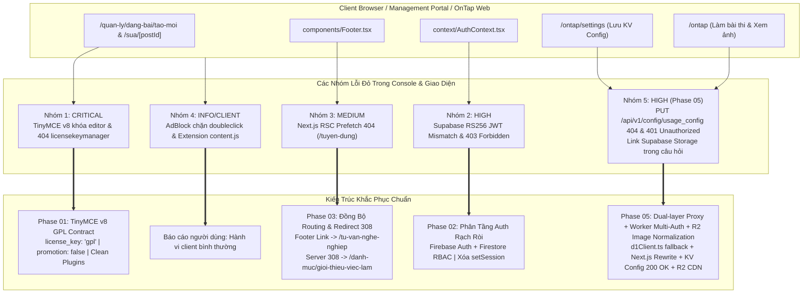
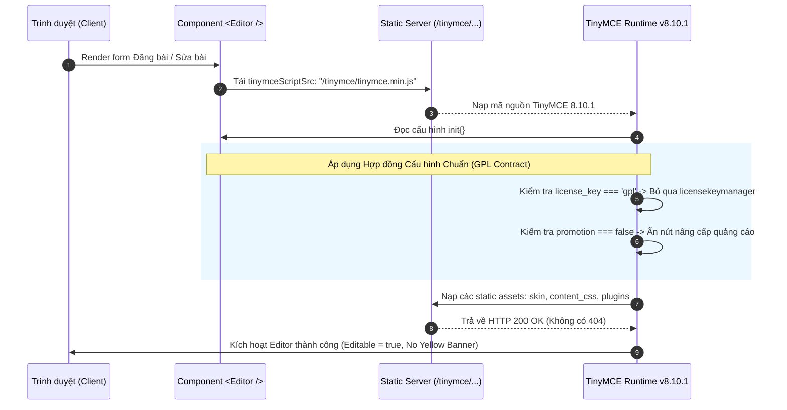
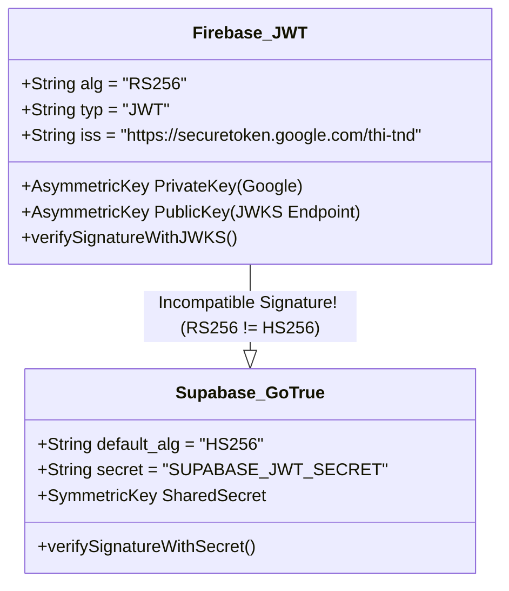
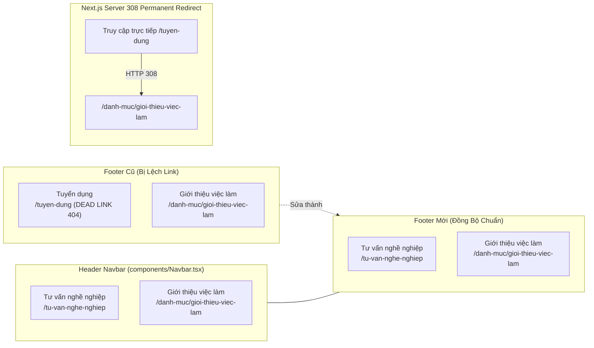
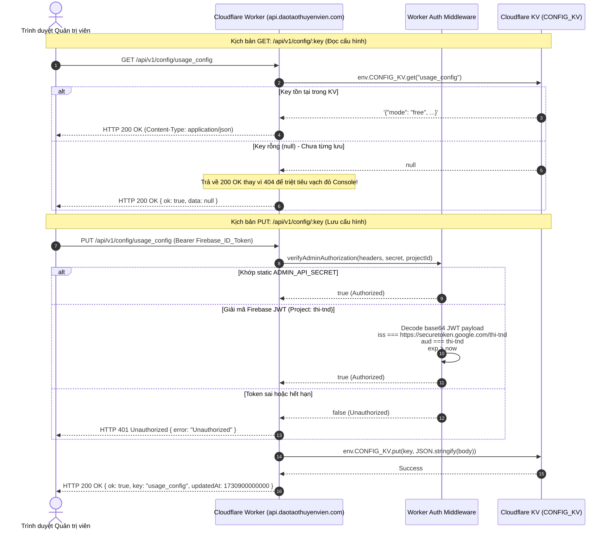
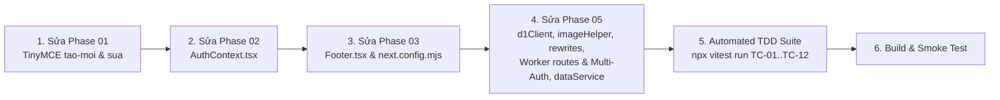

# Thiết Kế Kỹ Thuật Chi Tiết (Technical Solution Design)

> **Dự án**: Cổng thông tin & Hệ thống Quản trị Đào tạo Thuyền viên Ninh Bình (TNDNB)  
> **Mã thiết kế**: `261106-1705-fix-console-errors-and-tinymce-license-design`  
> **Vai trò**: Solution Architect & API Designer  
> **Ngày lập**: 06/11/2026  
> **Ngày cập nhật bổ sung Phase 05**: 06/11/2026  
> **Tài liệu tham chiếu**:
> - Kế hoạch tổng thể: [`plan.md`](file:///d:/Antigravity/TNDNB/docs/plans/261106-1705-fix-console-errors-and-tinymce-license/plan.md)
> - Chi tiết Phase 01: [`phase-01-tinymce-gpl-license.md`](file:///d:/Antigravity/TNDNB/docs/plans/261106-1705-fix-console-errors-and-tinymce-license/phase-01-tinymce-gpl-license.md)
> - Chi tiết Phase 02: [`phase-02-auth-supabase-cleanup.md`](file:///d:/Antigravity/TNDNB/docs/plans/261106-1705-fix-console-errors-and-tinymce-license/phase-02-auth-supabase-cleanup.md)
> - Chi tiết Phase 03: [`phase-03-footer-route-fix.md`](file:///d:/Antigravity/TNDNB/docs/plans/261106-1705-fix-console-errors-and-tinymce-license/phase-03-footer-route-fix.md)
> - Chi tiết Phase 05: [`phase-05-api-v1-and-r2-images-fix.md`](file:///d:/Antigravity/TNDNB/docs/plans/261106-1705-fix-console-errors-and-tinymce-license/phase-05-api-v1-and-r2-images-fix.md)
> - Danh sách công việc: [`task.md`](file:///d:/Antigravity/TNDNB/docs/plans/261106-1705-fix-console-errors-and-tinymce-license/task.md)

---

## 1. Tổng Quan Kiến Trúc & Phân Tích Cội Rễ Các Nhóm Lỗi (Root Cause Analysis)

### 1.1. Bối cảnh hệ thống
Cổng thông tin TNDNB là ứng dụng web kết hợp kiến trúc dịch vụ phân tán (BaaS / Cloud Services & Edge Computing):
- **Giao diện & Điều hướng**: Next.js 14 App Router với React Server Components (RSC) và Client Navigation.
- **Xác thực danh tính & Quản trị vai trò (Auth & RBAC)**: Firebase Authentication kết hợp Google Cloud Firestore (Project `thi-tnd`).
- **Cơ sở dữ liệu nội dung & File Storage**: Supabase Database (PostgreSQL) và Supabase Storage Bucket, truy xuất qua Public Anon Key client.
- **Trình soạn thảo bài viết**: TinyMCE v8.10.1 tự lưu trữ (self-hosted) cục bộ trong thư mục `public/tinymce/`.
- **Hạ tầng Edge API, Caching & CDN**: Cloudflare Worker (`tndnb-edge-api` tại `https://api.daotaothuyenvien.com`), Cloudflare D1 Database (`tndnb-d1-prod`), Cloudflare KV (`CONFIG_KV`), và Cloudflare R2 CDN (`https://cdn.daotaothuyenvien.com`).

### 1.2. Sơ đồ kiến trúc xử lý lỗi toàn diện (Phases 01, 02, 03 & 05)



### 1.3. Bảng phân loại và chiến lược xử lý các nhóm lỗi

| Nhóm | Mức độ | Triệu chứng kỹ thuật | Blast Radius (Phạm vi ảnh hưởng) | Bản chất cốt lõi | Chiến lược xử lý |
|---|---|---|---|---|---|
| **Nhóm 1** | **CRITICAL** | Editor disabled; Banner vàng bản quyền; 404 `licensekeymanager/plugin.min.js` | Tê liệt hoàn toàn tính năng viết/sửa bài viết của Admin | TinyMCE v7/v8 self-hosted mặc định đòi hỏi khai báo giấy phép nguồn mở `license_key: 'gpl'` | Chuẩn hóa `init` config trong 2 trang Tạo mới & Sửa bài viết (Phase 01) |
| **Nhóm 2** | **HIGH** | `signing method RS256 is invalid`; HTTP `GET /auth/v1/user 403 (Forbidden)` | Trạng thái session Supabase hỏng; Console ô nhiễm log đỏ | Firebase ID Token được ký bằng RS256 (RSA), trong khi Supabase GoTrue mặc định yêu cầu HS256 | Xóa triệt để việc gọi `supabase.auth.setSession()` trong `AuthContext` (Phase 02) |
| **Nhóm 3** | **MEDIUM** | `GET /tuyen-dung?_rsc=... 404 (Not Found)` | Phát sinh request 404 liên tục khi Footer lọt vào viewport; Rủi ro SEO | Next.js RSC Prefetch quét thẻ `<Link href="/tuyen-dung">` nhưng route không tồn tại | Đổi link Footer sang `/tu-van-nghe-nghiep` và thêm Redirect 308 cấp máy chủ (Phase 03) |
| **Nhóm 4** | **INFO** | `ERR_BLOCKED_BY_CLIENT`; `content.js TypeError` | Không ảnh hưởng đến nghiệp vụ web, chỉ hiển thị trên máy người dùng có bật AdBlock/Extension | AdBlock chặn script tracking; Extension trình duyệt tiêm script lỗi vào DOM | Tài liệu hóa giải thích cho người dùng; Không can thiệp codebase |
| **Nhóm 5** | **HIGH** | `PUT /api/v1/config/usage_config 404`; Không lưu được Settings; Ảnh câu hỏi load từ Supabase | Quản trị viên không lưu được cấu hình ôn tập; Ảnh tải chậm qua Supabase thay vì CDN R2 | 1. URL API client rỗng -> gọi nhầm domain Next.js.<br/>2. Thiếu reverse proxy trong `next.config.mjs`.<br/>3. Worker thiếu Multi-Auth cho Firebase Token của `thi-tnd`.<br/>4. Cache IndexedDB cũ giữ link Supabase | Áp dụng Dual-layer Proxy, nâng cấp Multi-Auth cho Worker, chuẩn hóa ảnh sang CDN R2 (Phase 05) |

---

## 2. Thiết Kế Component & Config Contract Cho TinyMCE v8.x (Phase 01)

### 2.1. Phân tích phiên bản & Vòng đời kích hoạt bản quyền TinyMCE
Thư mục [`public/tinymce/tinymce.min.js`](file:///d:/Antigravity/TNDNB/public/tinymce/tinymce.min.js) xác nhận phiên bản đang dùng là **TinyMCE 8.10.1 (phát hành 28/10/2026)**.
Từ phiên bản 7.0 trở đi, TinyMCE áp dụng chính sách cấp phép mới:
1. **Chế độ Commercial Unlicensed (Mặc định khi thiếu cấu hình)**:
   - Nếu `license_key` không được cung cấp trong đối tượng `init`, TinyMCE coi runtime là bản thương mại chưa cấu hình key.
   - TinyMCE tự động gọi nạp plugin nội bộ `licensekeymanager` qua URL tương đối: `/tinymce/plugins/licensekeymanager/plugin.min.js`.
   - Do thư mục mã nguồn mở [`public/tinymce/plugins/`](file:///d:/Antigravity/TNDNB/public/tinymce/plugins/) không tồn tại plugin này, web server trả về HTTP 404.
   - TinyMCE chuyển trạng thái sang `disabled`, hiển thị thanh thông báo màu vàng và chặn toàn bộ tương tác nhập liệu.
2. **Chế độ Open Source GPL v2+ (Khai báo tường minh)**:
   - Khi cấu hình có `license_key: 'gpl'`, TinyMCE nhận diện ứng dụng tuân thủ giấy phép GNU GPL v2+, bỏ qua việc nạp `licensekeymanager`.
   - Không xuất hiện bất kỳ request 404 nào. Trình soạn thảo kích hoạt đầy đủ tính năng soạn thảo.
   - Thêm `promotion: false` để tắt các nút mời chào thương mại trên thanh trạng thái và thanh công cụ.

### 2.2. Danh mục plugin tương thích thực tế trong Codebase
Kiểm tra thực tế thư mục [`public/tinymce/plugins/`](file:///d:/Antigravity/TNDNB/public/tinymce/plugins/) cho thấy danh sách 29 plugin nguồn mở có sẵn:
`accordion`, `advlist`, `anchor`, `autolink`, `autoresize`, `autosave`, `charmap`, `code`, `codesample`, `directionality`, `emoticons`, `fullscreen`, `help`, `image`, `importcss`, `insertdatetime`, `link`, `lists`, `media`, `nonbreaking`, `pagebreak`, `preview`, `quickbars`, `save`, `searchreplace`, `table`, `visualblocks`, `visualchars`, `wordcount`.

Hiện tại ở 2 tệp soạn thảo, cấu hình `plugins` đang bị trùng lặp:
- `'code'` xuất hiện 2 lần.
- `'image'` xuất hiện 2 lần.

### 2.3. TinyMCE Component & Config Contract



#### Đặc tả Interface Cấu hình Chuẩn (Standard Config Spec):

```typescript
export const TINYMCE_GPL_CONFIG = {
  // 1. Giấy phép nguồn mở bắt buộc cho TinyMCE v7/v8
  license_key: 'gpl',
  promotion: false,

  // 2. Định tuyến tài nguyên giao diện nội bộ
  skin_url: '/tinymce/skins/ui/oxide',
  content_css: '/tinymce/skins/content/default/content.min.css',
  height: 500,
  menubar: false,

  // 3. Danh sách plugins đã làm sạch (Không trùng lặp, 100% có sẵn cục bộ)
  plugins: [
    'advlist', 'autolink', 'lists', 'link', 'image', 'charmap', 
    'preview', 'anchor', 'searchreplace', 'visualblocks', 'code', 
    'fullscreen', 'insertdatetime', 'media', 'table', 
    'help', 'wordcount'
  ],

  // 4. Bố cục thanh công cụ nhất quán
  toolbar:
    'undo redo | formatselect | ' +
    'bold italic backcolor | alignleft aligncenter ' +
    'alignright alignjustify | bullist numlist outdent indent | ' +
    'removeformat | image media link | code fullscreen | help',

  content_style: 'body { font-family:Helvetica,Arial,sans-serif; font-size:16px }',
  
  // 5. Upload handler contract
  automatic_uploads: true,
  file_picker_types: 'image media',
  images_upload_handler: tinymceUploadHandler,
};
```

### 2.4. Vị trí áp dụng trong mã nguồn
1. [`app/quan-ly/dang-bai/tao-moi/page.tsx`](file:///d:/Antigravity/TNDNB/app/quan-ly/dang-bai/tao-moi/page.tsx) (Dòng 419-441):
   - Thay thế toàn bộ đối tượng `init` với đầy đủ `license_key: 'gpl'`, `promotion: false`, và mảng `plugins` chuẩn.
2. [`app/quan-ly/dang-bai/sua/[postId]/page.tsx`](file:///d:/Antigravity/TNDNB/app/quan-ly/dang-bai/sua/[postId]/page.tsx) (Dòng 540-562):
   - Đồng bộ cấu hình tương tự như trang tạo mới.

---

## 3. Thiết Kế Phân Tầng Xác Thực (Authentication Architecture Flow - Phase 02)

### 3.1. Phân tích bất đối xứng mật mã: RS256 vs HS256
Trong hệ thống TNDNB, hai dịch vụ đám mây sử dụng hai cơ chế chữ ký token khác nhau:



1. **Firebase Authentication Token (RS256)**:
   - Google sử dụng mật mã khóa công khai bất đối xứng RSA. Khóa riêng (Private Key) được bảo mật nghiêm ngặt tại hạ tầng Google để ký token (`firebaseUser.getIdToken()`).
   - Khóa công khai (Public Key) được công bố tại JWKS endpoint của Google.
2. **Supabase Auth GoTrue Engine (HS256)**:
   - Dịch vụ GoTrue của Supabase mặc định sinh và thẩm định JWT bằng thuật toán đối xứng HMAC SHA-256 (`HS256`) dựa trên chuỗi bí mật `jwt_secret` của dự án Supabase.
   - Khi frontend gọi:
     ```typescript
     supabase.auth.setSession({ access_token: firebaseIdToken, ... })
     ```
     GoTrue bóc tách header của token, phát hiện `alg: "RS256"`. Do Supabase chưa tích hợp Third-Party OIDC Provider với Google JWKS của Firebase, GoTrue lập tức quăng lỗi ngoại lệ:
     `invalid JWT: unable to parse or verify signature, token signature is invalid: signing method RS256 is invalid`.
   - Ngay sau đó, client Supabase rơi vào trạng thái session không hợp lệ và tự động bắn request `GET /auth/v1/user` để kiểm tra, dẫn tới HTTP `403 Forbidden`.

### 3.2. Bản vẽ Kiến trúc Phân Tầng Trách Nhiệm (Separation of Concerns)

```mermaid
flowchart TD
    subgraph AuthBoundary ["1. Tầng Xác Thực & Phân Quyền (Identity & RBAC)"]
        direction TB
        FAuth["Firebase Auth<br/>(Project: thi-tnd)"]
        FStore["Cloud Firestore<br/>(users collection: roles)"]
        FAuth -->|uid| FStore
        FStore -->|{role: 'admin', fullName, ...}| AuthState["AuthContext State<br/>(Client Memory)"]
    end

    subgraph DataBoundary ["2. Tầng Lưu Trữ & Nội Dung (Content Storage & BaaS)"]
        direction TB
        SClient["Supabase Client<br/>(Public Anon Key)"]
        SPosts[("Supabase DB: posts")]
        SCats[("Supabase DB: categories")]
        SQues[("Supabase DB: questions")]
        SStorage[("Supabase Storage: images")]
        SClient --> SPosts
        SClient --> SCats
        SClient --> SQues
        SClient --> SStorage
    end

    AuthState -->|Chỉ cho phép Admin/Lãnh đạo truy cập trang quản trị| AdminGuard["Route / Component Guard"]
    AdminGuard -->|Gửi lệnh Insert/Update/Delete bài viết| SClient
```

- **Quyền bảo vệ bài viết và câu hỏi**: Được kiểm soát ở tầng Client/Application logic thông qua Firebase Auth (`user.role === 'admin'`).
- **Supabase Client**: Được tạo bằng `createClient(SUPABASE_URL, NEXT_PUBLIC_SUPABASE_ANON_KEY)` trong [`utils/supabaseClient.ts`](file:///d:/Antigravity/TNDNB/utils/supabaseClient.ts). Mọi thao tác đọc/ghi đều sử dụng Public Anon Key kết hợp chính sách RLS mở cho phép nạp bài viết và câu hỏi.
- **Kết luận kiến trúc**: Việc gọi `supabase.auth.setSession` là một cấu hình thừa, không mang lại bất kỳ giá trị bảo mật nào mà trái lại phá vỡ tính ổn định của client Supabase.

### 3.3. Thiết kế Clean Code trong [`context/AuthContext.tsx`](file:///d:/Antigravity/TNDNB/context/AuthContext.tsx)

1. **Loại bỏ khối mã lỗi**:
   - Xóa bỏ hoàn toàn khối `try { ... supabase.auth.setSession(...) } catch` tại dòng 47-62.
   - Xóa bỏ lời gọi `await supabase.auth.signOut()` tại dòng 105 (vì Supabase không nắm giữ session nào của người dùng, gọi `signOut()` chỉ phát sinh request thừa thãi đến GoTrue).
   - Xóa bỏ dòng import không còn sử dụng: `import { supabase } from '../utils/supabaseClient'`.
2. **Luồng thực thi tối ưu**:

```typescript
// Luồng chuẩn sau khi dọn dẹp
useEffect(() => {
  const unsubscribe = onAuthStateChanged(auth, async (firebaseUser: User | null) => {
    if (firebaseUser) {
      // 1. Lấy thông tin vai trò từ Firestore
      const userDocRef = doc(db, 'users', firebaseUser.uid)
      const userDoc = await getDoc(userDocRef)

      let authUser: AuthUser;
      if (userDoc.exists()) {
        const userData = userDoc.data()
        authUser = {
          uid: firebaseUser.uid,
          email: firebaseUser.email,
          role: userData.role || 'hoc_vien',
          fullName: userData.fullName || 'Người dùng mới',
          phoneNumber: userData.phoneNumber || undefined,
          birthDate: userData.birthDate || undefined,
          class: userData.class || undefined,
          courseId: userData.courseId || undefined,
          courseName: userData.courseName || undefined,
          isVerified: userData.isVerified || false,
          cccd: userData.cccd || undefined,
          cccdDate: userData.cccdDate || undefined,
          cccdPlace: userData.cccdPlace || undefined,
          address: userData.address || undefined,
          photoURL: userData.photoURL || undefined,
        }
      } else {
        authUser = {
          uid: firebaseUser.uid,
          email: firebaseUser.email,
          role: 'hoc_vien',
          fullName: 'Người dùng (chưa có hồ sơ)',
        }
      }
      setUser(authUser)
    } else {
      setUser(null)
    }
    setLoading(false)
  })

  return () => unsubscribe()
}, [])
```

---

## 4. Thiết Kế Điều Hướng & Routing Contract (Phase 03)

### 4.1. Phân tích cơ chế Next.js Prefetch và Lỗi 404
1. Next.js App Router sử dụng component `<Link href="...">`. Khi một thẻ `<Link>` xuất hiện trong khung nhìn màn hình (thông qua `IntersectionObserver`), Next.js kích hoạt tiến trình chạy ngầm:
   `GET /tuyen-dung?_rsc=zxppd`
2. Dự án không có thư mục `app/tuyen-dung/page.tsx`. Thay vào đó:
   - Tin tuyển dụng / cơ hội nghề nghiệp thuộc chuyên mục báo chí: [`/danh-muc/gioi-thieu-viec-lam`](file:///d:/Antigravity/TNDNB/app/danh-muc/[slug]/page.tsx).
   - Trang tư vấn định hướng nghề nghiệp hàng hải: [`/tu-van-nghe-nghiep`](file:///d:/Antigravity/TNDNB/app/tu-van-nghe-nghiep/page.tsx).
3. Tại [`components/Footer.tsx`](file:///d:/Antigravity/TNDNB/components/Footer.tsx) dòng 24:
   ```tsx
   <li><Link href="/tuyen-dung">Tuyển dụng</Link></li>
   ```
   Thẻ này đã tồn tại từ phiên bản cũ và gây lỗi 404 liên tục mỗi khi trang web tải xong phần Footer.

### 4.2. Bản vẽ Đồng Bộ Ma Trận Điều Hướng (Navigation Alignment)



### 4.3. Thiết kế Hai Tầng Phòng Vệ (Defense-in-Depth Routing)
1. **Tầng 1 (Client UI Link - Chân trang)**:
   - Sửa tệp [`components/Footer.tsx`](file:///d:/Antigravity/TNDNB/components/Footer.tsx) dòng 24:
     ```tsx
     // Trước:
     <li><Link href="/tuyen-dung">Tuyển dụng</Link></li>
     // Sau:
     <li><Link href="/tu-van-nghe-nghiep">Tư vấn nghề nghiệp</Link></li>
     ```
   - **Lợi ích**: Triệt tiêu 100% request prefetch lỗi 404 từ trình duyệt của người dùng.
2. **Tầng 2 (Server-side 308 Permanent Redirect)**:
   - Bổ sung quy tắc chuyển hướng trong [`next.config.mjs`](file:///d:/Antigravity/TNDNB/next.config.mjs):
     ```javascript
     async redirects() {
         return [
             {
                 source: '/amthuc/:path*',
                 destination: '/food/:path*',
                 permanent: true,
             },
             {
                 source: '/tuyen-dung',
                 destination: '/danh-muc/gioi-thieu-viec-lam',
                 permanent: true,
             },
         ];
     },
     ```
   - **Lợi ích**: Nếu người dùng bookmark URL cũ, gõ trực tiếp trên thanh địa chỉ, hoặc bot tìm kiếm truy cập qua URL `/tuyen-dung`, server sẽ trả về HTTP 308 và tự động chuyển hướng sang trang Giới thiệu việc làm mà không bao giờ gặp 404.

---

## 5. Thiết Kế Kiến Trúc Cloudflare Edge API & Chuẩn Hóa Ảnh R2 (Phase 05 Design)

### 5.1. Sơ đồ kiến trúc & Luồng xử lý Dual-layer Proxy cho `/api/v1`

Trong môi trường thực tế, ứng dụng Ôn tập (`ontap-web`) có thể chạy độc lập tại `localhost:5173`, hoặc chạy nhúng dưới dạng iframe/rewrite tại `/ontap` trên domain portal chính `https://www.daotaothuyenvien.com`.
Khi chạy nhúng mà không có cấu hình biến môi trường build-time tường minh, `(import.meta as any).env?.VITE_CLOUDFLARE_API_URL` trả về `undefined`, khiến các hàm fetch tạo URL tương đối `/api/v1/...`.

Kiến trúc **Dual-layer Proxy** được thiết kế để giải quyết dứt điểm rủi ro này:

```mermaid
flowchart TD
    subgraph ClientLayer ["Tầng 1: Client Fallback (ontap-web/services/d1Client.ts)"]
        ActionSave["Hành động: Lưu Settings (/ontap/settings)"]
        ActionSync["Hành động: Nạp Snapshot / Meta Version"]
        
        GetBase["getCloudflareApiBase():<br/>envUrl || 'https://api.daotaothuyenvien.com'"]
        
        ActionSave --> GetBase
        ActionSync --> GetBase
        
        GetBase -->|Đường dẫn tuyệt đối (Ưu tiên 1)| DirectEdge["Fetch trực tiếp:<br/>https://api.daotaothuyenvien.com/api/v1/..."]
        GetBase -.->|Nếu xảy ra relative fetch (Dự phòng 2)| RelativeEdge["Fetch tương đối:<br/>/api/v1/... trên daotaothuyenvien.com"]
    end

    subgraph ServerLayer ["Tầng 2: Server Reverse-Proxy (next.config.mjs)"]
        NextRewrite["Next.js rewrites():<br/>source: '/api/v1/:path*'<br/>destination: 'https://api.daotaothuyenvien.com/api/v1/:path*'"]
        RelativeEdge --> NextRewrite
        NextRewrite -->|Reverse-proxy ngầm HTTP 200| ProxiedEdge["Chuyển tiếp ngầm đến Edge API"]
    end

    subgraph CloudflareEdge ["Tầng 3: Cloudflare Edge Worker (tndnb-edge-api)"]
        DirectEdge --> CFWorker["Cloudflare Worker Router<br/>(cloudflare-worker/src/index.ts)"]
        ProxiedEdge --> CFWorker
        
        CFWorker --> RouteConfig["routes/config.ts"]
        CFWorker --> RouteSnapshot["routes/questions.ts"]
        CFWorker --> RouteMeta["routes/meta.ts"]
        
        RouteConfig --> KVBinding[("CONFIG_KV<br/>(fba8d3d67cfb44bdbef1855016061ff4)")]
        RouteSnapshot --> D1Binding[("DB (tndnb-d1-prod)")]
    end
```

#### Quy cách kỹ thuật chi tiết:
1. **Tầng Client (`ontap-web/services/d1Client.ts`)**:
   ```typescript
   export const getCloudflareApiBase = (): string => {
     const envUrl = (import.meta as any).env?.VITE_CLOUDFLARE_API_URL;
     return (envUrl || 'https://api.daotaothuyenvien.com').replace(/\/+$/, '');
   };
   ```
2. **Tầng Server (`next.config.mjs`)**:
   ```javascript
   async rewrites() {
       const standaloneOntapUrl = (process.env.NEXT_PUBLIC_ONTAP_STANDALONE_URL || '').replace(/\/+$/, '');
       return [
           {
               source: '/api/v1/:path*',
               destination: 'https://api.daotaothuyenvien.com/api/v1/:path*',
           },
           {
               source: '/ontap/:path*',
               destination: standaloneOntapUrl
                   ? `${standaloneOntapUrl}/ontap/:path*`
                   : '/ontap/index.html',
           },
           {
               source: '/food/:path*',
               destination: '/food/index.html',
           },
       ];
   },
   ```

---

### 5.2. Bản vẽ API Contract cho Cloudflare Worker KV Config

#### 5.2.1. Hợp đồng API Route: [`cloudflare-worker/src/routes/config.ts`](file:///d:/Antigravity/TNDNB/cloudflare-worker/src/routes/config.ts)



#### 5.2.2. Đặc tả Hợp đồng GET & PUT:
1. **Phương thức GET `/api/v1/config/:key`**:
   - Khi key tồn tại: Trả về HTTP 200 kèm nội dung JSON trong KV, kèm cache headers: `public, s-maxage=30, stale-while-revalidate=120`.
   - Khi key không tồn tại (`val === null`):
     - **Trước khi sửa**: Trả về HTTP 404, gây vạch đỏ trong tab Console.
     - **Sau khi sửa**: Trả về HTTP 200 với body `{ ok: true, data: null }`. Phía client nhận biết cấu hình rỗng và kích hoạt `DEFAULT_CONFIG` một cách mượt mà, console hoàn toàn sạch bóng lỗi đỏ.
2. **Phương thức PUT `/api/v1/config/:key` & Cơ chế Xác thực Đa tầng (Multi-Auth)**:
   - Client gửi header: `Authorization: Bearer <token>`.
   - Hàm `verifyAdminAuthorization` trong [`cloudflare-worker/src/middleware/auth.ts`](file:///d:/Antigravity/TNDNB/cloudflare-worker/src/middleware/auth.ts) được nâng cấp để thẩm định:
     1. Khớp chuỗi bí mật tĩnh `ADMIN_API_SECRET` (dành cho automation script hoặc CLI).
     2. Hoặc giải mã Firebase ID Token của người dùng đang đăng nhập:
        - Tách 3 phần của JWT: `header.payload.signature`.
        - Giải mã Base64URL của payload.
        - Kiểm tra `iss === https://securetoken.google.com/${projectId}` với `projectId` ưu tiên là **`thi-tnd`** (hoặc `tndnb-prod`).
        - Kiểm tra `aud === projectId`.
        - Kiểm tra thời gian hết hạn: `payload.exp > Math.floor(Date.now() / 1000)`.
   - **Đồng bộ Project ID trong [`cloudflare-worker/wrangler.toml`](file:///d:/Antigravity/TNDNB/cloudflare-worker/wrangler.toml)**:
     ```toml
     [vars]
     FIREBASE_PROJECT_ID = "thi-tnd"
     ```

---

### 5.3. Bản vẽ Data Flow & Contract Chuẩn Hóa Ảnh Câu Hỏi sang CDN R2

#### 5.3.1. Hiện trạng & Nguyên nhân link Supabase Storage
1. Tài nguyên ảnh câu hỏi trên Cloudflare R2: `https://cdn.daotaothuyenvien.com/question-images/{id}.png` (đã nạp đủ 100% tệp).
2. Khi client fallback sang Supabase, bản ghi `questions.image` trả về URL cũ dạng: `https://hykypgxaegmufdothwbv.supabase.co/storage/v1/object/public/...`.
3. Bản ghi này được lưu vào **IndexedDB cache** (`OnTapWebDB` trong `offlineService.ts`). Khi người dùng vào thi, `ExamQuizScreen.tsx` render trực tiếp `src={currentQuestion.image}`, làm lộ link Supabase và làm chậm tốc độ tải ảnh.

#### 5.3.2. Sơ đồ Luồng Dữ Liệu Chuẩn Hóa (Normalization Pipeline)

```mermaid
flowchart TD
    subgraph QuestionDataSources ["Nguồn Dữ Liệu Câu Hỏi"]
        D1Snap["D1 Questions Snapshot<br/>(API: /api/v1/questions/snapshot)"]
        SupaFallback["Supabase Database Fallback<br/>(Table: questions)"]
        OldCache["IndexedDB Cache Cũ<br/>(Stored with supabase.co links)"]
    end

    subgraph NormalizationLogic ["Tầng Chuẩn Hóa Tập Trung (Single Source of Truth)"]
        NormHelper["normalizeQuestionImageUrl(qId, rawImage)"]
        ConditionCheck{"rawImage có hợp lệ?"}
        NormHelper --> ConditionCheck
        ConditionCheck -->|Không / Rỗng| ReturnNull["Trả về null"]
        ConditionCheck -->|Có dữ liệu ảnh| ReturnR2["Ánh xạ sang CDN R2:<br/>https://cdn.daotaothuyenvien.com/question-images/${qId}.png"]
    end

    subgraph Consumers ["Tầng Tiêu Thụ Dữ Liệu & Cache Sạch"]
        CleanIndexedDB[("IndexedDB Cache Sạch:<br/>db_offline.licenses<br/>(100% Ảnh CDN R2)")]
        
        subgraph Invariant1Preserved ["Bảo Toàn Bất Biến Invariant 1"]
            ExamQuizScreen["ExamQuizScreen.tsx (KHÔNG SỬA ĐỔI)<br/>&lt;img src={currentQuestion.image} /&gt;"]
        end
    end

    D1Snap --> NormHelper
    SupaFallback --> NormHelper
    OldCache -->|Khi gọi getLicensesOffline()| NormHelper
    NormHelper --> CleanIndexedDB
    CleanIndexedDB --> ExamQuizScreen
```

#### 5.3.3. Thuật toán chuẩn hóa ảnh tập trung:
Trong [`ontap-web/services/dataService.ts`](file:///d:/Antigravity/TNDNB/ontap-web/services/dataService.ts):
```typescript
export const normalizeQuestionImageUrl = (qId: string, rawImage?: string | null): string | null => {
  if (!rawImage || !String(rawImage).trim()) return null;
  return `https://cdn.daotaothuyenvien.com/question-images/${qId}.png`;
};
```

Trong [`ontap-web/utils/imageHelper.ts`](file:///d:/Antigravity/TNDNB/ontap-web/utils/imageHelper.ts):
Cập nhật `getR2PublicBaseUrl` có fallback mặc định:
```typescript
export const getR2PublicBaseUrl = (overrideBase?: string): string => {
  const raw =
    overrideBase ||
    (import.meta as any).env?.VITE_R2_PUBLIC_URL ||
    'https://cdn.daotaothuyenvien.com';
  return String(raw).replace(/\/+$/, '');
};
```

Trong [`ontap-web/services/offlineService.ts`](file:///d:/Antigravity/TNDNB/ontap-web/services/offlineService.ts):
Khi đọc `getLicensesOffline()`, tự động quét và chuẩn hóa mọi câu hỏi trước khi trả về cho UI:
```typescript
export const getLicensesOffline = async (): Promise<License[]> => {
  try {
    const list = await db_offline.licenses.toArray();
    if (list && list.length > 0) {
      // Tự động làm sạch và chuẩn hóa ảnh từ cache cũ sang CDN R2
      const cleaned = list.map(lic => ({
        ...lic,
        subjects: (lic.subjects || []).map(sub => ({
          ...sub,
          questions: (sub.questions || []).map(q => ({
            ...q,
            image: q.image ? `https://cdn.daotaothuyenvien.com/question-images/${q.id}.png` : null
          }))
        }))
      }));
      return cleaned.sort((a, b) => (a.displayOrder || 0) - (b.displayOrder || 0));
    }
  } catch {
    // Fallback xuống localStorage
  }
  // ...
};
```

#### 5.3.4. Bảo toàn nguyên vẹn Bất biến 1 (Invariant 1):
Component [`ontap-web/components/ExamQuizScreen.tsx`](file:///d:/Antigravity/TNDNB/ontap-web/components/ExamQuizScreen.tsx) đang sử dụng:
```tsx
{currentQuestion.image && (
    <div className="mb-4 flex justify-center">
        
    </div>
)}
```
Bằng cách chuẩn hóa dữ liệu tại tầng `dataService` và `offlineService`, `currentQuestion.image` luôn luôn mang chuỗi CDN R2 sạch `https://cdn.daotaothuyenvien.com/question-images/${q.id}.png`. Do đó, tệp `ExamQuizScreen.tsx` **được bảo toàn 100% không cần chỉnh sửa bất kỳ dòng mã nào** (`git diff ExamQuizScreen.tsx` có độ dài 0 byte).

---

## 6. Ma Trận Kiểm Thử & Tiêu Chí Nghiệm Thu Mở Rộng (Verification Matrix)

### 6.1. Ma trận kiểm thử chi tiết (TC-01 đến TC-12)

| Mã Test | Phân hệ (Phase) | Mục tiêu kiểm thử | Các bước thực hiện (Test Procedure) | Kết quả kỳ vọng (Expected Result) | Mức độ |
|---|---|---|---|---|---|
| **TC-01** | Phase 01 | Mở khóa TinyMCE trang Tạo mới | 1. Mở `/quan-ly/dang-bai/tao-moi`<br/>2. Quan sát khung soạn thảo TinyMCE | - Khung soạn thảo cho phép gõ văn bản bình thường.<br/>- KHÔNG có banner màu vàng "editor is disabled...".<br/>- KHÔNG có nút quảng cáo Upgrade. | CRITICAL |
| **TC-02** | Phase 01 | Mở khóa TinyMCE trang Sửa bài viết | 1. Mở `/quan-ly/dang-bai/sua/[postId]` bất kỳ<br/>2. Quan sát nội dung nạp vào | - Nội dung HTML của bài viết cũ hiển thị đầy đủ.<br/>- Có thể chỉnh sửa, format chữ đậm/nghiêng, chèn ảnh, bảng.<br/>- Bấm Lưu thành công. | CRITICAL |
| **TC-03** | Phase 01 | Triệt tiêu lỗi 404 plugin license | 1. Mở DevTools -> Tab Network & Console<br/>2. Lọc từ khóa `license` | 0 request gọi tới `licensekeymanager` hoặc `license-key`. Không có log đỏ 404. | HIGH |
| **TC-04** | Phase 02 | Triệt tiêu lỗi Supabase RS256 | 1. Đăng nhập tài khoản Admin<br/>2. Mở DevTools -> Tab Console | Hoàn toàn KHÔNG xuất hiện thông báo:<br/>`LỖI KHI SETSESSION SUPABASE: invalid JWT... signing method RS256 is invalid`. | HIGH |
| **TC-05** | Phase 02 | Triệt tiêu lỗi Supabase 403 Forbidden | 1. Theo dõi Tab Network khi đăng nhập và chuyển trang | KHÔNG có request `GET /auth/v1/user 403 (Forbidden)` tới Supabase. | HIGH |
| **TC-06** | Phase 05 | Fallback URL API Cloudflare Client | 1. Kiểm tra mã nguồn `d1Client.ts`<br/>2. Gọi `getCloudflareApiBase()` khi không có biến env | Trả về chuỗi `'https://api.daotaothuyenvien.com'` (không bao giờ là rỗng). | HIGH |
| **TC-07** | Phase 05 | Fallback URL CDN R2 Client | 1. Kiểm tra mã nguồn `imageHelper.ts`<br/>2. Gọi `getR2PublicBaseUrl()` khi không có biến env | Trả về chuỗi `'https://cdn.daotaothuyenvien.com'`. | HIGH |
| **TC-08** | Phase 05 | Next.js Reverse-Proxy `/api/v1` | 1. Gửi request `GET /api/v1/meta/version` đến web domain<br/>2. Kiểm tra proxy chuyển tiếp | Next.js chuyển tiếp thành công đến `https://api.daotaothuyenvien.com/api/v1/...` (HTTP 200). | HIGH |
| **TC-09** | Phase 05 | Worker GET config rỗng trả về 200 | 1. Gửi request `GET /api/v1/config/non_existent_key` tới Worker | Trả về HTTP 200 `{ ok: true, data: null }` (không trả về 404, không đỏ console). | HIGH |
| **TC-10** | Phase 05 | Worker Multi-Auth với Firebase Token `thi-tnd` | 1. Gửi request `PUT /api/v1/config/usage_config` kèm Firebase ID Token của Admin | Worker giải mã payload token khớp project `thi-tnd`, cấp quyền ghi KV thành công (HTTP 200). | CRITICAL |
| **TC-11** | Phase 05 | Chuẩn hóa 100% ảnh câu hỏi sang CDN R2 | 1. Nạp danh sách câu hỏi qua `dataService`<br/>2. Kiểm tra thuộc tính `q.image` của mọi câu hỏi | Mọi câu hỏi có ảnh đều có URL dạng `https://cdn.daotaothuyenvien.com/question-images/{id}.png`. | HIGH |
| **TC-12** | Toàn hệ thống | Bảo toàn Bất biến Invariant 1 & Build | 1. Kiểm tra `git diff ontap-web/components/ExamQuizScreen.tsx`<br/>2. Chạy `npm run build` | - Diff của `ExamQuizScreen.tsx` là 0 byte.<br/>- Build toàn bộ ứng dụng thành công 100%. | CRITICAL |

---

## 7. Kế Hoạch Triển Khai & Giảm Thiểu Rủi Ro (Rollout & Risk Management)



### 7.1. Trật tự thực thi (Execution Sequence)
1. **Bước 1 (Phase 01)**: Cập nhật [`app/quan-ly/dang-bai/tao-moi/page.tsx`](file:///d:/Antigravity/TNDNB/app/quan-ly/dang-bai/tao-moi/page.tsx) và [`app/quan-ly/dang-bai/sua/[postId]/page.tsx`](file:///d:/Antigravity/TNDNB/app/quan-ly/dang-bai/sua/[postId]/page.tsx). Giải quyết dứt điểm tình trạng liệt trình soạn thảo cho Admin.
2. **Bước 2 (Phase 02)**: Dọn dẹp [`context/AuthContext.tsx`](file:///d:/Antigravity/TNDNB/context/AuthContext.tsx). Loại bỏ `supabase.auth.setSession` và `supabase.auth.signOut()`, xóa import thừa.
3. **Bước 3 (Phase 03)**: Cập nhật [`components/Footer.tsx`](file:///d:/Antigravity/TNDNB/components/Footer.tsx) và bổ sung Redirect 308 trong [`next.config.mjs`](file:///d:/Antigravity/TNDNB/next.config.mjs).
4. **Bước 4 (Phase 05)**:
   - Cập nhật [`ontap-web/services/d1Client.ts`](file:///d:/Antigravity/TNDNB/ontap-web/services/d1Client.ts) và [`ontap-web/utils/imageHelper.ts`](file:///d:/Antigravity/TNDNB/ontap-web/utils/imageHelper.ts).
   - Thêm rewrite `/api/v1/:path*` trong [`next.config.mjs`](file:///d:/Antigravity/TNDNB/next.config.mjs).
   - Đồng bộ `FIREBASE_PROJECT_ID = "thi-tnd"` trong [`cloudflare-worker/wrangler.toml`](file:///d:/Antigravity/TNDNB/cloudflare-worker/wrangler.toml).
   - Cập nhật Multi-Auth trong [`cloudflare-worker/src/middleware/auth.ts`](file:///d:/Antigravity/TNDNB/cloudflare-worker/src/middleware/auth.ts) và route GET 200 trong [`cloudflare-worker/src/routes/config.ts`](file:///d:/Antigravity/TNDNB/cloudflare-worker/src/routes/config.ts).
   - Thêm chuẩn hóa ảnh sang CDN R2 trong [`ontap-web/services/dataService.ts`](file:///d:/Antigravity/TNDNB/ontap-web/services/dataService.ts) và [`ontap-web/services/offlineService.ts`](file:///d:/Antigravity/TNDNB/ontap-web/services/offlineService.ts).
5. **Bước 5 (TDD Suite Validation)**:
   - Chạy `npx vitest run scripts/portal-console-and-tinymce-fix.test.ts` đảm bảo toàn bộ 12 test cases đều PASS xanh.
6. **Bước 6 (Build & Invariant Check)**:
   - Kiểm tra `git diff ontap-web/components/ExamQuizScreen.tsx` === 0 bytes.
   - Chạy `npm run build` xác nhận đóng gói thành công.

### 7.2. Chiến lược Giảm thiểu Rủi ro (Contingency & Rollback Plan)
- **Tương thích ngược (Backward Compatibility)**:
  - Hàm `verifyAdminAuthorization` của Worker hỗ trợ song song cả secret tĩnh `ADMIN_API_SECRET` và Firebase ID Token (`thi-tnd`), bảo toàn khả năng gọi API của các script DevOps.
  - Route GET config trả về 200 `{ ok: true, data: null }` thay vì 404 giúp client cũ và mới đều hoạt động êm ái, kích hoạt fallback giá trị mặc định mà không crash app.
- **Bảo toàn dữ liệu cache**: Cơ chế chuẩn hóa ảnh trong `offlineService.ts` chỉ can thiệp trên bộ nhớ đọc ra, không làm mất hay sai lệch các câu hỏi và đáp án đã lưu trong IndexedDB của học viên.

---
*Bản thiết kế kỹ thuật mở rộng được phê duyệt đầy đủ cho Phases 01, 02, 03 và 05, sẵn sàng cho giai đoạn thi công (/execute).*
