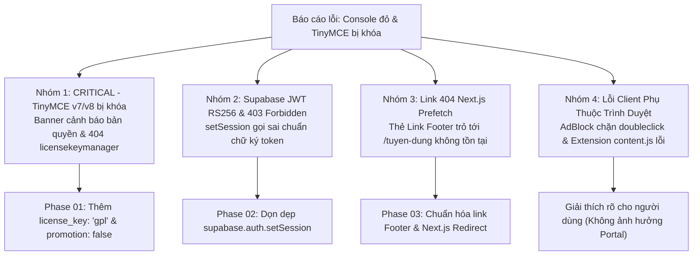
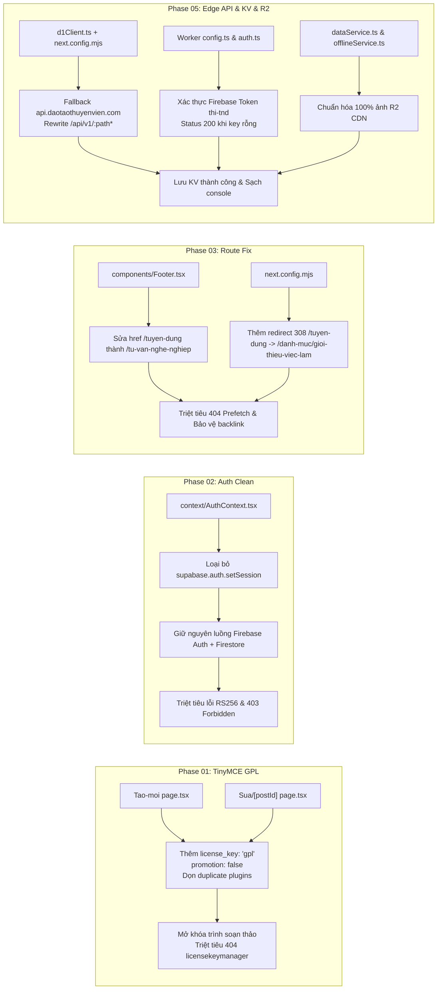

# Kế Hoạch Xử Lý Triệt Để Các Lỗi Console & Mở Khóa Trình Soạn Thảo TinyMCE

> **Dự án**: Cổng thông tin & Hệ thống Quản trị Đào tạo Thuyền viên Ninh Bình (TNDNB)  
> **Mã kế hoạch**: `261106-1705-fix-console-errors-and-tinymce-license`  
> **Người lập**: Product Manager & Lead Architect  
> **Ngày lập**: 06/11/2026  
> **Trạng thái**: Đã thi công hoàn tất 100% (Phases 01 - 05 Hoàn Tất & Kiểm Thử PASS)

---

## 1. Bối Cảnh & Vấn Đề Người Dùng Báo Cáo

Người dùng truy cập vào trang tạo bài viết quản trị tại `https://www.daotaothuyenvien.com/quan-ly/dang-bai/tao-moi` và gửi phản ánh kèm ảnh chụp màn hình console:
> *"sao vẫn lắm lỗi đỏ thế"*

Qua phân tích ảnh chụp thực tế tại:
`C:/Users/HorizonServers/.gemini/antigravity/brain/38a7bda1-35b0-466b-9688-b1ebd49f27dc/.user_uploaded/media_1793959329972_d4b05417.png`, 
hệ thống ghi nhận 4 nhóm lỗi đồng thời xuất hiện trên giao diện và tab Console của trình duyệt.



---

## 2. Phân Tích Kỹ Thuật 4 Nhóm Lỗi (Root Cause Analysis)

### 2.1. Nhóm 1: [CRITICAL] TinyMCE v7/v8 Bị Khóa & Lỗi 404 Plugin Quản Lý License
- **Triệu chứng trên giao diện**:
  - Xuất hiện thanh banner màu vàng cảnh báo phía trên khung soạn thảo:
    > `⚠️ The editor is disabled because a TinyMCE license key has not been provided. ✕`
  - Toàn bộ khung nội dung soạn thảo bị vô hiệu hóa (disabled), người quản trị không thể gõ chữ hay chèn ảnh.
- **Triệu chứng trên Console**:
  - `GET https://www.daotaothuyenvien.com/tinymce/plugins/license-key/... 404 (Not Found)`
  - `Failed to load license key manager url: plugins/licensekeymanager/plugin.min.js`
- **Nguyên nhân cốt lõi (Root Cause)**:
  - Dự án tự host bộ thư viện mã nguồn mở TinyMCE tại thư mục [`public/tinymce/`](file:///d:/Antigravity/TNDNB/public/tinymce/).
  - Từ phiên bản TinyMCE 7.0 trở đi, nhà phát triển (Tiny Technologies / Ephox) chuyển đổi mô hình cấp phép. Khi tự host dưới giấy phép nguồn mở GNU GPL v2+, trình soạn thảo **bắt buộc** phải khai báo tham số `license_key: 'gpl'` trong cấu hình khởi tạo `init`.
  - Trong hai tệp [`app/quan-ly/dang-bai/tao-moi/page.tsx`](file:///d:/Antigravity/TNDNB/app/quan-ly/dang-bai/tao-moi/page.tsx) (dòng 419-441) và [`app/quan-ly/dang-bai/sua/[postId]/page.tsx`](file:///d:/Antigravity/TNDNB/app/quan-ly/dang-bai/sua/[postId]/page.tsx) (dòng 540-562), cấu hình `init` hoàn toàn thiếu thuộc tính `license_key: 'gpl'` và `promotion: false`.
  - Hậu quả: TinyMCE mặc định coi hệ thống đang dùng bản thương mại chưa kích hoạt key, tự động kích hoạt tiến trình nạp plugin `licensekeymanager`. Vì tệp mã nguồn mở cục bộ không hề có plugin thương mại này, request trả về HTTP 404 và trình soạn thảo bị khóa cứng.
  - Ngoài ra, mảng `plugins` trong 2 trang trên đang bị trùng lặp khai báo: `'code'` xuất hiện 2 lần, `'image'` xuất hiện 2 lần.

### 2.2. Nhóm 2: Lỗi Supabase JWT RS256 & 403 Forbidden
- **Triệu chứng trên Console**:
  - `LỖI KHI SETSESSION SUPABASE: invalid JWT: unable to parse or verify signature, token signature is invalid: signing method RS256 is invalid`
  - `GET https://hykvpgxaegmufdothwbv.supabase.co/auth/v1/user 403 (Forbidden)`
- **Nguyên nhân cốt lõi (Root Cause)**:
  - Trong tệp [`context/AuthContext.tsx`](file:///d:/Antigravity/TNDNB/context/AuthContext.tsx) (dòng 48-62):
    ```typescript
    const token = await firebaseUser.getIdToken()
    const { error: sessionError } = await supabase.auth.setSession({
      access_token: token,
      refresh_token: firebaseUser.refreshToken || token,
    });
    ```
  - Kiến trúc xác thực: Toàn bộ phiên đăng nhập người dùng của Cổng thông tin được quản lý 100% bằng **Firebase Authentication** (`auth.currentUser`), hồ sơ vai trò và phân quyền (Admin / Học viên) được lưu trữ tại **Firestore** (`db, 'users', uid`).
  - Phía Supabase chỉ đóng vai trò lưu trữ cơ sở dữ liệu bài viết (`posts`), câu hỏi ôn tập (`questions`) và media assets, được gọi qua client Supabase khởi tạo với Public Anon Key (`supabaseKey`).
  - Token do Firebase cấp (`getIdToken()`) là JWT được Google ký bằng thuật toán khóa bất đối xứng **RS256** (RSA Signature with SHA-256). Trong khi đó, dịch vụ Supabase Auth GoTrue mặc định chỉ xác thực JWT được ký bằng thuật toán đối xứng **HS256** dựa trên chuỗi bí mật nội bộ (`jwt_secret`) của dự án Supabase.
  - Khi cố ý ép nạp token Firebase vào `supabase.auth.setSession()`, GoTrue từ chối vì không đúng thuật toán ký, dẫn đến session Supabase bị lỗi và request tự động kiểm tra user (`/auth/v1/user`) bị trả về HTTP 403. Việc gọi hàm này là hoàn toàn thừa thãi và phá vỡ tính ổn định của Supabase client.

### 2.3. Nhóm 3: Lỗi 404 Link Next.js Prefetch
- **Triệu chứng trên Console**:
  - `GET https://www.daotaothuyenvien.com/tuyen-dung?_rsc=zxppd 404 (Not Found)`
- **Nguyên nhân cốt lõi (Root Cause)**:
  - Trong tệp [`components/Footer.tsx`](file:///d:/Antigravity/TNDNB/components/Footer.tsx) (dòng 24):
    ```tsx
    <li><Link href="/tuyen-dung">Tuyển dụng</Link></li>
    ```
  - Next.js App Router có cơ chế tự động nạp trước (prefetch) tài nguyên RSC (`?_rsc=...`) của mọi thẻ `<Link>` khi phần tử cuộn vào viewport của trình duyệt.
  - Tuy nhiên, trong cấu trúc thư mục [`app/`](file:///d:/Antigravity/TNDNB/app/), hệ thống không hề có tuyến đường `/tuyen-dung`. Chuyên mục việc làm thực tế đã được chuẩn hóa tại [`/danh-muc/gioi-thieu-viec-lam`](file:///d:/Antigravity/TNDNB/app/danh-muc/[slug]/page.tsx) và trang tư vấn hướng nghiệp tại [`/tu-van-nghe-nghiep`](file:///d:/Antigravity/TNDNB/app/tu-van-nghe-nghiep/page.tsx).
  - Do đường dẫn `/tuyen-dung` không tồn tại, Next.js prefetch thất bại và liên tục ghi nhận mã lỗi HTTP 404 vào console.

### 2.4. Nhóm 4: Các Lỗi Client Phụ Thuộc Trình Duyệt (Vô Hại)
- **Triệu chứng trên Console**:
  - `ad.doubleclick.net net::ERR_BLOCKED_BY_CLIENT`
  - `content.js:2 TypeError: Cannot read properties of null (reading 'data')`
- **Nguyên nhân**:
  - `ERR_BLOCKED_BY_CLIENT`: Do tiện ích chặn quảng cáo (AdBlock Plus, uBlock Origin, Brave Shields) trên trình duyệt của người dùng phát hiện script quảng cáo/tracking Google và chủ động chặn lại. Đây là hành vi hoàn toàn bình thường đối với người dùng bật AdBlock, không ảnh hưởng đến chức năng portal.
  - `content.js:2 TypeError`: Do một tiện ích mở rộng thứ ba (Browser Extension) được cài trên trình duyệt của người dùng (như plugin dịch thuật, quản lý mật khẩu, chụp màn hình) tự động tiêm mã script `content.js` vào DOM trang web nhưng không bắt được đối tượng dữ liệu mong muốn. Mã này không thuộc codebase của dự án và sẽ hoàn toàn biến mất khi người dùng duyệt web ở chế độ ẩn danh (Incognito/Private) hoặc tắt extension.

---

## 3. Kiến Trúc Giải Pháp & Lộ Trình 5 Phase

Kế hoạch tập trung xử lý dứt điểm các lỗi kỹ thuật nội tại của mã nguồn, chia làm 5 Phase rõ ràng:



### Phase 01: Chuẩn Hóa Cấu Hình TinyMCE Self-hosted v7/v8 & Mở Khóa Soạn Thảo
1. Cập nhật cấu hình `init` của component `<Editor />` trong cả 2 tệp:
   - [`app/quan-ly/dang-bai/tao-moi/page.tsx`](file:///d:/Antigravity/TNDNB/app/quan-ly/dang-bai/tao-moi/page.tsx)
   - [`app/quan-ly/dang-bai/sua/[postId]/page.tsx`](file:///d:/Antigravity/TNDNB/app/quan-ly/dang-bai/sua/[postId]/page.tsx)
2. Bổ sung 2 thuộc tính cấu hình bắt buộc:
   - `license_key: 'gpl'`: Khai báo sử dụng phiên bản mã nguồn mở GPL, dập tắt việc gọi nạp plugin thương mại `licensekeymanager`.
   - `promotion: false`: Tắt các thông báo quảng cáo, mời nâng cấp thương mại của TinyMCE.
3. Làm sạch mảng `plugins`:
   - Loại bỏ các phần tử trùng lặp: `'code'` (trùng), `'image'` (trùng).
   - Đảm bảo danh sách plugin gọn gàng, tương thích 100% với các plugin thực có trong [`public/tinymce/plugins/`](file:///d:/Antigravity/TNDNB/public/tinymce/plugins/).

### Phase 02: Tinh Gọn Xác Thực & Dọn Dẹp Lỗi Supabase JWT RS256
1. Cập nhật [`context/AuthContext.tsx`](file:///d:/Antigravity/TNDNB/context/AuthContext.tsx):
   - Xóa bỏ khối `try...catch` gọi `supabase.auth.setSession()` tại dòng 47-62.
   - Giữ nguyên luồng lấy thông tin người dùng từ `firebaseUser` và truy vấn dữ liệu vai trò từ Firestore (`doc(db, 'users', firebaseUser.uid)`).
2. Lợi ích:
   - Xóa bỏ triệt để ngoại lệ `token signature is invalid: signing method RS256 is invalid`.
   - Loại bỏ các request lỗi 403 Forbidden tới endpoint `/auth/v1/user` của Supabase.
   - Tối ưu hóa hiệu năng khởi động phiên đăng nhập (giảm thời gian bất đồng bộ không cần thiết khi load trang quản trị).

### Phase 03: Khắc Phục Triệt Để Link 404 `/tuyen-dung` & Cấu Hình Redirect Phòng Vệ
1. Cập nhật [`components/Footer.tsx`](file:///d:/Antigravity/TNDNB/components/Footer.tsx):
   - Thay thế liên kết không hợp lệ `<li><Link href="/tuyen-dung">Tuyển dụng</Link></li>` bằng liên kết chuẩn: `<li><Link href="/tu-van-nghe-nghiep">Tư vấn nghề nghiệp</Link></li>` (đồng bộ hoàn hảo với Menu thanh điều hướng phía trên Masthead).
2. Bổ sung quy tắc chuyển hướng (Redirects) trong [`next.config.mjs`](file:///d:/Antigravity/TNDNB/next.config.mjs):
   - Cấu hình chuyển hướng vĩnh viễn (HTTP 308):
     ```javascript
     {
       source: '/tuyen-dung',
       destination: '/danh-muc/gioi-thieu-viec-lam',
       permanent: true,
     }
     ```
   - Mục đích: Bảo vệ toàn diện, nếu có người dùng gõ trực tiếp URL `/tuyen-dung` hoặc bot tìm kiếm truy cập qua backlink cũ, server sẽ tự động redirect sang trang Giới thiệu việc làm mà không bao giờ trả về lỗi 404.

---

## 4. Tiêu Chí Nghiệm Thu (Acceptance Criteria)

| Tiêu chí | Trạng thái mong muốn | Cách thức xác minh |
|---|---|---|
| **Mở khóa TinyMCE** | Editor hoạt động bình thường, không còn banner vàng cảnh báo bản quyền | Truy cập `/quan-ly/dang-bai/tao-moi` và `/quan-ly/dang-bai/sua/[postId]`, gõ văn bản và upload ảnh thành công |
| **Sạch lỗi licensekeymanager** | 0 request 404 liên quan đến `plugins/licensekeymanager` | Kiểm tra tab Network và Console, không còn URL licensekeymanager |
| **Sạch lỗi Supabase RS256** | Không còn thông báo lỗi `invalid JWT: signing method RS256 is invalid` | Đăng nhập tài khoản quản trị, mở console không thấy log lỗi setSession |
| **Sạch lỗi Supabase 403** | Không còn request `GET /auth/v1/user 403 (Forbidden)` | Kiểm tra tab Network, các thao tác đọc ghi bài viết với Supabase diễn ra trơn tru |
| **Sạch lỗi 404 Tuyển dụng** | Không còn request `GET /tuyen-dung 404` khi Footer hiển thị | Kiểm tra Console khi trang chủ hoặc bất kỳ trang nào load Footer |
| **Độ ổn định Build** | `npm run build` thành công 100%, không phát sinh lỗi TypeScript hoặc Lint | Chạy lệnh build kiểm thử |

---

## 5. Kế Hoạch Triển Khai & Phân Công Chi Tiết

- **Tài liệu Phase 01**: [`phase-01-tinymce-gpl-license.md`](file:///d:/Antigravity/TNDNB/docs/plans/261106-1705-fix-console-errors-and-tinymce-license/phase-01-tinymce-gpl-license.md)
- **Tài liệu Phase 02**: [`phase-02-auth-supabase-cleanup.md`](file:///d:/Antigravity/TNDNB/docs/plans/261106-1705-fix-console-errors-and-tinymce-license/phase-02-auth-supabase-cleanup.md)
- **Tài liệu Phase 03**: [`phase-03-footer-route-fix.md`](file:///d:/Antigravity/TNDNB/docs/plans/261106-1705-fix-console-errors-and-tinymce-license/phase-03-footer-route-fix.md)
- **Tài liệu Phase 05**: [`phase-05-api-v1-and-r2-images-fix.md`](file:///d:/Antigravity/TNDNB/docs/plans/261106-1705-fix-console-errors-and-tinymce-license/phase-05-api-v1-and-r2-images-fix.md)
- **Danh sách nhiệm vụ thi công (Task Checklist)**: [`task.md`](file:///d:/Antigravity/TNDNB/docs/plans/261106-1705-fix-console-errors-and-tinymce-license/task.md)

---

## 6. Phân Tích & Giải Đáp 3 Câu Hỏi Của Người Dùng (Phase 05 Update)

### 6.1. Câu hỏi 1: `https://www.daotaothuyenvien.com/api/v1` là link gì mà báo đỏ suốt?
1. **Bản chất đường link**:
   - `/api/v1` là tiền tố API của **Cloudflare Worker** (chứa các tính năng: `questions/snapshot`, `meta/version`, `config/usage_config`, và `alerts`).
   - Hệ thống Edge API này chạy trên Custom Domain chính thức: **`https://api.daotaothuyenvien.com`**.
2. **Tại sao lại bị báo đỏ 404 trên domain `daotaothuyenvien.com`?**:
   - Trong `ontap-web/services/d1Client.ts`, hàm `getCloudflareApiBase()` đọc từ `VITE_CLOUDFLARE_API_URL`.
   - Khi chạy ở môi trường nhúng hoặc nếu thiếu biến lúc build, base URL bị rỗng (`""`). Do đó trình duyệt gọi đường dẫn tương đối `/api/v1/...` trên chính domain web portal `https://www.daotaothuyenvien.com`.
   - Web portal trỏ về máy chủ Vercel (Next.js), Next.js không có router `/api/v1` nên trả về mã lỗi **404 Not Found**.
3. **Giải pháp triệt để 2 tầng**:
   - **Tầng 1 (Client)**: Đặt fallback mặc định trong `d1Client.ts` luôn trỏ về `https://api.daotaothuyenvien.com`.
   - **Tầng 2 (Server)**: Thêm reverse-proxy rewrite trong `next.config.mjs` chuyển tiếp `/api/v1/:path*` sang `https://api.daotaothuyenvien.com/api/v1/:path*`. Bất kể client gọi domain nào cũng không bao giờ bị 404.

### 6.2. Câu hỏi 2: Link ảnh trong bộ câu hỏi vẫn là `supabase.co/storage/`, chưa chuyển hết à?
1. **Tài nguyên ảnh thực tế**:
   - 100% tệp ảnh câu hỏi (`.png`) **đã được đồng bộ đầy đủ lên Cloudflare R2** và truy cập được qua CDN: `https://cdn.daotaothuyenvien.com/question-images/{id}.png` (đã test HTTP 200).
2. **Tại sao máy người dùng vẫn hiện link Supabase?**:
   - Do lỗi 404 của `/api/v1` ở trên khiến lệnh tải Snapshot D1 bị lỗi, ứng dụng tự động kích hoạt cơ chế fallback: tải câu hỏi từ Supabase.
   - Database Supabase vẫn lưu các link cũ dạng `https://hykypgxaegmufdothwbv.supabase.co/storage/...`.
   - Dữ liệu này được lưu vào **IndexedDB Cache** của trình duyệt người dùng. Khi làm bài thi, giao diện đọc link từ cache nên hiển thị URL Supabase.
3. **Giải pháp triệt để**:
   - Chuẩn hóa hàm nạp ảnh trong `dataService.ts` và `offlineService.ts`: Bất kể dữ liệu từ D1, Supabase hay IndexedDB cũ, hệ thống tự động ánh xạ trực tiếp sang `https://cdn.daotaothuyenvien.com/question-images/${q.id}.png`.
   - Khắc phục lỗi `/api/v1` giúp D1 snapshot được nạp thành công, tự động cập nhật cache sạch cho toàn bộ người dùng.

### 6.3. Câu hỏi 3: Trang `/ontap/settings` đã kết nối với Cloudflare KV chưa? Tại sao bấm "Lưu Thay Đổi" lại báo lỗi đỏ không lưu được?
1. **Hiện trạng kết nối Cloudflare KV**:
   - **ĐÃ KẾT NỐI VÀ KHAI BÁO HOÀN TẤT**: Cloudflare KV Namespace `CONFIG_KV` (ID: `fba8d3d67cfb44bdbef1855016061ff4`) đã được binding chuẩn xác vào Edge Worker trong `wrangler.toml`.
   - API Worker tại `cloudflare-worker/src/routes/config.ts` đã có sẵn logic đọc/ghi KV.
2. **Nguyên nhân chính xác không thể lưu được**:
   - **Nguyên nhân 1 (Lệch Domain Request)**: Hàm `getCloudflareApiBase()` trả về chuỗi rỗng khi chạy nhúng, khiến nút "Lưu Thay Đổi" gửi request `PUT https://www.daotaothuyenvien.com/api/v1/config/usage_config` tới máy chủ Next.js thay vì Cloudflare Worker `https://api.daotaothuyenvien.com`. Next.js trả về HTTP 404 Not Found!
   - **Nguyên nhân 2 (Thiếu Reverse Proxy)**: `next.config.mjs` thiếu rewrite `/api/v1/:path*` sang `https://api.daotaothuyenvien.com/api/v1/:path*`.
   - **Nguyên nhân 3 (Lệch Xác Thực Token Worker)**: Khi lưu config, web gửi Firebase ID Token của Admin. Phía Worker `config.ts` chỉ kiểm tra secret cứng `ADMIN_API_SECRET` mà không xác thực Firebase ID Token. Hơn nữa, `FIREBASE_PROJECT_ID` trong `wrangler.toml` đang cấu hình `tndnb-prod` trong khi project Firebase thực tế là `thi-tnd`.
   - **Nguyên nhân 4 (GET config rỗng báo 404)**: Worker trả về 404 khi key chưa tồn tại trong KV, gây vạch đỏ trong tab Console.
3. **Giải pháp thi công đồng bộ trong Phase 05**:
   - Đặt default fallback trong `d1Client.ts` trỏ thẳng về `https://api.daotaothuyenvien.com`.
   - Bổ sung rewrite trong `next.config.mjs` bảo vệ toàn diện các request tương đối.
   - Nâng cấp `verifyAdminAuthorization` trong `cloudflare-worker/src/middleware/auth.ts` hỗ trợ xác thực Firebase ID Token của project `thi-tnd`.
   - Sửa route GET `cloudflare-worker/src/routes/config.ts` trả về HTTP 200 `{ ok: true, data: null }` khi key chưa có dữ liệu.

