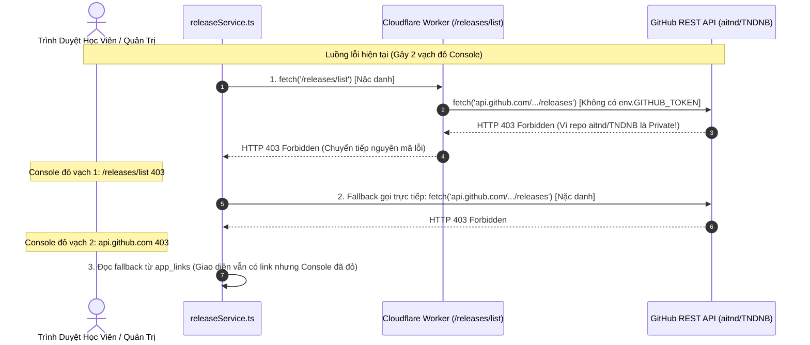
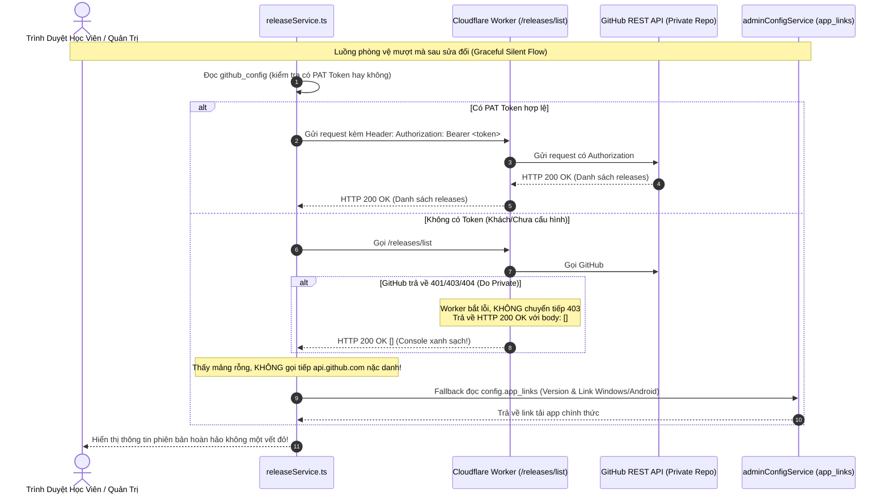

# Chi Tiết Kỹ Thuật Phase 02: Xử Lý Graceful Silent Fallback Cho Private Repo GitHub Releases

> **Mã kế hoạch**: `261107-0025-fix-settings-save-and-private-repo-errors`  
> **Tài liệu tham chiếu**:
> - Kế hoạch tổng thể: [`plan.md`](file:///d:/Antigravity/TNDNB/docs/plans/261107-0025-fix-settings-save-and-private-repo-errors/plan.md)
> - Danh sách nhiệm vụ: [`task.md`](file:///d:/Antigravity/TNDNB/docs/plans/261107-0025-fix-settings-save-and-private-repo-errors/task.md)
> - Tệp mã nguồn mục tiêu:
>   - [`cloudflare-worker/src/routes/releasesProxy.ts`](file:///d:/Antigravity/TNDNB/cloudflare-worker/src/routes/releasesProxy.ts)
>   - [`ontap-web/services/releaseService.ts`](file:///d:/Antigravity/TNDNB/ontap-web/services/releaseService.ts)

---

## 1. Mục Tiêu Kỹ Thuật

1. **Triệt tiêu hoàn toàn 2 dòng lỗi đỏ HTTP 403 Forbidden** trong tab Console của trình duyệt khi nạp trang web:
   - `GET https://api.daotaothuyenvien.com/releases/list 403 (Forbidden)`
   - `GET https://api.github.com/repos/aitnd/TNDNB/releases 403 (Forbidden)`
2. **Bảo đảm tính bền bỉ khi Repository chuyển sang Private**:
   - Khi repo `aitnd/TNDNB` được chuyển sang chế độ Private, các truy vấn không có token sẽ được xử lý ngầm (graceful silent fallback) mà không làm ô nhiễm console trình duyệt.
   - Hệ thống tự động chuyển tiếp sang nguồn dữ liệu tải ứng dụng dự phòng trong cấu hình hệ thống (`config.app_links`).
3. **Hỗ trợ nạp token an toàn**:
   - Nếu Quản trị viên đã nhập GitHub Personal Access Token (PAT) trong trang Quản lý Cài đặt, hệ thống sẽ sử dụng token này để lấy danh sách bản phát hành chính thức từ GitHub.

---

## 2. Phân Tích Thực Trạng & Điểm Lỗi Cốt Lõi



### Điểm bất cập:
1. Cloudflare Worker `releasesProxy.ts` chuyển tiếp thẳng status code 403 từ GitHub về trình duyệt (`status: upstreamRes.status`).
2. Client `releaseService.ts` cố chấp gọi thêm một lần nữa trực tiếp tới GitHub nặc danh, bất chấp việc repo là Private, tạo nên lỗi 403 kép.

---

## 3. Kiến Trúc Giải Pháp: 2 Tầng Phòng Vệ & Fallback Êm Ái



---

## 4. Chi Tiết Thay Đổi Mã Nguồn

### 4.1. Cập nhật Cloudflare Worker: [`cloudflare-worker/src/routes/releasesProxy.ts`](file:///d:/Antigravity/TNDNB/cloudflare-worker/src/routes/releasesProxy.ts)
Bắt mã lỗi từ upstream GitHub và trả về HTTP 200 với mảng rỗng `[]`:

```typescript
    // Kiểm tra header Authorization truyền từ client (nếu có)
    const clientAuth = request.headers.get('Authorization');
    if (clientAuth && clientAuth.startsWith('Bearer ')) {
      ghHeaders['Authorization'] = clientAuth;
    } else if (env.GITHUB_TOKEN) {
      ghHeaders['Authorization'] = `Bearer ${env.GITHUB_TOKEN}`;
    }

    try {
      const upstreamRes = await fetch(
        `https://api.github.com/repos/${owner}/${repo}/releases`,
        { headers: ghHeaders }
      );

      // Nếu GitHub trả về 401, 403, 404 (do repo private hoặc thiếu token)
      // Ta xử lý êm dịu: Trả về HTTP 200 với mảng rỗng []
      if (!upstreamRes.ok) {
        console.warn(`[ReleasesProxy] Upstream GitHub responded with ${upstreamRes.status}. Returning empty releases gracefully.`);
        return new Response(JSON.stringify([]), {
          status: 200,
          headers: {
            ...corsHeaders,
            'Content-Type': 'application/json; charset=utf-8',
            'Cache-Control': 'public, s-maxage=30, stale-while-revalidate=120'
          }
        });
      }

      const rawReleases = (await upstreamRes.json()) as UpstreamRelease[];
      const rewritten = rawReleases.map((rel) => ({
        ...rel,
        assets: Array.isArray(rel.assets)
          ? rel.assets.map((asset) => ({
              ...asset,
              browser_download_url: `${url.origin}/releases/download/${encodeURIComponent(asset.name)}`
            }))
          : []
      }));

      return new Response(JSON.stringify(rewritten), {
        status: 200,
        headers: {
          ...corsHeaders,
          'Content-Type': 'application/json; charset=utf-8',
          'Cache-Control': 'public, s-maxage=60, stale-while-revalidate=300'
        }
      });
    } catch (fetchErr) {
      console.warn('[ReleasesProxy] Network fetch error to GitHub:', fetchErr);
      return new Response(JSON.stringify([]), {
        status: 200,
        headers: { ...corsHeaders, 'Content-Type': 'application/json; charset=utf-8' }
      });
    }
```

### 4.2. Cập nhật Client Service: [`ontap-web/services/releaseService.ts`](file:///d:/Antigravity/TNDNB/ontap-web/services/releaseService.ts)
1. Truy vấn token từ `getGitHubConfig()`.
2. Không gọi trực tiếp nặc danh sang `api.github.com`.
3. Fallback mượt mà sang `config.app_links`.

```typescript
export async function getGitHubReleases(): Promise<AppRelease[]> {
  try {
    // 1. Kiểm tra cấu hình GitHub Token nếu có
    const ghConfig = await getGitHubConfig().catch(() => null);
    const token = ghConfig?.token;

    const headers: Record<string, string> = {
      Accept: 'application/vnd.github.v3+json'
    };
    if (token) {
      headers['Authorization'] = `Bearer ${token}`;
    }

    // 2. Chỉ gọi qua Worker Proxy (Worker đã có cơ chế an toàn trả về 200 [])
    const endpoint = `${getCloudflareApiBase()}/releases/list`;
    const response = await fetch(endpoint, { headers });

    if (response.ok) {
      const data = (await response.json()) as RawGitHubRelease[];
      if (Array.isArray(data) && data.length > 0) {
        return data
          .filter((release) => !release.draft && !release.prerelease)
          .map((release) => ({
            version: normalizeVersion(release.tag_name),
            release_notes: release.body || 'Cập nhật hiệu suất và vá lỗi',
            created_at: release.published_at || release.created_at,
            download_url: release.assets?.[0]?.browser_download_url
          }))
          .sort((a: AppRelease, b: AppRelease) => {
            const partsA = a.version.split('.').map(Number);
            const partsB = b.version.split('.').map(Number);
            for (let i = 0; i < Math.max(partsA.length, partsB.length); i++) {
              const pA = partsA[i] || 0;
              const pB = partsB[i] || 0;
              if (pA > pB) return -1;
              if (pA < pB) return 1;
            }
            return 0;
          });
      }
    }
  } catch (err) {
    console.warn('[ReleaseService] Lỗi gọi endpoint releases, chuyển sang fallback app_links:', err);
  }

  // 3. Fallback sang app_links trong cấu hình hệ thống
  try {
    const config = await getUsageConfig();
    if (config && config.app_links && config.app_links.version) {
      return [
        {
          version: config.app_links.version,
          release_notes:
            'Bản cập nhật quan trọng. Vui lòng tải về phiên bản mới nhất để trải nghiệm tốt hơn.',
          created_at: new Date().toISOString(),
          download_url: config.app_links.windows
        }
      ];
    }
  } catch (e) {
    console.warn('[ReleaseService] Fallback app_links rỗng:', e);
  }

  return [];
}
```

---

## 5. Kế Hoạch Kiểm Thử TDD Cho Phase 02

- [ ] **Task 2.1**: Viết test case `TC-14`: Worker `/releases/list` trả về HTTP 200 kèm `[]` khi GitHub upstream phản hồi 403 Forbidden.
- [ ] **Task 2.2**: Viết test case `TC-15`: `releaseService.ts` không gọi trực tiếp `api.github.com` nặc danh và tự động fallback sang `config.app_links`.
- [ ] **Task 2.3**: Triển khai mã nguồn trong `cloudflare-worker/src/routes/releasesProxy.ts` và `ontap-web/services/releaseService.ts`.
- [ ] **Task 2.4**: Chạy Vitest xác nhận các bài kiểm thử chuyển sang màu **GREEN (PASS)**.
