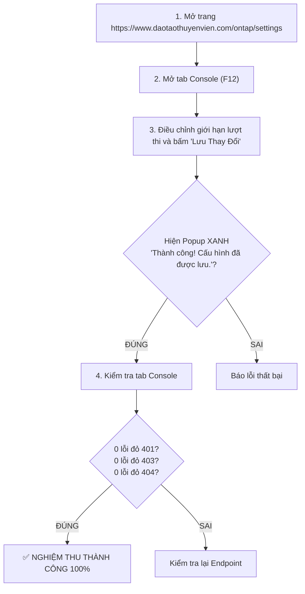

# Chi Tiết Kỹ Thuật Phase 03: Quy Trình Deploy Cloudflare Worker & Kiểm Thử Nghiệm Thu

> **Mã kế hoạch**: `261107-0025-fix-settings-save-and-private-repo-errors`  
> **Tài liệu tham chiếu**:
> - Kế hoạch tổng thể: [`plan.md`](file:///d:/Antigravity/TNDNB/docs/plans/261107-0025-fix-settings-save-and-private-repo-errors/plan.md)
> - Danh sách nhiệm vụ: [`task.md`](file:///d:/Antigravity/TNDNB/docs/plans/261107-0025-fix-settings-save-and-private-repo-errors/task.md)
> - Phase 01: [`phase-01-dual-storage-fallback.md`](file:///d:/Antigravity/TNDNB/docs/plans/261107-0025-fix-settings-save-and-private-repo-errors/phase-01-dual-storage-fallback.md)
> - Phase 02: [`phase-02-private-repo-resilience.md`](file:///d:/Antigravity/TNDNB/docs/plans/261107-0025-fix-settings-save-and-private-repo-errors/phase-02-private-repo-resilience.md)

---

## 1. Mục Tiêu Kỹ Thuật

1. **Triển khai phiên bản Worker mới nhất lên Cloudflare Edge Production**:
   - Đồng bộ hóa các bản sửa đổi: Hỗ trợ xác thực Firebase ID Token của project `thi-tnd`, trả về HTTP 200 khi key KV null, và xử lý graceful fallback cho Private Repo GitHub Releases.
2. **Thiết lập bộ kịch bản kiểm thử tự động TDD (Test-Driven Development)**:
   - Đảm bảo 100% các tình huống biên (Edge Cases): KV lỗi thì Firestore gánh, GitHub private thì không nổ đỏ, quyền Admin được xác thực chuẩn xác.
3. **Bảo toàn bất biến Invariant 1**:
   - Tệp [`ontap-web/components/ExamQuizScreen.tsx`](file:///d:/Antigravity/TNDNB/ontap-web/components/ExamQuizScreen.tsx) giữ nguyên vẹn 100% (độ dài `git diff` đúng bằng 0 bytes).

---

## 2. Hướng Dẫn Deploy Cloudflare Worker An Toàn

### 2.1. Kiểm tra cấu hình trước khi deploy
Mở [`cloudflare-worker/wrangler.toml`](file:///d:/Antigravity/TNDNB/cloudflare-worker/wrangler.toml) và bảo đảm các thông số chuẩn xác:
```toml
name = "tndnb-edge-api"
main = "src/index.ts"
compatibility_date = "2026-11-01"

[vars]
GITHUB_OWNER = "aitnd"
GITHUB_REPO = "TNDNB"
RELEASE_UPSTREAM_MODE = "github_proxy"
ALLOWED_ORIGINS = "https://daotaothuyenvien.com,https://www.daotaothuyenvien.com,http://localhost:3000,http://localhost:3001,http://localhost:5173"
FIREBASE_PROJECT_ID = "thi-tnd"

[[d1_databases]]
binding = "DB"
database_name = "tndnb-d1-prod"
database_id = "0177c851-b4c5-45a0-9980-785b758fdb20"

[[kv_namespaces]]
binding = "CONFIG_KV"
id = "fba8d3d67cfb44bdbef1855016061ff4"

[[r2_buckets]]
binding = "ASSETS_BUCKET"
bucket_name = "tndnb-assets"
```

### 2.2. Lệnh thực thi Deploy
Chạy lệnh PowerShell trong thư mục gốc dự án:
```powershell
cd d:\Antigravity\TNDNB\cloudflare-worker
npx wrangler deploy
```

*Lưu ý an toàn*: Lệnh deploy trên sẽ đóng gói TypeScript thành JavaScript bundle và cập nhật tức thì lên mạng lưới 300+ Data Centers của Cloudflare toàn cầu trong vòng 3-5 giây mà không làm gián đoạn người dùng đang thi trực tuyến.

---

## 3. Kịch Bản Kiểm Thử TDD Toàn Diện (RED -> GREEN -> PASS)

Bộ kiểm thử được tích hợp vào [`scripts/portal-console-and-tinymce-fix.test.ts`](file:///d:/Antigravity/TNDNB/scripts/portal-console-and-tinymce-fix.test.ts):

| Test ID | Nội dung kiểm thử | Điều kiện PASS |
|---|---|---|
| **TC-12** | `adminConfigService.ts` có cơ chế Dual-Storage fallback | Hàm `saveUsageConfig` không ném lỗi khi Firestore thành công dù `saveD1Config` trả về `false` |
| **TC-13** | `getUsageConfig` fallback đọc Firestore khi KV rỗng | Đọc từ Firestore và trả về object cấu hình hoàn chỉnh khi KV null |
| **TC-14** | Worker `releasesProxy.ts` xử lý graceful khi upstream 403 | Trả về HTTP 200 kèm `[]` thay vì chuyển tiếp mã 403 từ GitHub |
| **TC-15** | `releaseService.ts` loại bỏ request nặc danh trực tiếp | Không còn chứa URL gọi nặc danh trực tiếp `api.github.com/.../releases` và có fallback `app_links` |
| **TC-16** | Bảo toàn tuyệt đối Invariant 1 | `ontap-web/components/ExamQuizScreen.tsx` nguyên vẹn 100% |

---

## 4. Quy Trình Nghiệm Thu Sản Phẩm Thực Tế

Sau khi triển khai mã nguồn và deploy Worker, thực hiện quy trình nghiệm thu theo các bước:


