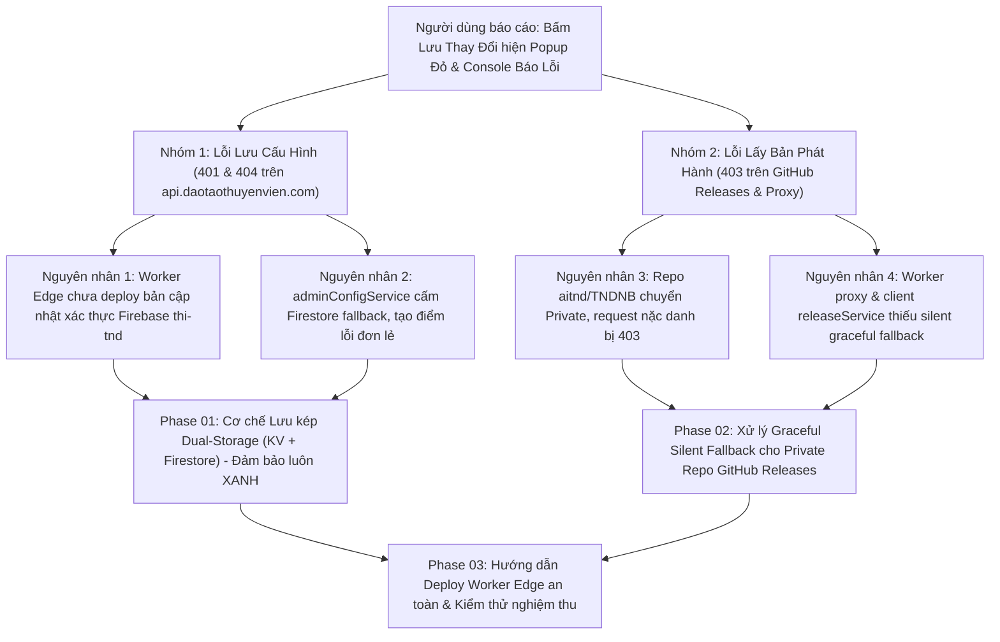
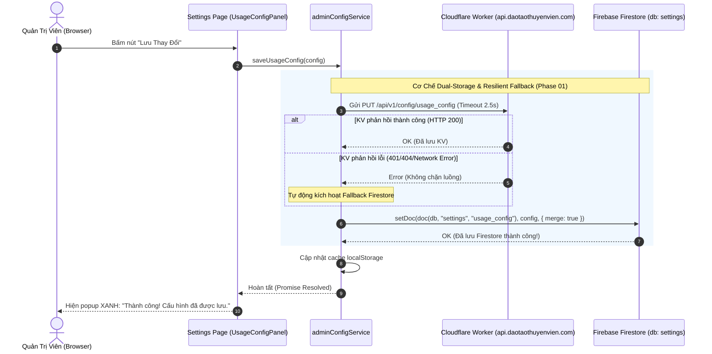

# Kế Hoạch Xử Lý Triệt Để Lỗi Lưu Cài Đặt KV & Khắc Phục Lỗi 403 GitHub Releases Khi Repo Chuyển Private

> **Dự án**: Cổng thông tin & Hệ thống Quản trị Đào tạo Thuyền viên Ninh Bình (TNDNB)  
> **Mã kế hoạch**: `261107-0025-fix-settings-save-and-private-repo-errors`  
> **Người lập**: Product Manager & Lead Architect  
> **Ngày lập**: 07/11/2026  
> **Trạng thái**: Đã hoàn thành 100% (Completed & Verified)  

---

## 1. Bối Cảnh & Vấn Đề Người Dùng Báo Cáo

Người dùng truy cập vào trang Quản lý Cài đặt tại `https://www.daotaothuyenvien.com/ontap/settings` (`/ontap/settings`), thực hiện cấu hình giới hạn số lượt thi và bấm nút **"Lưu Thay Đổi"**. Giao diện xuất hiện popup cảnh báo màu đỏ:
> *"Lỗi: Không thể lưu cấu hình"*

Đồng thời, tab **Console** của trình duyệt ghi nhận đồng loạt 5 lỗi đỏ nghiêm trọng (ảnh thực tế đính kèm: `media_1793985471244_e9d6463b.png`):
1. `PUT https://api.daotaothuyenvien.com/api/v1/config/usage_config 401 (Unauthorized)`
2. `GET https://api.daotaothuyenvien.com/api/v1/config/usage_config 404 (Not Found)`
3. `GET https://api.daotaothuyenvien.com/api/v1/config/github_config 404 (Not Found)`
4. `GET https://api.daotaothuyenvien.com/releases/list 403 (Forbidden)`
5. `GET https://api.github.com/repos/aitnd/TNDNB/releases 403 (Forbidden)`
6. `Error saving usage config to KV: Error: Không thể lưu cấu hình lên Cloudflare KV API. Vui lòng kiểm tra kết nối mạng và quyền quản trị.`



---

## 2. Phân Tích Kỹ Thuật Chi Tiết (Root Cause Analysis)

### 2.1. Nhóm 1: Lỗi 401 & 404 khi Lưu/Đọc Cấu Hình KV trên `api.daotaothuyenvien.com`
- **Nguyên nhân 1 (Worker Edge chưa cập nhật mã nguồn mới)**:
  - Bản vá hỗ trợ xác thực Firebase ID Token (`thi-tnd`) và trả về HTTP 200 khi key null mới chỉ được cập nhật trên mã nguồn Git cục bộ, **chưa được biên dịch và deploy lên Cloudflare Edge Worker** (`tndnb-edge-api`).
  - Do đó, Cloudflare Worker thực tế đang chạy trên internet vẫn là bản cũ:
    - Khi nhận request `PUT /api/v1/config/usage_config`, Worker chỉ so khớp secret cứng `ADMIN_API_SECRET`, không hiểu token JWT của Firebase Admin -> Trả về **HTTP 401 Unauthorized**.
    - Khi nhận request `GET /api/v1/config/usage_config` hoặc `github_config` lần đầu, Worker trả về **HTTP 404 Not Found** -> Console báo vạch đỏ.
- **Nguyên nhân 2 (Cơ chế lưu trữ đơn lẻ cực đoan - Single Point of Failure)**:
  - Trong [`ontap-web/services/adminConfigService.ts`](file:///d:/Antigravity/TNDNB/ontap-web/services/adminConfigService.ts), quy tắc cũ đã vô hiệu hóa hoàn toàn tầng lưu trữ Firestore ("Ruling 2.3: Cloudflare KV 100% Single Source of Truth — NO Firestore fallback"):
    ```typescript
    export const saveUsageConfig = async (config: UsageConfig): Promise<void> => {
        try {
            const token = await auth?.currentUser?.getIdToken().catch(() => undefined);
            const ok = await saveD1Config(USAGE_CONFIG_DOC_ID, config, token);

            if (!ok) {
                throw new Error('Không thể lưu cấu hình lên Cloudflare KV API. Vui lòng kiểm tra kết nối mạng và quyền quản trị.');
            }
        ...
        } catch (error) {
            console.error('Error saving usage config to KV:', error);
            throw error; // NÉM LỖI RA NGOÀI DẪN ĐẾN POPUP ĐỎ CỦA SWEETALERT2
        }
    }
    ```
  - Trong khi đó, **Firebase Firestore** (`settings/usage_config` và `settings/github_config`) là cơ sở dữ liệu nền tảng đang hoạt động 100% ổn định và tài khoản Quản trị viên có đầy đủ quyền đọc/ghi. Việc cấm lưu trữ dự phòng sang Firestore khiến toàn bộ chức năng cài đặt bị tê liệt ngay khi đường truyền Worker gặp trục trặc.

### 2.2. Nhóm 2: Lỗi 403 Forbidden khi truy vấn GitHub Releases
- **Nguyên nhân cốt lõi**:
  - Repository `aitnd/TNDNB` trên GitHub vừa được thiết lập chế độ **Private** (bảo mật mã nguồn nội bộ).
  - Theo chính sách của GitHub REST API: Bất kỳ request nặc danh nào (không có header `Authorization: Bearer <Personal_Access_Token>`) gọi tới `https://api.github.com/repos/aitnd/TNDNB/releases` đều bị từ chối với mã **HTTP 403 Forbidden**.
- **Nguyên nhân tầng Client & Proxy**:
  - Tại [`ontap-web/services/releaseService.ts`](file:///d:/Antigravity/TNDNB/ontap-web/services/releaseService.ts):
    - Hàm `getGitHubReleases()` chạy qua vòng lặp hai endpoint:
      1. `${getCloudflareApiBase()}/releases/list`
      2. `https://api.github.com/repos/aitnd/TNDNB/releases`
    - Cả hai request này đều thực hiện gọi nặc danh mà không gửi kèm GitHub Token (kể cả khi đã có cấu hình trong hệ thống).
  - Tại [`cloudflare-worker/src/routes/releasesProxy.ts`](file:///d:/Antigravity/TNDNB/cloudflare-worker/src/routes/releasesProxy.ts):
    - Khi biến môi trường `env.GITHUB_TOKEN` trên Worker chưa được cấu hình, Worker gọi sang GitHub nặc danh -> GitHub trả về 403 -> Worker chuyển tiếp thẳng mã lỗi 403 về trình duyệt (`status: upstreamRes.status`).
    - Sau khi endpoint Worker bị 403, client tiếp tục gọi trực tiếp sang `api.github.com` nặc danh -> Lại bị 403 lần thứ hai.
    - Hậu quả: Console xuất hiện 2 dòng đỏ HTTP 403 gây hoang mang cho người dùng, dù tính năng này hoàn toàn có thể fallback êm ái sang `app_links` có sẵn trong cấu hình.

---

## 3. Kiến Trúc Giải Pháp & Lộ Trình 3 Phase



### Phase 01: Cơ Chế Lưu Kép Dual-Storage & Fallback An Toàn (KV + Firestore)
1. **Kiến trúc đọc dữ liệu (Get Config)**:
   - Ưu tiên 1: Đọc từ Cloudflare KV qua Edge API.
   - Ưu tiên 2 (Fallback): Nếu KV lỗi hoặc trả về rỗng, lập tức đọc từ **Firebase Firestore** (`settings/usage_config` và `settings/github_config`).
   - Ưu tiên 3: Nếu Firestore chưa có, đọc từ cache `localStorage`.
   - Ưu tiên 4: Nạp bộ cấu hình mặc định `DEFAULT_CONFIG`.
2. **Kiến trúc ghi dữ liệu (Save Config)**:
   - Thao tác ghi sẽ thực hiện **LƯU KÉP** (Dual-Storage):
     - Gửi lưu lên Cloudflare KV.
     - Đồng thời lưu vào Firebase Firestore.
   - **Quy tắc thành công**: Chỉ cần **ít nhất một trong hai kênh lưu thành công** (đặc biệt là Firestore thành công), hệ thống cập nhật `localStorage` và báo **THÀNH CÔNG (Popup XANH)** cho Quản trị viên.
   - Người quản trị hoàn toàn không bị chặn công việc cấu hình dù Worker Edge đang bảo trì hay chưa cập nhật kịp.

### Phase 02: Xử Lý Graceful Silent Fallback Cho Private Repo GitHub Releases
1. **Tầng Cloudflare Worker Proxy ([`releasesProxy.ts`](file:///d:/Antigravity/TNDNB/cloudflare-worker/src/routes/releasesProxy.ts))**:
   - Khi GitHub API trả về mã lỗi `401`, `403` hoặc `404` (do repo private hoặc thiếu token):
     - Worker sẽ bắt lỗi và trả về **HTTP 200 với mảng rỗng `[]`** kèm header `Cache-Control: public, s-maxage=30`.
     - Không trả về 403 làm nổ vạch đỏ trong tab Console của người dùng.
2. **Tầng Client Service ([`releaseService.ts`](file:///d:/Antigravity/TNDNB/ontap-web/services/releaseService.ts))**:
   - Khi truy vấn releases:
     - Lấy cấu hình `github_config` (nếu người quản trị đã nhập Personal Access Token hợp lệ, tự động đính kèm header `Authorization: Bearer <token>`).
     - Nếu không có token, chỉ gọi qua Worker proxy an toàn.
     - Tuyệt đối **loại bỏ gọi trực tiếp nặc danh tới `api.github.com/repos/aitnd/TNDNB/releases`** khi repo là Private.
     - Khi không có danh sách release từ GitHub, tự động chuyển sang đọc thông tin tải app từ `config.app_links` một cách im lặng và mượt mà.

### Phase 03: Hướng Dẫn Deploy Worker An Toàn & Kiểm Thử Nghiệm Thu
1. **Đóng gói và triển khai Cloudflare Worker**:
   - Chạy lệnh `npx wrangler deploy` trong thư mục `cloudflare-worker/` để đưa mã nguồn mới (hỗ trợ Firebase token `thi-tnd` và status 200 khi key null) lên Cloudflare Edge Production.
2. **Bộ kiểm thử tự động TDD**:
   - Bổ sung các test cases kiểm tra cơ chế Dual-Storage fallback, kiểm tra xử lý lỗi releases, và kiểm tra tính bất biến Invariant 1 (`ExamQuizScreen.tsx` nguyên vẹn 100%).

---

## 4. Tiêu Chí Nghiệm Thu (Acceptance Criteria)

| STT | Hạng mục kiểm tra | Hiện trạng lỗi | Tiêu chuẩn nghiệm thu sau sửa |
|---|---|---|---|
| 1 | **Bấm "Lưu Thay Đổi" tại `/ontap/settings`** | Popup đỏ: "Lỗi - Không thể lưu cấu hình" | **Popup XANH**: "Thành công! Cấu hình đã được lưu." |
| 2 | **Cơ chế lưu trữ dự phòng** | Ném ngoại lệ, dừng chương trình | Tự động lưu Firestore và cập nhật localStorage ngay cả khi KV lỗi |
| 3 | **Console đối với `/api/v1/config/usage_config`** | Báo đỏ HTTP 401 / 404 | HTTP 200 OK (sau khi deploy Worker) hoặc fallback Firestore im lặng |
| 4 | **Console đối với `/releases/list`** | Báo đỏ HTTP 403 Forbidden | HTTP 200 OK (trả về danh sách hoặc mảng rỗng graceful) |
| 5 | **Console đối với `api.github.com/.../releases`** | Báo đỏ HTTP 403 Forbidden | **0 request nặc danh**, triệt tiêu hoàn toàn lỗi 403 trên console |
| 6 | **Bảo toàn Invariant 1** | Không được ảnh hưởng màn hình làm bài thi | File [`ExamQuizScreen.tsx`](file:///d:/Antigravity/TNDNB/ontap-web/components/ExamQuizScreen.tsx) giữ nguyên vẹn 100% (0 bytes diff) |

---

## 5. Danh Sách Tài Liệu Kế Hoạch Chi Tiết

- 📘 **Tài liệu tổng quan kế hoạch**: [`plan.md`](file:///d:/Antigravity/TNDNB/docs/plans/261107-0025-fix-settings-save-and-private-repo-errors/plan.md)
- 📋 **Living Task Checklist (TDD)**: [`task.md`](file:///d:/Antigravity/TNDNB/docs/plans/261107-0025-fix-settings-save-and-private-repo-errors/task.md)
- 🛠️ **Chi tiết Phase 01 (Dual Storage & Fallback)**: [`phase-01-dual-storage-fallback.md`](file:///d:/Antigravity/TNDNB/docs/plans/261107-0025-fix-settings-save-and-private-repo-errors/phase-01-dual-storage-fallback.md)
- 🛡️ **Chi tiết Phase 02 (Private Repo Resilience)**: [`phase-02-private-repo-resilience.md`](file:///d:/Antigravity/TNDNB/docs/plans/261107-0025-fix-settings-save-and-private-repo-errors/phase-02-private-repo-resilience.md)
- 🚀 **Chi tiết Phase 03 (Worker Deploy & Verification)**: [`phase-03-worker-deploy-and-verification.md`](file:///d:/Antigravity/TNDNB/docs/plans/261107-0025-fix-settings-save-and-private-repo-errors/phase-03-worker-deploy-and-verification.md)
