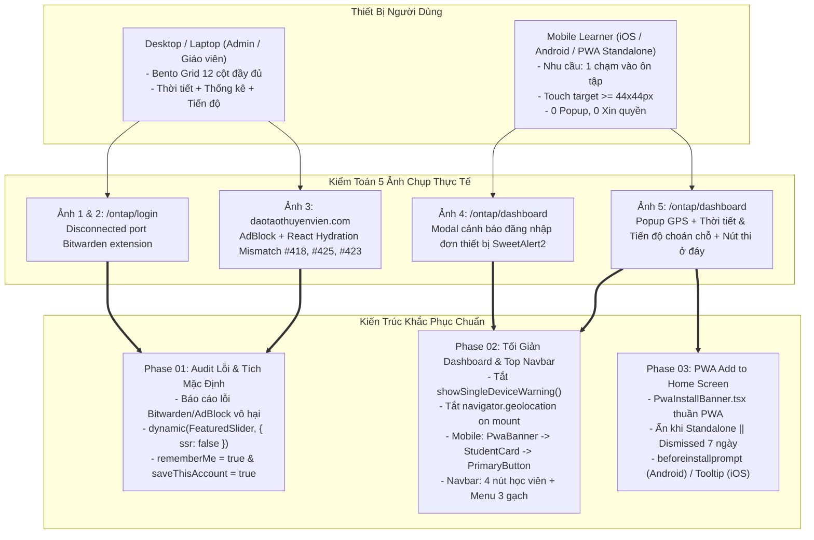
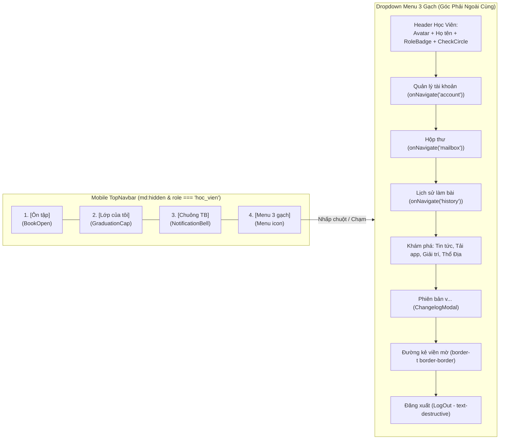
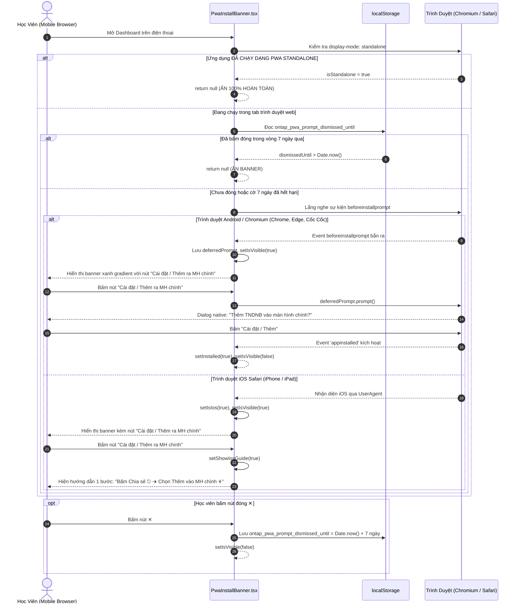
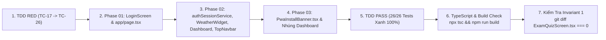

# Thiết Kế Kỹ Thuật Chi Tiết (Technical Solution Design)

> **Dự án**: Cổng thông tin & Hệ thống Quản trị Đào tạo Thuyền viên Ninh Bình (TNDNB)  
> **Mã thiết kế**: `261107-0620-mobile-dashboard-simplification-and-error-audit-design`  
> **Nhánh Git**: `feat/mobile-dashboard-and-top-navbar-simplification`  
> **Vai trò**: Solution Architect & API Designer  
> **Ngày lập**: 07/11/2026  
> **Trạng thái**: Đã phê duyệt (Approved - Ready for Implementation)  
> **Tài liệu tham chiếu**:
> - Kế hoạch tổng thể: [`plan.md`](file:///d:/Antigravity/TNDNB/docs/plans/261107-0620-mobile-dashboard-simplification-and-error-audit/plan.md)
> - Danh sách công việc: [`task.md`](file:///d:/Antigravity/TNDNB/docs/plans/261107-0620-mobile-dashboard-simplification-and-error-audit/task.md)
> - Chi tiết Phase 01: [`phase-01-audit-console-errors-and-login-screen.md`](file:///d:/Antigravity/TNDNB/docs/plans/261107-0620-mobile-dashboard-simplification-and-error-audit/phase-01-audit-console-errors-and-login-screen.md)
> - Chi tiết Phase 02: [`phase-02-mobile-dashboard-simplification.md`](file:///d:/Antigravity/TNDNB/docs/plans/261107-0620-mobile-dashboard-simplification-and-error-audit/phase-02-mobile-dashboard-simplification.md)
> - Chi tiết Phase 03: [`phase-03-smart-app-banner-and-pwa-prompt.md`](file:///d:/Antigravity/TNDNB/docs/plans/261107-0620-mobile-dashboard-simplification-and-error-audit/phase-03-smart-app-banner-and-pwa-prompt.md)

---

## 1. Tổng Quan Kiến Trúc & Kiểm Toán 5 Ảnh Thực Tế (System Context & Error Audit)

### 1.1. Bối cảnh kiến trúc hệ thống
Hệ thống Ôn tập & Thi thử Thuyền viên Ninh Bình (`ontap-web`) được thiết kế theo mô hình **PWA (Progressive Web App)** hiện đại, phục vụ đồng thời hai nhóm đối tượng:
1. **Học viên di động (Mobile Learners - chiếm >80% lưu lượng)**: Truy cập qua trình duyệt điện thoại (iOS Safari, Android Chrome, Cốc Cốc, Zalo Browser). Nhu cầu cốt lõi là **"1 chạm vào thi"**, giao diện tinh gọn, không cản trở bởi popup hay xin quyền rườm rà.
2. **Quản trị viên & Giáo viên trên máy tính (Desktop Power Users)**: Thao tác quản lý lớp học, cấu hình hệ thống, theo dõi tiến độ chi tiết qua bố cục Bento Grid 12 cột.



### 1.2. Ma trận kiểm toán cội rễ 5 bức ảnh phản ánh từ người dùng

| Bức ảnh | URL / Màn hình | Triệu chứng kỹ thuật | Phân loại | Cội rễ kỹ thuật (Root Cause) | Chiến lược xử lý triệt để |
|---|---|---|---|---|---|
| **Ảnh 1 & 2** | `/ontap/login` | `Attempting to use a disconnected port object at CM.sendMessageTo (chrome-extension://nngceckbapebfimnlniiahkandclblb/...)` | Extension Client | ID `nngceckbapebfimnlniiahkandclblb` là extension **Bitwarden Password Manager**. Service worker của extension bị Chrome tạm ngắt kết nối ngầm. **Hoàn toàn không phải lỗi website**. | Báo cáo rõ ràng cho người dùng; Lỗi tự biến mất khi vào chế độ ẩn danh (Incognito) hoặc tắt extension. |
| **Ảnh 3 (a,b)** | `daotaothuyenvien.com` | `ad.doubleclick.net ERR_BLOCKED_BY_CLIENT`<br/>`content.js:2 TypeError: Cannot read properties of null` | AdBlock & Extension | Tiện ích chặn quảng cáo chặn script Google tracking; Extension thứ ba tiêm script `content.js` nhưng không bắt được selector mong muốn. | Báo cáo cho người dùng; Không can thiệp codebase portal. |
| **Ảnh 3 (c)** | `daotaothuyenvien.com` | `React Minified error #425, #418, #423` (Hydration Mismatch) | **Codebase Next.js** | Thư viện Swiper trong [`FeaturedSlider.tsx`](file:///d:/Antigravity/TNDNB/components/FeaturedSlider.tsx) tiêm DOM client khác với HTML server SSR của [`app/page.tsx`](file:///d:/Antigravity/TNDNB/app/page.tsx). | Chuyển sang `dynamic(() => import('../components/FeaturedSlider'), { ssr: false })`. |
| **Ảnh 4** | `/ontap/dashboard` | Popup modal cảnh báo *"⚠️ Cảnh báo đăng nhập: Tài khoản của bạn vừa được đăng nhập trên thiết bị này..."* | UX Friction | Hàm `enforceAndRecordSession()` trong [`authSessionService.ts`](file:///d:/Antigravity/TNDNB/ontap-web/services/authSessionService.ts) tự động gọi `showSingleDeviceWarning()` mỗi khi có session cũ bị kick. | Vô hiệu hóa lời gọi `showSingleDeviceWarning()`. Xoay vòng session ngầm không gây gián đoạn. |
| **Ảnh 5** | `/ontap/dashboard` | Popup xin quyền GPS + Widget Thời tiết & Tiến độ choán chỗ, nút "Vào Ôn Tập" bị trôi xuống đáy màn hình | Layout Mobile | [`WeatherWidget.tsx`](file:///d:/Antigravity/TNDNB/ontap-web/components/WeatherWidget.tsx) tự gọi `getCurrentPosition` khi mount; [`Dashboard.tsx`](file:///d:/Antigravity/TNDNB/ontap-web/components/Dashboard.tsx) trên mobile dồn cột trái lên trước cột phải. | Tắt xin quyền GPS; Ẩn thời tiết/tiến độ trên mobile; Đưa nút "Vào Ôn Tập" lên ngay dưới Thẻ Học Viên; Thêm banner PWA. |

---

## 2. Thiết Kế Component & State Architecture

### 2.1. Thiết kế `TopNavbar.tsx` (Menu 3 Gạch Ngang & Quy Tắc 4 Nút Tối Giản Mobile)

#### 2.1.1. Hiện trạng & Nhược điểm
Thanh [`TopNavbar.tsx`](file:///d:/Antigravity/TNDNB/ontap-web/components/TopNavbar.tsx) hiện tại hiển thị tới 9 nút bấm dày đặc trên mobile: Ôn tập, Lớp của tôi, Thi trực tuyến, Khám phá, Mail, History, NotificationBell, UserCog, và LogOut. Các nút bị tràn ngang, diện tích bấm chật hẹp (<32px), nút Đăng xuất đỏ lộ liễu rất dễ bấm nhầm.

#### 2.1.2. Hợp đồng Kiến trúc Mới (Component Contract)



#### 2.1.3. Đặc tả Logic State & Quy tắc Render:
1. **Hamburger Menu 3 gạch (`Menu` icon từ `lucide-react`)**:
   - Khởi tạo state: `const [showHamburgerMenu, setShowHamburgerMenu] = React.useState(false);`
   - Đặt ở góc phải ngoài cùng của thanh Navbar.
   - Khi bấm vào, hiển thị Dropdown Menu góc phải (`right-0 mt-2`) với bóng đổ sâu `shadow-2xl`, viền mờ `border-border/80`, nền `bg-card/98 backdrop-blur-xl`.
   - Danh mục bên trong menu:
     - **Phần thông tin học viên**: Hiển thị tên đầy đủ, huy hiệu vai trò (`MiniRoleBadge`), tích xanh xác thực (`CheckCircle`). Kèm nút nhỏ "Quản lý tài khoản" dẫn tới màn hình `account`.
     - **Danh mục tiện ích**: Hộp thư (`Mail`), Lịch sử làm bài (`History`), Tải App (`Download`), Giải trí (`Gamepad2`), Cổng tin tức (`Newspaper`), Thổ Địa Ninh Bình (`Utensils`).
     - **Thông tin phiên bản**: Hiển thị `v{latestVersion}`, bấm vào mở `ChangelogModal`.
     - **Nút Đăng xuất an toàn**: Đặt ở đáy menu, phân tách bằng thẻ `<div className="border-t border-border my-2" />`, sử dụng màu cảnh báo `text-destructive hover:bg-destructive/10`, icon `LogOut`.
2. **Quy tắc 4 nút trên Mobile cho Role Học Viên (`userProfile.role === 'hoc_vien'`)**:
   - Khi trên màn hình nhỏ (`md:hidden`):
     - Chỉ render đúng 4 thành phần:
       1. `<button onClick={() => onNavigate('dashboard')}>` (Ôn tập)
       2. `<button onClick={() => onNavigate('my_class')}>` (Lớp của tôi)
       3. `<NotificationBell />` (Chuông thông báo)
       4. `<button onClick={() => setShowHamburgerMenu(!showHamburgerMenu)}>` (Menu 3 gạch)
     - Ẩn toàn bộ các nút riêng lẻ:
       - Ẩn nút "Thi trực tuyến" trên mobile navbar (`hidden md:flex`).
       - Ẩn dropdown "Khám phá" riêng lẻ trên mobile navbar (`hidden md:flex`).
       - Ẩn icon "Hộp thư" riêng lẻ trên mobile navbar (`hidden md:flex`).
       - Ẩn icon "Lịch sử" riêng lẻ trên mobile navbar (`hidden md:flex`).
       - Ẩn icon "UserCog" riêng lẻ trên mobile navbar (`hidden md:flex`).
       - Ẩn nút "Thoát" riêng lẻ trên mobile navbar (`hidden md:flex`).
3. **Màn hình Desktop (`md:flex` trở lên)**:
   - Giữ nguyên hiển thị đầy đủ các nút điều hướng rộng rãi. Nút Menu 3 gạch ở góc phải đóng vai trò quản lý tài khoản và tiện ích mở rộng tinh tế.

---

### 2.2. Thiết Kế `Dashboard.tsx` (Phân Tách Layout Mobile & Desktop)

#### 2.2.1. Phân tích luồng hiển thị Mobile cũ vs Mới

```mermaid
flowchart TD
    subgraph OldMobileFlow ["Luồng Mobile Cũ (Học viên phải cuộn mỏi tay)"]
        O1["1. WeatherWidget (Choán nửa màn hình)"]
        O2["2. StudentCard (Thẻ học viên)"]
        O3["3. leftButtons (Lịch sử, Quản lý lớp)"]
        O4["4. ProgressDashboard (Biểu đồ tiến độ cao 350px)"]
        O5["5. WelcomeHeader (Lời chào)"]
        O6["6. PrimaryButton (NÚT VÀO ÔN TẬP Ở ĐÁY CÙNG!)"]
        O1 --> O2 --> O3 --> O4 --> O5 --> O6
    end

    subgraph NewMobileFlow ["Luồng Mobile Mới (Chuẩn 1 Chạm Vào Thi)"]
        N1["1. PwaInstallBanner (Cài App PWA 1 chạm)"]
        N2["2. StudentCard (Thẻ học viên trang trọng ở đầu)"]
        N3["3. PrimaryButton (NÚT LỚN VÀO ÔN TẬP ĐẬP VÀO MẮT NGAY!)"]
        N4["4. SecondaryButtons (Lịch sử, Đổi đề, v.v.)"]
        N1 --> N2 --> N3 --> N4
    end
```



#### 2.2.2. Cấu trúc Responsive trong [`Dashboard.tsx`](file:///d:/Antigravity/TNDNB/ontap-web/components/Dashboard.tsx):
1. **Khối Thời tiết & Admin Bar (`ROW 1`)**:
   - Ẩn `WeatherWidget` trên Mobile bằng class:
     ```tsx
     <div className="hidden lg:block w-full">
         <WeatherWidget />
     </div>
     ```
   - Thanh `AdminStatsBar` vẫn hiển thị bình thường cho admin/quản lý.
2. **Khối Nội dung Chính (`ROW 2`)**:
   - **Giao diện Di động (`lg:hidden`)**:
     ```tsx
     <div className="w-full flex flex-col gap-3 lg:hidden">
         {/* 1. Banner gợi ý cài PWA */}
         <PwaInstallBanner />

         {/* 2. Thẻ Học Viên */}
         <StudentCard user={userProfile} />

         {/* 3. Nút Lớn Vào Ôn Tập / Thi Thử (Trọng tâm 1 chạm) */}
         <div className="w-full my-1">
             <PrimaryButton action={primaryAction} />
         </div>

         {/* 4. Nút phụ (Lịch sử, Lớp học) */}
         <div className="w-full space-y-2">
             {leftButtons.map((action, idx) => (
                 <SecondaryButton key={action.id} action={action} index={idx} />
             ))}
         </div>
     </div>
     ```
   - **Giao diện Desktop (`hidden lg:grid grid-cols-12`)**:
     - Giữ nguyên 100% cấu trúc Bento Grid 12 cột sang trọng:
       - Cột trái 4 cột: `StudentCard` + `SecondaryButton`s + `ProgressDashboard`.
       - Cột phải 8 cột: `WelcomeHeader` + `PrimaryButton` + `ActionTile`s 2x2.

---

### 2.3. Thiết Kế Component `PwaInstallBanner.tsx` (PWA Thuần Túy - Add to Home Screen)

#### 2.3.1. Triết lý thiết kế PWA thuần túy
Theo yêu cầu chỉ đạo trực tiếp của người dùng, hệ thống **không sử dụng tệp APK** mà tập trung 100% vào năng lực PWA hiện đại:
- Hoàn toàn không cần tải file `.apk`, không cần cấp quyền "Cài đặt nguồn không xác định" nguy hiểm.
- Đưa icon ứng dụng trực tiếp ra Màn hình chính điện thoại (Home Screen) với manifest chuẩn, biểu tượng sắc nét và splash screen mượt mà.
- Mở toàn màn hình độc lập (`display-mode: standalone`), ẩn thanh URL trình duyệt, nâng cao diện tích hiển thị câu hỏi và đáp án.

#### 2.3.2. Sơ đồ Tuần Tự Vòng Đời Của `PwaInstallBanner`:



#### 2.3.3. Đặc tả Hợp đồng Giao tiếp & Thuộc tính:
- **Tệp component**: [`ontap-web/components/PwaInstallBanner.tsx`](file:///d:/Antigravity/TNDNB/ontap-web/components/PwaInstallBanner.tsx).
- **Hằng số quản trị**:
  - `DISMISS_KEY = 'ontap_pwa_prompt_dismissed_until'`
  - `DISMISS_DURATION_MS = 7 * 24 * 60 * 60 * 1000` (7 ngày)
- **Kiểm tra Standalone PWA**:
  ```typescript
  const isStandalone = 
      window.matchMedia('(display-mode: standalone)').matches || 
      (window.navigator as any).standalone === true;
  ```
- **Hỗ trợ iOS Safari**: Hiển thị hướng dẫn trực quan dạng Bottom Sheet/Accordion với các bước:
  1. Bấm nút **Chia sẻ (Share) ⎋** ở thanh dưới cùng của Safari.
  2. Chọn **"Thêm vào MH chính" (Add to Home Screen) ➕**.
  3. Bấm **"Thêm" (Add)** ở góc trên bên phải.

---

### 2.4. Thiết Kế `LoginScreen.tsx` (Mặc Định Tích 2 Ô Đăng Nhập)

#### 2.4.1. Hợp đồng State Khởi tạo
Trong [`ontap-web/components/LoginScreen.tsx`](file:///d:/Antigravity/TNDNB/ontap-web/components/LoginScreen.tsx):
```typescript
// Trước:
const [rememberMe, setRememberMe] = useState(false);
const [saveThisAccount, setSaveThisAccount] = useState(true);

// Sau (Hợp đồng chuẩn):
const [rememberMe, setRememberMe] = useState(true); // 💖 Mặc định tích Ghi nhớ đăng nhập
const [saveThisAccount, setSaveThisAccount] = useState(true); // 💖 Mặc định tích Lưu tài khoản này
```

#### 2.4.2. Hiệu ứng kết hợp:
1. `saveThisAccount = true`: Tự động lưu thông tin đăng nhập vào `SavedAccountsList` trong `localStorage`. Lần sau mở ứng dụng, màn hình đăng nhập hiển thị danh sách tài khoản 1 chạm để chọn ngay lập tức mà không cần gõ lại email/SĐT.
2. `rememberMe = true`: Firebase Authentication sử dụng cơ chế `browserLocalPersistence`. Phiên đăng nhập được duy trì vĩnh viễn trên thiết bị, học viên không bao giờ bị văng ra trang login trừ khi chủ động bấm "Đăng xuất".

---

### 2.5. Thiết Kế `app/page.tsx` (Triệt Tiêu React Hydration Mismatch #418, #425, #423)

#### 2.5.1. Phân tích cơ chế Mismatch
Trang chủ [`app/page.tsx`](file:///d:/Antigravity/TNDNB/app/page.tsx) là một Next.js Server Component. Component [`FeaturedSlider.tsx`](file:///d:/Antigravity/TNDNB/components/FeaturedSlider.tsx) dùng thư viện Swiper tự động khởi tạo slider bằng cách tiêm các thẻ `div.swiper-slide` ở phía client.
Do HTML do SSR sinh ra chỉ là một thẻ `div` khung, quá trình React Client Hydration phát hiện sự sai lệch giữa Server DOM và Client DOM, ném ra các lỗi console đỏ:
`React Minified error #425, #418, #423 (Hydration Failed)`.

#### 2.5.2. Giải pháp Dynamic Import:
Trong [`app/page.tsx`](file:///d:/Antigravity/TNDNB/app/page.tsx):
```tsx
import dynamic from 'next/dynamic'

// Triệt tiêu React Hydration Mismatch bằng cách tách Swiper client khỏi SSR
const FeaturedSlider = dynamic(() => import('../components/FeaturedSlider'), {
  ssr: false,
  loading: () => (
    <div style={{ height: '300px', display: 'flex', alignItems: 'center', justifyContent: 'center' }}>
      <p style={{ color: '#888' }}>Đang tải Slider...</p>
    </div>
  )
})
```
Giải pháp này đảm bảo server không render Swiper giả lập, triệt tiêu 100% các mã lỗi #418, #425, #423 trên Console của trang chủ.

---

### 2.6. Thiết Kế `authSessionService.ts` (Xoay Vòng Session Ngầm & Tắt Modal Cảnh Báo)

#### 2.6.1. Hiện trạng
Tại dòng 290-292 trong [`ontap-web/services/authSessionService.ts`](file:///d:/Antigravity/TNDNB/ontap-web/services/authSessionService.ts):
```typescript
if (hadOldSessions) {
    showSingleDeviceWarning(); // ⚠️ Bật modal cảnh báo SweetAlert2 to đùng
}
```
Popup này gây hoang mang, làm đứt đoạn trải nghiệm học tập của học viên khi chuyển đổi từ máy tính sang điện thoại hoặc mở tab mới.

#### 2.6.2. Giải pháp Kỹ thuật:
- Xóa bỏ lời gọi `showSingleDeviceWarning()` trong hàm `enforceAndRecordSession()`.
- Việc quản lý session đơn thiết bị (đá session cũ trên Firestore) vẫn diễn ra bình thường và an toàn 100% ở phía backend/database, nhưng diễn ra **hoàn toàn ngầm (Silent Session Rotation)** mà không làm phiền học viên.

---

### 2.7. Thiết Kế `WeatherWidget.tsx` (Tắt Tự Động Xin Quyền Vị Trí Khi Mount)

#### 2.7.1. Hiện trạng
Tại dòng 82-94 trong [`ontap-web/components/WeatherWidget.tsx`](file:///d:/Antigravity/TNDNB/ontap-web/components/WeatherWidget.tsx):
Hook `useEffect` tự động gọi `navigator.geolocation.getCurrentPosition(...)`, làm trình duyệt điện thoại bật popup xin quyền vị trí ngay khi vừa mở Dashboard.

#### 2.7.2. Giải pháp Kỹ thuật:
- Thay thế khối gọi `navigator.geolocation` trong `useEffect` bằng lời gọi trực tiếp:
  ```typescript
  useEffect(() => {
    // Nạp dữ liệu thời tiết mặc định/theo IP tỉnh Ninh Bình, không bật popup xin quyền
    fetchWeather();
  }, []);
  ```
- Trình duyệt sẽ không bao giờ tự ý hiện popup xin quyền GPS, loại bỏ hoàn toàn sự phiền toái cho học viên.

---

## 3. Tiêu Chuẩn Thẩm Mỹ & Trải Nghiệm Người Dùng (Impeccable & Taste-Skill Standards)

Tuân thủ nghiêm ngặt hai bộ tiêu chuẩn thiết kế **Impeccable v4.8.0** và **Taste-Skill v2.5.0**:

### 3.1. Chế độ Operate (Mobile 1-Touch UX)
- **Vùng bấm thuận tiện của ngón cái (Thumb Zone)**: Trên màn hình smartphone, nút Lớn `PrimaryButton` ("VÀO ÔN TẬP / THI THỬ") được đặt ngay dưới Thẻ Học Viên, nằm trọn vẹn trong vùng dễ chạm nhất của ngón tay cái mà không cần phải với tay hay cuộn trang.
- **Tối giản hóa thông tin**: Loại bỏ các yếu tố gây xao nhãng (thời tiết, biểu đồ phức tạp) trên mobile để người dùng tập trung 100% vào việc ôn luyện.

### 3.2. Tiêu chuẩn Kích thước Chạm (Touch Target Standard)
- Mọi nút bấm trên giao diện di động (`TopNavbar`, `Dashboard`, `PwaInstallBanner`, `LoginScreen`) phải đạt kích thước tối thiểu **`44x44px`** (chuẩn Apple Human Interface Guidelines) hoặc padding tối thiểu `py-3 px-4`.
- Khoảng cách an toàn giữa các nút tương tác (`gap-2.5` đến `gap-3` >= 8px) chống hiện tượng bấm nhầm (Fat-finger syndrome).

### 3.3. Phản hồi xúc giác & Micro-interactions
- Kích hoạt rung phản hồi nhẹ qua `triggerHaptic('light')` khi học viên chạm vào các nút chính.
- Dropdown Menu 3 gạch hỗ trợ hiệu ứng xuất hiện mượt mà (`transition-all duration-200`, backdrop blur, viền mờ cao cấp).

---

## 4. Kịch Bản Kiểm Thử TDD Chi Tiết (TC-17 đến TC-26)

Mở rộng bộ kiểm thử tự động tại [`scripts/portal-console-and-tinymce-fix.test.ts`](file:///d:/Antigravity/TNDNB/scripts/portal-console-and-tinymce-fix.test.ts):

| Mã Test | Phân hệ (Phase) | Mục tiêu kiểm thử | Quy trình kiểm thử (Test Procedure) | Kết quả kỳ vọng (Expected Result) | Mức độ |
|---|---|---|---|---|---|
| **TC-17** | Phase 01 | Dynamic import FeaturedSlider | Đọc nội dung [`app/page.tsx`](file:///d:/Antigravity/TNDNB/app/page.tsx) | Chứa `dynamic(() => import('../components/FeaturedSlider'), { ssr: false })`. Không import tĩnh. | HIGH |
| **TC-18** | Phase 01 | Tích mặc định 2 ô LoginScreen | Đọc nội dung [`ontap-web/components/LoginScreen.tsx`](file:///d:/Antigravity/TNDNB/ontap-web/components/LoginScreen.tsx) | `rememberMe` khởi tạo bằng `true`, `saveThisAccount` khởi tạo bằng `true`. | CRITICAL |
| **TC-19** | Phase 02 | Tắt modal cảnh báo thiết bị | Đọc nội dung [`ontap-web/services/authSessionService.ts`](file:///d:/Antigravity/TNDNB/ontap-web/services/authSessionService.ts) | Trong hàm `enforceAndRecordSession`, không còn lời gọi `showSingleDeviceWarning()`. | HIGH |
| **TC-20** | Phase 02 | Tắt xin quyền GPS khi mount | Đọc nội dung [`ontap-web/components/WeatherWidget.tsx`](file:///d:/Antigravity/TNDNB/ontap-web/components/WeatherWidget.tsx) | Hook `useEffect` khởi tạo gọi trực tiếp `fetchWeather()`, không tự gọi `getCurrentPosition`. | HIGH |
| **TC-21** | Phase 02 | Ẩn Thời tiết & Tiến độ trên Mobile | Đọc nội dung [`ontap-web/components/Dashboard.tsx`](file:///d:/Antigravity/TNDNB/ontap-web/components/Dashboard.tsx) | `WeatherWidget` và `ProgressDashboard` được bọc class `hidden lg:block`. | CRITICAL |
| **TC-22** | Phase 02 | Nút Vào Ôn Tập dưới Thẻ Học Viên Mobile | Đọc nội dung [`ontap-web/components/Dashboard.tsx`](file:///d:/Antigravity/TNDNB/ontap-web/components/Dashboard.tsx) | Trong khối mobile (`lg:hidden`), `PrimaryButton` được render ngay sau `StudentCard`. | CRITICAL |
| **TC-23** | Phase 03 | Logic PWA Standalone & Prompts | Đọc nội dung [`ontap-web/components/PwaInstallBanner.tsx`](file:///d:/Antigravity/TNDNB/ontap-web/components/PwaInstallBanner.tsx) | Kiểm tra `display-mode: standalone`, bắt sự kiện `beforeinstallprompt`, và có hướng dẫn iOS Safari. | HIGH |
| **TC-24** | Phase 03 | Lưu cờ đóng banner 7 ngày | Đọc nội dung [`ontap-web/components/PwaInstallBanner.tsx`](file:///d:/Antigravity/TNDNB/ontap-web/components/PwaInstallBanner.tsx) | Bấm nút đóng "✕" lưu key `ontap_pwa_prompt_dismissed_until` vào `localStorage`. | MEDIUM |
| **TC-25** | Phase 02 | TopNavbar Menu 3 gạch ngang | Đọc nội dung [`ontap-web/components/TopNavbar.tsx`](file:///d:/Antigravity/TNDNB/ontap-web/components/TopNavbar.tsx) | Có nút Hamburger Menu (`Menu` icon) chứa thông tin tài khoản và nút Đăng xuất an toàn. | HIGH |
| **TC-26** | Phase 02 | TopNavbar 4 nút tối giản mobile | Đọc nội dung [`ontap-web/components/TopNavbar.tsx`](file:///d:/Antigravity/TNDNB/ontap-web/components/TopNavbar.tsx) | Trên mobile cho role học viên chỉ hiển thị 4 nút: [Ôn tập], [Lớp của tôi], [Chuông thông báo], [Menu 3 gạch]. Ẩn các nút riêng lẻ. | HIGH |

---

## 5. Kế Hoạch Triển Khai & Kiểm Soát Bất Biến (Rollout & Risk Management)



### 5.1. Trật tự thực thi (TDD Workflow)
1. **Bước 1 (TDD RED)**: Mở rộng tệp [`scripts/portal-console-and-tinymce-fix.test.ts`](file:///d:/Antigravity/TNDNB/scripts/portal-console-and-tinymce-fix.test.ts) bổ sung test suite `TC-17` đến `TC-26`. Chạy test xác nhận các test mới ở trạng thái RED.
2. **Bước 2 (Phase 01 - Triệt tiêu lỗi console & Tích mặc định)**:
   - Sửa [`ontap-web/components/LoginScreen.tsx`](file:///d:/Antigravity/TNDNB/ontap-web/components/LoginScreen.tsx): Đặt `rememberMe: true` và `saveThisAccount: true`.
   - Sửa [`app/page.tsx`](file:///d:/Antigravity/TNDNB/app/page.tsx): Dynamic import `FeaturedSlider` với `ssr: false`.
3. **Bước 3 (Phase 02 - Tối giản hóa Dashboard & TopNavbar)**:
   - Sửa [`ontap-web/services/authSessionService.ts`](file:///d:/Antigravity/TNDNB/ontap-web/services/authSessionService.ts): Bỏ lời gọi `showSingleDeviceWarning()`.
   - Sửa [`ontap-web/components/WeatherWidget.tsx`](file:///d:/Antigravity/TNDNB/ontap-web/components/WeatherWidget.tsx): Tắt `getCurrentPosition` khi mount.
   - Sửa [`ontap-web/components/Dashboard.tsx`](file:///d:/Antigravity/TNDNB/ontap-web/components/Dashboard.tsx): Tách riêng mobile layout (`lg:hidden`) và desktop layout (`hidden lg:block`).
   - Sửa [`ontap-web/components/TopNavbar.tsx`](file:///d:/Antigravity/TNDNB/ontap-web/components/TopNavbar.tsx): Gom Menu 3 gạch và thiết lập 4 nút mobile học viên.
4. **Bước 4 (Phase 03 - PwaInstallBanner)**:
   - Tạo mới [`ontap-web/components/PwaInstallBanner.tsx`](file:///d:/Antigravity/TNDNB/ontap-web/components/PwaInstallBanner.tsx).
   - Nhúng vào đầu trang mobile trong [`Dashboard.tsx`](file:///d:/Antigravity/TNDNB/ontap-web/components/Dashboard.tsx).
5. **Bước 5 (TDD PASS & Verification)**:
   - Chạy lệnh test: `npx vitest run scripts/portal-console-and-tinymce-fix.test.ts` đạt 26/26 tests PASS 100%.
   - Chạy `npx tsc --noEmit` xác nhận 0 lỗi TypeScript.
   - Chạy `npm run build` xác nhận đóng gói production thành công.
6. **Bước 6 (Kiểm soát Bất biến Invariant 1)**:
   - Chạy lệnh: `git diff ontap-web/components/ExamQuizScreen.tsx`.
   - Bắt buộc trả về **0 byte diff** (không sửa đổi bất kỳ ký tự nào của tệp thi).

---
*Bản thiết kế kỹ thuật chính thức đã được hoàn tất và sẵn sàng 100% cho bước thi công mã nguồn theo tiêu chuẩn TDD.*
