# Chi Tiết Kỹ Thuật Phase 02: Tối Giản Hóa Dashboard Mobile, Trải Nghiệm 1 Chạm Vào Thi, Menu 3 Gạch Ngang & Triệt Tiêu Hỏi Quyền/Cảnh Báo

> **Mã kế hoạch**: `261107-0620-mobile-dashboard-simplification-and-error-audit`  
> **Quy trình áp dụng**: TDD Enriched (RED -> FAIL -> GREEN -> PASS -> COMMIT)  
> **Tài liệu tham chiếu**:
> - Kế hoạch tổng thể: [`plan.md`](file:///d:/Antigravity/TNDNB/docs/plans/261107-0620-mobile-dashboard-simplification-and-error-audit/plan.md)
> - Thiết kế kỹ thuật: [`DESIGN.md`](file:///d:/Antigravity/TNDNB/docs/plans/261107-0620-mobile-dashboard-simplification-and-error-audit/DESIGN.md)
> - Danh sách nhiệm vụ: [`task.md`](file:///d:/Antigravity/TNDNB/docs/plans/261107-0620-mobile-dashboard-simplification-and-error-audit/task.md)
> - Tệp mã nguồn mục tiêu:
>   - [`ontap-web/services/authSessionService.ts`](file:///d:/Antigravity/TNDNB/ontap-web/services/authSessionService.ts)
>   - [`ontap-web/components/WeatherWidget.tsx`](file:///d:/Antigravity/TNDNB/ontap-web/components/WeatherWidget.tsx)
>   - [`ontap-web/components/Dashboard.tsx`](file:///d:/Antigravity/TNDNB/ontap-web/components/Dashboard.tsx)
>   - [`ontap-web/components/TopNavbar.tsx`](file:///d:/Antigravity/TNDNB/ontap-web/components/TopNavbar.tsx)
> - Bộ kiểm thử TDD: [`scripts/portal-console-and-tinymce-fix.test.ts`](file:///d:/Antigravity/TNDNB/scripts/portal-console-and-tinymce-fix.test.ts)

---

## 🎨 Review Focus & Tiêu Chuẩn Thẩm Mỹ UI (Impeccable + Taste-Skill)

> [!IMPORTANT]
> **Subagent thi công BẮT BUỘC đọc và tuân thủ:**
> 1. Thiết kế chi tiết tại [`DESIGN.md`](file:///d:/Antigravity/TNDNB/docs/plans/261107-0620-mobile-dashboard-simplification-and-error-audit/DESIGN.md) (Mục 2.1 & 2.2).
> 2. **Impeccable Craft Floor (v4.8.0)**:
>    - **Touch Targets**: Mọi nút bấm trên Mobile (Menu 3 gạch, Nút Thi thử, Ôn tập) phải đạt kích thước tối thiểu **44x44px** (`min-h-[44px] min-w-[44px]`).
>    - **Visual Hierarchy**: Nút "Vào Ôn Tập / Thi Thử" (`PrimaryButton`) phải có độ tương phản cao, kích thước to rõ, nằm ngay bên dưới `StudentCard`.
>    - **Backdrop Polish**: Dropdown Menu 3 gạch sử dụng `bg-card/95 backdrop-blur-md shadow-2xl border border-border/80 rounded-2xl p-2 animate-in fade-in zoom-in-95 duration-150`.
> 3. **Kiểm tra tự động Taste-Skill sau thi công**:
>    ```powershell
>    node "C:\Users\HorizonServers\.gemini\config\skills\taste-skill\scripts\consistency.mjs" ontap-web/components
>    node "C:\Users\HorizonServers\.gemini\config\skills\taste-skill\scripts\perf.mjs" ontap-web/components
>    ```

---

## 1. Thiết Kế Giao Diện Mobile Trước & Sau Tối Ưu

```mermaid
flowchart TD
    subgraph BeforeMobile ["Giao Diện Mobile Cũ (Rườm Rà - Bị Chặn)"]
        A1["1. Popup xin quyền GPS: 'Cho phép biết vị trí' ⚠️"] --> A2["2. Popup cảnh báo đăng nhập: 'Thiết bị cũ bị kick' ⚠️"]
        A2 --> A3["3. Widget Thời tiết to đùng chiếm nửa màn hình"]
        A3 --> A4["4. Thẻ Học Viên"]
        A4 --> A5["5. Nút phụ: Lịch sử, Lớp học"]
        A5 --> A6["6. Khung Biểu đồ tiến bộ học tập"]
        A6 --> A7["7. Lời chào + NÚT VÀO ÔN TẬP (BỊ ĐẨY TẬN ĐÁY MÀN HÌNH!)"]
    end

    subgraph AfterMobile ["Giao Diện Mobile Mới (Tối Giản - 1 Chạm Vào Thi)"]
        B1["1. Mở ra vào thẳng Dashboard (0 Popup, 0 Xin quyền)"]
        B1 --> B2["2. Smart App Banner (Gợi ý Cài PWA / Thêm ra màn hình chính)"]
        B2 --> B3["3. THẺ HỌC VIÊN (StudentCard)"]
        B3 --> B4["4. NÚT TO 'VÀO ÔN TẬP / THI THỬ' (ĐẬP VÀO MẮT NGAY LẬP TỨC!)"]
        B4 --> B5["5. Các nút phụ gọn gàng (Lịch sử, Đổi đề, v.v.)"]
    end
```



---

## 2. Implementation Steps (TDD Enriched)

### Task 1: Triệt Tiêu Modal Cảnh Báo Đăng Nhập trong `authSessionService.ts`

**Files:**
- Modify: [`ontap-web/services/authSessionService.ts`](file:///d:/Antigravity/TNDNB/ontap-web/services/authSessionService.ts)
- Test: [`scripts/portal-console-and-tinymce-fix.test.ts`](file:///d:/Antigravity/TNDNB/scripts/portal-console-and-tinymce-fix.test.ts)

**Interfaces:**
- Consumes: `enforceAndRecordSession()`
- Produces: Phiên đăng nhập luân chuyển ngầm (silent session rotation), không bật modal cảnh báo.

- [ ] **Step 1.1: Viết test thất bại (RED - TC-19)**
  ```typescript
  // scripts/portal-console-and-tinymce-fix.test.ts
  it('TC-19: ontap-web/services/authSessionService.ts must eliminate showSingleDeviceWarning popup on session rotation', () => {
    const filePath = path.resolve(rootDir, 'ontap-web/services/authSessionService.ts');
    const content = fs.readFileSync(filePath, 'utf8');

    // Không được gọi showSingleDeviceWarning() trong enforceAndRecordSession
    expect(content).not.toMatch(/if\s*\(\s*hadOldSessions\s*\)\s*\{\s*showSingleDeviceWarning\(\);?\s*\}/);
  });
  ```

- [ ] **Step 1.2: Chạy test — xác nhận FAIL**
  ```bash
  npx vitest run scripts/portal-console-and-tinymce-fix.test.ts -t "TC-19"
  ```
  Expected: FAIL (do hàm đang gọi `showSingleDeviceWarning()` khi `hadOldSessions` là `true`).

- [ ] **Step 1.3: Implement tối thiểu (GREEN)**
  Trong [`ontap-web/services/authSessionService.ts`](file:///d:/Antigravity/TNDNB/ontap-web/services/authSessionService.ts) (dòng 291):
  ```typescript
  if (hadOldSessions) {
      // Silent session rotation: Việc đá session cũ vẫn diễn ra ngầm an toàn, không làm phiền học viên bằng modal
  }
  ```

- [ ] **Step 1.4: Chạy test — xác nhận PASS**
  ```bash
  npx vitest run scripts/portal-console-and-tinymce-fix.test.ts -t "TC-19"
  ```
  Expected: PASS

- [ ] **Step 1.5: Commit checkpoint**
  ```bash
  git add ontap-web/services/authSessionService.ts scripts/portal-console-and-tinymce-fix.test.ts
  git commit -m "fix(auth): disable noisy single-device warning modal for smooth login"
  ```

---

### Task 2: Tắt Tự Động Xin Quyền Vị Trí trong `WeatherWidget.tsx`

**Files:**
- Modify: [`ontap-web/components/WeatherWidget.tsx`](file:///d:/Antigravity/TNDNB/ontap-web/components/WeatherWidget.tsx)
- Test: [`scripts/portal-console-and-tinymce-fix.test.ts`](file:///d:/Antigravity/TNDNB/scripts/portal-console-and-tinymce-fix.test.ts)

**Interfaces:**
- Consumes: Hook `useEffect` khởi tạo
- Produces: Gọi `fetchWeather()` trực tiếp, không tự kích hoạt `navigator.geolocation.getCurrentPosition`.

- [ ] **Step 2.1: Viết test thất bại (RED - TC-20)**
  ```typescript
  // scripts/portal-console-and-tinymce-fix.test.ts
  it('TC-20: ontap-web/components/WeatherWidget.tsx must NOT automatically request geolocation in useEffect on mount', () => {
    const filePath = path.resolve(rootDir, 'ontap-web/components/WeatherWidget.tsx');
    const content = fs.readFileSync(filePath, 'utf8');

    // useEffect không được chứa lời gọi navigator.geolocation
    expect(content).not.toMatch(/useEffect\s*\(\s*\(\)\s*=>\s*\{[\s\S]*?navigator\.geolocation\.getCurrentPosition/);
    expect(content).toMatch(/useEffect\s*\(\s*\(\)\s*=>\s*\{[\s\S]*?fetchWeather\(\);/);
  });
  ```

- [ ] **Step 2.2: Chạy test — xác nhận FAIL**
  ```bash
  npx vitest run scripts/portal-console-and-tinymce-fix.test.ts -t "TC-20"
  ```
  Expected: FAIL (do `useEffect` hiện tại đang gọi `navigator.geolocation.getCurrentPosition`).

- [ ] **Step 2.3: Implement tối thiểu (GREEN)**
  Trong [`ontap-web/components/WeatherWidget.tsx`](file:///d:/Antigravity/TNDNB/ontap-web/components/WeatherWidget.tsx):
  ```typescript
  useEffect(() => {
      // Tắt tự động gọi navigator.geolocation khi mount trang để tránh popup xin quyền phiền toái
      fetchWeather();
  }, []);
  ```

- [ ] **Step 2.4: Chạy test — xác nhận PASS**
  ```bash
  npx vitest run scripts/portal-console-and-tinymce-fix.test.ts -t "TC-20"
  ```
  Expected: PASS

- [ ] **Step 2.5: Commit checkpoint**
  ```bash
  git add ontap-web/components/WeatherWidget.tsx scripts/portal-console-and-tinymce-fix.test.ts
  git commit -m "fix(weather): prevent automatic GPS permission request on mount"
  ```

---

### Task 3: Tối Giản Layout Mobile trong `Dashboard.tsx`

**Files:**
- Modify: [`ontap-web/components/Dashboard.tsx`](file:///d:/Antigravity/TNDNB/ontap-web/components/Dashboard.tsx)
- Test: [`scripts/portal-console-and-tinymce-fix.test.ts`](file:///d:/Antigravity/TNDNB/scripts/portal-console-and-tinymce-fix.test.ts)

**Interfaces:**
- Consumes: `<StudentCard />`, `<PrimaryButton />`, `<WeatherWidget />`, `<ProgressDashboard />`
- Produces: Bố cục Mobile (`lg:hidden`) tối giản: Thẻ học viên -> Nút lớn "VÀO ÔN TẬP / THI THỬ" -> Nút phụ. Bố cục Desktop (`lg:block`) giữ nguyên Bento Grid.

- [ ] **Step 3.1: Viết test thất bại (RED - TC-21 & TC-22)**
  ```typescript
  // scripts/portal-console-and-tinymce-fix.test.ts
  it('TC-21: ontap-web/components/Dashboard.tsx must hide WeatherWidget and ProgressDashboard on mobile using hidden lg:block', () => {
    const filePath = path.resolve(rootDir, 'ontap-web/components/Dashboard.tsx');
    const content = fs.readFileSync(filePath, 'utf8');

    // WeatherWidget và ProgressDashboard phải có class hidden lg:block
    expect(content).toMatch(/className="[^"]*hidden lg:block[^"]*"[\s\S]*?<WeatherWidget/);
    expect(content).toMatch(/className="[^"]*hidden lg:block[^"]*"[\s\S]*?<ProgressDashboard/);
  });

  it('TC-22: ontap-web/components/Dashboard.tsx must render PrimaryButton directly under StudentCard on mobile view (lg:hidden)', () => {
    const filePath = path.resolve(rootDir, 'ontap-web/components/Dashboard.tsx');
    const content = fs.readFileSync(filePath, 'utf8');

    // Trên mobile view, PrimaryButton phải được render ngay sau StudentCard
    expect(content).toMatch(/<StudentCard[\s\S]*?<div className="[^"]*lg:hidden[^"]*"[\s\S]*?<PrimaryButton/);
  });
  ```

- [ ] **Step 3.2: Chạy test — xác nhận FAIL**
  ```bash
  npx vitest run scripts/portal-console-and-tinymce-fix.test.ts -t "TC-21|TC-22"
  ```
  Expected: FAIL

- [ ] **Step 3.3: Implement tối thiểu (GREEN)**
  Trong [`ontap-web/components/Dashboard.tsx`](file:///d:/Antigravity/TNDNB/ontap-web/components/Dashboard.tsx):
  ```tsx
  {/* Widget Thời Tiết: Ẩn trên mobile, chỉ hiện trên Desktop */}
  <div className="hidden lg:block mb-4">
      <WeatherWidget />
  </div>

  {/* Thẻ Học Viên */}
  <StudentCard user={userProfile} ... />

  {/* Nút Thi Lớn Ưu Tiên Số 1 Cho Mobile: Xuất hiện ngay lập tức dưới Thẻ Học Viên */}
  <div className="w-full mt-3 mb-2 lg:hidden">
      <PrimaryButton action={primaryAction} />
  </div>

  {/* Khung Biểu Đồ Tiến Bộ: Ẩn trên mobile, chỉ hiện trên Desktop */}
  <div className="hidden lg:block mt-4">
      <ProgressDashboard ... />
  </div>
  ```

- [ ] **Step 3.4: Chạy test — xác nhận PASS**
  ```bash
  npx vitest run scripts/portal-console-and-tinymce-fix.test.ts -t "TC-21|TC-22"
  ```
  Expected: PASS

- [ ] **Step 3.5: Commit checkpoint**
  ```bash
  git add ontap-web/components/Dashboard.tsx scripts/portal-console-and-tinymce-fix.test.ts
  git commit -m "feat(dashboard): streamline mobile layout with instant CTA under student card"
  ```

---

### Task 4: Tối Giản TopNavbar: Menu 3 Gạch Ngang & Quy Tắc 4 Nút Tối Giản Mobile Cho Role Học Viên

**Files:**
- Modify: [`ontap-web/components/TopNavbar.tsx`](file:///d:/Antigravity/TNDNB/ontap-web/components/TopNavbar.tsx)
- Test: [`scripts/portal-console-and-tinymce-fix.test.ts`](file:///d:/Antigravity/TNDNB/scripts/portal-console-and-tinymce-fix.test.ts)

**Interfaces:**
- Consumes: `userProfile`, `onNavigate`, `onLogout`, `unreadCount`
- Produces: 
  - Nút Menu 3 gạch (`Menu` icon) ở góc phải ngoài cùng.
  - Dropdown panel chứa: Header tài khoản, Quản lý tài khoản, Hộp thư, Lịch sử, Khám phá, Phiên bản, Divider, Nút Đăng xuất (`LogOut`).
  - Mobile role học viên (`userProfile?.role === 'hoc_vien'`): Chỉ hiển thị 4 thành phần `[Ôn tập]`, `[Lớp của tôi]`, `[NotificationBell]`, `[Menu 3 gạch]`.

- [ ] **Step 4.1: Viết test thất bại (RED - TC-25 & TC-26)**
  ```typescript
  // scripts/portal-console-and-tinymce-fix.test.ts
  it('TC-25: ontap-web/components/TopNavbar.tsx must have a 3-line hamburger menu button containing account and logout', () => {
    const filePath = path.resolve(rootDir, 'ontap-web/components/TopNavbar.tsx');
    const content = fs.readFileSync(filePath, 'utf8');

    // Phải import Menu từ lucide-react
    expect(content).toMatch(/import\s*\{[^}]*Menu[^}]*\}\s*from\s*['"]lucide-react['"]/);
    // Menu dropdown phải chứa onNavigate('account') và onLogout
    expect(content).toMatch(/onNavigate\(['"]account['"]\)/);
    expect(content).toMatch(/onLogout/);
  });

  it('TC-26: ontap-web/components/TopNavbar.tsx must strictly hide non-essential items on mobile for hoc_vien role', () => {
    const filePath = path.resolve(rootDir, 'ontap-web/components/TopNavbar.tsx');
    const content = fs.readFileSync(filePath, 'utf8');

    // Nút Thi trực tuyến và Khám phá phải có class hidden md:flex hoặc tương đương để ẩn trên mobile
    expect(content).toMatch(/hidden\s+md:flex[^"]*['"][\s\S]*?Thi trực tuyến|Thi trực tuyến[\s\S]*?hidden\s+md:flex/);
  });
  ```

- [ ] **Step 4.2: Chạy test — xác nhận FAIL**
  ```bash
  npx vitest run scripts/portal-console-and-tinymce-fix.test.ts -t "TC-25|TC-26"
  ```
  Expected: FAIL

- [ ] **Step 4.3: Implement tối thiểu (GREEN)**
  Trong [`ontap-web/components/TopNavbar.tsx`](file:///d:/Antigravity/TNDNB/ontap-web/components/TopNavbar.tsx):
  1. Thêm import `Menu` từ `lucide-react`.
  2. Thêm state `const [showMenu, setShowMenu] = useState(false);` và ref click-outside.
  3. Gom các nút:
     - Ẩn nút Thi trực tuyến trên mobile (`hidden md:flex`).
     - Ẩn nút Khám phá trên mobile (`hidden md:flex`).
     - Ẩn icon Mail và History riêng lẻ trên mobile (`hidden md:flex`).
     - Ẩn nút Đăng xuất riêng lẻ ngoài navbar (`hidden md:flex`).
  4. Tạo nút Hamburger 3 gạch (`Menu` icon) ở ngoài cùng bên phải với kích thước chuẩn mobile 44x44px.
  5. Menu panel thả xuống chứa thông tin học viên, Quản lý tài khoản, Mail, Lịch sử, Khám phá, Version, Divider và Nút Đăng xuất màu đỏ (`text-destructive`).

- [ ] **Step 4.4: Chạy test — xác nhận PASS**
  ```bash
  npx vitest run scripts/portal-console-and-tinymce-fix.test.ts -t "TC-25|TC-26"
  ```
  Expected: PASS

- [ ] **Step 4.5: Commit checkpoint**
  ```bash
  git add ontap-web/components/TopNavbar.tsx scripts/portal-console-and-tinymce-fix.test.ts
  git commit -m "feat(navbar): simplify mobile navbar with hamburger menu and 4-item student layout"
  ```

---

## 3. Tổng Kết Nghiệm Thu Phase 02

| Tiêu chí | Lệnh kiểm tra | Kết quả kỳ vọng |
|---|---|---|
| Vitest TC-19, TC-20, TC-21, TC-22, TC-25, TC-26 | `npx vitest run scripts/portal-console-and-tinymce-fix.test.ts -t "TC-19|TC-20|TC-21|TC-22|TC-25|TC-26"` | PASS 100% |
| Impeccable Touch Target & Consistency | `node "C:\Users\HorizonServers\.gemini\config\skills\taste-skill\scripts\consistency.mjs" ontap-web/components` | 0 issues |
| Performance Audit | `node "C:\Users\HorizonServers\.gemini\config\skills\taste-skill\scripts\perf.mjs" ontap-web/components` | PASS |
| Type Check | `npx tsc --noEmit` | 0 error |
