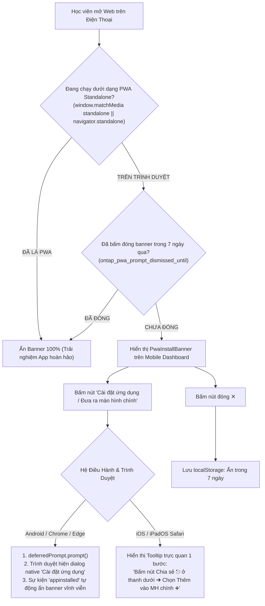

# Chi Tiết Kỹ Thuật Phase 03: Tính Năng Cài Đặt Ứng Dụng PWA / Đưa Ra Màn Hình Chính (PWA Add to Home Screen)

> **Mã kế hoạch**: `261107-0620-mobile-dashboard-simplification-and-error-audit`  
> **Quy trình áp dụng**: TDD Enriched (RED -> FAIL -> GREEN -> PASS -> COMMIT)  
> **Tài liệu tham chiếu**:
> - Kế hoạch tổng thể: [`plan.md`](file:///d:/Antigravity/TNDNB/docs/plans/261107-0620-mobile-dashboard-simplification-and-error-audit/plan.md)
> - Thiết kế kỹ thuật: [`DESIGN.md`](file:///d:/Antigravity/TNDNB/docs/plans/261107-0620-mobile-dashboard-simplification-and-error-audit/DESIGN.md)
> - Danh sách nhiệm vụ: [`task.md`](file:///d:/Antigravity/TNDNB/docs/plans/261107-0620-mobile-dashboard-simplification-and-error-audit/task.md)
> - Tệp mã nguồn mục tiêu:
>   - [`ontap-web/components/PwaInstallBanner.tsx`](file:///d:/Antigravity/TNDNB/ontap-web/components/PwaInstallBanner.tsx) (Tạo mới)
>   - [`ontap-web/components/Dashboard.tsx`](file:///d:/Antigravity/TNDNB/ontap-web/components/Dashboard.tsx)
> - Bộ kiểm thử TDD: [`scripts/portal-console-and-tinymce-fix.test.ts`](file:///d:/Antigravity/TNDNB/scripts/portal-console-and-tinymce-fix.test.ts)

---

## 🎨 Review Focus & Định Hướng PWA Thuần Túy

> [!IMPORTANT]
> **Subagent thi công BẮT BUỘC lưu ý nguyên tắc vàng từ phản hồi người dùng:**
> *"không phải tải apk đâu. mà đang nói đến cài app và đưa ra màn hình chính là cùng chức năng cài PWA"*
> 
> 1. **TUYỆT ĐỐI KHÔNG tạo nút tải file APK**: Chỉ sử dụng API Web PWA chuẩn (`beforeinstallprompt` cho Android/Chromium, hướng dẫn "Thêm vào MH chính" cho iOS Safari).
> 2. **Tự Động Ẩn Khi Đã Là PWA**: Nếu ứng dụng đang chạy ở chế độ Standalone (`window.matchMedia('(display-mode: standalone)').matches || window.navigator.standalone === true`), component trả về `null` ngay lập tức để giữ giao diện sạch đẹp 100%.
> 3. **Bộ nhớ 7 ngày**: Khi người dùng nhấn nút đóng "✕", lưu `ontap_pwa_prompt_dismissed_until` vào `localStorage` và không làm phiền trong 7 ngày kế tiếp.
> 4. **Touch Target**: Nút bấm cài đặt và nút đóng đạt chuẩn tối thiểu 44x44px.

---

## 1. Kiến Trúc Luồng Hoạt Động Của Banner



---

## 2. Implementation Steps (TDD Enriched)

### Task 1: Xây Dựng Component `PwaInstallBanner.tsx`

**Files:**
- Create: [`ontap-web/components/PwaInstallBanner.tsx`](file:///d:/Antigravity/TNDNB/ontap-web/components/PwaInstallBanner.tsx)
- Test: [`scripts/portal-console-and-tinymce-fix.test.ts`](file:///d:/Antigravity/TNDNB/scripts/portal-console-and-tinymce-fix.test.ts)

**Interfaces:**
- Consumes: `window.matchMedia('(display-mode: standalone)')`, sự kiện `beforeinstallprompt`, `localStorage` key `'ontap_pwa_prompt_dismissed_until'`.
- Produces: Component banner React xuất hiện trên mobile, cung cấp nút 1 chạm cài đặt PWA hoặc hướng dẫn iOS.

- [ ] **Step 1.1: Viết test thất bại (RED - TC-23 & TC-24)**
  ```typescript
  // scripts/portal-console-and-tinymce-fix.test.ts
  it('TC-23: ontap-web/components/PwaInstallBanner.tsx must handle standalone check, beforeinstallprompt, and iOS guide', () => {
    const filePath = path.resolve(rootDir, 'ontap-web/components/PwaInstallBanner.tsx');
    expect(fs.existsSync(filePath)).toBe(true);

    const content = fs.readFileSync(filePath, 'utf8');
    // Phải kiểm tra chế độ standalone để tự động ẩn khi app đã cài đặt
    expect(content).toMatch(/display-mode:\s*standalone/);
    // Phải xử lý sự kiện beforeinstallprompt cho Android
    expect(content).toMatch(/beforeinstallprompt/);
    // Phải có cơ chế hướng dẫn iOS Thêm vào màn hình chính
    expect(content).toMatch(/Thêm vào màn hình chính|Thêm vào MH chính/);
  });

  it('TC-24: ontap-web/components/PwaInstallBanner.tsx must save 7-day dismiss memory into localStorage', () => {
    const filePath = path.resolve(rootDir, 'ontap-web/components/PwaInstallBanner.tsx');
    const content = fs.readFileSync(filePath, 'utf8');

    // Phải lưu localStorage key ontap_pwa_prompt_dismissed_until khi đóng banner
    expect(content).toMatch(/ontap_pwa_prompt_dismissed_until/);
    expect(content).toMatch(/localStorage\.setItem/);
  });
  ```

- [ ] **Step 1.2: Chạy test — xác nhận FAIL**
  ```bash
  npx vitest run scripts/portal-console-and-tinymce-fix.test.ts -t "TC-23|TC-24"
  ```
  Expected: FAIL (do tệp `ontap-web/components/PwaInstallBanner.tsx` chưa được tạo).

- [ ] **Step 1.3: Implement tối thiểu (GREEN)**
  Tạo tệp [`ontap-web/components/PwaInstallBanner.tsx`](file:///d:/Antigravity/TNDNB/ontap-web/components/PwaInstallBanner.tsx) theo đúng hợp đồng thiết kế tại [`DESIGN.md`](file:///d:/Antigravity/TNDNB/docs/plans/261107-0620-mobile-dashboard-simplification-and-error-audit/DESIGN.md) (Mục 3):
  - State quản lý `isVisible`, `deferredPrompt`, `isIos`, `showIosGuide`, `installed`.
  - `useEffect` lắng nghe `beforeinstallprompt`, `appinstalled`, kiểm tra `display-mode: standalone` và `ontap_pwa_prompt_dismissed_until`.
  - Giao diện mobile-only (`lg:hidden`), gradient xanh hiện đại `from-blue-600 via-indigo-600 to-blue-700`, nút đóng ✕ mờ tinh tế và nút bấm cài đặt to rõ (`min-h-[44px]`).

- [ ] **Step 1.4: Chạy test — xác nhận PASS**
  ```bash
  npx vitest run scripts/portal-console-and-tinymce-fix.test.ts -t "TC-23|TC-24"
  ```
  Expected: PASS

- [ ] **Step 1.5: Commit checkpoint**
  ```bash
  git add ontap-web/components/PwaInstallBanner.tsx scripts/portal-console-and-tinymce-fix.test.ts
  git commit -m "feat(pwa): create PwaInstallBanner with native prompt and iOS home screen guide"
  ```

---

### Task 2: Tích Hợp `PwaInstallBanner` Vào Mobile Dashboard

**Files:**
- Modify: [`ontap-web/components/Dashboard.tsx`](file:///d:/Antigravity/TNDNB/ontap-web/components/Dashboard.tsx)
- Test: [`scripts/portal-console-and-tinymce-fix.test.ts`](file:///d:/Antigravity/TNDNB/scripts/portal-console-and-tinymce-fix.test.ts)

**Interfaces:**
- Consumes: `<PwaInstallBanner />`
- Produces: Mobile Dashboard hiển thị banner gợi ý cài app ngay trên đầu thẻ học viên.

- [ ] **Step 2.1: Viết test thất bại (RED - TC-27)**
  ```typescript
  // scripts/portal-console-and-tinymce-fix.test.ts
  it('TC-27: ontap-web/components/Dashboard.tsx must import and render PwaInstallBanner above StudentCard', () => {
    const filePath = path.resolve(rootDir, 'ontap-web/components/Dashboard.tsx');
    const content = fs.readFileSync(filePath, 'utf8');

    expect(content).toMatch(/import\s*\{\s*PwaInstallBanner\s*\}\s*from\s*['"]\.\/PwaInstallBanner['"]/);
    expect(content).toMatch(/<PwaInstallBanner[\s\S]*?<StudentCard/);
  });
  ```

- [ ] **Step 2.2: Chạy test — xác nhận FAIL**
  ```bash
  npx vitest run scripts/portal-console-and-tinymce-fix.test.ts -t "TC-27"
  ```
  Expected: FAIL

- [ ] **Step 2.3: Implement tối thiểu (GREEN)**
  Trong [`ontap-web/components/Dashboard.tsx`](file:///d:/Antigravity/TNDNB/ontap-web/components/Dashboard.tsx):
  ```tsx
  import { PwaInstallBanner } from './PwaInstallBanner';

  // Trong return JSX:
  {/* Banner Gợi Ý Cài Đặt PWA / Thêm Ra Màn Hình Chính */}
  <PwaInstallBanner />

  {/* Thẻ Học Viên */}
  <StudentCard user={userProfile} ... />
  ```

- [ ] **Step 2.4: Chạy test — xác nhận PASS**
  ```bash
  npx vitest run scripts/portal-console-and-tinymce-fix.test.ts -t "TC-27"
  ```
  Expected: PASS

- [ ] **Step 2.5: Commit checkpoint**
  ```bash
  git add ontap-web/components/Dashboard.tsx scripts/portal-console-and-tinymce-fix.test.ts
  git commit -m "feat(dashboard): integrate PwaInstallBanner above student card"
  ```

---

### Task 3: Toàn Bộ Kiểm Thử TDD, TypeCheck & Kiểm Tra Bất Biến Invariant 1

**Files:**
- Test: [`scripts/portal-console-and-tinymce-fix.test.ts`](file:///d:/Antigravity/TNDNB/scripts/portal-console-and-tinymce-fix.test.ts)
- Invariant: [`ontap-web/components/ExamQuizScreen.tsx`](file:///d:/Antigravity/TNDNB/ontap-web/components/ExamQuizScreen.tsx)

- [ ] **Step 3.1: Chạy 100% Vitest test suite**
  ```bash
  npx vitest run scripts/portal-console-and-tinymce-fix.test.ts
  ```
  Expected: Tất cả các test cases từ TC-01 đến TC-27 đều **PASS 100%**.

- [ ] **Step 3.2: Chạy TypeScript Compilation Check**
  ```bash
  npx tsc --noEmit
  ```
  Expected: 0 errors.

- [ ] **Step 3.3: Chạy Next.js Production Build**
  ```bash
  npm run build
  ```
  Expected: Build thành công không có cảnh báo hydration hay lỗi biên dịch.

- [ ] **Step 3.4: Kiểm tra bất biến Invariant 1 (Protected File)**
  ```bash
  git diff ontap-web/components/ExamQuizScreen.tsx
  ```
  Expected: 0 bytes (Tệp ExamQuizScreen.tsx được bảo vệ 100% nguyên vẹn, không có bất kỳ thay đổi nào).

- [ ] **Step 3.5: Final commit**
  ```bash
  git add -A
  git commit -m "feat(pwa): finalize mobile dashboard simplification and PWA home screen prompt"
  ```

---

## 3. Tổng Kết Nghiệm Thu Phase 03

| Tiêu chí | Lệnh kiểm tra | Kết quả kỳ vọng |
|---|---|---|
| Vitest 27 Test Cases | `npx vitest run scripts/portal-console-and-tinymce-fix.test.ts` | 27/27 PASS (100%) |
| Type Check | `npx tsc --noEmit` | 0 error |
| Production Build | `npm run build` | Thành công |
| Invariant 1 (`ExamQuizScreen.tsx`) | `git diff ontap-web/components/ExamQuizScreen.tsx` | 0 dòng khác biệt |
