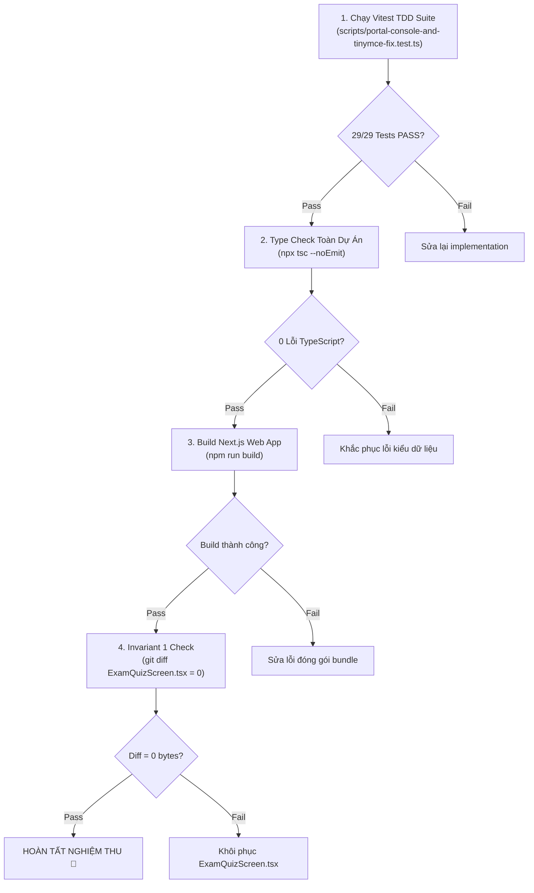

# Phase 02: Kiểm Thử TDD & Nghiệm Thu Toàn Diện

> **Mã kế hoạch**: `261107-0940-clean-console-and-guest-firestore-guard`  
> **Tài liệu**: Kế hoạch kiểm thử & nghiệm thu Phase 02  
> **Mục tiêu**: Xây dựng test suite TDD tự động (`TC-28`, `TC-29`), kiểm chứng toàn vẹn TypeScript, build Next.js và nghiệm thu thực tế không còn cảnh báo vàng trên console.

---

## 1. Thiết Kế Test Suite TDD (Vitest)

Bộ kiểm thử được tích hợp trực tiếp vào file [`scripts/portal-console-and-tinymce-fix.test.ts`](file:///d:/Antigravity/TNDNB/scripts/portal-console-and-tinymce-fix.test.ts).

### 1.1 Chi Tiết Test Cases Mới

#### `TC-28`: Guard Clause Cho `getUsageConfig()`
- **Mục tiêu**: Đảm bảo hàm `getUsageConfig()` chỉ gọi Firestore fallback khi có đủ 3 điều kiện: dữ liệu KV chưa có (`!data`), instance Firestore đã khởi tạo (`db`), và người dùng hiện tại đã đăng nhập (`auth?.currentUser`).
- **Mã kiểm thử mẫu**:
  ```typescript
  it('TC-28: ontap-web/services/adminConfigService.ts must guard getUsageConfig Firestore fallback with auth?.currentUser', () => {
    const filePath = path.resolve(rootDir, 'ontap-web/services/adminConfigService.ts');
    const content = fs.readFileSync(filePath, 'utf8');

    // Tìm hàm getUsageConfig
    const usageConfigBlock = content.match(/export const getUsageConfig = async[\s\S]*?return transformConfig/);
    expect(usageConfigBlock).toBeTruthy();

    if (usageConfigBlock) {
      const code = usageConfigBlock[0];
      // Phải có điều kiện auth?.currentUser trước khi gọi getDoc cho USAGE_CONFIG_DOC_ID
      expect(code).toMatch(/if\s*\(!data\s*&&\s*db\s*&&\s*auth\?\.currentUser\)/);
    }
  });
  ```

#### `TC-29`: Guard Clause Cho `getGitHubConfig()`
- **Mục tiêu**: Đảm bảo hàm `getGitHubConfig()` cũng áp dụng guard clause tương tự để loại bỏ cảnh báo vàng Firestore khi khách vãng lai thi thử.
- **Mã kiểm thử mẫu**:
  ```typescript
  it('TC-29: ontap-web/services/adminConfigService.ts must guard getGitHubConfig Firestore fallback with auth?.currentUser', () => {
    const filePath = path.resolve(rootDir, 'ontap-web/services/adminConfigService.ts');
    const content = fs.readFileSync(filePath, 'utf8');

    // Tìm hàm getGitHubConfig
    const gitHubConfigBlock = content.match(/export const getGitHubConfig = async[\s\S]*?return\s*\{[\s\S]*?owner:\s*['"]aitnd['"]/);
    expect(gitHubConfigBlock).toBeTruthy();

    if (gitHubConfigBlock) {
      const code = gitHubConfigBlock[0];
      // Phải có điều kiện auth?.currentUser trước khi gọi getDoc cho github_config
      expect(code).toMatch(/if\s*\(!data\s*&&\s*db\s*&&\s*auth\?\.currentUser\)/);
    }
  });
  ```

---

## 2. Quy Trình Kiểm Thử Đa Tầng (Multi-Tier Verification)



---

## 3. Các Lệnh Thực Thi Kiểm Thử (Execution Commands)

### 3.1 Chạy Test TDD Vitest:
```powershell
npx vitest run scripts/portal-console-and-tinymce-fix.test.ts
```
*Kỳ vọng*: 29/29 tests pass (bao gồm 27 test cũ + TC-28, TC-29).

### 3.2 Kiểm Tra Cú Pháp & Kiểu Dữ Liệu TypeScript:
```powershell
npx tsc --noEmit
```
*Kỳ vọng*: 0 lỗi cú pháp hoặc type mismatch.

### 3.3 Kiểm Tra Đóng Gói (Production Build):
```powershell
npm run build
```
*Kỳ vọng*: Không có lỗi prerendering hoặc module resolution.

### 3.4 Kiểm Tra Bất Biến Invariant 1:
```powershell
git diff --stat ontap-web/components/ExamQuizScreen.tsx
```
*Kỳ vọng*: Output rỗng (0 dòng thay đổi).

---

## 4. Tiêu Chuẩn Nghiệm Thu Thực Tế Trên Trình Duyệt (Manual Verification)

1. Mở trình duyệt ở chế độ ẩn danh (Incognito Window) để đảm bảo không có cookie / session đăng nhập cũ (`auth.currentUser === null`).
2. Mở tab DevTools (`F12`), chuyển sang tab **Console**, tích chọn filter cảnh báo vàng (**Warnings**).
3. Truy cập vào trang làm bài thi thử bất kỳ:
   - `http://localhost:3000/ontap/thithu`
   - Hoặc bài thi thử trực tiếp: `http://localhost:3000/ontap?tab=thithu`
4. **Kết quả quan sát**:
   - Tab Console sạch bóng hoàn toàn, không xuất hiện dòng cảnh báo vàng:
     `[Config] Firestore getGitHubConfig failed: Missing or insufficient permissions`.
   - Bài thi thử tải bình thường, câu hỏi hiển thị đầy đủ, không ảnh hưởng đến bất kỳ trải nghiệm nào của người dùng.
