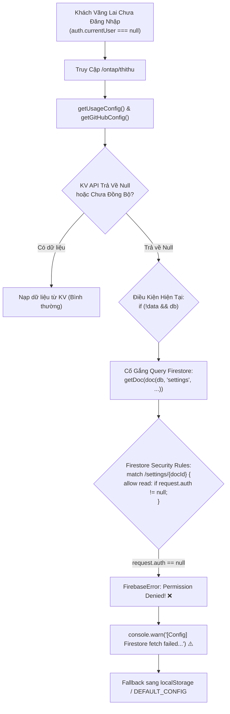
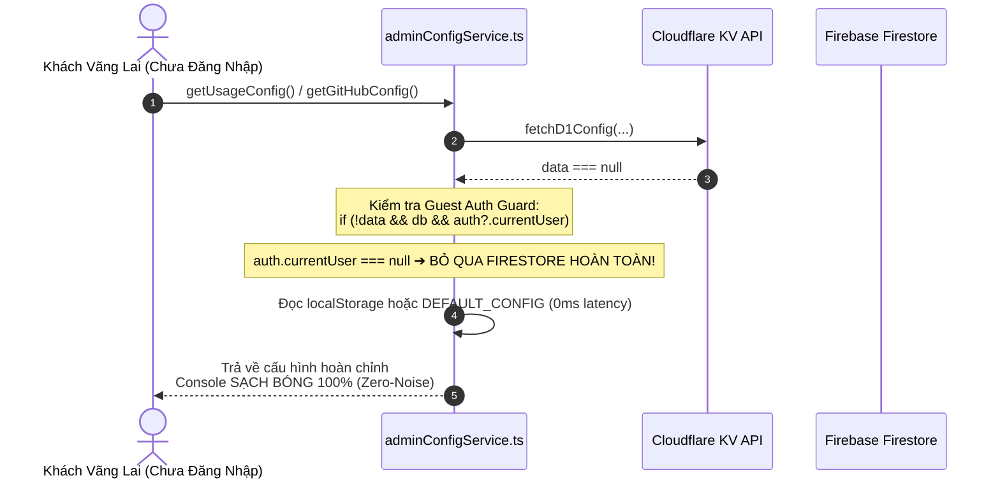
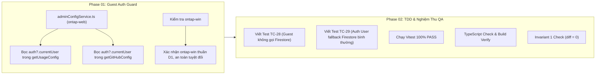

# Kế Hoạch Xử Lý Triệt Để Cảnh Báo Vàng Firestore Permissions Khi Khách Vãng Lai Thi Thử (Zero-Noise Console)

> **Dự án**: Cổng thông tin & Hệ thống Quản trị Đào tạo Thuyền viên Ninh Bình (TNDNB)  
> **Mã kế hoạch**: `261107-0940-clean-console-and-guest-firestore-guard`  
> **Người lập**: Product Manager & Lead Architect  
> **Ngày lập**: 07/11/2026  
> **Trạng thái**: Sẵn sàng thực thi (Ready for Implementation)  

---

## 1. Bối Cảnh & Vấn Đề Người Dùng (User Context & Problem Statement)

Khi người dùng chưa đăng nhập (khách vãng lai) truy cập vào hệ thống để làm bài thi thử tại đường dẫn `/ontap/thithu` hoặc bất kỳ màn hình ôn tập công khai nào, tab Console của trình duyệt xuất hiện cảnh báo màu vàng:
> `⚠️ [Config] Firestore getGitHubConfig failed: Missing or insufficient permissions`  
> (kèm mã lỗi nội bộ: `FirebaseError: Missing or insufficient permissions: [code=permission-denied]`)

### Đánh Giá Trải Nghiệm & Ảnh Hưởng:
1. **Trải nghiệm người dùng**: Mặc dù ứng dụng vẫn hoạt động bình thường nhờ có cơ chế fallback sang `localStorage` và `DEFAULT_CONFIG`, nhưng dòng cảnh báo vàng xuất hiện trên Console làm giảm tính thẩm mỹ, thiếu tính chuyên nghiệp của sản phẩm.
2. **Hiệu năng & Tài nguyên mạng**: Với mỗi lượt truy cập của khách vãng lai, trình duyệt gửi thêm 1-2 request đọc tài liệu `settings/usage_config` và `settings/github_config` tới máy chủ Google Firebase Firestore. Các request này chắc chắn 100% bị từ chối, gây tiêu tốn quota đọc của Firebase một cách vô ích và lãng phí thời gian chờ đợi phản hồi (~300-500ms).

---

## 2. Phân Tích Kỹ Thuật (Root Cause Analysis)



### Chi Tiết Cốt Lõi:
1. Trong [`firestore.rules`](file:///d:/Antigravity/TNDNB/firestore.rules) (dòng 26-29):
   ```javascript
   // Collection: settings (Cấu hình hệ thống, bao gồm usage_config)
   match /settings/{docId} {
     allow read: if request.auth != null;
     allow write: if isAdminOnly();
   }
   ```
   Quy tắc bảo mật quy định rõ: **Chỉ người dùng đã đăng nhập (`request.auth != null`) mới được phép đọc collection `settings`**. Quy tắc này là hoàn toàn chính xác để bảo vệ các thông số cấu hình nội bộ (giới hạn lượt thi, ngưỡng cooldown quảng cáo, v.v.).
2. Trong [`ontap-web/services/adminConfigService.ts`](file:///d:/Antigravity/TNDNB/ontap-web/services/adminConfigService.ts):
   Hàm `getUsageConfig()` và `getGitHubConfig()` hiện tại chỉ kiểm tra `if (!data && db)` mà **hoàn toàn không kiểm tra xem người dùng hiện tại đã đăng nhập hay chưa** (`auth?.currentUser`).
   Do đó, ngay cả với khách vãng lai (`auth.currentUser === null`), hàm vẫn cố tình gửi request đọc Firestore, dẫn đến việc bị chặn và in cảnh báo vàng ra console.

---

## 3. Kiến Trúc Giải Pháp: Guest Auth Guard (Zero-Noise Console)

Giải pháp tối ưu là bổ sung **Guest Auth Guard** ngay tại tầng client: Chỉ cho phép kích hoạt fallback Firestore khi người dùng **đã đăng nhập** (`auth?.currentUser != null`). Nếu là khách vãng lai, hệ thống tự động bỏ qua Firestore và fallback trực tiếp sang `localStorage` hoặc cấu hình mặc định.



### So Sánh 2 Luồng Người Dùng Sau Khi Nâng Cấp:
1. **Luồng Khách vãng lai (`auth.currentUser == null`)**:
   - Thử đọc Cloudflare KV.
   - Nếu KV null: Bỏ qua Firestore, đọc ngay `localStorage` hoặc trả về `DEFAULT_CONFIG`.
   - Kết quả: **0 request lỗi tới Firestore, 0 dòng cảnh báo vàng trên console, tốc độ phản hồi tức thì**.
2. **Luồng Người dùng / Admin đã đăng nhập (`auth.currentUser != null`)**:
   - Thử đọc Cloudflare KV.
   - Nếu KV lỗi/null: Fallback sang Firestore đọc `settings/usage_config` hoặc `settings/github_config`. Vì đã có token xác thực, Firestore trả về dữ liệu bình thường.
   - Kết quả: **Duy trì 100% độ bền bỉ của cơ chế Dual-Storage Resilience**.

---

## 4. Lộ Trình Triển Khai 2 Phase



### Phase 01: Cài Đặt Guest Auth Guard Trong `adminConfigService.ts`
- Cập nhật hàm `getUsageConfig`:
  ```typescript
  if (!data && db && auth?.currentUser) {
      try {
          const snap = await getDoc(doc(db, SETTINGS_COLLECTION, USAGE_CONFIG_DOC_ID));
          if (snap.exists()) {
              data = snap.data() as Partial<UsageConfig>;
          }
      } catch (err) {
          console.warn('[Config] Firestore fetch failed, trying localStorage:', err);
      }
  }
  ```
- Cập nhật hàm `getGitHubConfig`:
  ```typescript
  if (!data && db && auth?.currentUser) {
      try {
          const snap = await getDoc(doc(db, SETTINGS_COLLECTION, 'github_config'));
          if (snap.exists()) {
              data = snap.data() as GitHubConfig;
          }
      } catch (err) {
          console.warn('[Config] Firestore getGitHubConfig failed, trying localStorage:', err);
      }
  }
  ```
- Rà soát [`ontap-win/services/adminConfigService.ts`](file:///d:/Antigravity/TNDNB/ontap-win/services/adminConfigService.ts): Xác nhận bản desktop Windows chỉ sử dụng D1 API và localStorage, không query Firestore nên hoàn toàn miễn nhiễm với lỗi này.

### Phase 02: Kiểm Thử TDD & Nghiệm Thu Toàn Diện
- Mở rộng bộ test Vitest [`scripts/portal-console-and-tinymce-fix.test.ts`](file:///d:/Antigravity/TNDNB/scripts/portal-console-and-tinymce-fix.test.ts):
  - `TC-28`: Kiểm tra `adminConfigService.ts` chứa điều kiện `auth?.currentUser` trước khi gọi `getDoc(doc(db, SETTINGS_COLLECTION...))`.
  - `TC-29`: Kiểm tra `getGitHubConfig` chứa điều kiện `auth?.currentUser` trước khi gọi Firestore `github_config`.
- Chạy kiểm tra TypeScript `npx tsc --noEmit` (0 lỗi).
- Chạy `npm run build` xác nhận không có lỗi đóng gói.
- **Bảo toàn bất biến Invariant 1**: [`ontap-web/components/ExamQuizScreen.tsx`](file:///d:/Antigravity/TNDNB/ontap-web/components/ExamQuizScreen.tsx) giữ nguyên vẹn 100% (`git diff = 0`).

---

## 5. Tiêu Chí Nghiệm Thu (Acceptance Criteria)

| STT | Tiêu chí | Trước khi sửa | Sau khi hoàn thành |
|---|---|---|---|
| 1 | **Khách vãng lai thi thử (`/ontap/thithu`)** | In cảnh báo vàng `[Config] Firestore getGitHubConfig failed...` | **Console sạch bóng 100%**, không có cảnh báo vàng |
| 2 | **Request Firestore từ khách vãng lai** | Gửi 1-2 request và bị từ chối 403 Permission Denied | **0 request gửi tới Firestore**, tiết kiệm quota |
| 3 | **Độ trễ tải trang của khách vãng lai** | Phải chờ Firestore phản hồi lỗi (~300ms) | **Phản hồi tức thì** từ localStorage/mặc định (0ms) |
| 4 | **Người dùng đã đăng nhập (Học viên/Admin)** | Hoạt động bình thường | **Duy trì 100%** cơ chế Dual-Storage fallback Firestore |
| 5 | **Bộ kiểm thử tự động (Vitest)** | 27 tests PASS | **29 tests PASS 100%** (bổ sung TC-28, TC-29) |
| 6 | **Bất biến Invariant 1** | Giữ nguyên component thi | File `ExamQuizScreen.tsx` có `git diff = 0` |

---

## 6. Danh Sách Tài Liệu Kế Hoạch Chi Tiết

- 📘 **Kế hoạch tổng thể chính thức**: [`plan.md`](file:///d:/Antigravity/TNDNB/docs/plans/261107-0940-clean-console-and-guest-firestore-guard/plan.md)
- 📋 **Living Task Checklist (TDD)**: [`task.md`](file:///d:/Antigravity/TNDNB/docs/plans/261107-0940-clean-console-and-guest-firestore-guard/task.md)
- 🛠️ **Chi tiết kỹ thuật Phase 01**: [`phase-01-guest-firestore-guard.md`](file:///d:/Antigravity/TNDNB/docs/plans/261107-0940-clean-console-and-guest-firestore-guard/phase-01-guest-firestore-guard.md)
- 🧪 **Chi tiết kỹ thuật Phase 02**: [`phase-02-test-and-verification.md`](file:///d:/Antigravity/TNDNB/docs/plans/261107-0940-clean-console-and-guest-firestore-guard/phase-02-test-and-verification.md)
