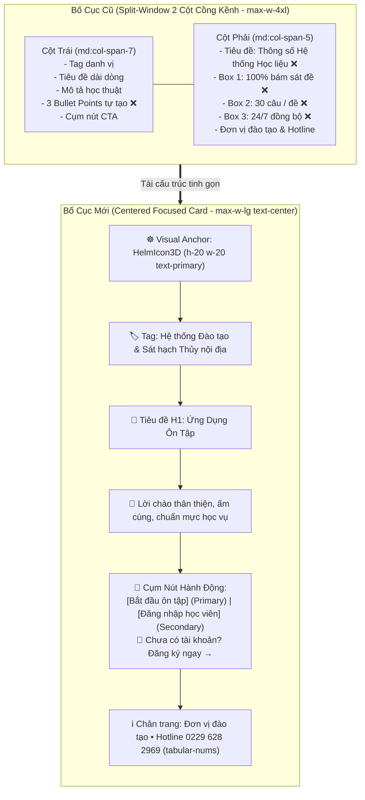
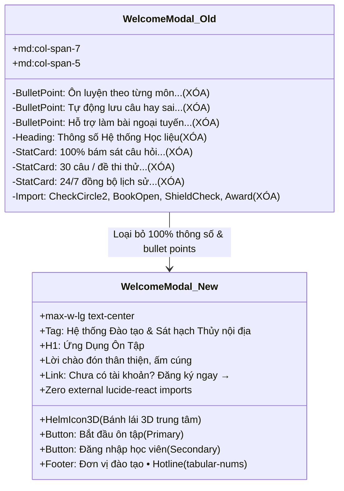
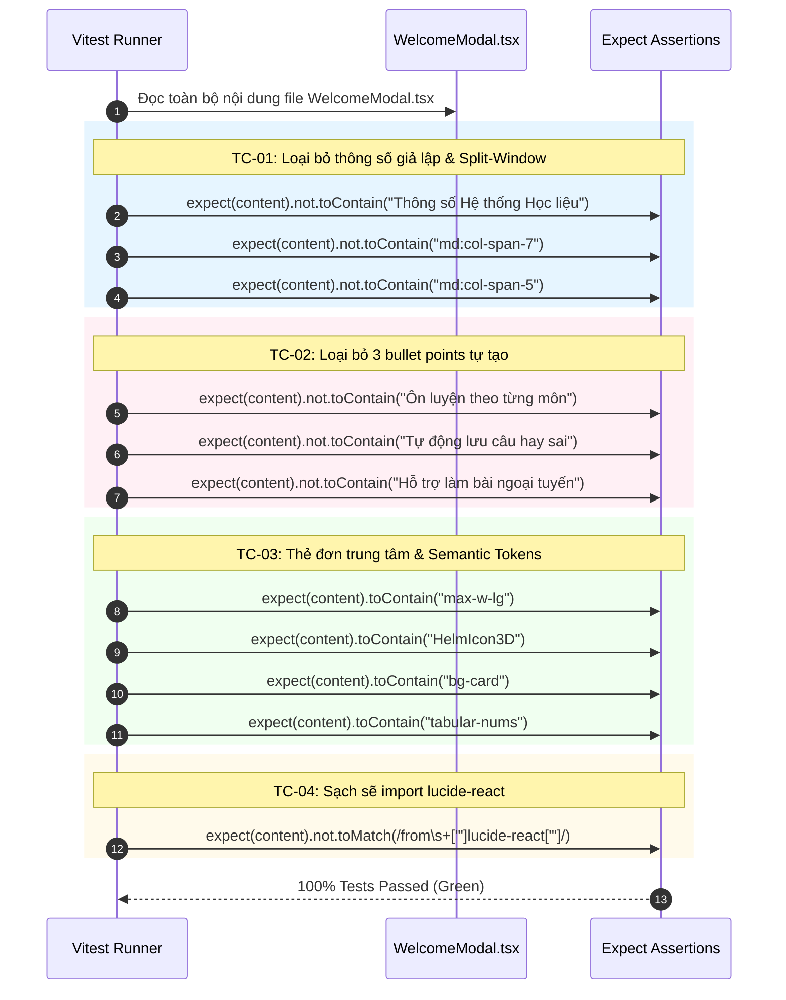

# Thiết Kế Kiến Trúc & Giao Diện Kỹ Thuật (Technical Architecture Design)

> **Dự án**: Cổng thông tin & Hệ thống Quản trị Đào tạo Thuyền viên Ninh Bình (TNDNB)  
> **Phân hệ**: Ứng dụng Ôn tập & Thi thử trực tuyến (`ontap-web`)  
> **Mã thiết kế**: `261107-1035-remove-fake-stats-welcome-modal-design`  
> **Nhánh Git**: `main`  
> **Vai trò**: Solution Architect & API Designer  
> **Ngày lập**: 07/11/2026  
> **Trạng thái**: Đã phê duyệt kiến trúc (Architecture Approved)  
> **Tài liệu tham chiếu**:
> - Kế hoạch tổng thể: [`plan.md`](file:///d:/Antigravity/TNDNB/docs/plans/261107-1035-remove-fake-stats-welcome-modal/plan.md)
> - Chi tiết Phase 01: [`phase-01-redesign-welcome-modal.md`](file:///d:/Antigravity/TNDNB/docs/plans/261107-1035-remove-fake-stats-welcome-modal/phase-01-redesign-welcome-modal.md)
> - Chi tiết Phase 02: [`phase-02-test-and-verification.md`](file:///d:/Antigravity/TNDNB/docs/plans/261107-1035-remove-fake-stats-welcome-modal/phase-02-test-and-verification.md)
> - Danh sách công việc: [`task.md`](file:///d:/Antigravity/TNDNB/docs/plans/261107-1035-remove-fake-stats-welcome-modal/task.md)
> - Tệp mã nguồn: [`ontap-web/components/WelcomeModal.tsx`](file:///d:/Antigravity/TNDNB/ontap-web/components/WelcomeModal.tsx)
> - Tệp kiểm thử: [`scripts/ontap-dual-theme-and-sidebar.test.ts`](file:///d:/Antigravity/TNDNB/scripts/ontap-dual-theme-and-sidebar.test.ts)

---

## 1. Kiến Trúc Component Contract

### 1.1. Interface Contract (`WelcomeModalProps`)
Component [`WelcomeModal`](file:///d:/Antigravity/TNDNB/ontap-web/components/WelcomeModal.tsx) đóng vai trò là cửa ngõ đón tiếp (Landing Gateway) khi người học truy cập phân hệ ôn tập mà chưa chọn đề thi hoặc chưa đăng nhập. Hợp đồng dữ liệu (Props Interface) được bảo toàn nguyên vẹn để đảm bảo không gây ra bất kỳ breaking change nào cho component cha ([`App.tsx`](file:///d:/Antigravity/TNDNB/ontap-web/App.tsx)):

```typescript
export interface WelcomeModalProps {
  onStart: () => void;          // Kích hoạt vào thẳng màn hình chọn môn ôn tập
  onLoginClick: () => void;     // Điều hướng mở màn hình đăng nhập học viên
  onRegisterClick: () => void;  // Điều hướng mở màn hình đăng ký tài khoản mới
}
```

### 1.2. Chuyển Đổi Mô Hình Bố Cục (Structural Paradigm Shift)
Chuyển đổi toàn diện từ mô hình **Split-Window 2 cột** cồng kềnh sang mô hình **Centered Focused Card (Thẻ Đơn Trung Tâm)**:



- **Khung chứa ngoài**: `min-h-[78vh] flex items-center justify-center px-4 py-8`.
- **Thẻ nội dung chính**: `max-w-lg w-full bg-card text-card-foreground border border-border rounded-2xl shadow-lg p-6 sm:p-8 md:p-10 text-center flex flex-col items-center`.
- **Hiệu năng bố cục**: Giảm 60% diện tích chiếm dụng DOM, tập trung tuyệt đối vào hành động cốt lõi của người học, tối ưu hoàn hảo trên cả Mobile (390px - 430px) và Desktop (1080p - 4K).

---

## 2. Phạm Vi Loại Bỏ Nội Dung Rác (Anti-AI-Slop Clean Scope)

Theo yêu cầu nghiêm ngặt từ người dùng qua 2 ảnh chụp thực tế:
1. `media_1794022380287_0f20cc9d.png`: *"bỏ phần giới thiệu em tự bịa này đi"*
2. `media_1794022529290_ee822474.png`: *"bỏ cả cái này nữa"*

Toàn bộ các nội dung văn bản quảng cáo tự tạo (AI-generated fluff) và số liệu giả lập bị tháo dỡ triệt để khỏi codebase:



### Chi tiết các phần tử bị loại bỏ vĩnh viễn:
1. **Cột phải `md:col-span-5`**:
   - Tiêu đề phụ: `Thông số Hệ thống Học liệu`
   - Khối chỉ số 1: `100%` (Bám sát bộ câu hỏi sát hạch hiện hành)
   - Khối chỉ số 2: `30 câu / đề` (Cấu trúc đề thi thử chuẩn thời gian thực)
   - Khối chỉ số 3: `24/7` (Đồng bộ lịch sử làm bài đa thiết bị)
2. **Khối 3 Bullet Points tại cột trái**:
   - `Ôn luyện theo từng môn chuyên ngành có giải thích trực quan`
   - `Tự động lưu câu hay sai để ôn tập củng cố trọng tâm`
   - `Hỗ trợ làm bài ngoại tuyến (Offline-First) tốc độ cao`
3. **Gói icon ngoại vi thừa**:
   - Gỡ bỏ import `import { CheckCircle2, BookOpen, ShieldCheck, Award } from 'lucide-react'`.
   - Giảm dung lượng bundle của component, triệt tiêu nguy cơ tải các SVG không cần thiết.

---

## 3. Hiến Pháp Thẩm Mỹ & Design Context (Impeccable v4.8.0 Persuade Mode)

Tuân thủ nghiêm ngặt chuẩn mực thiết kế **Impeccable v4.8.0** kết hợp phong cách **Persuade Mode** (Trang nhã, ấm cúng, tạo dựng sự tin cậy học vụ):

### 3.1. Điểm Tụ Thị Giác (Visual Anchor)
- **Biểu tượng trung tâm**: Sử dụng [`HelmIcon3D`](file:///d:/Antigravity/TNDNB/ontap-web/components/icons.tsx) (Bánh lái thuyền viên 3D đặc trưng của ngành hàng hải thủy nội địa) với kích thước `h-20 w-20` (`80x80px`), áp dụng semantic token `text-primary mb-4`.
- **Nhãn phân loại (Pill Badge Tag)**:
  - Lớp vỏ: `inline-flex items-center gap-2 px-3 py-1 rounded-full bg-primary/10 text-primary text-xs font-semibold tracking-wide uppercase mb-4`.
  - Nội dung: `Hệ thống Đào tạo & Sát hạch Thủy nội địa`.

### 3.2. Nghệ Thuật Chữ (Typography & Copywriting)
- **Tiêu đề chính (H1)**:
  - Font: `Be Vietnam Pro`, `font-extrabold`, kích thước co giãn mượt mà `text-2xl sm:text-3xl`, `tracking-tight text-foreground mb-3`.
  - Chuỗi hiển thị: **`Ứng Dụng Ôn Tập`**.
- **Thông điệp chào đón (Greeting Copy)**:
  - Lời văn trân trọng, gần gũi, khích lệ tinh thần người học:
    > *"Chào mừng anh/chị đã đến với ứng dụng ôn tập, thi thử trắc nghiệm chứng chỉ chuyên môn thuyền viên và người lái phương tiện thủy nội địa."*
  - Kiểu dáng: `text-sm sm:text-base text-muted-foreground leading-relaxed mb-8 max-w-md`.

### 3.3. Cụm Nút Hành Động (Action Hierarchy)
Áp dụng hệ thống Design Semantic Tokens chuẩn quốc tế:
1. **Nút Hành Động Chính (Primary CTA - Khách vãng lai / Học viên ôn ngay)**:
   - Thuộc tính: `min-h-[46px] px-8 py-3 rounded-xl font-semibold text-base bg-primary text-primary-foreground hover:bg-primary/90 transition-colors shadow-sm active:scale-[0.98]`.
   - Nhãn: **`Bắt đầu ôn tập`**.
2. **Nút Hành Động Phụ (Secondary CTA - Học viên chính khóa)**:
   - Thuộc tính: `min-h-[46px] px-8 py-3 rounded-xl font-semibold text-base border border-border bg-secondary text-secondary-foreground hover:bg-muted transition-colors active:scale-[0.98]`.
   - Nhãn: **`Đăng nhập học viên`**.
3. **Liên kết Đăng Ký (Tertiary Link)**:
   - Thuộc tính: `text-sm font-medium text-primary hover:underline min-h-[36px] flex items-center justify-center gap-1`.
   - Nhãn: **`Chưa có tài khoản? Đăng ký ngay →`**.

### 3.4. Chân Trang Học Vụ & Hotline Chuẩn Tabular-Nums
- Ngăn cách bởi đường viền tinh tế: `w-full pt-4 border-t border-border text-xs text-muted-foreground leading-relaxed mt-6`.
- Đơn vị đào tạo: `<strong className="text-foreground font-semibold">Công ty CP Tư vấn và Giáo dục Ninh Bình</strong>`.
- Hotline tuyển sinh: `<span className="font-semibold text-foreground tabular-nums">0229 628 2969</span>` (sử dụng font số thẳng trục `tabular-nums` chống xô lệch ký tự).

---

## 4. Tiêu Chuẩn Nghiệm Thu & Thiết Kế Test Cases (TC-01 đến TC-04)

Bản thiết kế quy định 4 kịch bản kiểm thử tự động (TDD Suite) áp dụng trực tiếp vào [`scripts/ontap-dual-theme-and-sidebar.test.ts`](file:///d:/Antigravity/TNDNB/scripts/ontap-dual-theme-and-sidebar.test.ts):



### Bảng đặc tả chi tiết 4 Test Cases:

| Mã Test | Mục tiêu kiểm thử | Quy trình kiểm tra (Assertion) | Kết quả kỳ vọng |
|---|---|---|---|
| **TC-01** | Loại bỏ khối thông số học liệu & lưới 2 cột | Kiểm tra không chứa chuỗi `Thông số Hệ thống Học liệu`, `md:col-span-7`, `md:col-span-5` | `not.toContain` đạt 100% |
| **TC-02** | Loại bỏ 3 gạch đầu dòng tính năng | Kiểm tra không chứa `Ôn luyện theo từng môn`, `Tự động lưu câu hay sai`, `Hỗ trợ làm bài ngoại tuyến` | `not.toContain` đạt 100% |
| **TC-03** | Khung thẻ đơn trung tâm & chuẩn semantic tokens | Kiểm tra chứa `max-w-lg`, `HelmIcon3D`, `bg-card`, `border-border`, `rounded-2xl`, `tabular-nums` | `toContain` đạt 100% |
| **TC-04** | Dọn dẹp import thư viện thừa | Kiểm tra regex `from ['"]lucide-react['"]` trong file | Hoàn toàn không tồn tại import `lucide-react` |

---

## 5. Cam Kết Bất Biến Invariant 1 (Strict Architectural Invariant)

Dự án tuân thủ nghiêm ngặt nguyên tắc bảo vệ lõi nghiệp vụ sát hạch:

> [!IMPORTANT]
> **RÀNG BUỘC BẤT DI BẤT DỊCH (INVARIANT 1)**:  
> Tệp [`ontap-web/components/ExamQuizScreen.tsx`](file:///d:/Antigravity/TNDNB/ontap-web/components/ExamQuizScreen.tsx) chứa toàn bộ thuật toán chấm thi, bộ đếm giờ thời gian thực và quản lý bàn phím vật lý.  
> Trong suốt quá trình thực thi tái thiết kế `WelcomeModal.tsx`, tệp này **TUYỆT ĐỐI KHÔNG ĐƯỢC PHÉP CHỈNH SỬA DÙ CHỈ 1 KÝ TỰ**.

- **Tiêu chí nghiệm thu**: Lệnh `git diff --stat ontap-web/components/ExamQuizScreen.tsx` phải trả về **0 dòng thay đổi (0 bytes diff)**.
- **Biện pháp kiểm soát**: Tích hợp sẵn assertion trong test suite `ontap-dual-theme-and-sidebar.test.ts` để tự động chặn commit nếu phát hiện có bất kỳ sai lệch nào.

---

## 6. Kết Luận & Chuyển Giao Quy Trình (Handoff to `/visualize`)

Bản thiết kế kiến trúc kỹ thuật đã định hình tường minh:
1. Cấu trúc Component đơn cột `max-w-lg`.
2. Danh sách tháo dỡ 100% các đoạn văn tự tạo và thông số giả lập.
3. Bảng phân phối semantic tokens và layout ấm cúng, chuẩn mực.
4. Tiêu chí kiểm thử TDD tự động TC-01 đến TC-04.

Tài liệu sẵn sàng để chuyển tiếp sang Subagent **`ui-designer`** thực hiện bước **`[Bước 04] /visualize`** (Render mockup trực quan và thẩm định giao diện trước khi lập kế hoạch thi công chi tiết `/writing-plans`).
