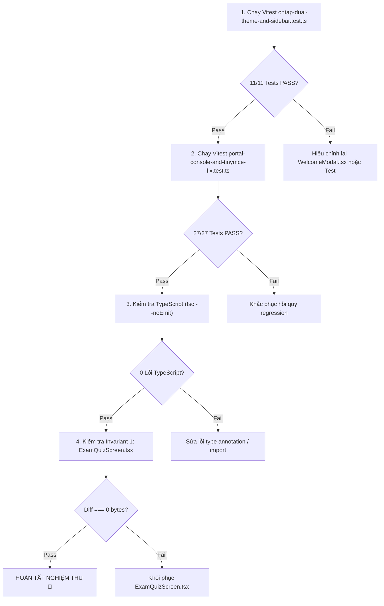

# Phase 02: Kiểm Thử TDD & Nghiệm Thu Toàn Diện

> **Mã kế hoạch**: `261107-1035-remove-fake-stats-welcome-modal`  
> **Tài liệu**: Kế hoạch kiểm thử & nghiệm thu Phase 02  
> **Mục tiêu**: Cập nhật bộ test case TDD tự động trong [`scripts/ontap-dual-theme-and-sidebar.test.ts`](file:///d:/Antigravity/TNDNB/scripts/ontap-dual-theme-and-sidebar.test.ts), kiểm chứng TypeScript, build và bảo vệ tuyệt đối bất biến Invariant 1.

---

## 1. Cập Nhật Test Suite TDD

### 1.1 Vị Trí Cần Cập Nhật:
- **Tệp**: [`scripts/ontap-dual-theme-and-sidebar.test.ts`](file:///d:/Antigravity/TNDNB/scripts/ontap-dual-theme-and-sidebar.test.ts)
- **Vị trí**: Dòng 119 - 130 (Test case `Task 2.2`).

### 1.2 Đặc Tả Test Case Nâng Cấp:
```typescript
  it('Task 2.2: WelcomeModal.tsx áp dụng bố cục thẻ trung tâm tối giản, xóa sạch viền neon, thông số tự bịa và bullet points', () => {
    const welcomeModal = fs.readFileSync(
      path.resolve(rootDir, 'ontap-web/components/WelcomeModal.tsx'),
      'utf8'
    )

    // Đảm bảo không còn hiệu ứng neon blur cũ
    expect(welcomeModal).not.toContain('via-blue-500 to-violet-500')
    expect(welcomeModal).not.toContain('blur-xl')

    // Đảm bảo đã xóa sạch khối thông số tự tạo và bố cục split-window 2 cột cũ
    expect(welcomeModal).not.toContain('Thông số Hệ thống Học liệu')
    expect(welcomeModal).not.toContain('md:col-span-7')
    expect(welcomeModal).not.toContain('md:col-span-5')

    // Đảm bảo đã xóa sạch 3 bullet points tính năng theo phản hồi của người dùng
    expect(welcomeModal).not.toContain('Ôn luyện theo từng môn')
    expect(welcomeModal).not.toContain('Tự động lưu câu hay sai')
    expect(welcomeModal).not.toContain('Hỗ trợ làm bài ngoại tuyến')

    // Xác nhận áp dụng bố cục thẻ đơn tối giản max-w-lg và semantic tokens
    expect(welcomeModal).toContain('max-w-lg')
    expect(welcomeModal).toContain('bg-card')
    expect(welcomeModal).toContain('border-border')
    expect(welcomeModal).toContain('rounded-2xl')
    expect(welcomeModal).toContain('HelmIcon3D')

    // Xác nhận giữ định dạng tabular-nums cho hotline đào tạo
    expect(welcomeModal).toContain('tabular-nums')
  })
```

---

## 2. Quy Trình Nghiệm Thu Đa Tầng (Multi-Tier Verification)



---

## 3. Các Lệnh Thực Thi Kiểm Thử (Verification Commands)

### 3.1 Chạy Test Suite Theme & Sidebar:
```powershell
npx vitest run scripts/ontap-dual-theme-and-sidebar.test.ts
```
*Kỳ vọng*: 11/11 tests pass 100%.

### 3.2 Chạy Test Suite Console & Portal:
```powershell
npx vitest run scripts/portal-console-and-tinymce-fix.test.ts
```
*Kỳ vọng*: 27/27 tests pass 100%.

### 3.3 Kiểm Tra TypeScript Compiler:
```powershell
npx tsc --noEmit
```
*Kỳ vọng*: 0 lỗi kiểu dữ liệu và cú pháp.

### 3.4 Kiểm Tra Bất Biến Invariant 1:
```powershell
git diff --stat ontap-web/components/ExamQuizScreen.tsx
```
*Kỳ vọng*: Không có bất kỳ thay đổi nào (0 bytes diff).

---

## 4. Nghiệm Thu Trực Quan (Visual Verification)

1. Mở trình duyệt truy cập vào `http://localhost:3000/ontap`.
2. Kiểm tra trên **màn hình Desktop**:
   - Thẻ `WelcomeModal` căn giữa trang nhã với `max-w-lg`.
   - Bánh lái `HelmIcon3D` nổi bật.
   - Không còn bất kỳ khối thông số hay bullet point nào.
   - Cụm 2 nút "Bắt đầu ôn tập" và "Đăng nhập học viên" nổi bật, dễ thao tác.
   - Dòng hotline và đơn vị đào tạo nằm tinh tế ở đáy thẻ.
3. Kiểm tra trên **màn hình Mobile (390px - 430px)**:
   - Toàn bộ nội dung hiển thị vừa vặn trong 1 khung nhìn (viewport), không có thanh cuộn ngang, trải nghiệm mượt mà.
