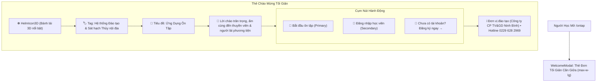
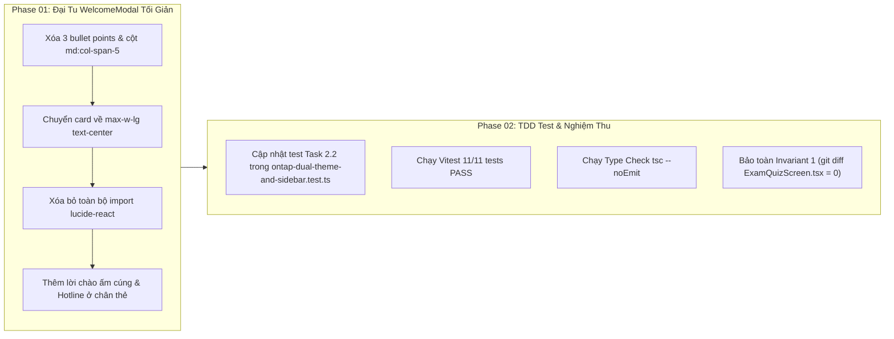

# Kế Hoạch Loại Bỏ Toàn Bộ Nội Dung Tự Tạo & Chuẩn Hóa WelcomeModal Tối Giản, Ấm Cúng

> **Dự án**: Cổng thông tin & Hệ thống Quản trị Đào tạo Thuyền viên Ninh Bình (TNDNB)  
> **Mã kế hoạch**: `261107-1035-remove-fake-stats-welcome-modal`  
> **Người lập**: Senior Product Manager & Lead Architect  
> **Ngày cập nhật**: 07/11/2026 (Bổ sung phản hồi ảnh 2)  
> **Trạng thái**: Sẵn sàng thực thi (Ready for Implementation)  

---

## 1. Bối Cảnh & Phản Hồi Người Dùng (User Problem Statement)

Người dùng đã gửi liên tiếp 2 phản hồi trực tiếp kèm ảnh chụp màn hình:
1. **Phản hồi 1** (`media_1794022380287_0f20cc9d.png`):  
   > *"bỏ phần giới thiệu em tự bịa này đi"*  
   ➔ Yêu cầu xóa khối cột phải **"THÔNG SỐ HỆ THỐNG HỌC LIỆU"** (`100%`, `30 câu / đề`, `24/7`).
2. **Phản hồi 2** (`media_1794022529290_ee822474.png`):  
   > *"bỏ cả cái này nữa"*  
   ➔ Yêu cầu xóa luôn khối **3 gạch đầu dòng tính năng** (`<ul className="...">`):
     - *Ôn luyện theo từng môn chuyên ngành có giải thích trực quan*
     - *Tự động lưu câu hay sai để ôn tập củng cố trọng tâm*
     - *Hỗ trợ làm bài ngoại tuyến (Offline-First) tốc độ cao*

### Đánh Giá Sản Phẩm & Định Hướng Mới (Product Strategy):
- **Bản chất vấn đề**: Người dùng mong muốn một giao diện **thuần túy học vụ, tối giản và ấm cúng**, không có các đoạn văn quảng cáo tính năng hoặc thông số giả lập do AI tạo ra.
- **Hình mẫu lý tưởng**: Kế thừa triết lý thiết kế tối giản, thân thiện của bản gốc [`ontap-win/components/WelcomeModal.tsx`](file:///d:/Antigravity/TNDNB/ontap-win/components/WelcomeModal.tsx), đồng thời áp dụng hệ thống Design Token hiện đại (`bg-card`, `border-border`, `text-card-foreground`, `rounded-2xl`, `shadow-lg`):
  1. Biểu tượng bánh lái 3D nổi bật (`HelmIcon3D`).
  2. Tag danh vị: `Hệ thống Đào tạo & Sát hạch Thủy nội địa`.
  3. Tiêu đề rõ ràng: **Ứng Dụng Ôn Tập**.
  4. Lời chào mừng trân trọng, ấm cúng: *"Chào mừng anh/chị đã đến với ứng dụng ôn tập, thi thử trắc nghiệm chứng chỉ chuyên môn thuyền viên và người lái phương tiện thủy nội địa."*
  5. Cụm 2 nút hành động chính cân đối: **[Bắt đầu ôn tập]** và **[Đăng nhập học viên]**.
  6. Đường dẫn phụ: **Chưa có tài khoản? Đăng ký ngay →**.
  7. Chân trang: Đơn vị đào tạo (Công ty CP Tư vấn và Giáo dục Ninh Bình) • Hotline: `0229 628 2969` (`tabular-nums`).

---

## 2. Phân Tích Kỹ Thuật (Technical Analysis)

### 2.1 File Cần Sửa Đổi:
- **Tệp nguồn chính**: [`ontap-web/components/WelcomeModal.tsx`](file:///d:/Antigravity/TNDNB/ontap-web/components/WelcomeModal.tsx)
- **Tệp kiểm thử liên quan**: [`scripts/ontap-dual-theme-and-sidebar.test.ts`](file:///d:/Antigravity/TNDNB/scripts/ontap-dual-theme-and-sidebar.test.ts)

### 2.2 Các Khối Cần Tháo Dỡ Hoàn Toàn Trong `WelcomeModal.tsx`:
1. **Xóa khối 3 bullet points** (Dòng 31-44):
   ```tsx
   <ul className="space-y-2.5 mb-8 text-sm text-foreground">
     <li>... Ôn luyện theo từng môn chuyên ngành ...</li>
     <li>... Tự động lưu câu hay sai ...</li>
     <li>... Hỗ trợ làm bài ngoại tuyến ...</li>
   </ul>
   ```
2. **Xóa cột phải `md:col-span-5`** (Dòng 73-115):
   Toàn bộ khối "Thông số Hệ thống Học liệu" cùng các con số `100%`, `30 câu / đề`, `24/7`.
3. **Xóa bố cục lưới 2 cột**:
   Xóa `grid grid-cols-1 md:grid-cols-12`, `md:col-span-7`, `md:col-span-5`.
4. **Dọn dẹp thư viện**:
   Xóa toàn bộ import từ `lucide-react` (`CheckCircle2`, `BookOpen`, `ShieldCheck`, `Award`). File chỉ cần import `React` và `HelmIcon3D`.

---

## 3. Kiến Trúc Thiết Kế Mới (Minimalist Centered Modal)



---

## 4. Lộ Trình Triển Khai 2 Phase



---

## 5. Tiêu Chí Nghiệm Thu (Acceptance Criteria)

| STT | Tiêu chí | Trước khi sửa | Sau khi hoàn thành |
|---|---|---|---|
| 1 | **Khối "Thông số Hệ thống Học liệu"** | Có ở cột phải (100%, 30 câu/đề, 24/7) | **Xóa bỏ hoàn toàn 100%** |
| 2 | **Khối 3 gạch đầu dòng tính năng** | Có 3 bullet points giải thích | **Xóa bỏ hoàn toàn 100%** |
| 3 | **Bố cục Modal** | Split-Window 2 cột cồng kềnh | **Thẻ đơn trung tâm (`max-w-lg`) tối giản, ấm cúng** |
| 4 | **Thư viện icon** | Import nhiều icon lucide không dùng | **Chỉ dùng duy nhất `HelmIcon3D`**, sạch sẽ |
| 5 | **Bộ kiểm thử Vitest** | Assertion kiểm tra `md:col-span-5` | **100% PASS**, assertion kiểm tra thẻ đơn tối giản |
| 6 | **Bất biến Invariant 1** | Giữ nguyên component thi | File `ExamQuizScreen.tsx` có `git diff = 0` |

---

## 6. Danh Sách Tài Liệu Kế Hoạch Chi Tiết

- 📘 **Kế hoạch tổng thể chính thức**: [`plan.md`](file:///d:/Antigravity/TNDNB/docs/plans/261107-1035-remove-fake-stats-welcome-modal/plan.md)
- 📋 **Living Task Checklist (TDD)**: [`task.md`](file:///d:/Antigravity/TNDNB/docs/plans/261107-1035-remove-fake-stats-welcome-modal/task.md)
- 🛠️ **Chi tiết kỹ thuật Phase 01**: [`phase-01-redesign-welcome-modal.md`](file:///d:/Antigravity/TNDNB/docs/plans/261107-1035-remove-fake-stats-welcome-modal/phase-01-redesign-welcome-modal.md)
- 🧪 **Chi tiết kỹ thuật Phase 02**: [`phase-02-test-and-verification.md`](file:///d:/Antigravity/TNDNB/docs/plans/261107-1035-remove-fake-stats-welcome-modal/phase-02-test-and-verification.md)
