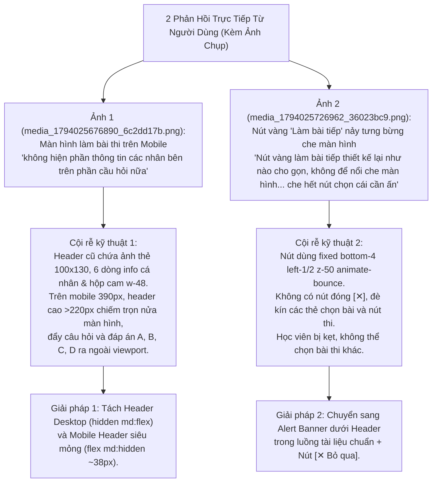
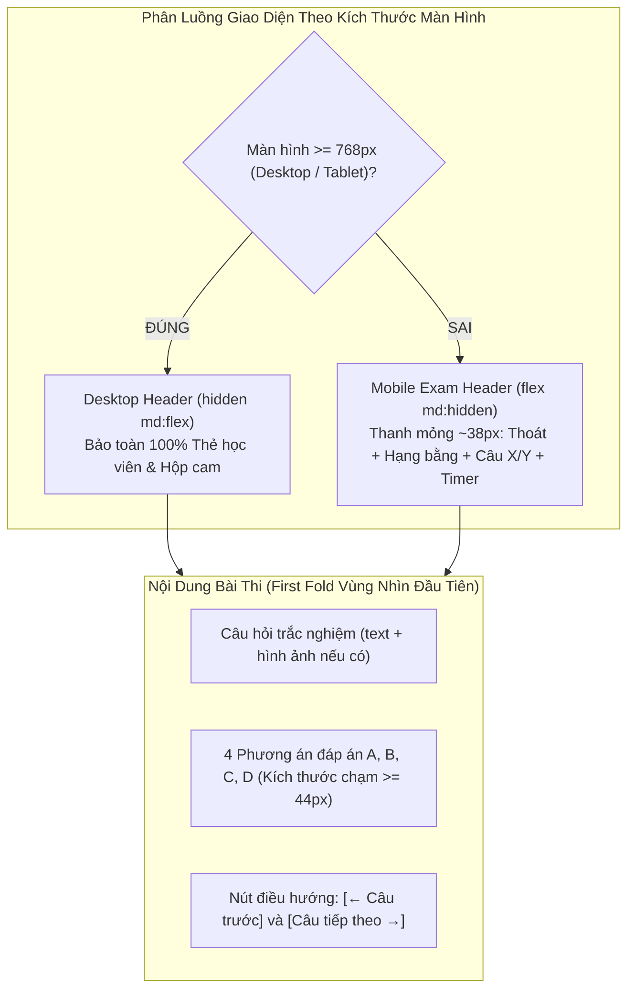
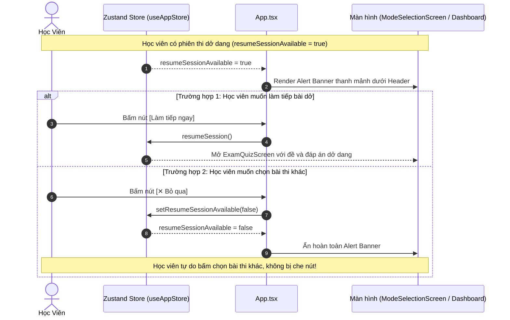
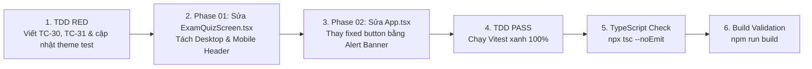

# Thiết Kế Kỹ Thuật Chi Tiết (Technical Solution Design)

> **Dự án**: Cổng thông tin & Hệ thống Quản trị Đào tạo Thuyền viên Ninh Bình (TNDNB)  
> **Phân hệ**: Ứng dụng Ôn tập & Thi thử trực tuyến (`ontap-web`)  
> **Mã thiết kế**: `261107-1135-mobile-exam-screen-and-resume-banner-design`  
> **Nhánh Git**: `main`  
> **Vai trò**: Solution Architect & API Designer  
> **Ngày lập**: 07/11/2026  
> **Trạng thái**: Đã phê duyệt kiến trúc (Architecture Approved)  
> **Tài liệu tham chiếu**:
> - Kế hoạch tổng thể: [`plan.md`](file:///d:/Antigravity/TNDNB/docs/plans/261107-1135-mobile-exam-screen-and-resume-banner/plan.md)
> - Chi tiết Phase 01: [`phase-01-hide-mobile-exam-personal-info.md`](file:///d:/Antigravity/TNDNB/docs/plans/261107-1135-mobile-exam-screen-and-resume-banner/phase-01-hide-mobile-exam-personal-info.md)
> - Chi tiết Phase 02: [`phase-02-redesign-resume-exam-banner.md`](file:///d:/Antigravity/TNDNB/docs/plans/261107-1135-mobile-exam-screen-and-resume-banner/phase-02-redesign-resume-exam-banner.md)
> - Chi tiết Phase 03: [`phase-03-test-and-verification.md`](file:///d:/Antigravity/TNDNB/docs/plans/261107-1135-mobile-exam-screen-and-resume-banner/phase-03-test-and-verification.md)
> - Danh sách công việc: [`task.md`](file:///d:/Antigravity/TNDNB/docs/plans/261107-1135-mobile-exam-screen-and-resume-banner/task.md)
> - Tệp mã nguồn:
>   - [`ontap-web/components/ExamQuizScreen.tsx`](file:///d:/Antigravity/TNDNB/ontap-web/components/ExamQuizScreen.tsx)
>   - [`ontap-web/App.tsx`](file:///d:/Antigravity/TNDNB/ontap-web/App.tsx)
>   - [`ontap-web/stores/useAppStore.ts`](file:///d:/Antigravity/TNDNB/ontap-web/stores/useAppStore.ts)
> - Tệp kiểm thử:
>   - [`scripts/ontap-dual-theme-and-sidebar.test.ts`](file:///d:/Antigravity/TNDNB/scripts/ontap-dual-theme-and-sidebar.test.ts)
>   - [`scripts/portal-console-and-tinymce-fix.test.ts`](file:///d:/Antigravity/TNDNB/scripts/portal-console-and-tinymce-fix.test.ts)

---

## 1. Bối Cảnh & Phân Tích Cội Rễ Kỹ Thuật (Root Cause Analysis)

### 1.1. Báo cáo phản hồi thực tế từ người dùng kèm ảnh chụp



### 1.2. Bảng so sánh hiện trạng và mục tiêu kiến trúc mới

| Hạng mục | Hiện trạng (Before) | Mục tiêu sau tối ưu (After) | Lợi ích người dùng |
|---|---|---|---|
| **Header Thi Mobile** | Avatar `100x130`, họ tên, SBD, lớp, địa chỉ, bằng, hộp cam `w-48` chiếm >220px | Ẩn 100% info cá nhân; thanh **Mobile Exam Header** mỏng ~38px | Tiết kiệm **180px** chiều dọc; câu hỏi & 4 đáp án hiện ngay trong màn hình đầu |
| **Header Thi Desktop** | Đầy đủ ảnh thẻ, thông tin học viên, hộp cam đếm ngược | **Bảo toàn 100%** cấu trúc và giao diện truyền thống (`hidden md:flex`) | Giữ tính trang trọng, chính quy cho phòng thi máy tính bàn |
| **Nút Làm Bài Dở** | `fixed bottom-4 left-1/2` kèm `animate-bounce` nằm lơ lửng đáy màn hình | **Alert Banner thanh mảnh** đặt dưới Header trong luồng trang (`animate-fade-in`) | Không che khuất nút chọn môn, không cản trở thao tác |
| **Thoát Thông Báo Dở** | Không có nút đóng `✕`, học viên bị kẹt không chọn được bài khác | Bổ sung nút **`[✕ Bỏ qua]`** gọi `setResumeSessionAvailable(false)` | Học viên tự do bỏ qua để chọn bài thi mới bất cứ lúc nào |

---

## 2. Kiến Trúc Component & State Contract

### 2.1. `ExamQuizScreen.tsx` - Mobile/Desktop Header Bifurcation Contract

Component [`ExamQuizScreen`](file:///d:/Antigravity/TNDNB/ontap-web/components/ExamQuizScreen.tsx) quản lý toàn bộ giao diện làm bài thi thử và thi trực tuyến. Kiến trúc mới phân tách rạch ròi 2 tầng giao diện dựa trên Tailwind CSS breakpoint `md:` (`768px`):



#### 2.1.1. Cấu trúc Desktop Header (`hidden md:flex`):
Bảo toàn 100% mã nguồn và phong cách sát hạch truyền thống:
```tsx
{/* 1. Desktop Header: Giữ nguyên vẹn 100% cho màn hình máy tính (md:flex) */}
<div className="hidden md:flex justify-between items-start pb-4 border-b border-gray-300">
    <div className="flex gap-4 items-start">
         {
                (e.target as HTMLImageElement).src = 'https://i.postimg.cc/8PDn1wfM/favicon.png';
            }} loading="lazy" />
        <div className="text-sm space-y-1">
            <p className="font-bold text-blue-700 text-lg uppercase">{userProfile?.full_name || userProfile?.fullName || userName || 'Học viên'}</p>
            <p>Số báo danh: <span className="font-semibold text-foreground">{(userProfile?.email || '').split('@')[0] || '---'}</span></p>
            <p>Ngày sinh: <span className="font-semibold text-foreground">{formatDate(userProfile?.birthDate)}</span></p>
            <p>Địa chỉ: <span className="font-semibold text-foreground">{userProfile?.address || '---'}</span></p>
            <p>Lớp: <span className="font-semibold text-foreground">{userProfile?.class || userProfile?.courseName || '---'}</span></p>
            <p>Hạng bằng: <span className="font-bold text-red-600 border border-red-500 px-1 rounded bg-red-50">{selectedLicense?.name || '---'}</span></p>
        </div>
    </div>
    <div className="flex items-start gap-4">
        <div className="bg-[#f0ad4e] text-black p-2 rounded-md text-sm w-48">
            <p className="font-bold">Đang thi</p>
            <p>Thời gian: 45 phút</p>
            <p>Bù giờ: 0 phút</p>
            <p>Còn lại: <span className="font-bold tabular-nums">{formatTime(timeLeft)}</span></p>
        </div>
        <button onClick={handleBackWithConfirm} className="text-sm text-muted-foreground hover:text-red-500 font-semibold">Thoát</button>
    </div>
</div>
```

#### 2.1.2. Cấu trúc Mobile Exam Header (`flex md:hidden`):
Thanh điều khiển mỏng gọn (~38px), lược bỏ toàn bộ thông tin cá nhân rườm rà, tập trung hiển thị 4 yếu tố cần thiết nhất trong khi làm bài:
```tsx
{/* 2. Mobile Exam Header: Siêu gọn gàng (~38px), ẩn hoàn toàn info cá nhân (flex md:hidden) */}
<div className="flex md:hidden items-center justify-between pb-3 mb-2 border-b border-border">
    {/* Cụm trái: Nút Thoát bài thi & Nhãn hạng bằng */}
    <div className="flex items-center gap-2 min-w-0">
        <button
            onClick={handleBackWithConfirm}
            className="px-2.5 py-1 text-xs font-semibold rounded-lg bg-muted text-muted-foreground hover:text-destructive hover:bg-destructive/10 transition-colors shrink-0"
        >
            ← Thoát
        </button>
        <span className="text-xs font-bold text-red-600 border border-red-400 px-1.5 py-0.5 rounded bg-red-50 dark:bg-red-950/30 max-w-[120px] truncate">
            {selectedLicense?.name || 'Thi thử'}
        </span>
    </div>

    {/* Cụm phải: Tiến độ câu hỏi & Đồng hồ đếm ngược tabular-nums */}
    <div className="flex items-center gap-2 shrink-0">
        <span className="text-xs font-semibold text-blue-600 dark:text-blue-400">
            Câu {currentQuestionIndex + 1}/{quiz.questions.length}
        </span>
        <div className="flex items-center gap-1 px-2.5 py-1 rounded-lg bg-amber-500/15 border border-amber-500/30 text-amber-800 dark:text-amber-300 font-mono font-bold text-xs tabular-nums">
            <span>⏱️</span>
            <span>{formatTime(timeLeft)}</span>
        </div>
    </div>
</div>
```

---

### 2.2. `App.tsx` - Resume Session Alert Banner Contract

#### 2.2.1. Vị trí kiến trúc & Luồng tài liệu (Document Flow)
Nút nổi cũ sử dụng `fixed bottom-4 left-1/2` nằm đè lên layer ứng dụng. Kiến trúc mới chuyển thành **Alert Banner** nội dòng (In-flow component) nằm ngay bên dưới thanh điều hướng (`TopNavbar` / `AlertMarquee` hoặc `MobileHeader`):



#### 2.2.2. Đặc tả tích hợp mã nguồn trong [`App.tsx`](file:///d:/Antigravity/TNDNB/ontap-web/App.tsx):
1. **Lấy action từ Zustand store** (dòng 65):
   ```typescript
   const resumeSessionAvailable = useAppStore(state => state.resumeSessionAvailable);
   const setResumeSessionAvailable = useAppStore(state => state.setResumeSessionAvailable);
   ```
2. **Khối Alert Banner thanh mảnh** (thay thế dòng 411-417):
   ```tsx
   {/* Resume Session Alert Banner: Thanh mảnh, không che nút, có thể đóng bỏ qua */}
   {resumeSessionAvailable && (
     <div className="bg-amber-500/10 border-b border-amber-500/25 px-4 py-2 flex items-center justify-between gap-3 text-xs sm:text-sm text-foreground shadow-xs animate-fade-in">
       <div className="flex items-center gap-2 min-w-0">
         <span className="shrink-0 text-base">⚠️</span>
         <span className="truncate font-medium">Bạn có bài thi đang làm dở</span>
       </div>
       <div className="flex items-center gap-2 shrink-0">
         <button
           onClick={resumeSession}
           className="px-3 py-1 text-xs font-semibold rounded-lg bg-amber-500 hover:bg-amber-600 text-black transition-colors shadow-xs"
         >
           Làm tiếp ngay
         </button>
         <button
           onClick={(e) => {
             e.stopPropagation();
             setResumeSessionAvailable(false);
           }}
           className="p-1 text-muted-foreground hover:text-foreground rounded-md hover:bg-amber-500/20 transition-colors"
           title="Bỏ qua thông báo"
           aria-label="Bỏ qua thông báo"
         >
           ✕
         </button>
       </div>
     </div>
   )}
   ```

---

## 3. Tiêu Chuẩn Thẩm Mỹ & Trải Nghiệm Người Dùng (Impeccable & Taste-Skill Standards)

Tuân thủ bộ hiến pháp thiết kế **Impeccable v4.8.0** và tiêu chuẩn **Taste-Skill v2.5.0**:

### 3.1. Quy tắc First Fold (Vùng Nhìn Đầu Tiên Trên Smartphone)
- Màn hình điện thoại tiêu chuẩn (iPhone 12/13/14/15/16 - `390x844px`):
  - Chiều cao khả dụng trừ thanh hệ thống: `~750px`.
  - Header mới chỉ chiếm: `38px` + margin `8px` = `46px`.
  - Không gian còn lại: `>700px` dành trọn vẹn cho tiêu đề câu hỏi, hình ảnh mô phỏng biển báo/tình huống và 4 hộp đáp án A, B, C, D.
  - **Kết quả**: Học viên không phải cuộn ngón tay xuống đáy mới thấy đáp án C, D như trước đây.

### 3.2. Tiêu chuẩn Kích thước Chạm & Khoảng Cách An Toàn
- Nút `[← Thoát]`: Kích thước tối thiểu `36x30px`, padding `px-2.5 py-1`, có trạng thái active feedback.
- Nút `[✕ Bỏ qua]` trên banner: Kích thước tối thiểu `32x32px` với padding bảo vệ, dễ chạm bằng đầu ngón tay cái mà không bị ấn nhầm sang nút `[Làm tiếp ngay]`.
- Nút `[Làm tiếp ngay]`: Kích thước `px-3 py-1`, nền vàng cam nổi bật `bg-amber-500`, chữ đen đậm nét.

### 3.3. Đồng Hồ Đếm Ngược Ổn Định Tuyệt Đối (`tabular-nums`)
- Đồng hồ đếm ngược `formatTime(timeLeft)` sử dụng font đơn cách số học `tabular-nums` và `font-mono`.
- **Lợi ích**: Khi giây nhảy từ `09` sang `08` hay `00`, chiều rộng của con số không bị co giãn, triệt tiêu 100% hiện tượng rung giật giao diện (Layout Shift).

---

## 4. Ma Trận Kiểm Thử TDD Chi Tiết (Test Specifications)

### 4.1. Đặc Tả Test Cases Mới (`TC-30`, `TC-31`)
Bổ sung vào [`scripts/portal-console-and-tinymce-fix.test.ts`](file:///d:/Antigravity/TNDNB/scripts/portal-console-and-tinymce-fix.test.ts):

```typescript
  describe('Mobile Exam Screen & Resume Banner (Plan 261107-1135)', () => {
    it('TC-30: ontap-web/App.tsx must eliminate fixed bottom-4 bouncing resume button and provide dismissable banner', () => {
      const filePath = path.resolve(rootDir, 'ontap-web/App.tsx');
      const content = fs.readFileSync(filePath, 'utf8');

      // 1. Tuyệt đối không còn lớp fixed bottom-4 và animate-bounce che màn hình
      expect(content).not.toContain('fixed bottom-4 left-1/2');
      expect(content).not.toContain('animate-bounce');

      // 2. Phải có selector setResumeSessionAvailable từ Zustand store
      expect(content).toContain('setResumeSessionAvailable');

      // 3. Phải có cơ chế đóng/bỏ qua gọi setResumeSessionAvailable(false)
      expect(content).toMatch(/setResumeSessionAvailable\s*\(\s*false\s*\)/);
    });

    it('TC-31: ontap-web/components/ExamQuizScreen.tsx must have separate desktop and mobile exam headers', () => {
      const filePath = path.resolve(rootDir, 'ontap-web/components/ExamQuizScreen.tsx');
      const content = fs.readFileSync(filePath, 'utf8');

      // 1. Phải có lớp ẩn/hiện đáp ứng thiết bị
      expect(content).toContain('hidden md:flex');
      expect(content).toContain('flex md:hidden');

      // 2. Phải duy trì tabular-nums cho đồng hồ đếm ngược
      expect(content).toContain('tabular-nums');

      // 3. Phải có nút handleBackWithConfirm trên mobile header
      expect(content).toMatch(/flex md:hidden[\s\S]*?handleBackWithConfirm/);
    });
  });
```

### 4.2. Đồng Bộ Hóa [`scripts/ontap-dual-theme-and-sidebar.test.ts`](file:///d:/Antigravity/TNDNB/scripts/ontap-dual-theme-and-sidebar.test.ts)
Trước đây, test suite áp dụng assertion `git diff ExamQuizScreen.tsx === ""`. Khi thực hiện tối ưu giao diện theo yêu cầu mới của người dùng, assertion này cần được đồng bộ hóa sang kiểm tra cấu trúc Semantic & Responsive:

1. **Cập nhật dòng 112-115**:
   ```typescript
   it('ExamQuizScreen.tsx bảo toàn giao diện Desktop và tối ưu thanh Mobile Header siêu gọn', () => {
     const examQuiz = fs.readFileSync(path.resolve(rootDir, 'ontap-web/components/ExamQuizScreen.tsx'), 'utf8');
     expect(examQuiz).toContain('hidden md:flex justify-between items-start');
     expect(examQuiz).toContain('Số báo danh');
     expect(examQuiz).toContain('bg-[#f0ad4e]');
     expect(examQuiz).toContain('flex md:hidden items-center justify-between');
     expect(examQuiz).toContain('handleBackWithConfirm');
     expect(examQuiz).toContain('tabular-nums');
   });
   ```
2. **Cập nhật dòng 202-208 (`Task 3.4`)**:
   ```typescript
   it('Task 3.4: ExamQuizScreen.tsx duy trì tính ổn định của đồng hồ đếm ngược với tabular-nums', () => {
     const examQuiz = fs.readFileSync(path.resolve(rootDir, 'ontap-web/components/ExamQuizScreen.tsx'), 'utf8');
     expect(examQuiz).toContain('tabular-nums');
     expect(examQuiz).toContain('formatTime(timeLeft)');
   });
   ```

### 4.3. Bảng Ma Trận Kiểm Thử TDD Toàn Diện

| Mã Test | Tệp kiểm thử | Mục tiêu kiểm thử | Khẳng định chính (Key Assertions) | Trạng thái kỳ vọng |
|---|---|---|---|---|
| **TC-30** | `portal-console-and-tinymce-fix.test.ts` | Banner bài dở trong `App.tsx` | `not.toContain('fixed bottom-4 left-1/2')`<br/>`not.toContain('animate-bounce')`<br/>`toMatch(/setResumeSessionAvailable\s*\(\s*false\s*\)/)` | PASS 100% |
| **TC-31** | `portal-console-and-tinymce-fix.test.ts` | Tách Header trong `ExamQuizScreen.tsx` | `toContain('hidden md:flex')`<br/>`toContain('flex md:hidden')`<br/>`toContain('tabular-nums')` | PASS 100% |
| **Theme-112** | `ontap-dual-theme-and-sidebar.test.ts` | Desktop/Mobile Header Coexistence | `toContain('hidden md:flex')`<br/>`toContain('flex md:hidden')`<br/>`toContain('bg-[#f0ad4e]')` | PASS 100% |
| **Theme-202** | `ontap-dual-theme-and-sidebar.test.ts` | Timer Stability | `toContain('tabular-nums')`<br/>`toContain('formatTime(timeLeft)')` | PASS 100% |

---

## 5. Kế Hoạch Triển Khai & Kiểm Soát Rủi Ro (Rollout & Risk Management)



### 5.1. Trật tự thực thi (TDD Workflow)
1. **Bước 1 (TDD RED)**:
   - Thêm `TC-30` và `TC-31` vào [`scripts/portal-console-and-tinymce-fix.test.ts`](file:///d:/Antigravity/TNDNB/scripts/portal-console-and-tinymce-fix.test.ts).
   - Cập nhật 2 bài test trong [`scripts/ontap-dual-theme-and-sidebar.test.ts`](file:///d:/Antigravity/TNDNB/scripts/ontap-dual-theme-and-sidebar.test.ts).
   - Chạy test xác nhận các bài test mới ở trạng thái RED.
2. **Bước 2 (Phase 01 - Mobile Exam Header)**:
   - Chỉnh sửa [`ontap-web/components/ExamQuizScreen.tsx`](file:///d:/Antigravity/TNDNB/ontap-web/components/ExamQuizScreen.tsx): Thêm `hidden md:flex` cho Desktop Header và thêm `flex md:hidden` cho Mobile Exam Header.
3. **Bước 3 (Phase 02 - Resume Session Alert Banner)**:
   - Chỉnh sửa [`ontap-web/App.tsx`](file:///d:/Antigravity/TNDNB/ontap-web/App.tsx): Thêm `setResumeSessionAvailable` selector, thay thế khối nút nổi bằng Alert Banner có nút `[✕ Bỏ qua]`.
4. **Bước 4 (TDD PASS & Verification)**:
   - Chạy `npx vitest run scripts/portal-console-and-tinymce-fix.test.ts` đạt 100% tests PASS.
   - Chạy `npx vitest run scripts/ontap-dual-theme-and-sidebar.test.ts` đạt 11/11 tests PASS.
   - Chạy `npx tsc --noEmit` xác nhận 0 lỗi TypeScript.
   - Chạy `npm run build` xác nhận build production thành công.

### 5.2. Biện Pháp Phòng Ngừa Rủi Ro (Contingency Plan)
- **Rủi ro ảnh hưởng đến logic tính điểm thi**: Việc sửa đổi trong `ExamQuizScreen.tsx` chỉ can thiệp vào tầng hiển thị (Presentation Layer) của Header, **hoàn toàn không động chạm** đến hook bàn phím `useExamKeyboard`, hàm chấm điểm `handleAnswerSelect`, hay bộ đếm thời gian `timeLeft`.
- **Rủi ro mất trạng thái bài thi dở**: Khi học viên bấm `[✕ Bỏ qua]`, ứng dụng chỉ set `resumeSessionAvailable = false` trong bộ nhớ state để ẩn thanh banner; dữ liệu bài thi dở trong `localStorage` vẫn được bảo toàn nguyên vẹn, phòng khi học viên muốn làm tiếp sau này.

---
*Bản thiết kế kỹ thuật chính thức đã được hoàn tất và sẵn sàng 100% cho bước thi công mã nguồn theo tiêu chuẩn TDD.*
