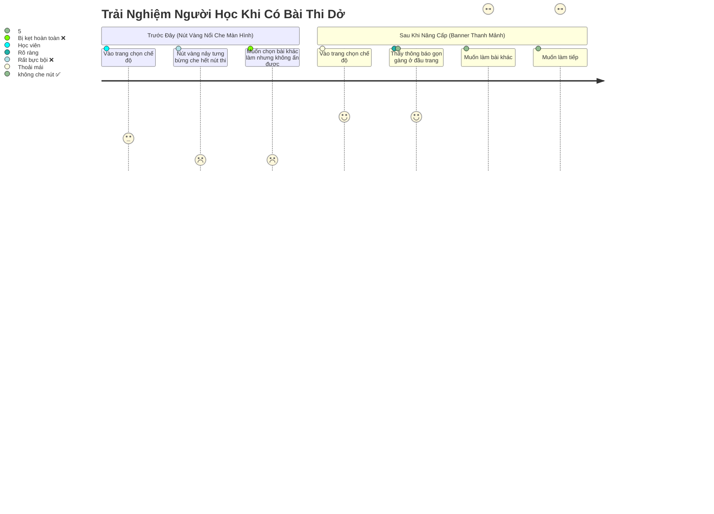

# Phase 02: Tái Thiết Kế Nút Nhắc Làm Bài Dở Thành Banner Thanh Mảnh Có Nút Đóng

> **Mã kế hoạch**: `261107-1135-mobile-exam-screen-and-resume-banner`  
> **Tài liệu**: Kế hoạch kỹ thuật chi tiết Phase 02  
> **Tệp tác động**: [`ontap-web/App.tsx`](file:///d:/Antigravity/TNDNB/ontap-web/App.tsx)  
> **Mục tiêu**: Xóa bỏ nút nổi màu vàng nhảy nhót che kín màn hình ở đáy trang, thay thế bằng thanh thông báo thanh mảnh đặt dưới header, có nút `[✕ Bỏ qua]` cho phép học viên chủ động tắt để chọn bài khác.

---

## 1. Mục Tiêu Kỹ Thuật (Objectives)

1. **Triệt tiêu hành vi che khuất màn hình (Non-blocking UI)**:
   - Xóa bỏ hoàn toàn lớp `fixed bottom-4 left-1/2 transform -translate-x-1/2` và hiệu ứng nhấp nháy `animate-bounce`.
   - Không để nút nổi đè lên các nút hành động cốt lõi ("Ôn tập theo môn", "Thi thử", thanh điều hướng dưới cùng `MobileBottomNav`) trên [`ModeSelectionScreen.tsx`](file:///d:/Antigravity/TNDNB/ontap-web/components/ModeSelectionScreen.tsx).
2. **Cung cấp cơ chế đóng / bỏ qua thông báo (`[✕ Bỏ qua]`)**:
   - Khi học viên muốn làm một bài thi mới hoặc chuyển sang nội dung khác, họ có thể bấm nút `[✕]` để tắt thông báo ngay lập tức.
   - Nút `[✕]` gọi hàm `setResumeSessionAvailable(false)` từ `useAppStore`.
3. **Giữ nguyên tính năng làm tiếp thuận tiện (`[Làm tiếp ngay]`)**:
   - Nút `[Làm tiếp ngay]` nhỏ gọn, màu sắc hài hòa (`bg-amber-500 hover:bg-amber-600`), nhấn vào là lập tức khôi phục đề thi, đáp án đã chọn và thời gian còn lại.
4. **Tương thích toàn diện Dark Mode & Semantic Tokens**:
   - Nền `bg-amber-500/10`, viền `border-amber-500/25`, văn bản `text-foreground`. Hiển thị đẹp mắt trên cả chế độ sáng (Light Mode) và chế độ tối (Dark Mode).

---

## 2. Chi Tiết Thay Đổi Mã Nguồn

### 2.1 File Cần Chỉnh Sửa
- **Đường dẫn**: [`ontap-web/App.tsx`](file:///d:/Antigravity/TNDNB/ontap-web/App.tsx)
- **Vị trí 1**: Dòng 65 - Lấy `setResumeSessionAvailable` từ Zustand store.
- **Vị trí 2**: Dòng 411 - 417 - Thay thế nút nổi `fixed bottom-4`.

### 2.2 Thay Đổi 1: Thêm Selector Trong `App.tsx` (Dòng 65)

#### Trước khi sửa:
```tsx
  const resumeSessionAvailable = useAppStore(state => state.resumeSessionAvailable);
  const isMobileApp = useAppStore(state => state.isMobileApp);
```

#### Sau khi sửa:
```tsx
  const resumeSessionAvailable = useAppStore(state => state.resumeSessionAvailable);
  const setResumeSessionAvailable = useAppStore(state => state.setResumeSessionAvailable);
  const isMobileApp = useAppStore(state => state.isMobileApp);
```

---

### 2.3 Thay Đổi 2: Tái Cấu Trúc Khối Hiển Thị Banner (Dòng 411 - 417)

#### Trước khi sửa:
```tsx
      {resumeSessionAvailable && (
        <div className="fixed bottom-4 left-1/2 transform -translate-x-1/2 bg-yellow-400 text-black px-6 py-3 rounded-full shadow-xl z-50 animate-bounce cursor-pointer hover:bg-yellow-500 font-bold flex items-center gap-2"
          onClick={resumeSession}>
          <span>⚠️ Bạn đang có bài thi làm dở!</span>
          <span className="underline">Làm tiếp ngay</span>
        </div>
      )}
```

#### Sau khi sửa (Resume Session Alert Banner thanh mảnh):
```tsx
      {resumeSessionAvailable && (
        <div className="bg-amber-500/10 border-b border-amber-500/25 px-4 py-2 flex items-center justify-between gap-3 text-xs sm:text-sm text-foreground shadow-xs animate-fade-in">
          <div className="flex items-center gap-2 min-w-0">
            <span className="shrink-0 text-base">⚠️</span>
            <span className="truncate font-medium">Bạn có bài thi đang làm dở</span>
          </div>
          <div className="flex items-center gap-2 shrink-0">
            <button
              onClick={resumeSession}
              className="px-3 py-1 text-xs font-semibold rounded-lg bg-amber-500 hover:bg-amber-600 text-black transition-colors shadow-xs"
            >
              Làm tiếp ngay
            </button>
            <button
              onClick={(e) => {
                e.stopPropagation();
                setResumeSessionAvailable(false);
              }}
              className="p-1 text-muted-foreground hover:text-foreground rounded-md hover:bg-amber-500/20 transition-colors"
              title="Bỏ qua thông báo"
              aria-label="Bỏ qua thông báo"
            >
              ✕
            </button>
          </div>
        </div>
      )}
```

---

## 3. Đánh Giá Trải Nghiệm Người Dùng (UX Review)



---

## 4. Danh Mục Kiểm Tra Khi Thi Công (Execution Checklist)

- [ ] Lấy `setResumeSessionAvailable` từ Zustand store trong [`ontap-web/App.tsx`](file:///d:/Antigravity/TNDNB/ontap-web/App.tsx).
- [ ] Thay thế nút nổi `fixed bottom-4` bằng Resume Session Alert Banner thanh mảnh.
- [ ] Xác nhận không còn `animate-bounce` và không còn `fixed bottom-4 left-1/2`.
- [ ] Xác nhận nút `[✕]` tắt được banner mà không phát sinh lỗi.
- [ ] Kiểm tra cú pháp TypeScript bằng `npx tsc --noEmit`.
