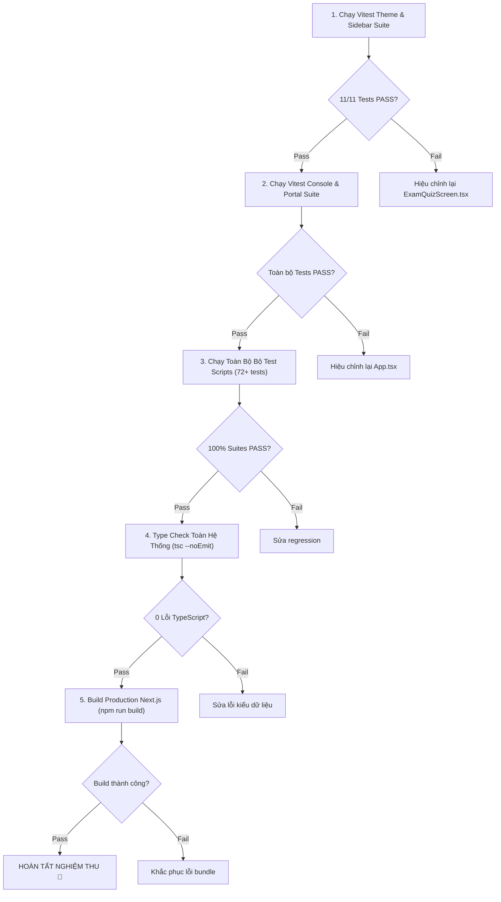

# Phase 03: Kiểm Thử TDD & Nghiệm Thu Toàn Diện

> **Mã kế hoạch**: `261107-1135-mobile-exam-screen-and-resume-banner`  
> **Tài liệu**: Kế hoạch kiểm thử & nghiệm thu Phase 03  
> **Mục tiêu**: Cập nhật bộ test case TDD tự động, thêm test case kiểm định Mobile Header & Banner dở dang, kiểm tra Type Check toàn dự án và nghiệm thu build ứng dụng.

---

## 1. Cập Nhật Test Suite TDD Hiện Hữu

### 1.1 Cập Nhật Trong [`scripts/ontap-dual-theme-and-sidebar.test.ts`](file:///d:/Antigravity/TNDNB/scripts/ontap-dual-theme-and-sidebar.test.ts)

Trước đây, khi `ExamQuizScreen.tsx` chưa được yêu cầu tối ưu, test suite áp dụng ràng buộc đóng băng `git diff === ""`. Nay người dùng đã yêu cầu rõ ràng việc tách giao diện Desktop / Mobile, bài test cần được cập nhật sang kiểm tra cấu trúc Semantic & Responsive:

#### Cập nhật Test case tại dòng 112:
```typescript
  it('ExamQuizScreen.tsx bảo toàn giao diện Desktop và tối ưu thanh Mobile Header siêu gọn', () => {
    const examQuiz = fs.readFileSync(
      path.resolve(rootDir, 'ontap-web/components/ExamQuizScreen.tsx'),
      'utf8'
    );

    // 1. Phải bảo toàn khối Desktop Header đầy đủ thông tin cá nhân và hộp cam
    expect(examQuiz).toContain('hidden md:flex justify-between items-start');
    expect(examQuiz).toContain('Số báo danh');
    expect(examQuiz).toContain('bg-[#f0ad4e]');

    // 2. Phải có thanh Mobile Exam Header siêu gọn gàng
    expect(examQuiz).toContain('flex md:hidden items-center justify-between');
    expect(examQuiz).toContain('handleBackWithConfirm');
    expect(examQuiz).toContain('tabular-nums');
  });
```

#### Cập nhật Test case tại dòng 202 (`Task 3.4`):
```typescript
  it('Task 3.4: ExamQuizScreen.tsx duy trì tính ổn định của đồng hồ đếm ngược với tabular-nums', () => {
    const examQuiz = fs.readFileSync(
      path.resolve(rootDir, 'ontap-web/components/ExamQuizScreen.tsx'),
      'utf8'
    );

    expect(examQuiz).toContain('tabular-nums');
    expect(examQuiz).toContain('formatTime(timeLeft)');
  });
```

---

## 2. Bổ Sung Test Cases Mới Vào [`scripts/portal-console-and-tinymce-fix.test.ts`](file:///d:/Antigravity/TNDNB/scripts/portal-console-and-tinymce-fix.test.ts)

### 2.1 `TC-30`: Kiểm Tra Banner Làm Bài Dở Trong `App.tsx`
```typescript
    it('TC-30: ontap-web/App.tsx must eliminate fixed bottom-4 bouncing resume button and provide dismissable banner', () => {
      const filePath = path.resolve(rootDir, 'ontap-web/App.tsx');
      const content = fs.readFileSync(filePath, 'utf8');

      // 1. Không còn lớp fixed bottom-4 và animate-bounce che màn hình
      expect(content).not.toContain('fixed bottom-4 left-1/2');
      expect(content).not.toContain('animate-bounce');

      // 2. Phải có cơ chế đóng/bỏ qua bằng setResumeSessionAvailable(false)
      expect(content).toContain('setResumeSessionAvailable');
      expect(content).toMatch(/setResumeSessionAvailable\s*\(\s*false\s*\)/);
    });
```

### 2.2 `TC-31`: Kiểm Tra Tách Biệt Desktop & Mobile Header Trong `ExamQuizScreen.tsx`
```typescript
    it('TC-31: ontap-web/components/ExamQuizScreen.tsx must have separate desktop and mobile exam headers', () => {
      const filePath = path.resolve(rootDir, 'ontap-web/components/ExamQuizScreen.tsx');
      const content = fs.readFileSync(filePath, 'utf8');

      // Phải có lớp ẩn/hiện đáp ứng thiết bị
      expect(content).toContain('hidden md:flex');
      expect(content).toContain('flex md:hidden');
    });
```

---

## 3. Quy Trình Nghiệm Thu Đa Tầng (Multi-Tier Verification)



---

## 4. Các Lệnh Thực Thi Kiểm Thử

### 4.1 Chạy Test Suite Theme & Sidebar:
```powershell
npx vitest run scripts/ontap-dual-theme-and-sidebar.test.ts
```
*Kỳ vọng*: 11/11 tests pass 100%.

### 4.2 Chạy Test Suite Console & Portal Fix:
```powershell
npx vitest run scripts/portal-console-and-tinymce-fix.test.ts
```
*Kỳ vọng*: Toàn bộ tests pass 100%.

### 4.3 Chạy Toàn Bộ Test Suite Scripts:
```powershell
npx vitest run scripts/
```
*Kỳ vọng*: 11 test files passed, 74+ tests pass 100%.

### 4.4 Kiểm Tra TypeScript Compiler:
```powershell
npx tsc --noEmit
```
*Kỳ vọng*: 0 lỗi cú pháp hoặc kiểu dữ liệu.

---

## 5. Tiêu Chuẩn Nghiệm Thu Thực Tế (Visual / Mobile Emulation)

1. **Màn hình làm bài thi trên Mobile (DevTools Responsive 390px - iPhone 12/13/14)**:
   - Truy cập `/ontap/thithu`.
   - **Kết quả**: Không có avatar 100x130, không có các dòng thông tin cá nhân.
   - Thanh Mobile Header mỏng gọn (~38px) hiển thị nút `← Thoát`, nhãn hạng bằng, `Câu X/Y` và đồng hồ `⏱️ MM:SS`.
   - Nội dung câu hỏi và 4 đáp án A, B, C, D nằm trọn vẹn trong màn hình đầu tiên, không phải cuộn trang.
2. **Màn hình làm bài thi trên Desktop (>= 1024px)**:
   - Truy cập `/ontap/thithu`.
   - **Kết quả**: Vẫn giữ nguyên 100% avatar ảnh thẻ học viên, họ tên, số báo danh, lớp, hạng bằng và khối hộp màu cam đếm ngược truyền thống.
3. **Banner bài thi dở dang trên Mobile & Desktop**:
   - Bắt đầu thi rồi bấm thoát ra trang chủ để lưu phiên dở dang (`resumeSessionAvailable = true`).
   - Vào lại trang chọn chế độ (`/ontap/chonchedo`).
   - **Kết quả**:
     - Không có nút tròn màu vàng nảy tưng bừng ở đáy màn hình.
     - Banner thanh mảnh màu hổ phách xuất hiện dưới thanh điều hướng, không che bất kỳ nút bấm nào.
     - Bấm nút `[✕]` ➔ Banner biến mất ngay lập tức, học viên thoải mái chọn bài thi khác.
     - Bấm nút `[Làm tiếp ngay]` ➔ Đưa học viên vào làm tiếp đúng câu hỏi và thời gian của bài thi dở.
