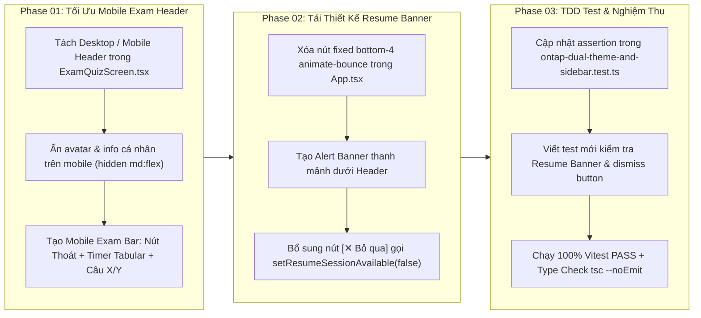

# Kế Hoạch Tối Ưu Giao Diện Làm Bài Thi Mobile & Tái Thiết Kế Banner Làm Bài Tiếp

> **Dự án**: Cổng thông tin & Hệ thống Quản trị Đào tạo Thuyền viên Ninh Bình (TNDNB)  
> **Mã kế hoạch**: `261107-1135-mobile-exam-screen-and-resume-banner`  
> **Người lập**: Senior Product Manager & Lead Architect  
> **Ngày lập**: 07/11/2026  
> **Trạng thái**: Sẵn sàng thực thi (Ready for Implementation)  

---

## 1. Bối Cảnh & Phản Hồi Thực Tế Của Người Dùng

Người dùng gửi 2 yêu cầu cụ thể kèm ảnh chụp màn hình thực tế từ thiết bị di động:
1. **Yêu cầu 1 (Ảnh 1 - `media_1794025676890_6c2dd17b.png`)**:  
   > *"không hiện phần thông tin các nhân bên trên phần cầu hỏi nữa (ảnh 1)"*  
   - **Hiện trạng**: Màn hình làm bài thi thử ([`ExamQuizScreen.tsx`](file:///d:/Antigravity/TNDNB/ontap-web/components/ExamQuizScreen.tsx)) hiển thị khối thông tin cá nhân (ảnh thẻ học viên `w-[100px] h-[130px]`, họ tên, số báo danh, ngày sinh, địa chỉ, lớp, hạng bằng) cùng khối đồng hồ màu cam lớn `w-48`.
   - **Vấn đề trên Mobile**: Chiều rộng màn hình di động hẹp (~390px) khiến khối màu cam đè lên chữ, chiếm hơn 220px chiều cao của viewport. Câu hỏi và các lựa chọn đáp án A, B, C, D bị đẩy xuống đáy màn hình hoặc tràn ra ngoài khung nhìn, buộc học viên phải liên tục cuộn trang để đọc câu hỏi và chọn đáp án.
   - **Giải pháp**: 
     - **Trên Desktop (`md:flex`)**: Giữ nguyên 100% giao diện truyền thống (ảnh thẻ, bảng thông tin đầy đủ, khối cam đếm ngược).
     - **Trên Mobile (`flex md:hidden`)**: Ẩn hoàn toàn thông tin cá nhân; thay thế bằng thanh **Mobile Exam Header** siêu gọn gàng (~38px): Nút `[← Thoát]`, nhãn hạng bằng, tiến độ `Câu X/Y` và badge đếm ngược `⏱️ Còn lại: MM:SS` (`tabular-nums`).

2. **Yêu cầu 2 (Ảnh 2 - `media_1794025726962_36023bc9.png`)**:  
   > *"Nút vàng làm bài tiếp thiết kế lại như nào cho gọn, không để nổi che màn hình , nhiều máy màn hình bé nút nổi che hết các nút cần ấn trên màn hình. Nhiều khi người muốn thoát ra để chọn bài khác làm mà nút nổi Lam bài tiếp che hét nút chọn cái cần ấn"*  
   - **Hiện trạng**: Trong [`App.tsx`](file:///d:/Antigravity/TNDNB/ontap-web/App.tsx) (dòng 411-417), khi có phiên thi chưa hoàn tất (`resumeSessionAvailable = true`), hệ thống hiển thị nút nổi màu vàng `fixed bottom-4 left-1/2 transform -translate-x-1/2 bg-yellow-400 text-black ... animate-bounce`.
   - **Vấn đề trên Mobile**: Nút nổi chiếm đúng vị trí trung tâm đáy màn hình, đè trực tiếp lên các thẻ chọn bài và nút chức năng của [`ModeSelectionScreen.tsx`](file:///d:/Antigravity/TNDNB/ontap-web/components/ModeSelectionScreen.tsx). Do không có nút đóng (`✕`), học viên bị kẹt, không thể bấm chọn bài thi khác nếu không bấm vào làm tiếp bài cũ.
   - **Giải pháp**: Tái thiết kế thành **Resume Session Alert Banner** dạng thanh thông báo thanh mảnh đặt ngay dưới header (trong luồng hiển thị chuẩn, không dùng `fixed bottom` hay `animate-bounce`), bổ sung nút **`[✕ Bỏ qua]`** để học viên có thể chủ động tắt thông báo khi muốn chọn bài khác.

---

## 2. Phân Tích Kỹ Thuật (Root Cause & Technical Analysis)

```mermaid
flowchart TD
    subgraph MobileExamScreen ["Vấn Đề 1: ExamQuizScreen.tsx trên Mobile"]
        OldHeader["Header hiện tại: Avatar 100x130 + Info + Orange Box w-48"] --> Overlap["Chiếm >220px chiều cao viewport trên màn hình 390px"]
        Overlap --> PushDown["Câu hỏi & đáp án bị đẩy xuống đáy, che khuất đáp án"]
        PushDown --> Solution1["Giải pháp: Tách giao diện Desktop (hidden md:flex) và Mobile Header siêu gọn (flex md:hidden, 38px)"]
    end

    subgraph ResumeBanner ["Vấn Đề 2: Nút Vàng 'Làm Bài Tiếp' trong App.tsx"]
        OldBtn["Nút fixed bottom-4 left-1/2 z-50 animate-bounce"] --> CoverBtn["Đè trực tiếp lên nút Chọn Môn / Thi Thử trên mobile"]
        CoverBtn --> NoDismiss["Không có nút đóng ✕ ➔ Người dùng bị kẹt"]
        NoDismiss --> Solution2["Giải pháp: Banner thanh mảnh dưới Header + Nút [✕ Bỏ qua] gọi setResumeSessionAvailable(false)"]
    end
```



---

## 3. Kiến Trúc Giải Pháp & Chi Tiết Triển Khai

### 3.1 Giao Diện Làm Bài Thi Trên Mobile ([`ExamQuizScreen.tsx`](file:///d:/Antigravity/TNDNB/ontap-web/components/ExamQuizScreen.tsx))
- **Desktop View (`hidden md:flex`)**: Giữ nguyên vẹn 100% khối thông tin cá nhân và bảng màu cam truyền thống phục vụ sát hạch trên máy tính bàn / laptop.
- **Mobile View (`flex md:hidden`)**:
  ```tsx
  <div className="flex md:hidden items-center justify-between pb-3 mb-2 border-b border-border">
      <div className="flex items-center gap-2">
          <button
              onClick={handleBackWithConfirm}
              className="px-2.5 py-1 text-xs font-semibold rounded-lg bg-muted text-muted-foreground hover:text-destructive hover:bg-destructive/10 transition-colors"
          >
              ← Thoát
          </button>
          <span className="text-xs font-bold text-red-600 border border-red-400 px-1.5 py-0.5 rounded bg-red-50 max-w-[120px] truncate">
              {selectedLicense?.name || 'Thi thử'}
          </span>
      </div>
      <div className="flex items-center gap-2">
          <span className="text-xs font-semibold text-blue-600">
              Câu {currentQuestionIndex + 1}/{quiz.questions.length}
          </span>
          <div className="flex items-center gap-1 px-2.5 py-1 rounded-lg bg-amber-500/15 border border-amber-500/30 text-amber-800 dark:text-amber-300 font-mono font-bold text-xs tabular-nums">
              <span>⏱️</span>
              <span>{formatTime(timeLeft)}</span>
          </div>
      </div>
  </div>
  ```
- **Hiệu quả**: Tiết kiệm hơn **180px** chiều dọc màn hình; câu hỏi và các lựa chọn đáp án A, B, C, D hiển thị ngay trên màn hình đầu tiên, học viên không cần phải cuộn chuột.

### 3.2 Banner Nhắc Làm Bài Dở ([`App.tsx`](file:///d:/Antigravity/TNDNB/ontap-web/App.tsx))
- **Vị trí**: Đặt ngay dưới Header / Marquee trong luồng tài liệu chuẩn, không dùng `fixed bottom` che nút.
- **Cấu trúc**:
  ```tsx
  {resumeSessionAvailable && (
    <div className="bg-amber-500/10 border-b border-amber-500/25 px-4 py-2 flex items-center justify-between gap-3 text-xs sm:text-sm text-foreground shadow-xs animate-fade-in">
      <div className="flex items-center gap-2 min-w-0">
        <span className="shrink-0 text-base">⚠️</span>
        <span className="truncate font-medium">Bạn có bài thi đang làm dở</span>
      </div>
      <div className="flex items-center gap-2 shrink-0">
        <button
          onClick={resumeSession}
          className="px-3 py-1 text-xs font-semibold rounded-lg bg-amber-500 hover:bg-amber-600 text-black transition-colors shadow-xs"
        >
          Làm tiếp ngay
        </button>
        <button
          onClick={(e) => {
            e.stopPropagation();
            setResumeSessionAvailable(false);
          }}
          className="p-1 text-muted-foreground hover:text-foreground rounded-md hover:bg-amber-500/20 transition-colors"
          title="Bỏ qua thông báo"
          aria-label="Bỏ qua thông báo"
        >
          ✕
        </button>
      </div>
    </div>
  )}
  ```
- **Hiệu quả**: Không che khuất bất kỳ nút bấm hay thẻ môn học nào; học viên có thể bấm `[✕]` để bỏ qua và chọn bài thi khác bất cứ lúc nào.

---

## 4. Lộ Trình Triển Khai 3 Phase (TDD Protocol)



---

## 5. Tiêu Chí Nghiệm Thu (Acceptance Criteria)

| STT | Hạng mục | Trước khi tối ưu | Sau khi hoàn thành |
|---|---|---|---|
| 1 | **Header thi thử trên Mobile** | Avatar 100x130, thông tin cá nhân và hộp cam chiếm >220px | **Ẩn hoàn toàn thông tin cá nhân**; thanh Mobile Header chỉ cao ~38px |
| 2 | **Vị trí câu hỏi & đáp án trên Mobile** | Bị đẩy xuống đáy, phải cuộn trang | **Nằm ngay vùng mắt nhìn đầu tiên**, không cần cuộn |
| 3 | **Giao diện thi thử trên Desktop** | Hiển thị đầy đủ thông tin học viên | **Giữ nguyên vẹn 100%** không đổi |
| 4 | **Nút nhắc làm bài tiếp** | Nút vàng nổi `fixed bottom-4`, `animate-bounce` che nút khác | **Banner thanh mảnh**, không che nút, không nhấp nháy |
| 5 | **Thoát thông báo làm bài tiếp** | Không có nút thoát, bị kẹt | **Có nút `[✕ Bỏ qua]`** để tắt thông báo và tự do chọn bài |
| 6 | **Bộ kiểm thử Vitest** | Ràng buộc git diff cũ | **100% PASS**, bổ sung test cases kiểm định mobile header & banner |
| 7 | **Kiểm tra TypeScript** | Không lỗi | **0 lỗi cú pháp hoặc kiểu dữ liệu (`tsc --noEmit`)** |

---

## 6. Danh Sách Tài Liệu Kế Hoạch Chi Tiết

- 📘 **Kế hoạch tổng thể chính thức**: [`plan.md`](file:///d:/Antigravity/TNDNB/docs/plans/261107-1135-mobile-exam-screen-and-resume-banner/plan.md)
- 📋 **Living Task Checklist (TDD)**: [`task.md`](file:///d:/Antigravity/TNDNB/docs/plans/261107-1135-mobile-exam-screen-and-resume-banner/task.md)
- 🛠️ **Chi tiết kỹ thuật Phase 01**: [`phase-01-hide-mobile-exam-personal-info.md`](file:///d:/Antigravity/TNDNB/docs/plans/261107-1135-mobile-exam-screen-and-resume-banner/phase-01-hide-mobile-exam-personal-info.md)
- 🛠️ **Chi tiết kỹ thuật Phase 02**: [`phase-02-redesign-resume-exam-banner.md`](file:///d:/Antigravity/TNDNB/docs/plans/261107-1135-mobile-exam-screen-and-resume-banner/phase-02-redesign-resume-exam-banner.md)
- 🧪 **Chi tiết kỹ thuật Phase 03**: [`phase-03-test-and-verification.md`](file:///d:/Antigravity/TNDNB/docs/plans/261107-1135-mobile-exam-screen-and-resume-banner/phase-03-test-and-verification.md)
