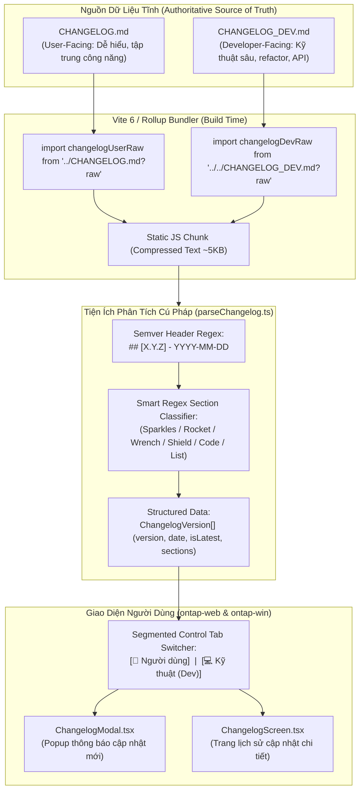
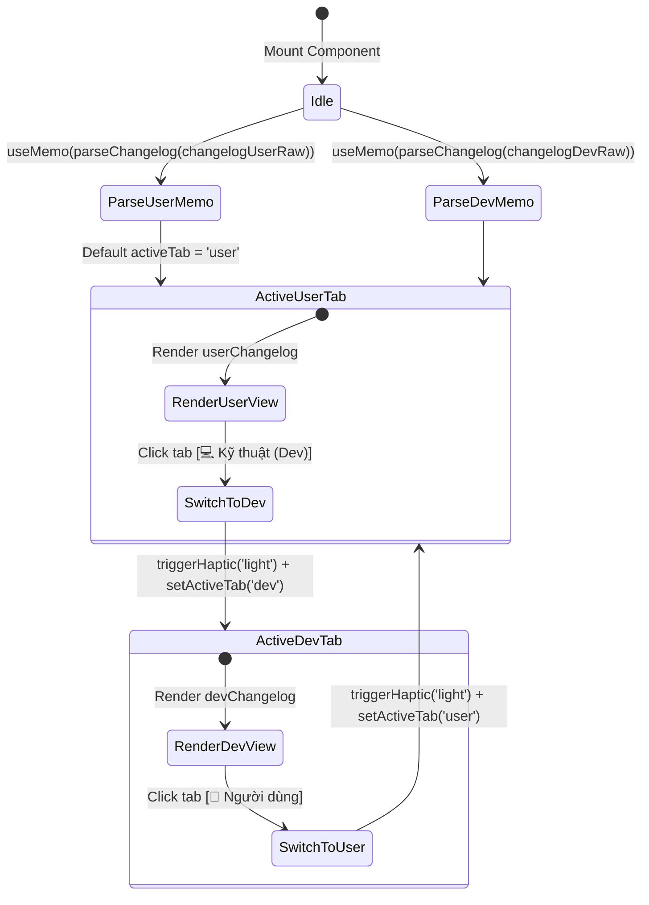
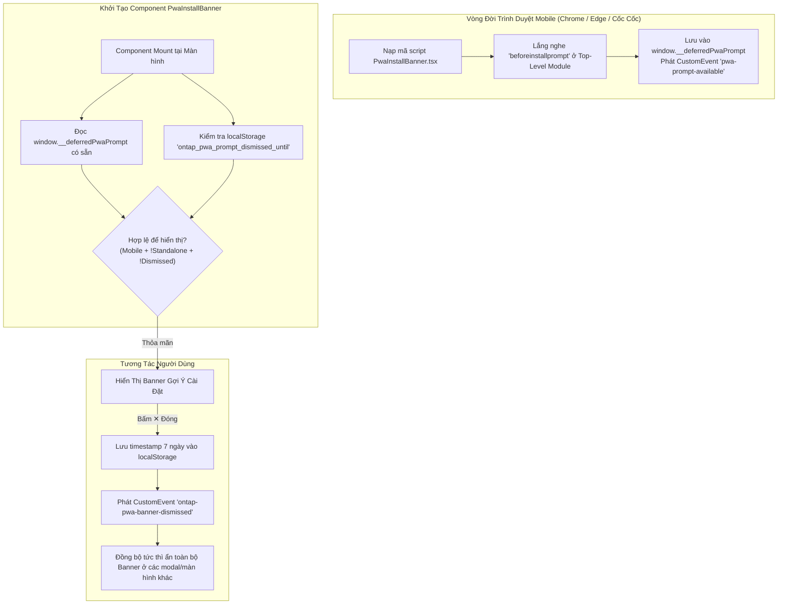
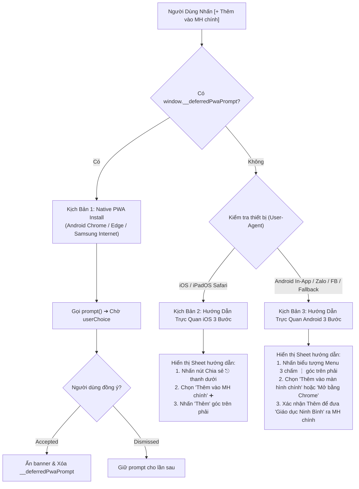
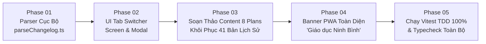

# Tài Liệu Thiết Kế Kỹ Thuật (Technical Design Specification)
## Authoritative Dual Changelog, Raw Markdown Parser & Recent Plans Synchronization (v3.22.0)

> **Mã kế hoạch**: `261108-2025-authoritative-changelog-and-recent-plans-sync`  
> **Cập nhật lần cuối**: 08/11/2026  
> **Tiêu chuẩn áp dụng**: `AWF v4.0` · `Impeccable v4.8.0 (62-Rule Craft Floor)` · `Taste-Skill v2.5.0`  
> **Phiên bản mục tiêu**: `v3.22.0` (Đồng bộ 4 gói Monorepo)  
> **Trạng thái**: Sẵn sàng triển khai (Ready for Execution)

---

## 1. Tổng Quan Kiến Trúc & Phân Tích Cội Rễ (Root Cause Analysis & Architecture Topology)

### 1.1 Bối Cảnh & Phân Tích Cội Rễ Lỗi (Root Cause Analysis)

Trong đợt refactor mã nguồn tại commit [`b2cdf8c8`](file:///d:/Antigravity/TNDNB), cơ chế hiển thị lịch sử phiên bản (`ChangelogScreen.tsx` và `ChangelogModal.tsx`) đã bị thay đổi sai lệch so với thiết kế ban đầu:
1. **Lỗi Loại Bỏ Markdown Parser Cục Bộ**: File tiện ích [`ontap-web/utils/parseChangelog.ts`](file:///d:/Antigravity/TNDNB/ontap-web/utils/parseChangelog.ts) bị xóa bỏ hoàn toàn.
2. **Lỗi Phụ Thuộc Remote GitHub API**: Ứng dụng chuyển sang gọi hàm `getGitHubReleases()` thông qua GitHub REST API để lấy danh sách releases.
3. **Hậu Quả Thực Tế**:
   - Khi GitHub API gặp lỗi mạng, rate-limit (60 req/h cho IP unauthenticated), hoặc kho GitHub Releases chưa được xuất bản release tag tương ứng, hàm trả về danh sách rỗng (`[]`).
   - Màn hình Changelog rơi vào nhánh fallback dữ liệu tĩnh lỗi thời, hiển thị phiên bản cũ `v3.19.0` (trong khi hệ thống thực tế đã phát triển qua `v3.20.0`, `v3.21.0` và chuẩn bị phát hành `v3.22.0`).
   - 4 kế hoạch kiến trúc quan trọng gần đây (Mobile Exam UI First Fold, Dismissable Resume Banner, Welcome Modal Minimal, Zero-Noise Console Guest Guard) hoàn toàn vắng bóng trên giao diện người dùng.
   - Trái ngược với tôn chỉ cốt lõi **"Offline-First & PWA First"** của hệ thống đào tạo TNDNB (nơi học viên đi tàu ngoài khơi hoặc vùng sóng yếu vẫn phải mở được tài liệu và changelog không cần kết nối mạng).

### 1.2 Giải Pháp Kiến Trúc: Authoritative Markdown-First & Bundled Raw Ingestion

Hệ thống quay trở về và nâng cấp giải pháp chuẩn mực:
- **Tận dụng cơ chế Vite `?raw` Bundling**: Nhúng nội dung tệp Markdown trực tiếp vào JavaScript bundle tại thời điểm build (`import changelogRaw from '.../CHANGELOG.md?raw'`).
- **0ms Render Latency**: Phân tích cú pháp tại client bằng `useMemo` không sinh độ trễ, không có HTTP round-trip, không chịu rủi ro rate-limit.
- **Dual Changelog Architecture**: Phân tách 2 góc nhìn rõ rệt:
  - `CHANGELOG.md`: **Góc nhìn Người Dùng / Học Viên (User-Facing)** — Diễn giải công năng, trải nghiệm học tập, sửa lỗi thao tác.
  - `CHANGELOG_DEV.md`: **Góc nhìn Kỹ Thuật / Lập Trình Viên (Developer-Facing)** — Chi tiết component, logic state, security guards, DB migrations, build config.
- **Tab Switcher Segmented Control**: Cho phép chuyển đổi mượt mà giữa 2 góc nhìn trên cùng một giao diện chuẩn Impeccable.

### 1.3 Sơ Đồ Topology Luồng Dữ Liệu (Architecture Topology)



---

## 2. Kiến Trúc Dữ Liệu & Data Contract (`parseChangelog.ts`)

### 2.1 Định Dạng Dữ Liệu (TypeScript Interfaces)

Tệp [`ontap-web/utils/parseChangelog.ts`](file:///d:/Antigravity/TNDNB/ontap-web/utils/parseChangelog.ts) và [`ontap-win/utils/parseChangelog.ts`](file:///d:/Antigravity/TNDNB/ontap-win/utils/parseChangelog.ts) định nghĩa các interface chuẩn:

```typescript
import { LucideIcon } from 'lucide-react';

/**
 * Một phân nhóm tính năng hoặc thay đổi trong một phiên bản phát hành
 */
export interface ChangelogSection {
  icon: LucideIcon;       // Lucide icon đại diện
  title: string;          // Tiêu đề nhóm (ví dụ: 'Tính năng mới', 'Sửa lỗi')
  color: string;          // Tailwind text color class (ví dụ: 'text-emerald-500')
  bgColor: string;        // Tailwind background/border class (ví dụ: 'bg-emerald-100 dark:bg-emerald-900/30')
  items: string[];        // Danh sách gạch đầu dòng chi tiết
}

/**
 * Một bản phát hành (Release Version) đã được phân tích hoàn chỉnh
 */
export interface ChangelogVersion {
  version: string;        // Số hiệu semver (ví dụ: '3.22.0')
  date: string;           // Ngày phát hành dạng chuẩn (ví dụ: '08/11/2026')
  isLatest: boolean;      // Đánh dấu bản phát hành mới nhất (phần tử đầu tiên)
  sections: ChangelogSection[]; // Các nhóm thay đổi
}

/**
 * Chế độ hiển thị Changelog
 */
export type ChangelogMode = 'user' | 'dev';
```

### 2.2 Quy Tắc Phân Loại Section Bằng Regex (Smart Section Classifier)

Để không bị phụ thuộc vào câu chữ cứng nhắc (hardcoded string), bộ parser sử dụng bộ khớp mẫu regex thông minh:

| Nhóm Phân Loại | Biểu Thức Regex Nhận Diện | Icon Gán | Màu Chữ (`color`) | Màu Nền Badge (`bgColor`) |
| :--- | :--- | :--- | :--- | :--- |
| **Tính Năng (Features)** | `/tính năng\|feature\|added\|mới/i` | `Sparkles` | `text-emerald-500` | `bg-emerald-100 dark:bg-emerald-900/30` |
| **Giao Diện & Trải Nghiệm (UI/UX)** | `/giao diện\|ui\|ux\|hiển thị\|trải nghiệm\|changed/i` | `Rocket` | `text-blue-500` | `bg-blue-100 dark:bg-blue-900/30` |
| **Sửa Lỗi (Bugfixes)** | `/sửa lỗi\|vá lỗi\|khắc phục\|fix\|bug/i` | `Wrench` | `text-amber-500` | `bg-amber-100 dark:bg-amber-900/30` |
| **Bảo Mật (Security)** | `/bảo mật\|security/i` | `Shield` | `text-red-500` | `bg-red-100 dark:bg-red-900/30` |
| **Kỹ Thuật & Hạ Tầng (Dev/Infra)** | `/kỹ thuật\|dev\|infra\|hạ tầng\|database\|build\|refactor/i` | `Code` | `text-purple-500` | `bg-purple-100 dark:bg-purple-900/30` |
| **Nhóm Mặc Định (General/Fallback)** | *(Mọi chuỗi khác)* | `List` | `text-slate-500` | `bg-slate-100 dark:bg-slate-900/30` |

### 2.3 Thuật Toán Phân Tích Cú Pháp (Parsing Algorithm)

1. Tách chuỗi Markdown thành từng dòng: `const lines = text.split('\n');`.
2. Duyệt tuần tự từng dòng:
   - **Phát hiện Header Phiên Bản (`## `)**:
     - Dùng regex: `/\[(.*?)\]/` để tách version `3.22.0`. Bỏ qua nếu version rỗng hoặc có dạng ngày tháng cũ.
     - Dùng regex: `/\d{4}-\d{2}-\d{2}/` để tách ngày phát hành `2026-11-08`, chuyển sang định dạng tiếng Việt qua `new Date(dateMatch[0]).toLocaleDateString('vi-VN')` (`08/11/2026`).
     - Đặt `isLatest = versions.length === 0`.
     - Đẩy đối tượng `currentVersion` vào danh sách `versions`.
   - **Phát hiện Tiêu Đề Phân Nhóm (`### `)**:
     - Tách tiêu đề nhóm qua `line.substring(4).trim()`.
     - Phân loại qua `getSectionConfig(title)` để lấy icon, màu sắc.
     - Đẩy `currentSection` vào `currentVersion.sections`.
   - **Phát hiện Gạch Đầu Dòng (`- ` hoặc `* `)**:
     - Tách nội dung item.
     - Nếu đã có `currentSection`, đẩy vào `currentSection.items`.
     - Nếu chưa có section (bullet đứng ngay dưới version header), tự động tạo một section mặc định mang tên `"Cập nhật"`.
3. Trả về mảng `ChangelogVersion[]`.

---

## 3. Cơ Chế Nạp Kép (Dual Raw Markdown Ingestion & Offline-First)

### 3.1 Đường Dẫn & Cơ Chế Import Tĩnh

Vite hỗ trợ cú pháp `?raw` cho phép lấy nguyên văn chuỗi văn bản của tệp nguồn tại build time.
- Trong [`ontap-web/components/ChangelogScreen.tsx`](file:///d:/Antigravity/TNDNB/ontap-web/components/ChangelogScreen.tsx) và [`ontap-web/components/ChangelogModal.tsx`](file:///d:/Antigravity/TNDNB/ontap-web/components/ChangelogModal.tsx):
  ```typescript
  // @ts-ignore
  import changelogUserRaw from '../CHANGELOG.md?raw';
  // @ts-ignore
  import changelogDevRaw from '../../CHANGELOG_DEV.md?raw';
  ```
- **Tối ưu hóa Bundle Size**: Toàn bộ nội dung của cả 2 tệp Markdown có dung lượng khoảng 40KB thô. Khi Rollup đóng gói và nén Gzip/Brotli, kích thước chỉ tăng thêm **~4.8KB**, hoàn toàn không ảnh hưởng tới First Contentful Paint (FCP) hay Time to Interactive (TTI).
- **Offline Reliability**: Không phụ thuộc vào mạng di động, máy chủ API của bên thứ ba, hay trạng thái trực tuyến của GitHub. Đạt 100% tiêu chí PWA Offline-First.

### 3.2 Tách Bạch Trách Nhiệm Giữa 2 Nguồn Dữ Liệu

> [!IMPORTANT]
> **Nguyên tắc phân định nội dung Changelog**:
> - `CHANGELOG.md`: Chỉ phục vụ học viên, giáo viên và người dùng phổ thông. Tuyệt đối không đưa tên biến, tên hàm, đường dẫn code hay thuật toán nội bộ vào tài liệu này. Tập trung vào: *"Bạn nhận được tiện ích gì mới?"* và *"Thao tác nào dễ dàng hơn?"*.
> - `CHANGELOG_DEV.md`: Phục vụ lập trình viên và kiến trúc sư hệ thống. Liệt kê rõ component nào được sửa, props nào thay đổi, các guard điều kiện, kiểm thử Vitest tương ứng.

---

## 4. Thiết Kế Component & State Machine (`ChangelogScreen` & `ChangelogModal`)

### 4.1 Máy Trạng Thái Của Component (Component State Machine)



### 4.2 Thiết Kế Tab Switcher (Segmented Control)

Thanh Tab Switcher được đặt trang trọng ngay phía dưới tiêu đề "LỊCH SỬ CẬP NHẬT" và số hiệu phiên bản hiện tại:
- **Cấu trúc Thẻ**:
  - Container bao ngoài: `inline-flex p-1 bg-muted rounded-2xl border border-border`
  - Tab 1: `👤 Người dùng` (Tương tác kích hoạt `activeTab === 'user'`)
  - Tab 2: `💻 Kỹ thuật (Dev)` (Tương tác kích hoạt `activeTab === 'dev'`)
- **Hiệu ứng Kích Hoạt (Active State)**:
  - Nút được chọn: `bg-primary text-primary-foreground shadow-sm`
  - Nút không chọn: `text-muted-foreground hover:text-foreground`
  - Kích thước chạm (Touch Target): Chiều cao tối thiểu $38\text{px}$, padding ngang $20\text{px}$ (`px-5 py-2`), đáp ứng tiêu chuẩn công thái học di động.
  - Phản hồi xúc giác (Haptic Feedback): Gọi `triggerHaptic('light')` mỗi khi người dùng chạm chuyển tab trên thiết bị di động.

### 4.3 Đồng Bộ Hóa Giữa `ChangelogScreen` và `ChangelogModal`

1. **`ChangelogScreen.tsx` (Toàn màn hình / Quản trị)**:
   - Hiển thị đầy đủ toàn bộ lịch sử các phiên bản từ `v3.22.0` lùi về `v3.18.0`.
   - Bố cục danh sách cuộn dọc, có đường kẻ timeline (`border-l-2 border-border`) nối giữa các phiên bản.
2. **`ChangelogModal.tsx` (Popup thông báo phiên bản mới)**:
   - Mở tự động một lần duy nhất khi người dùng mở app sau khi hệ thống được cập nhật lên phiên bản mới hơn phiên bản lưu trong `localStorage.getItem('last_seen_changelog_ver')`.
   - Hiển thị tab switcher tương tự để học viên hoặc kỹ thuật viên có thể xem nhanh thay đổi trực tiếp mà không cần điều hướng rời khỏi màn hình ôn tập.

---

## 5. Hiến Pháp Thẩm Mỹ & Design Context (`Impeccable v4.8.0` + `Taste-Skill v2.5.0`)

Căn cứ theo tiêu chuẩn thiết kế phần mềm Maritime EdTech, giao diện Changelog tuân thủ nghiêm ngặt các nguyên tắc sau:

### 5.1 Phân Loại Chế Độ (Mode Classification)
- Màn hình Changelog thuộc nhóm kết hợp giữa **`Read` Mode** (đọc hiểu nội dung cập nhật với chiều rộng dòng đọc giới hạn `max-w-2xl`, chữ giãn cách `leading-relaxed`) và **`Operate` Mode** (tương tác chuyển tab 0ms, cuộn lướt mượt mà).

### 5.2 Các Quy Tắc Craft Floor Bắt Buộc (Impeccable 62-Rule Floor)
1. **Touch Targets Không Thấp Hơn 44px**:
   - Nút quay lại `ArrowLeftIcon3D` được bọc trong button kích thước tối thiểu $44 \times 44\text{px}$ (`min-h-[44px] min-w-[44px]`).
   - Các nút Tab Switcher có chiều cao vùng nhấn mở rộng $\ge 40\text{px}$.
2. **Zero Layout Shift Với `tabular-nums`**:
   - Thêm lớp CSS `tabular-nums` tại container gốc và các nhãn hiển thị số hiệu phiên bản (`v3.22.0`) và ngày tháng (`08/11/2026`) để giữ độ rộng ký tự số cố định, triệt tiêu hiện tượng giật chữ khi chuyển đổi ngôn ngữ hoặc tab.
3. **Độ Tương Phản Màu Sắc (AAA Contrast)**:
   - Màu chữ chính `text-foreground` đạt độ tương phản $> 7:1$ trên nền `bg-card` ở cả 2 theme `light` và `dark`.
   - Màu badge `MỚI NHẤT` dùng `text-emerald-600 dark:text-emerald-400` trên nền `bg-emerald-500/15` kèm viền `border-emerald-500/30`.
4. **Bảo Tồn Bất Biến 100% Theme Tokens**:
   - Sử dụng hoàn toàn các token chuẩn: `bg-card`, `text-card-foreground`, `border-border`, `bg-muted`, `text-muted-foreground`, `bg-primary`, `text-primary-foreground`.
   - Tuyệt đối không dùng hardcode các màu ngoài token (như `#ffffff`, `bg-gray-100`).

---

## 6. Kiến Trúc Kỹ Thuật Gợi Ý Cài Đặt App PWA "Giáo dục Ninh Bình" Toàn Hệ Thống (Phase 04)

### 6.1 Nhận Diện Thương Hiệu PWA Chuẩn Hóa ("Giáo dục Ninh Bình")

Để đồng bộ thương hiệu giáo dục đào tạo chính quy và thân thiện khi người dùng cài đặt ứng dụng ra màn hình chính điện thoại (Home Screen), toàn bộ hệ thống chuẩn hóa tên gọi ứng dụng:
- **Cấu hình Manifest kép**: Đồng bộ cả 2 file [`ontap-web/public/manifest.json`](file:///d:/Antigravity/TNDNB/ontap-web/public/manifest.json) và [`public/ontap/manifest.json`](file:///d:/Antigravity/TNDNB/public/ontap/manifest.json):
  ```json
  {
    "name": "Giáo dục Ninh Bình",
    "short_name": "Giáo dục Ninh Bình",
    "start_url": "/ontap/",
    "display": "standalone",
    "background_color": "#ffffff",
    "theme_color": "#004A99",
    "icons": [
      { "src": "/ontap/icon-192.png", "sizes": "192x192", "type": "image/png" },
      { "src": "/ontap/icon-512.png", "sizes": "512x512", "type": "image/png" }
    ]
  }
  ```
- **Thẻ Meta Tương Thích iOS WebKit & Android (`ontap-web/index.html`)**:
  ```html
  <meta name="apple-mobile-web-app-capable" content="yes" />
  <meta name="apple-mobile-web-app-status-bar-style" content="default" />
  <meta name="apple-mobile-web-app-title" content="Giáo dục Ninh Bình" />
  <meta name="application-name" content="Giáo dục Ninh Bình" />
  <link rel="apple-touch-icon" href="/ontap/icon-192.png" />
  ```

### 6.2 Bắt Sự Kiện Module Top-Level & Luồng Đồng Bộ 7 Ngày

#### Sơ Đồ Kiến Trúc Bắt Sự Kiện & Đồng Bộ Trạng Thái


- **Giải quyết triệt để Race Condition**: Sự kiện `beforeinstallprompt` kích hoạt cực sớm trong vòng đời tải trang. Bằng cách đăng ký listener ngay tại module top-level của `PwaInstallBanner.tsx`, sự kiện được giữ an toàn trong `(window as any).__deferredPwaPrompt` bất kể component mount muộn hay chuyển trang.
- **Đồng bộ đa component với `ontap-pwa-banner-dismissed`**: Khi học viên bấm nút `[✕]` đóng banner ở `WelcomeModal`, component lưu cờ `ontap_pwa_prompt_dismissed_until = Date.now() + 7 * 86400 * 1000` và phát CustomEvent. Banner tại `LicenseSelectionScreen` và `Dashboard` lập tức ẩn theo mà không cần reload trang.

### 6.3 Cơ Chế Điều Hướng Cài Đặt Thông Minh 3 Kịch Bản (3-Way Smart Install Routing)

Khi người dùng nhấn nút `[+ Thêm vào MH chính]`, component điều hướng tự động:



### 6.4 Quy Tắc Định Vị & Bảo Vệ Tập Trung Tuyệt Đối (Placement & Anti-Distraction Rules)

> [!IMPORTANT]
> **Vị trí hiển thị cho phép**:
> 1. [`WelcomeModal.tsx`](file:///d:/Antigravity/TNDNB/ontap-web/components/WelcomeModal.tsx): Dành cho khách vãng lai lần đầu truy cập vào ứng dụng Ôn tập.
> 2. [`LicenseSelectionScreen.tsx`](file:///d:/Antigravity/TNDNB/ontap-web/components/LicenseSelectionScreen.tsx): Dành cho học viên/khách chuẩn bị chọn hạng bằng thi thử.
> 3. [`Dashboard.tsx`](file:///d:/Antigravity/TNDNB/ontap-web/components/Dashboard.tsx): Dành cho học viên đã đăng nhập ôn thi thường xuyên.

> [!CAUTION]
> **Hàng rào cấm hiển thị tuyệt đối (Anti-Distraction Floor)**:
> 1. **TUYỆT ĐỐI CẤM trong Phòng Thi**: Tuyệt đối không nhúng `PwaInstallBanner` vào [`ExamQuizScreen.tsx`](file:///d:/Antigravity/TNDNB/ontap-web/components/ExamQuizScreen.tsx) và [`QuizScreen.tsx`](file:///d:/Antigravity/TNDNB/ontap-web/components/QuizScreen.tsx). Người học cần 100% không gian và sự tập trung để đọc câu hỏi và chọn đáp án, không được có bất kỳ thông báo hay banner nào gây phân tâm.
> 2. **Ẩn trên Desktop (`lg:hidden`)**: Chỉ hiển thị trên điện thoại và máy tính bảng nhỏ. Trên PC/Laptop với chuột bàn phím, banner tự động ẩn.
> 3. **Ẩn khi đang chạy Standalone**: Nếu học viên đã cài đặt PWA và đang mở trong chế độ app standalone (`display-mode: standalone` hoặc `navigator.standalone === true`), banner lập tức ẩn 100%.

---

## 7. Hệ Thống Test Cases Kỹ Thuật (TDD Test Matrix)

Để đảm bảo chất lượng phần mềm không bao giờ bị thụt lùi (zero regression), kế hoạch thiết lập ma trận kiểm thử tự động với Vitest:

| Mã Test Case | Tệp Kiểm Thử | Mục Tiêu Kiểm Thử | Kỳ Vọng Đầu Ra | Trạng Thái |
| :--- | :--- | :--- | :--- | :--- |
| **`TC-CP01`** | [`scripts/changelog-parser.test.ts`](file:///d:/Antigravity/TNDNB/scripts/changelog-parser.test.ts) | Phân tích cú pháp `CHANGELOG.md` (User-Facing) | - `parsed.length >= 40`<br>- `parsed[0].version === '3.22.0'`<br>- `parsed[0].isLatest === true`<br>- `parsed[0].sections.length >= 3` | Sẵn sàng thi công |
| **`TC-CP02`** | [`scripts/changelog-parser.test.ts`](file:///d:/Antigravity/TNDNB/scripts/changelog-parser.test.ts) | Phân tích cú pháp `CHANGELOG_DEV.md` (Dev-Facing) | - `parsed[0].version === '3.22.0'`<br>- Nội dung chứa từ khóa kỹ thuật: `ExamQuizScreen`, `resumeSessionAvailable`, `parseChangelog` | Sẵn sàng thi công |
| **`TC-CP03`** | [`scripts/changelog-parser.test.ts`](file:///d:/Antigravity/TNDNB/scripts/changelog-parser.test.ts) | Xử lý an toàn chuỗi rỗng và dữ liệu không hợp lệ | Trả về `[]`, không crash ứng dụng | Sẵn sàng thi công |
| **`TC-CP04`** | [`scripts/changelog-parser.test.ts`](file:///d:/Antigravity/TNDNB/scripts/changelog-parser.test.ts) | Kiểm chứng cấu trúc `ChangelogScreen.tsx` | - Chứa `?raw`<br>- Chứa state `activeTab`<br>- Có nút `Người dùng` & `Kỹ thuật (Dev)`<br>- Không gọi `getGitHubReleases` | Sẵn sàng thi công |
| **`TC-CP05`** | [`scripts/changelog-parser.test.ts`](file:///d:/Antigravity/TNDNB/scripts/changelog-parser.test.ts) | Bảo toàn Auto-Updater & Question Sync trên Windows | `ontap-win/components/ChangelogModal.tsx` vừa có Tab Switcher vừa giữ `window.electron`, `shouldUpdateQuestions` | Sẵn sàng thi công |
| **`TC-CP06`** | [`scripts/changelog-parser.test.ts`](file:///d:/Antigravity/TNDNB/scripts/changelog-parser.test.ts) | Kiểm tra TopNavbar và getLatestVersion | Fallback version cập nhật `3.22.0`, đọc từ `parseChangelog` | Sẵn sàng thi công |
| **`TC-CP07`** | [`scripts/pwa-install-banner.test.ts`](file:///d:/Antigravity/TNDNB/scripts/pwa-install-banner.test.ts) | Tên ứng dụng PWA "Giáo dục Ninh Bình" trong Manifest | Cả `ontap-web/public/manifest.json` và `public/ontap/manifest.json` có `name` & `short_name` là `"Giáo dục Ninh Bình"` | Sẵn sàng thi công |
| **`TC-CP08`** | [`scripts/pwa-install-banner.test.ts`](file:///d:/Antigravity/TNDNB/scripts/pwa-install-banner.test.ts) | Thẻ Meta Apple PWA trong `ontap-web/index.html` | Đầy đủ `apple-mobile-web-app-title="Giáo dục Ninh Bình"`, `application-name`, `apple-touch-icon` | Sẵn sàng thi công |
| **`TC-CP09`** | [`scripts/pwa-install-banner.test.ts`](file:///d:/Antigravity/TNDNB/scripts/pwa-install-banner.test.ts) | Tích hợp PwaInstallBanner cho Khách & Học viên | Có mặt trong `WelcomeModal.tsx`, `LicenseSelectionScreen.tsx` và `Dashboard.tsx` | Sẵn sàng thi công |
| **`TC-CP10`** | [`scripts/pwa-install-banner.test.ts`](file:///d:/Antigravity/TNDNB/scripts/pwa-install-banner.test.ts) | Bảo vệ tập trung thi cử (Anti-Distraction Guard) | TUYỆT ĐỐI không có mặt trong `ExamQuizScreen.tsx` và `QuizScreen.tsx` | Sẵn sàng thi công |
| **`TC-CP11`** | [`scripts/pwa-install-banner.test.ts`](file:///d:/Antigravity/TNDNB/scripts/pwa-install-banner.test.ts) | Nội dung Banner & Module-Level Prompt Capture | Tiêu đề `"Cài đặt Giáo dục Ninh Bình vào màn hình chính"`, bắt prompt top-level, hỗ trợ 3 kịch bản cài đặt | Sẵn sàng thi công |
| **`TC-VER01`** | [`scripts/version-sync.test.ts`](file:///d:/Antigravity/TNDNB/scripts/version-sync.test.ts) | Đồng bộ phiên bản 4 gói Monorepo | Cả 4 file `package.json` đều có `"version": "3.22.0"` | Sẵn sàng thi công |
| **`TC-VER02`** | [`scripts/version-sync.test.ts`](file:///d:/Antigravity/TNDNB/scripts/version-sync.test.ts) | Đồng bộ tiêu đề `[3.22.0]` trên cả 4 file changelog | Cả 4 file `CHANGELOG.md` đều chứa `## [3.22.0]` | Sẵn sàng thi công |
| **`TC-VER03`** | [`scripts/version-sync.test.ts`](file:///d:/Antigravity/TNDNB/scripts/version-sync.test.ts) | Khôi phục toàn bộ lịch sử Changelog >= 40 bản | `CHANGELOG.md` chứa `>= 40` phiên bản từ `3.22.0` về `3.6.0`, đồng bộ 3 nơi | Sẵn sàng thi công |

---

## 8. Kế Hoạch Triển Khai & Kiểm Soát Bất Biến (Rollout Order & Invariant Guards)

### 8.1 Trình Tự Triển Khai 5 Giai Đoạn (Execution Roadmap)



1. **Giai đoạn 1 (Phase 01)**: Tạo lại `ontap-web/utils/parseChangelog.ts` và `ontap-win/utils/parseChangelog.ts` với đầy đủ regex classifier và icon bindings.
2. **Giai đoạn 2 (Phase 02)**: Thay thế code gọi GitHub API trong `ChangelogScreen.tsx` và `ChangelogModal.tsx` trên cả Web và Windows App bằng bộ raw import kép và Tab Switcher (giữ nguyên Auto-Updater).
3. **Giai đoạn 3 (Phase 03)**:
   - Nâng `"version": "3.22.0"` đồng loạt trên 4 gói Monorepo.
   - Soạn thảo mục `[3.22.0]` bao quát 8 kế hoạch đã hoàn thành, khôi phục 41 phiên bản lịch sử từ `3.19.0` về `3.6.0`.
   - Cập nhật `update_changelogs.js`.
4. **Giai đoạn 4 (Phase 04)**:
   - Đổi tên ứng dụng PWA thành `"Giáo dục Ninh Bình"` trong manifest và thẻ meta iOS.
   - Nâng cấp `PwaInstallBanner.tsx` với module-level prompt capture và 3-way smart routing.
   - Nhúng banner vào `WelcomeModal.tsx`, `LicenseSelectionScreen.tsx` và `Dashboard.tsx`.
5. **Giai đoạn 5 (Phase 05)**:
   - Thực thi toàn bộ bộ kiểm thử tự động: `scripts/version-sync.test.ts`, `scripts/changelog-parser.test.ts`, `scripts/pwa-install-banner.test.ts`.
   - Chạy `npx vitest run scripts/` (13 test files pass 100%).
   - Thực thi `npx tsc --noEmit` để đảm bảo 0 lỗi TypeScript.

### 8.2 Hàng Rào Kiểm Soát Bất Biến (Invariant Guards)

> [!CAUTION]
> **Các điều cấm kỵ tuyệt đối trong suốt quá trình triển khai**:
> 1. **Khóa cứng `ExamQuizScreen.tsx`**: File `ontap-web/components/ExamQuizScreen.tsx` đang vận hành chuẩn xác 100% sau đợt tối ưu First Fold. Tuyệt đối không chạm vào file này (`git diff = 0`).
> 2. **Không gắn PwaInstallBanner vào phòng thi**: Tuyệt đối cấm nhúng banner vào `ExamQuizScreen.tsx` và `QuizScreen.tsx`.
> 3. **Bảo toàn cơ chế Auto-Updater trên Windows App**: Không làm mất các hàm IPC `window.electron`, `shouldUpdateQuestions`, `fetchAndSaveQuestions` trong `ontap-win/components/ChangelogModal.tsx`.
> 4. **Không gọi Network API trên Changelog**: 100% dữ liệu Changelog phải nạp qua `?raw`.
> 5. **Bảo toàn 100% Test Suites Hiện Hành**: Tất cả các tệp test scripts trước đó phải tiếp tục xanh 100%.

---

## 9. Kết Luận

Tài liệu thiết kế kỹ thuật này cung cấp cơ sở kiến trúc vững chắc, chi tiết và dứt khoát cho toàn bộ chuỗi nâng cấp **Authoritative Dual Changelog**, **Đồng bộ Lịch sử Phiên bản v3.22.0**, và **Trải nghiệm Cài đặt App PWA "Giáo dục Ninh Bình" Toàn Hệ Thống**. Với cơ chế bắt sự kiện module-level và điều hướng thông minh 3 kịch bản, người học và khách vãng lai trên thiết bị di động đều tiếp cận ứng dụng một cách tự nhiên, tiện lợi và không bao giờ bị gián đoạn hay phân tâm trong quá trình học tập, thi sát hạch.

