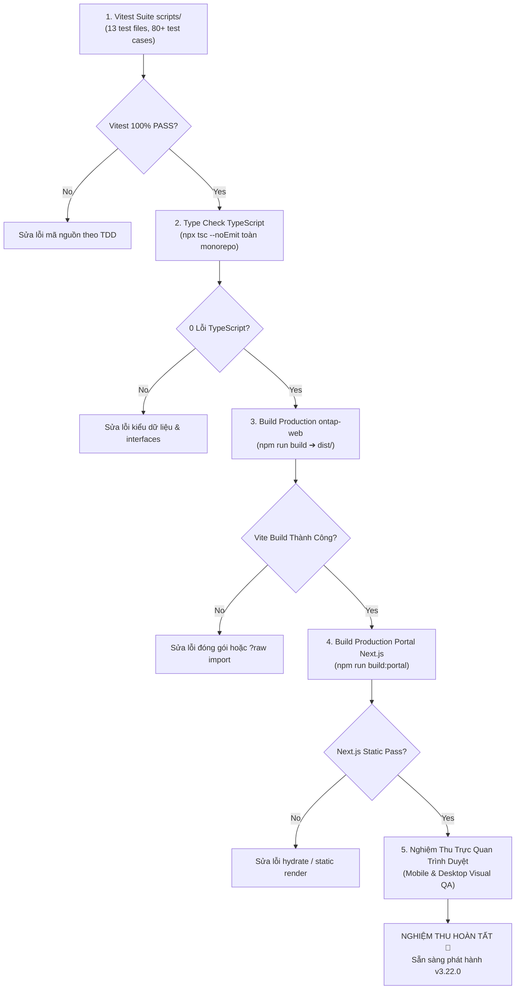

# Phase 05: Kiểm Thử TDD Tự Động & Quy Trình Nghiệm Thu Toàn Diện

> **Mã kế hoạch**: `261108-2025-authoritative-changelog-and-recent-plans-sync`  
> **Tài liệu**: Kế hoạch kiểm thử & nghiệm thu Phase 05 (Bao gồm nghiệm thu Markdown Changelog kép v3.22.0 và PWA App "Giáo dục Ninh Bình" cho Khách & Học viên Mobile)  
> **Tệp tác động**:
> - [`scripts/version-sync.test.ts`](file:///d:/Antigravity/TNDNB/scripts/version-sync.test.ts) (cập nhật)
> - [`scripts/changelog-parser.test.ts`](file:///d:/Antigravity/TNDNB/scripts/changelog-parser.test.ts) (kiểm tra)
> - [`scripts/pwa-install-banner.test.ts`](file:///d:/Antigravity/TNDNB/scripts/pwa-install-banner.test.ts) (tạo mới kiểm thử PWA Banner & Tên App "Giáo dục Ninh Bình")  
> **Mục tiêu**: Xây dựng test suite TDD tự động kiểm tra tính nhất quán phiên bản `v3.22.0`, kiểm chứng bộ parser Markdown kép đa section, khôi phục đủ `>= 40` phiên bản lịch sử, bảo toàn 100% cơ chế Auto-Updater trên bản Windows, và nghiệm thu toàn diện cơ chế gợi ý cài đặt PWA App "Giáo dục Ninh Bình" cho khách chưa đăng nhập trên Mobile.

---

## 1. Thiết Kế Test Suite TDD (Vitest)

### 1.1 Cập Nhật `scripts/version-sync.test.ts`
```typescript
import { describe, it, expect } from 'vitest';
import fs from 'node:fs';
import path from 'node:path';

describe('Version Synchronization & Changelog Verification (v3.22.0)', () => {
  const rootDir = process.cwd();

  const packageJsonPaths = [
    path.resolve(rootDir, 'package.json'),
    path.resolve(rootDir, 'ontap-web/package.json'),
    path.resolve(rootDir, 'ontap-win/package.json'),
    path.resolve(rootDir, 'cloudflare-worker/package.json'),
  ];

  const changelogPaths = [
    path.resolve(rootDir, 'CHANGELOG.md'),
    path.resolve(rootDir, 'ontap-web/CHANGELOG.md'),
    path.resolve(rootDir, 'ontap-win/CHANGELOG.md'),
    path.resolve(rootDir, 'CHANGELOG_DEV.md'),
  ];

  it('tất cả 4 gói (root, ontap-web, ontap-win, cloudflare-worker) đều có version === "3.22.0"', () => {
    packageJsonPaths.forEach((pkgPath) => {
      expect(fs.existsSync(pkgPath), `File ${pkgPath} phải tồn tại`).toBe(true);
      const pkg = JSON.parse(fs.readFileSync(pkgPath, 'utf8'));
      expect(pkg.version, `Package tại ${pkgPath} phải có version 3.22.0`).toBe('3.22.0');
    });
  });

  it('tất cả 4 file CHANGELOG đều có mục ghi chú phát hành "## [3.22.0]"', () => {
    changelogPaths.forEach((logPath) => {
      expect(fs.existsSync(logPath), `File ${logPath} phải tồn tại`).toBe(true);
      const content = fs.readFileSync(logPath, 'utf8');
      expect(content, `File ${logPath} phải chứa mục ## [3.22.0]`).toContain('## [3.22.0]');
    });
  });

  it('khôi phục đầy đủ lịch sử CHANGELOG.md (>= 40 phiên bản từ 3.22.0 về 3.6.0) và đồng bộ giữa root, ontap-web, ontap-win', () => {
    const rootContent = fs.readFileSync(path.resolve(rootDir, 'CHANGELOG.md'), 'utf8');
    const webContent = fs.readFileSync(path.resolve(rootDir, 'ontap-web/CHANGELOG.md'), 'utf8');
    const winContent = fs.readFileSync(path.resolve(rootDir, 'ontap-win/CHANGELOG.md'), 'utf8');

    const versionHeaders = rootContent.match(/^## \[/gm) || [];
    expect(versionHeaders.length).toBeGreaterThanOrEqual(40);
    expect(rootContent).toContain('## [3.6.0]');
    expect(webContent).toBe(rootContent);
    expect(winContent).toBe(rootContent);
  });
});
```

---

### 1.2 Test Suite `scripts/changelog-parser.test.ts`
```typescript
import { describe, it, expect } from 'vitest';
import fs from 'node:fs';
import path from 'node:path';

describe('Changelog Parser & UI Integration Test Suite', () => {
  const rootDir = process.cwd();

  it('TC-CP01: parseChangelog phân tích chính xác tiêu đề ## [3.22.0], đa section màu sắc và >= 40 phiên bản lịch sử', async () => {
    const { parseChangelog } = await import('../ontap-web/utils/parseChangelog');
    const userLog = fs.readFileSync(path.resolve(rootDir, 'CHANGELOG.md'), 'utf8');
    const parsed = parseChangelog(userLog);

    expect(parsed.length).toBeGreaterThanOrEqual(40);
    expect(parsed[0].version).toBe('3.22.0');
    expect(parsed[0].isLatest).toBe(true);
    expect(parsed[0].date).not.toBe('N/A');
    expect(parsed[0].sections.length).toBeGreaterThanOrEqual(3);
  });

  it('TC-CP02: parseChangelog phân tích chính xác CHANGELOG_DEV.md với đầy đủ thông tin kỹ thuật của 8 kế hoạch', async () => {
    const { parseChangelog } = await import('../ontap-web/utils/parseChangelog');
    const devLog = fs.readFileSync(path.resolve(rootDir, 'CHANGELOG_DEV.md'), 'utf8');
    const parsed = parseChangelog(devLog);

    expect(parsed.length).toBeGreaterThanOrEqual(40);
    expect(parsed[0].version).toBe('3.22.0');
    expect(parsed[0].sections.length).toBeGreaterThanOrEqual(3);
    const allItems = parsed[0].sections.flatMap((s) => s.items).join(' ');
    expect(allItems).toContain('ExamQuizScreen');
    expect(allItems).toContain('resumeSessionAvailable');
    expect(allItems).toContain('parseChangelog');
  });

  it('TC-CP03: parseChangelog xử lý an toàn chuỗi rỗng và định dạng lạ', async () => {
    const { parseChangelog } = await import('../ontap-web/utils/parseChangelog');
    expect(parseChangelog('')).toEqual([]);
    // @ts-ignore
    expect(parseChangelog(null)).toEqual([]);
    expect(parseChangelog('Văn bản ngẫu nhiên không có header')).toEqual([]);
  });

  it('TC-CP04: ChangelogScreen.tsx và ChangelogModal.tsx nạp ?raw và có Tab Switcher', () => {
    const screenCode = fs.readFileSync(path.resolve(rootDir, 'ontap-web/components/ChangelogScreen.tsx'), 'utf8');
    expect(screenCode).toContain('?raw');
    expect(screenCode).toContain('activeTab');
    expect(screenCode).toContain('Người dùng');
    expect(screenCode).toContain('Kỹ thuật (Dev)');
    expect(screenCode).not.toContain('getGitHubReleases');
  });

  it('TC-CP05: ontap-win/components/ChangelogModal.tsx vừa có Tab Switcher vừa bảo toàn nguyên vẹn Electron Auto-Updater & Question Sync', () => {
    const winModalCode = fs.readFileSync(path.resolve(rootDir, 'ontap-win/components/ChangelogModal.tsx'), 'utf8');
    expect(winModalCode).toContain('activeTab');
    expect(winModalCode).toContain('Người dùng');
    expect(winModalCode).toContain('Kỹ thuật (Dev)');
    expect(winModalCode).toContain('window.electron');
    expect(winModalCode).toContain('shouldUpdateQuestions');
    expect(winModalCode).toContain('fetchAndSaveQuestions');
  });

  it('TC-CP06: TopNavbar.tsx (Web & Win) cập nhật fallback version lên 3.22.0 và getLatestVersion đọc từ parseChangelog', async () => {
    const webNavbar = fs.readFileSync(path.resolve(rootDir, 'ontap-web/components/TopNavbar.tsx'), 'utf8');
    const winNavbar = fs.readFileSync(path.resolve(rootDir, 'ontap-win/components/TopNavbar.tsx'), 'utf8');
    expect(webNavbar).not.toContain('3.19.2');
    expect(winNavbar).not.toContain('3.19.2');

    const { getLatestVersion } = await import('../ontap-web/services/githubService');
    const latest = await getLatestVersion();
    expect(latest).toBe('3.22.0');
  });
});
```

---

### 1.3 Test Suite `scripts/pwa-install-banner.test.ts`
```typescript
import { describe, it, expect } from 'vitest';
import fs from 'node:fs';
import path from 'node:path';

describe('Global PWA Install Banner & App Branding "Giáo dục Ninh Bình" (Phase 04 Verification)', () => {
  const rootDir = process.cwd();

  it('TC-CP07: manifest.json và public/ontap/manifest.json đổi tên ứng dụng thành "Giáo dục Ninh Bình"', () => {
    const webManifest = JSON.parse(fs.readFileSync(path.resolve(rootDir, 'ontap-web/public/manifest.json'), 'utf8'));
    const portalManifest = JSON.parse(fs.readFileSync(path.resolve(rootDir, 'public/ontap/manifest.json'), 'utf8'));

    expect(webManifest.name).toBe('Giáo dục Ninh Bình');
    expect(webManifest.short_name).toBe('Giáo dục Ninh Bình');
    expect(portalManifest.name).toBe('Giáo dục Ninh Bình');
    expect(portalManifest.short_name).toBe('Giáo dục Ninh Bình');
  });

  it('TC-CP08: ontap-web/index.html có đầy đủ meta tags PWA cho iOS & Android với tên "Giáo dục Ninh Bình"', () => {
    const htmlCode = fs.readFileSync(path.resolve(rootDir, 'ontap-web/index.html'), 'utf8');

    expect(htmlCode).toContain('apple-mobile-web-app-title" content="Giáo dục Ninh Bình"');
    expect(htmlCode).toContain('application-name" content="Giáo dục Ninh Bình"');
    expect(htmlCode).toContain('apple-mobile-web-app-capable" content="yes"');
    expect(htmlCode).toContain('apple-touch-icon');
  });

  it('TC-CP09: PwaInstallBanner được tích hợp vào WelcomeModal, LicenseSelectionScreen và Dashboard', () => {
    const welcomeModal = fs.readFileSync(path.resolve(rootDir, 'ontap-web/components/WelcomeModal.tsx'), 'utf8');
    const licenseSelect = fs.readFileSync(path.resolve(rootDir, 'ontap-web/components/LicenseSelectionScreen.tsx'), 'utf8');
    const dashboard = fs.readFileSync(path.resolve(rootDir, 'ontap-web/components/Dashboard.tsx'), 'utf8');

    expect(welcomeModal).toContain('PwaInstallBanner');
    expect(licenseSelect).toContain('PwaInstallBanner');
    expect(dashboard).toContain('PwaInstallBanner');
  });

  it('TC-CP10: PwaInstallBanner TUYỆT ĐỐI không được gắn vào ExamQuizScreen và QuizScreen để tránh phân tâm thi cử', () => {
    const examQuiz = fs.readFileSync(path.resolve(rootDir, 'ontap-web/components/ExamQuizScreen.tsx'), 'utf8');
    const practiceQuiz = fs.readFileSync(path.resolve(rootDir, 'ontap-web/components/QuizScreen.tsx'), 'utf8');

    expect(examQuiz).not.toContain('PwaInstallBanner');
    expect(practiceQuiz).not.toContain('PwaInstallBanner');
  });

  it('TC-CP11: PwaInstallBanner có tiêu đề "Cài đặt Giáo dục Ninh Bình vào màn hình chính" và hỗ trợ 3 luồng cài đặt', () => {
    const bannerCode = fs.readFileSync(path.resolve(rootDir, 'ontap-web/components/PwaInstallBanner.tsx'), 'utf8');
    
    expect(bannerCode).toContain('Cài đặt Giáo dục Ninh Bình vào màn hình chính');
    expect(bannerCode).toMatch(/__deferredPwaPrompt|beforeinstallprompt/);
    expect(bannerCode).toContain('Thêm vào MH chính');
    expect(bannerCode).toMatch(/Android|Hướng dẫn cài đặt|Cài đặt ứng dụng/);
  });
});
```

---

## 2. Các Bước Thực Thi Nghiệm Thu Toàn Diện

### Task 5: Kiểm Thử Tự Động & Đóng Gói Nghiệm Thu Toàn Diện

**Files:**
- Modify: [`scripts/version-sync.test.ts`](file:///d:/Antigravity/TNDNB/scripts/version-sync.test.ts)
- Verify: [`scripts/changelog-parser.test.ts`](file:///d:/Antigravity/TNDNB/scripts/changelog-parser.test.ts)
- Create: [`scripts/pwa-install-banner.test.ts`](file:///d:/Antigravity/TNDNB/scripts/pwa-install-banner.test.ts)

- [ ] **Step 5.1: Chạy toàn bộ test suite tự động**
  Run: `npx vitest run scripts/`
  Expected: Toàn bộ các bộ test files (`version-sync`, `changelog-parser`, `pwa-install-banner`, ...) đều PASS 100%.

- [ ] **Step 5.2: Kiểm tra kiểu dữ liệu TypeScript**
  Run: `npx tsc --noEmit` và `cd ontap-web && npx tsc --noEmit`
  Expected: 0 errors trên toàn bộ Monorepo.

- [ ] **Step 5.3: Đóng gói Production Vite**
  Run: `cd ontap-web && npm run build`
  Expected: Build thành công trong thư mục `dist/`.

- [ ] **Step 5.4: Đóng gói Portal Next.js**
  Run: `npm run build:portal`
  Expected: Build thành công toàn bộ static routes.

- [ ] **Step 5.5: Commit nghiệm thu**
  ```bash
  git add scripts/version-sync.test.ts scripts/changelog-parser.test.ts scripts/pwa-install-banner.test.ts
  git commit -m "test(verification): complete full automated test suites for dual changelog, pwa app branding, and v3.22.0 parity"
  ```

---

## 3. Sơ Đồ Quy Trình Nghiệm Thu Đa Tầng (Multi-Tier Verification Pipeline)



---

## 4. Tiêu Chuẩn Nghiệm Thu Trực Quan Trên Trình Duyệt (Visual Acceptance Checklist)

1. **Kiểm tra Màn hình Lịch sử Cập nhật (`/ontap/changelog` hoặc `ChangelogModal.tsx`)**:
   - [ ] Header hiển thị đúng: `Phiên bản hiện tại: v3.22.0`.
   - [ ] Tab Switcher chuyển đổi mượt mà giữa `[👤 Người dùng]` và `[💻 Kỹ thuật (Dev)]` (0ms, không xoay loading).
   - [ ] Tab Người dùng: Đầy đủ 3 nhóm màu sắc (`🌟 Tính năng mới`, `🚀 Giao diện & Trải nghiệm`, `🔧 Sửa lỗi & Ổn định`), ghi nhận đủ 8 plans gần đây.
   - [ ] Tab Kỹ thuật: Đầy đủ 4 nhóm kỹ thuật sâu (`Kiến trúc & Core Engine`, `Frontend & Responsive UI`, `Bảo mật & Persistence`, `Kiểm thử & Build Pipeline`).
   - [ ] Danh sách cuộn mượt, khôi phục đầy đủ `>= 40` phiên bản từ `v3.22.0` về `v3.6.0`.

2. **Kiểm tra App PWA "Giáo dục Ninh Bình" Cho Khách & Học Viên**:
   - [ ] Mở `/ontap` trên mobile (chưa đăng nhập): `WelcomeModal.tsx` hiển thị banner tiêu đề `"Cài đặt Giáo dục Ninh Bình vào màn hình chính"` bo tròn êm dịu, không giật layout.
   - [ ] Mở màn hình chọn hạng bằng (`LicenseSelectionScreen.tsx`): Thấy banner phía trên các thẻ hạng bằng.
   - [ ] Đăng nhập học viên (`Dashboard.tsx`): Thấy banner phía dưới AdminStatsBar trên mobile.
   - [ ] Bấm nút `[+ Thêm vào MH chính]`:
     * Trên Android Chrome: Hiện prompt native cài đặt.
     * Trên iOS Safari: Mở sheet hướng dẫn 3 bước trực quan (Chia sẻ ➔ Thêm vào MH chính ➔ Thêm).
     * Trên Android Fallback (Zalo/Facebook): Mở sheet hướng dẫn 3 bước (Menu `⋮` ➔ Thêm vào màn hình chính).
   - [ ] Bấm `[✕]` đóng banner: Banner ẩn ngay, lưu cờ 7 ngày và đồng bộ ẩn tức thì trên toàn bộ các màn hình khác qua CustomEvent `'ontap-pwa-banner-dismissed'`.
   - [ ] Vào làm bài thi (`ExamQuizScreen.tsx` hoặc `QuizScreen.tsx`): **TUYỆT ĐỐI KHÔNG CÓ BANNER**, bảo toàn 100% không gian làm bài cho thí sinh.
   - [ ] Mở trên máy tính Desktop ($> 1024\text{px}$): Banner tự động ẩn (`lg:hidden`).

