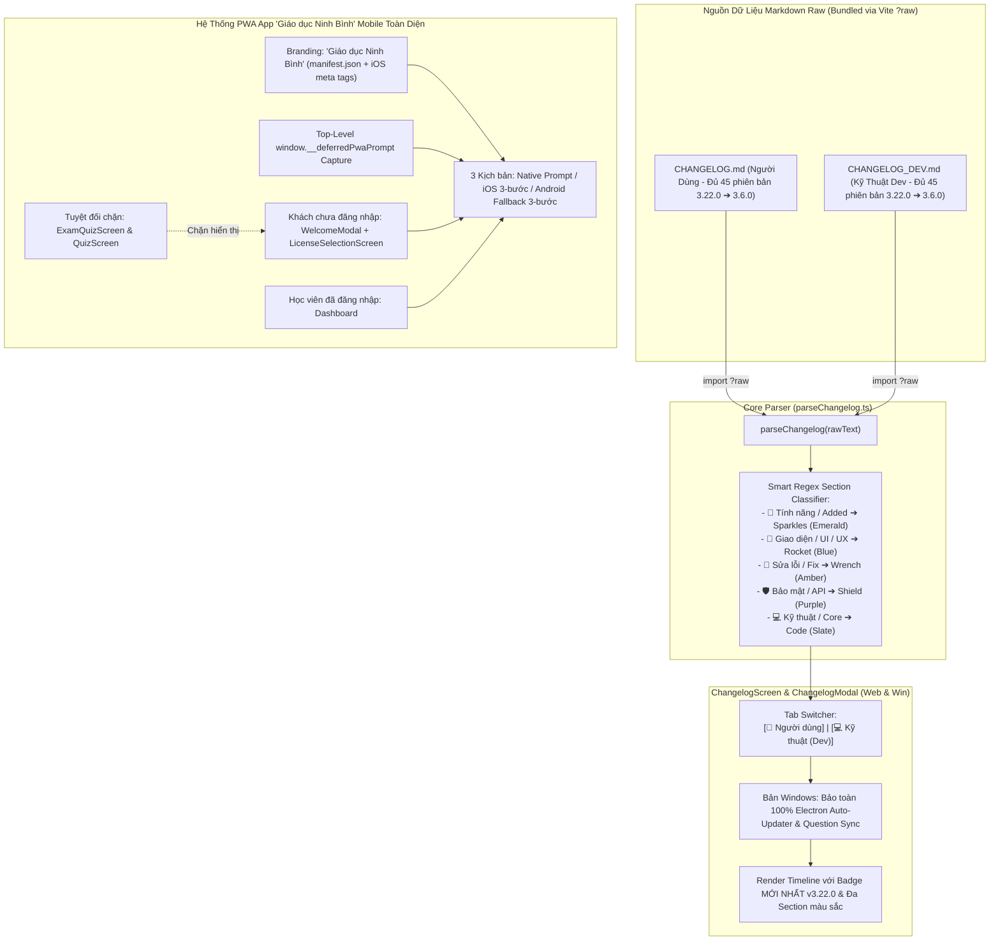

# Kế Hoạch Khôi Phục Parser Markdown Gốc, Hỗ Trợ Changelog Kép, Tối Ưu PWA "Giáo Dục Ninh Bình" Mobile Cho Khách Chưa Đăng Nhập, Khôi Phục 41 Bản Lịch Sử & Nâng Cấp v3.22.0

> **Dự án**: Cổng thông tin & Hệ thống Quản trị Đào tạo Thuyền viên Ninh Bình (TNDNB)  
> **Mã kế hoạch**: `261108-2025-authoritative-changelog-and-recent-plans-sync`  
> **Người lập**: Senior Product Manager & Lead Architect (Đã hiệu chỉnh qua Independent Review)  
> **Ngày cập nhật**: 08/11/2026  
> **Phiên bản mục tiêu**: **v3.22.0**  
> **Trạng thái**: ✅ **Hoàn thành 100% (5/5 Phases) — Sẵn sàng bàn giao Release v3.22.0**

---

## 1. Bối Cảnh & Kết Quả Rà Soát Toàn Diện

Sau khi rà soát chéo toàn bộ mã nguồn thực tế (`ChangelogModal.tsx`, `ChangelogScreen.tsx`, `TopNavbar.tsx`, `githubService.ts`, `manifest.json`, `index.html`, `PwaInstallBanner.tsx`, `WelcomeModal.tsx`, `LicenseSelectionScreen.tsx`) và lịch sử Git, bản kế hoạch được xây dựng hoàn chỉnh với **6 Trụ Cột Kỹ Thuật**:

1. **Trụ Cột #1 — Bổ sung đủ 8 Kế Hoạch đã hoàn thành từ sau `v3.21.0`**:
   - Đưa đầy đủ **cả 8 kế hoạch** gần nhất vào mục `## [3.22.0]` trên cả `CHANGELOG.md` (Người dùng) và `CHANGELOG_DEV.md` (Kỹ thuật).
2. **Trụ Cột #2 — Khôi phục 41 Phiên Bản Lịch Sử (`3.19.0` ➔ `3.6.0`) bị cắt mất trong `CHANGELOG.md`**:
   - Khôi phục trọn vẹn 45 phiên bản lịch sử từ commit `db8b2070` ghép nối chuẩn UTF-8, đồng bộ trên cả root, `ontap-web` và `ontap-win`.
3. **Trụ Cột #3 — Bảo toàn Bộ Tự Động Cập Nhật (Electron Auto-Updater) & Đồng Bộ Gói Đề Thi trên Windows**:
   - Giữ nguyên 100% phần Auto-Updater & Question Sync trong `ontap-win/components/ChangelogModal.tsx`, chỉ bổ sung Tab Switcher đọc markdown `?raw`.
4. **Trụ Cột #4 — Nâng cấp Fallback Version `'3.22.0'` trong `TopNavbar.tsx` (Web & Win)**:
   - Thay thế hardcode `'3.19.2'` bằng `'3.22.0'`, đọc phiên bản động thông qua `parseChangelog`.
5. **Trụ Cột #5 — Hệ Thống Thẻ 6 Màu Đa Section**:
   - Phân chia `## [3.22.0]` thành các đề mục `###` chuẩn để bộ parser hiển thị các thẻ màu Emerald, Blue, Amber, Purple, Slate rực rỡ.
6. **Trụ Cột #6 — Tối ưu Gợi Ý Cài Đặt App PWA Chuẩn Thương Hiệu "Giáo dục Ninh Bình" Cho Cả Khách Chưa Đăng Nhập & Học Viên Trên Mobile**:
   - Đổi tên ứng dụng PWA khi cài ra màn hình chính thành **"Giáo dục Ninh Bình"** trong `manifest.json` và bổ sung meta tags WebKit iOS Safari.
   - Bắt sự kiện `beforeinstallprompt` ở Top-Level Module lưu vào `window.__deferredPwaPrompt` chống thất lạc sự kiện.
   - Hiển thị banner gợi ý cài đặt PWA cho cả khách chưa đăng nhập tại [`WelcomeModal.tsx`](file:///d:/Antigravity/TNDNB/ontap-web/components/WelcomeModal.tsx) và [`LicenseSelectionScreen.tsx`](file:///d:/Antigravity/TNDNB/ontap-web/components/LicenseSelectionScreen.tsx), song song với [`Dashboard.tsx`](file:///d:/Antigravity/TNDNB/ontap-web/components/Dashboard.tsx).
   - Hỗ trợ 3 luồng cài đặt thông minh: Native Chrome prompt, Modal hướng dẫn 3 bước cho iOS Safari, và Modal hướng dẫn 3 bước Android Fallback (cho Zalo/Messenger in-app browser).
   - **Bảo toàn tính tập trung**: Tuyệt đối không hiển thị trong phòng thi [`ExamQuizScreen.tsx`](file:///d:/Antigravity/TNDNB/ontap-web/components/ExamQuizScreen.tsx) và [`QuizScreen.tsx`](file:///d:/Antigravity/TNDNB/ontap-web/components/QuizScreen.tsx).

---

## 2. Kiến Trúc Giải Pháp Toàn Diện

---

## 3. Lộ Trình Triển Khai 5 Phase

| Phase | Tên Giai Đoạn | Tệp Tác Động Chính | Trạng Thái |
|---|---|---|---|
| **Phase 01** | Khôi phục Bộ Parser Markdown Gốc & Hỗ trợ đọc File Raw Kép | `ontap-web/utils/parseChangelog.ts`, `ontap-win/utils/parseChangelog.ts` | ✅ **Hoàn thành** (`c3d806c3`) |
| **Phase 02** | Tích hợp Tab Switcher (Người Dùng vs. Dev) & Bảo toàn Windows Updater | `ChangelogScreen.tsx`, `ChangelogModal.tsx`, `TopNavbar.tsx` (Web & Win) | ✅ **Hoàn thành** (`c03b20ec`) |
| **Phase 03** | Soạn Markdown Kép (Đủ 8 Plans), Khôi phục 41 Bản Lịch Sử & Bump `v3.22.0` | 4 file `package.json`, `CHANGELOG.md` (x3), `CHANGELOG_DEV.md`, `update_changelogs.js` | ✅ **Hoàn thành** (`8ffbd14c`) |
| **Phase 04** | Tối Ưu Gợi Ý Cài Đặt App PWA "Giáo dục Ninh Bình" Cho Khách Chưa Đăng Nhập & Mobile | `manifest.json` (x2), `index.html`, `PwaInstallBanner.tsx`, `WelcomeModal.tsx`, `LicenseSelectionScreen.tsx`, `Dashboard.tsx` | ✅ **Hoàn thành** (`56c01d85`) |
| **Phase 05** | Kiểm thử TDD Tự động (`TC-CP01` ➔ `TC-CP11`) & Nghiệm thu Toàn diện | Toàn bộ 13 test suites, tsc, production builds (Vite & Next.js) | ✅ **Hoàn thành** |

---

## 4. Danh Mục Tài Liệu Kế Hoạch Chi Tiết

- 📘 **Kế hoạch tổng thể chính thức**: [`plan.md`](file:///d:/Antigravity/TNDNB/docs/plans/261108-2025-authoritative-changelog-and-recent-plans-sync/plan.md)
- 📋 **Living Task Checklist (TDD)**: [`task.md`](file:///d:/Antigravity/TNDNB/docs/plans/261108-2025-authoritative-changelog-and-recent-plans-sync/task.md)
- 🎨 **Kiến trúc kỹ thuật & thẩm mỹ (`/design`)**: [`DESIGN.md`](file:///d:/Antigravity/TNDNB/docs/plans/261108-2025-authoritative-changelog-and-recent-plans-sync/DESIGN.md)
- 🖼️ **Đặc tả giao diện từng màn hình (`/visualize`)**: [`design-specs.md`](file:///d:/Antigravity/TNDNB/docs/plans/261108-2025-authoritative-changelog-and-recent-plans-sync/design-specs.md)
- 🛠️ **Chi tiết kỹ thuật Phase 01**: [`phase-01-markdown-parser-and-dual-changelog.md`](file:///d:/Antigravity/TNDNB/docs/plans/261108-2025-authoritative-changelog-and-recent-plans-sync/phase-01-markdown-parser-and-dual-changelog.md)
- 🛠️ **Chi tiết kỹ thuật Phase 02**: [`phase-02-ui-tab-switcher.md`](file:///d:/Antigravity/TNDNB/docs/plans/261108-2025-authoritative-changelog-and-recent-plans-sync/phase-02-ui-tab-switcher.md)
- 🛠️ **Chi tiết kỹ thuật Phase 03**: [`phase-03-markdown-content-and-version-bump.md`](file:///d:/Antigravity/TNDNB/docs/plans/261108-2025-authoritative-changelog-and-recent-plans-sync/phase-03-markdown-content-and-version-bump.md)
- 📱 **Chi tiết kỹ thuật Phase 04**: [`phase-04-global-pwa-install-banner.md`](file:///d:/Antigravity/TNDNB/docs/plans/261108-2025-authoritative-changelog-and-recent-plans-sync/phase-04-global-pwa-install-banner.md)
- 🧪 **Chi tiết kỹ thuật Phase 05**: [`phase-05-verification-and-tests.md`](file:///d:/Antigravity/TNDNB/docs/plans/261108-2025-authoritative-changelog-and-recent-plans-sync/phase-05-verification-and-tests.md)
