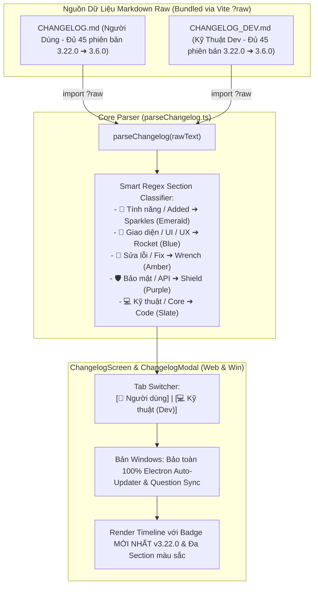

# Kế Hoạch Khôi Phục Parser Markdown Gốc, Hỗ Trợ Changelog Kép (Người Dùng & Dev), Khôi Phục 41 Bản Lịch Sử, Đồng Bộ 8 Kế Hoạch & Nâng Cấp v3.22.0

> **Dự án**: Cổng thông tin & Hệ thống Quản trị Đào tạo Thuyền viên Ninh Bình (TNDNB)  
> **Mã kế hoạch**: `261108-2025-authoritative-changelog-and-recent-plans-sync`  
> **Người lập**: Senior Product Manager & Lead Architect (Đã hiệu chỉnh qua Independent Zero-Trust Review)  
> **Ngày cập nhật**: 08/11/2026  
> **Phiên bản mục tiêu**: **v3.22.0**  
> **Trạng thái**: Đã hoàn tất Review Độc Lập — Sẵn sàng thực thi `[Bước 06] /code`

---

## 1. Bối Cảnh & Kết Quả Kiểm Toán Độc Lập (Independent Zero-Trust Plan Review)

Sau khi rà soát chéo toàn bộ mã nguồn thực tế (`ChangelogModal.tsx`, `ChangelogScreen.tsx`, `TopNavbar.tsx`, `githubService.ts`) và lịch sử Git (`git log -p CHANGELOG.md`, `git show db8b2070:CHANGELOG.md`), bản kế hoạch đã được nâng cấp để **xử lý triệt để 5 Điểm Mù Kỹ Thuật (Critical Blind Spots)**:

1. **Điểm Mù #1 — Bổ sung đủ 8 Kế Hoạch đã hoàn thành từ sau `v3.21.0` (thay vì chỉ 4 kế hoạch)**:
   - Bản kế hoạch trước chỉ liệt kê 4 plan ngày 07–08/11 mà bỏ sót 4 plan lớn ngày 05–07/11 (`261105-1408-portal-login-dashboard-restore`, `261105-1836-ontap-web-ui-overhaul`, `261106-1705-fix-console-errors-and-tinymce-license`, `261107-0025-fix-settings-save-and-private-repo-errors`).
   - **Giải pháp**: Đưa đầy đủ **cả 8 kế hoạch** vào mục `## [3.22.0]` trên cả `CHANGELOG.md` (góc nhìn Người dùng) và `CHANGELOG_DEV.md` (góc nhìn Kỹ thuật).
2. **Điểm Mù #2 — Khôi phục 41 Phiên Bản Lịch Sử (`3.19.0` ➔ `3.6.0`) bị cắt mất trong `CHANGELOG.md`**:
   - Hiện tại `CHANGELOG.md` chỉ còn đúng 25 dòng (4 phiên bản `3.21.0`, `3.19.3`, `3.19.2`, `3.19.1`), trong khi `CHANGELOG_DEV.md` có tới 371 dòng (từ `3.21.0` về `3.6.0`). Nguyên nhân là commit `0c7116f3` khi sửa lỗi font đã vô tình cắt cụt 41 phiên bản lịch sử của người dùng.
   - **Giải pháp**: Trích xuất nguyên vẹn lịch sử chuẩn UTF-8 từ commit `db8b2070:CHANGELOG.md` (`3.17.0` ➔ `3.6.0`) cộng với `3.19.0`..`3.18.0`, ghép nối dưới `3.19.1` để khôi phục trọn vẹn **45 phiên bản lịch sử** cho tab `[👤 Người dùng]`.
3. **Điểm Mù #3 — Bảo toàn Bộ Tự Động Cập Nhật (Electron Auto-Updater) & Đồng Bộ Gói Đề Thi trên Windows (`ontap-win/components/ChangelogModal.tsx`)**:
   - Khác với bản Web (170 dòng), file `ontap-win/components/ChangelogModal.tsx` (363 dòng) chứa toàn bộ logic tải bản cập nhật `.exe` (`window.electron.downloadUpdate`, `installUpdate`, `onUpdateProgress`) và nút **"🔄 Cập nhật Gói Đề Thi"** (`shouldUpdateQuestions`, `fetchAndSaveQuestions`) từ dòng 16 đến 287.
   - **Giải pháp**: Tuyệt đối không ghi đè file Modal của bản Web sang bản Windows. Giữ nguyên 100% phần Auto-Updater & Question Sync (dòng 16–287) của `ontap-win/components/ChangelogModal.tsx`, chỉ nâng cấp phần hiển thị nội dung Changelog bên dưới (dòng 289–338) để gắn Tab Switcher và đọc `?raw` Markdown.
4. **Điểm Mù #4 — Xử lý Hardcode `'3.19.2'` trong `TopNavbar.tsx` (Web & Win)**:
   - Cả `ontap-web/components/TopNavbar.tsx` và `ontap-win/components/TopNavbar.tsx` đều đang gọi `getLatestVersion().then(...)` kèm giá trị fallback cứng `'3.19.2'`.
   - **Giải pháp**: Giữ nguyên chữ ký `async getLatestVersion(): Promise<string>` trong `githubService.ts` nhưng đọc trực tiếp từ `parseChangelog(changelogUserRaw)[0]?.version || '3.22.0'`, đồng thời nâng fallback trong cả 2 file `TopNavbar.tsx` lên `'3.22.0'`.
5. **Điểm Mù #5 — Chia Đa Section `###` trong mục `## [3.22.0]` để kích hoạt Hệ Thống Thẻ 6 Màu**:
   - Bản thảo Phase 03 cũ gom toàn bộ các dòng vào chung 1 tiêu đề `###` duy nhất, khiến bộ parser chỉ vẽ ra 1 khung màu đơn điệu.
   - **Giải pháp**: Tách mục `## [3.22.0]` thành các tiêu đề con chuẩn (`### 🌟 Tính năng mới`, `### 🚀 Giao diện & Trải nghiệm`, `### 🔧 Sửa lỗi & Ổn định hệ thống`, `### 💻 Kiến trúc & Core Engine`, `### 🛡️ Bảo mật, API & Persistence`) để giao diện hiển thị đầy đủ các thẻ màu Emerald, Blue, Amber, Purple, Slate rực rỡ.

---

## 2. Kiến Trúc Giải Pháp: Markdown Raw Parser & Dual Tab Switcher

---

## 3. Lộ Trình Triển Khai 4 Phase

| Phase | Tên Giai Đoạn | Tệp Tác Động Chính | Trạng Thái |
|---|---|---|---|
| **Phase 01** | Khôi phục Bộ Parser Markdown Gốc & Hỗ trợ đọc File Raw Kép | `ontap-web/utils/parseChangelog.ts`, `ontap-win/utils/parseChangelog.ts` | ✅ **Hoàn thành** (`c3d806c3`) |
| **Phase 02** | Tích hợp Tab Switcher (Người Dùng vs. Dev) & Bảo toàn Windows Updater | `ChangelogScreen.tsx`, `ChangelogModal.tsx`, `TopNavbar.tsx` (Web & Win) | ✅ **Hoàn thành** (`c03b20ec`) |
| **Phase 03** | Soạn Markdown Kép (Đủ 8 Plans), Khôi phục 41 Bản Lịch Sử & Bump `v3.22.0` | 4 file `package.json`, `CHANGELOG.md` (x3), `CHANGELOG_DEV.md`, `update_changelogs.js` | ✅ **Hoàn thành** |
| **Phase 04** | Kiểm thử TDD Tự động (`TC-CP01` ➔ `TC-CP07`) & Nghiệm thu Toàn diện | `scripts/version-sync.test.ts`, `scripts/changelog-parser.test.ts` | ⏳ Sẵn sàng |

---

## 4. Danh Mục Tài Liệu Kế Hoạch Chi Tiết

- 📘 **Kế hoạch tổng thể chính thức**: [`plan.md`](file:///d:/Antigravity/TNDNB/docs/plans/261108-2025-authoritative-changelog-and-recent-plans-sync/plan.md)
- 📋 **Living Task Checklist (TDD)**: [`task.md`](file:///d:/Antigravity/TNDNB/docs/plans/261108-2025-authoritative-changelog-and-recent-plans-sync/task.md)
- 🎨 **Kiến trúc kỹ thuật & thẩm mỹ (`/design`)**: [`DESIGN.md`](file:///d:/Antigravity/TNDNB/docs/plans/261108-2025-authoritative-changelog-and-recent-plans-sync/DESIGN.md)
- 🖼️ **Đặc tả giao diện từng màn hình (`/visualize`)**: [`design-specs.md`](file:///d:/Antigravity/TNDNB/docs/plans/261108-2025-authoritative-changelog-and-recent-plans-sync/design-specs.md)
- 🛠️ **Chi tiết kỹ thuật Phase 01**: [`phase-01-markdown-parser-and-dual-changelog.md`](file:///d:/Antigravity/TNDNB/docs/plans/261108-2025-authoritative-changelog-and-recent-plans-sync/phase-01-markdown-parser-and-dual-changelog.md)
- 🛠️ **Chi tiết kỹ thuật Phase 02**: [`phase-02-ui-tab-switcher.md`](file:///d:/Antigravity/TNDNB/docs/plans/261108-2025-authoritative-changelog-and-recent-plans-sync/phase-02-ui-tab-switcher.md)
- 🛠️ **Chi tiết kỹ thuật Phase 03**: [`phase-03-markdown-content-and-version-bump.md`](file:///d:/Antigravity/TNDNB/docs/plans/261108-2025-authoritative-changelog-and-recent-plans-sync/phase-03-markdown-content-and-version-bump.md)
- 🧪 **Chi tiết kỹ thuật Phase 04**: [`phase-04-verification-and-tests.md`](file:///d:/Antigravity/TNDNB/docs/plans/261108-2025-authoritative-changelog-and-recent-plans-sync/phase-04-verification-and-tests.md)
