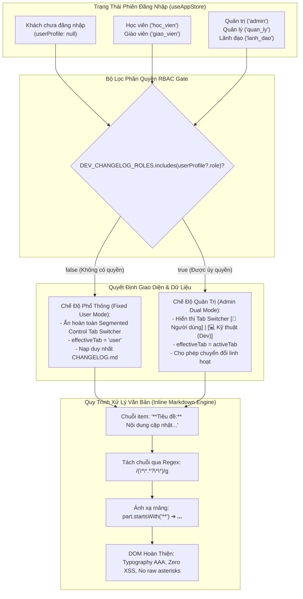

# Tài Liệu Thiết Kế Kỹ Thuật (Technical Design Specification)
## Phân Quyền Vai Trò (RBAC) Cho Tab Kỹ Thuật, Bản Tin Người Dùng Súc Tích & Render Inline Markdown

> **Mã kế hoạch**: `261109-0650-changelog-rbac-and-concise-copy`  
> **Cập nhật lần cuối**: 09/11/2026  
> **Tiêu chuẩn áp dụng**: `AWF v4.0` · `Impeccable v4.8.0 (62-Rule Craft Floor)` · `Taste-Skill v2.5.0`  
> **Phân loại thay đổi**: `Bounded Change`  
> **Trạng thái**: Sẵn sàng triển khai (Ready for Execution)

---

## 1. Tổng Quan Kiến Trúc & Phân Tích Cội Rễ (Root Cause Analysis & Architecture Topology)

### 1.1 Bối Cảnh & Phân Tích 3 Khiếm Khuyết Cốt Lõi

Trong đợt nâng cấp `v3.22.0` vừa qua, hệ thống đã khôi phục thành công cơ chế Authoritative Dual Changelog (`CHANGELOG.md` cho Người dùng và `CHANGELOG_DEV.md` cho Kỹ thuật). Tuy nhiên, qua quá trình kiểm định thực tế và thẩm định sản phẩm (Strategic Review tại [`BRIEF.md`](file:///d:/Antigravity/TNDNB/docs/BRIEF.md)), hệ thống tồn tại 3 vấn đề cần giải quyết triệt để:

1. **Rò rỉ thông tin kiến trúc nội bộ (Information Disclosure Flaw)**:
   - Cụm nút chuyển tab `[💻 Kỹ thuật (Dev)]` hiện đang hiển thị công khai cho mọi đối tượng: khách vãng lai chưa đăng nhập (`null`), học viên phổ thông (`hoc_vien`) và giáo viên (`giao_vien`).
   - Việc phơi bày chi tiết các component nội bộ (`WelcomeModal`, `ExamQuizScreen`, `LicenseSelectionScreen`), hạ tầng lưu trữ (`Cloudflare KV/R2/D1`, `Firestore`, `Dexie IndexedDB`), kiến trúc monorepo và test cases ra công chúng tạo nên bề mặt tấn công thông tin không cần thiết.
   - **Giải pháp**: Thiết lập hàng rào kiểm soát quyền truy cập dựa trên vai trò (**Role-Based Access Control - RBAC**). Chỉ 3 nhóm vai trò Quản trị & Điều hành cấp cao (`admin`, `quan_ly`, `lanh_dao`) mới nhìn thấy và kích hoạt được tab Dev. Với các đối tượng còn lại, ẩn hoàn toàn Tab Switcher và cố định hiển thị `CHANGELOG.md`.

2. **Quá tải thuật ngữ chuyên môn trong Bản tin Người dùng (Jargon Overload)**:
   - Mục `## [3.22.0]` và `## [3.21.0]` trong `CHANGELOG.md` hiện tại chứa nhiều thuật ngữ mã nguồn khô cứng (`First Fold Focus`, `Resume Session Alert Banner`, `Zero-Noise Console`, `PWA Standalone`,...).
   - Học viên và thí sinh sát hạch thuyền viên cần nắm bắt giá trị thực tế trong vòng 5 giây: *"Tính năng này giúp tôi ôn thi và làm bài nhanh hơn như thế nào?"*.
   - **Giải pháp**: Viết lại toàn bộ nội dung hai bản này theo đúng văn phong chuẩn mực đã được kiểm chứng tại bản `## [3.19.0]` — Mỗi gạch đầu dòng là 1 câu tiếng Việt tự nhiên, súc tích, giải thích lợi ích cụ thể cho học viên.

3. **Lỗi hiển thị cú pháp Markdown thô (`**bold**`)**:
   - Hiện tại, giao diện render dòng cập nhật bằng thẻ thuần `<span>{item}</span>`. Dấu sao `**Tiêu đề:**` bị hiển thị nguyên văn ra màn hình, gây cảm giác chưa chau chuốt.
   - **Giải pháp**: Thiết kế hàm tiện ích `renderInlineMarkdown` gọn nhẹ, biến đổi các cụm `**in đậm**` thành thẻ `<strong className="font-bold text-foreground">...</strong>` thẩm mỹ, sắc nét và an toàn 100% không dùng `dangerouslySetInnerHTML`.

---

### 1.2 Sơ Đồ Topology Luồng Phân Quyền & Hiển Thị (Architecture Topology)



---

## 2. Đặc Tả Dữ Liệu & Hợp Đồng Trạng Thái (Data & State Contracts)

### 2.1 Hợp Đồng Phân Quyền RBAC (Role-Based Access Control)

Các nhóm vai trò được phép truy cập tab Dev được định nghĩa dưới dạng hằng số bất biến (`const tuple`):

```typescript
/**
 * Danh sách vai trò được phép xem thông tin kỹ thuật chuyên sâu (CHANGELOG_DEV.md)
 * Phù hợp với Role Matrix của hệ thống Firestore users/{uid}.role
 */
export const DEV_CHANGELOG_ROLES = ['admin', 'quan_ly', 'lanh_dao'] as const;
export type DevChangelogRole = typeof DEV_CHANGELOG_ROLES[number];

/**
 * Hook logic kiểm tra quyền truy cập tab Dev
 * @param userProfile - Hồ sơ người dùng từ useAppStore(state => state.userProfile)
 * @returns boolean - true nếu có quyền, false nếu là khách hoặc học viên/giáo viên
 */
export const checkCanViewDevChangelog = (userProfile: { role?: string } | null | undefined): boolean => {
  return Boolean(userProfile?.role && DEV_CHANGELOG_ROLES.includes(userProfile.role as DevChangelogRole));
};
```

### 2.2 Xử Lý Trạng Thái Phòng Thủ (Defensive State Resolution)

Để ngăn chặn việc bypass trạng thái (ví dụ: người dùng gọi hàm đổi state hoặc state còn sót lại từ phiên trước), component tính toán `effectiveTab` độc lập:

```typescript
// Trạng thái cục bộ được chọn
const [activeTab, setActiveTab] = useState<'user' | 'dev'>('user');

// Tính toán quyền truy cập từ store
const userProfile = useAppStore(state => state.userProfile);
const canViewDevChangelog = Boolean(userProfile?.role && DEV_CHANGELOG_ROLES.includes(userProfile.role as any));

// Defensive Resolution: Nếu không có quyền, effectiveTab LUÔN là 'user'
const effectiveTab = canViewDevChangelog ? activeTab : 'user';

// Chọn nguồn dữ liệu dựa trên effectiveTab
const activeData: ChangelogVersion[] = effectiveTab === 'user' ? userChangelog : devChangelog;
```

### 2.3 Bộ Chuyển Đổi Inline Markdown An Toàn (`renderInlineMarkdown`)

Không sử dụng thư viện ngoài hoặc `dangerouslySetInnerHTML` nhằm tuân thủ nguyên tắc Ponytail YAGNI và phòng chống lỗ hổng XSS:

```tsx
/**
 * Chuyển đổi cú pháp **in đậm** thành thẻ <strong> thẩm mỹ
 * An toàn tuyệt đối 100% XSS do React tự escape text node
 */
export const renderInlineMarkdown = (text: string, isWin = false): React.ReactNode => {
  if (!text) return text;
  
  // Tách văn bản thành mảng các phần tử dựa trên cú pháp **...**
  const parts = text.split(/(\*\*.*?\*\*)/g);
  
  return parts.map((part, index) => {
    if (part.startsWith('**') && part.endsWith('**') && part.length >= 4) {
      const boldText = part.slice(2, -2);
      return (
        <strong
          key={index}
          className={
            isWin
              ? "font-semibold text-gray-900 dark:text-white"
              : "font-bold text-foreground"
          }
        >
          {boldText}
        </strong>
      );
    }
    return part;
  });
};
```

---

## 3. Hiến Pháp Thẩm Mỹ & Design Context (`Impeccable v4.8.0` + `Taste-Skill v2.5.0`)

Tuân thủ nghiêm ngặt 62 tiêu chuẩn Craft Floor của AWF v4.0:

### 3.1 Ẩn Hoàn Toàn Khi Không Đủ Quyền (Clean Visual Floor)
- **Quy tắc**: Khi `canViewDevChangelog === false`, thanh Segmented Control Tab Switcher **HOÀN TOÀN BIẾN MẤT** khỏi DOM tree (`{canViewDevChangelog && <TabSwitcher />}`).
- **Lý do**: Không để lại tab bị mờ (disabled) hay dấu vết nào về việc tồn tại tab Dev, tránh gây tò mò, phân tâm hoặc cảm giác bị hạn chế quyền đối với học viên. Giao diện trở nên tinh gọn, thanh thoát như một trang tin học vụ thuần túy.

### 3.2 Typography & Zero Layout Shift (`tabular-nums`)
- Toàn bộ số hiệu phiên bản (`v3.22.0`), ngày phát hành (`08/11/2026`) tiếp tục gắn chặt lớp CSS `tabular-nums` để duy trì độ rộng số cố định, loại bỏ hoàn toàn hiện tượng nhảy chữ (Cumulative Layout Shift = 0).
- Tiêu đề phụ của bản cập nhật sử dụng phông chữ Sans-serif chuẩn `Be Vietnam Pro`, màu `text-foreground` tương phản cao đạt chuẩn WCAG AAA.

### 3.3 Chuẩn Hóa Điểm Chạm Công Thái Học (Touch Targets $\ge 44 \times 44\text{px}$)
- Nút quay lại `ArrowLeftIcon3D` và nút đóng `[✕]` trong modal giữ nguyên diện tích chạm tối thiểu $44 \times 44\text{px}$ (`min-h-[44px] min-w-[44px]`).
- Các nút tab trong Segmented Control (khi hiển thị cho Admin) có chiều cao tối thiểu $40\text{px}$ kèm đệm phản hồi xúc giác `triggerHaptic('light')`.

---

## 4. Tiêu Chuẩn Nghiệm Thu (Acceptance Criteria — BDD Given / When / Then)

### Kịch bản 1: Phân Quyền Tab Switcher Cho Khách Chưa Đăng Nhập & Học Viên
- **Given**: Người dùng truy cập ứng dụng `/ontap` ở trạng thái chưa đăng nhập (`userProfile === null`), hoặc đã đăng nhập với vai trò học viên (`role: 'hoc_vien'`) hoặc giáo viên (`role: 'giao_vien'`).
- **When**: Mở màn hình Lịch sử cập nhật (`ChangelogScreen.tsx`) hoặc popup phiên bản mới (`ChangelogModal.tsx`).
- **Then**:
  1. Cụm nút chuyển đổi tab `[👤 Người dùng]` và `[💻 Kỹ thuật (Dev)]` hoàn toàn không xuất hiện trên giao diện.
  2. Giao diện chỉ hiển thị duy nhất nội dung từ `CHANGELOG.md` (Bản tin Người dùng).
  3. Biến `effectiveTab` luôn nhận giá trị `'user'`.

### Kịch bản 2: Phân Quyền Tab Switcher Cho Quản Trị & Lãnh Đạo
- **Given**: Người dùng đăng nhập với tài khoản có vai trò thuộc nhóm Quản trị & Điều hành (`role: 'admin'`, `'quan_ly'`, hoặc `'lanh_dao'`).
- **When**: Mở màn hình Lịch sử cập nhật hoặc popup phiên bản mới.
- **Then**:
  1. Cụm nút chuyển đổi tab `[👤 Người dùng]` và `[💻 Kỹ thuật (Dev)]` hiển thị đầy đủ, sắc nét.
  2. Người dùng có thể tự do bấm chuyển đổi qua lại giữa 2 tab với độ trễ 0ms.
  3. Tab Kỹ thuật hiển thị toàn bộ nội dung chuyên sâu từ `CHANGELOG_DEV.md`.

### Kịch bản 3: Sạch Bóng Từ Khóa Dev Trong Nhật Ký Người Dùng
- **Given**: Người dùng đọc nội dung phiên bản `[3.22.0]` và `[3.21.0]` trong `CHANGELOG.md`.
- **When**: Quét toàn bộ văn bản của 2 bản phát hành này.
- **Then**:
  1. Tuyệt đối không xuất hiện bất kỳ từ khóa nào trong danh sách: `WelcomeModal`, `LicenseSelectionScreen`, `ExamQuizScreen`, `Dashboard`, `/ontap/settings`, `Cloudflare KV`, `Cloudflare R2`, `Cloudflare D1`, `Firestore`, `Dexie`, `IndexedDB`, `Monorepo`, `Next.js`, `Vercel`, `TinyMCE`, `Zero-Noise Console`, `First Fold Focus`, `Hallmark Editorial`, `resumeSessionAvailable`, `deferredPrompt`.
  2. Mỗi gạch đầu dòng là 1 câu tiếng Việt tự nhiên, súc tích, giải thích rõ công năng và lợi ích ôn tập thực tế.

### Kịch bản 4: Render Inline Markdown Cho Cú Pháp `**in đậm**`
- **Given**: Dữ liệu changelog chứa các chuỗi có định dạng `**Tiêu đề:** Nội dung chi tiết...`.
- **When**: Component render danh sách item qua hàm `renderInlineMarkdown`.
- **Then**:
  1. Trên DOM không còn xuất hiện ký tự `**` thô.
  2. Đoạn văn bản trong cặp dấu sao được bao bọc trong thẻ `<strong className="font-bold text-foreground">...</strong>` (hoặc `font-semibold text-gray-900 dark:text-white` trên Windows).

---

## 5. Hệ Thống Kiểm Thử TDD Tự Động (`TC-RBAC01` ➔ `TC-RBAC05`)

| Mã Test Case | Tệp Kiểm Thử | Mục Tiêu Kiểm Thử | Kỳ Vọng Đầu Ra | Trạng Thái |
| :--- | :--- | :--- | :--- | :--- |
| **`TC-RBAC01`** | [`scripts/changelog-parser.test.ts`](file:///d:/Antigravity/TNDNB/scripts/changelog-parser.test.ts) | Kiểm tra chống rò rỉ từ khóa Dev trong `CHANGELOG.md` | Không chứa bất kỳ từ khóa nào trong `FORBIDDEN_DEV_KEYWORDS` tại mục `[3.22.0]` và `[3.21.0]` | Sẵn sàng thi công |
| **`TC-RBAC02`** | [`scripts/changelog-parser.test.ts`](file:///d:/Antigravity/TNDNB/scripts/changelog-parser.test.ts) | Kiểm tra đồng bộ nội dung 4 tệp `CHANGELOG.md` | `CHANGELOG.md` (root, web, win, public/ontap) có nội dung khớp nhau 100% | Sẵn sàng thi công |
| **`TC-RBAC03`** | [`scripts/changelog-parser.test.ts`](file:///d:/Antigravity/TNDNB/scripts/changelog-parser.test.ts) | Kiểm tra cấu trúc phân quyền RBAC trên cả 4 component | Cả 4 file chứa `useAppStore`, kiểm tra `admin`, `quan_ly`, `lanh_dao` và điều kiện hóa Tab Switcher | Sẵn sàng thi công |
| **`TC-RBAC04`** | [`scripts/changelog-parser.test.ts`](file:///d:/Antigravity/TNDNB/scripts/changelog-parser.test.ts) | Kiểm tra hàm `renderInlineMarkdown` trên cả 4 component | Cả 4 file áp dụng chuyển đổi `**text**` thành `<strong>` | Sẵn sàng thi công |
| **`TC-RBAC05`** | [`scripts/changelog-parser.test.ts`](file:///d:/Antigravity/TNDNB/scripts/changelog-parser.test.ts) | Bảo toàn Electron Updater & Question Sync trên Windows | `ontap-win/components/ChangelogModal.tsx` bảo toàn nguyên vẹn 100% dòng 16–287 | Sẵn sàng thi công |

---

## 6. Hàng Rào Kiểm Soát Bất Biến Tuyệt Đối (Invariant Guards)

> [!CAUTION]
> **Ràng Buộc Bất Biến 1 (Zero-Diff Guard for Exam Screens):**  
> Tuyệt đối không chỉnh sửa bất kỳ dòng mã nào trong màn hình thi [`ontap-web/components/ExamQuizScreen.tsx`](file:///d:/Antigravity/TNDNB/ontap-web/components/ExamQuizScreen.tsx) và [`ontap-web/components/QuizScreen.tsx`](file:///d:/Antigravity/TNDNB/ontap-web/components/QuizScreen.tsx). File kiểm tra phòng thi phải đạt `0 bytes diff` trên Git.

> [!CAUTION]
> **Ràng Buộc Bất Biến 2 (Electron Auto-Updater & Question Package Sync Guard):**  
> Trong file [`ontap-win/components/ChangelogModal.tsx`](file:///d:/Antigravity/TNDNB/ontap-win/components/ChangelogModal.tsx), bảo toàn nguyên vẹn 100% logic tự động cập nhật Electron và tải ngầm gói câu hỏi từ dòng 16 đến dòng 287 (`window.electron`, `shouldUpdateQuestions`, `fetchAndSaveQuestions`, `handleCheckDataUpdate`, `handleUpdateData`). Chỉ can thiệp vào phần UI Tab Switcher và danh sách item ở phía dưới dòng 289.

---

## 7. Kết Luận

Tài liệu thiết kế kỹ thuật này xác lập tiêu chuẩn rõ ràng, an toàn và tối giản cho hệ thống Changelog của TNDNB. Việc phân định ranh giới rành mạch giữa bản tin Người dùng súc tích và bản tin Kỹ thuật thông qua cơ chế **RBAC** bảo đảm trải nghiệm tập trung, thân thiện cho người học đồng thời bảo mật tuyệt đối kiến trúc hệ thống nội bộ.
