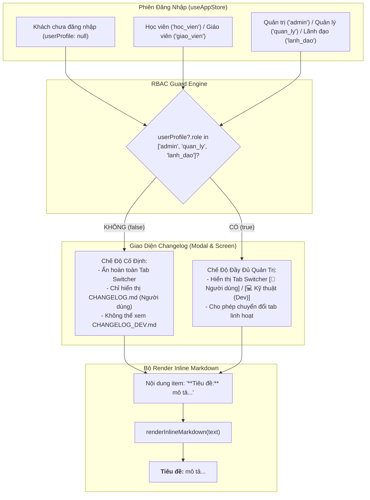

# Kế Hoạch Phân Quyền Vai Trò (RBAC) Cho Tab Kỹ Thuật, Chuẩn Hóa Bản Tin Người Dùng Súc Tích & Render Inline Markdown

> **Dự án**: Cổng thông tin & Hệ thống Quản trị Đào tạo Thuyền viên Ninh Bình (TNDNB)  
> **Mã kế hoạch**: `261109-0650-changelog-rbac-and-concise-copy`  
> **Người lập**: Senior Product Manager & System Architect  
> **Ngày phê duyệt**: 09/11/2026  
> **Phân loại**: `Bounded Change` (Thay đổi cục bộ có phạm vi kiểm soát chặt chẽ)  
> **Trạng thái**: Đã sẵn sàng thực thi `[Bước 06] /code`

---

## 1. Tổng Quan Kế Hoạch & Đánh Giá Sản Phẩm (PRD Overview)

Dựa trên kết quả đánh giá chiến lược tại [`BRIEF.md`](file:///d:/Antigravity/TNDNB/docs/BRIEF.md) và thiết kế kỹ thuật tại [`2026-11-09-changelog-rbac-and-concise-copy-design.md`](file:///d:/Antigravity/TNDNB/docs/superpowers/specs/2026-11-09-changelog-rbac-and-concise-copy-design.md), kế hoạch này tập trung xử lý dứt điểm **3 Vấn Đề Cốt Lõi**:

1. **Khắc phục lỗi rò rỉ thông tin kiến trúc nội bộ (Information Disclosure Flaw)**:
   - Hiện nay, thanh chuyển đổi tab `[💻 Kỹ thuật (Dev)]` đang hiển thị công khai cho mọi người dùng, kể cả khách chưa đăng nhập (`null`), học viên phổ thông (`hoc_vien`) và giáo viên (`giao_vien`).
   - Việc hiển thị chi tiết tên component, hạ tầng lưu trữ (`Cloudflare KV/R2/D1`, `Firestore`, `Dexie IndexedDB`, `Monorepo`,...) ra ngoài là một sai sót về mặt bảo mật và quản trị sản phẩm.
   - **Giải pháp**: Ứng dụng mô hình phân quyền dựa trên vai trò (**RBAC**), chỉ hiển thị Tab Switcher cho 3 nhóm vai trò Quản trị & Điều hành cấp cao: `'admin'`, `'quan_ly'`, `'lanh_dao'`.
2. **Loại bỏ 100% thuật ngữ Dev trong Nhật ký Người dùng (Jargon Overload)**:
   - Bản cập nhật `[3.22.0]` và `[3.21.0]` trong `CHANGELOG.md` hiện đang dùng ngôn ngữ kỹ thuật khô cứng, khó hiểu đối với học viên.
   - **Giải pháp**: Viết lại toàn bộ nội dung của hai bản này theo đúng phong cách súc tích, thực tế của bản `[3.19.0]` — Mỗi ý là 1 câu tiếng Việt tự nhiên, giải thích rõ ràng tính năng mới giúp ích gì cho việc ôn luyện và thi sát hạch.
3. **Xử lý triệt để lỗi hiển thị cú pháp Markdown thô (`**bold**`)**:
   - Hiện tại dấu sao `**Tiêu đề:**` bị hiển thị nguyên văn ra màn hình do thiếu bộ lọc inline markdown.
   - **Giải pháp**: Xây dựng hàm `renderInlineMarkdown` gọn nhẹ chuyển đổi cú pháp `**in đậm**` thành thẻ `<strong>` thẩm mỹ, sắc nét.

---

## 2. Các Ràng Buộc Bất Biến Tuyệt Đối (Invariants)

> [!CAUTION]
> **Ràng Buộc Bất Biến 1 (Zero-Diff Guard for Exam Screens):**  
> Tuyệt đối không chỉnh sửa bất kỳ dòng mã nào trong màn hình thi [`ontap-web/components/ExamQuizScreen.tsx`](file:///d:/Antigravity/TNDNB/ontap-web/components/ExamQuizScreen.tsx) và [`ontap-web/components/QuizScreen.tsx`](file:///d:/Antigravity/TNDNB/ontap-web/components/QuizScreen.tsx). File kiểm tra phòng thi phải đạt `0 bytes diff` trên Git.

> [!CAUTION]
> **Ràng Buộc Bất Biến 2 (Electron Auto-Updater & Question Package Sync Guard):**  
> Trong file [`ontap-win/components/ChangelogModal.tsx`](file:///d:/Antigravity/TNDNB/ontap-win/components/ChangelogModal.tsx), bảo toàn nguyên vẹn 100% logic tự động cập nhật Electron và tải ngầm gói câu hỏi từ dòng 16 đến dòng 287 (`window.electron`, `shouldUpdateQuestions`, `fetchAndSaveQuestions`, `handleCheckDataUpdate`, `handleUpdateData`). Chỉ can thiệp vào phần UI Tab Switcher và danh sách item ở phía dưới dòng 289.

---

## 3. Kiến Trúc Giải Pháp & Luồng Phân Quyền (RBAC Architecture)

---

## 4. Lộ Trình Triển Khai 3 Phase Chi Tiết

| Phase | Tên Giai Đoạn | Tệp Tin Tác Động Chính | Trạng Thái |
|---|---|---|---|
| **Phase 01** | Chuẩn hóa Nội dung Người dùng Súc tích & Render Inline Markdown Đẹp mắt | [`CHANGELOG.md`](file:///d:/Antigravity/TNDNB/CHANGELOG.md), [`ontap-web/CHANGELOG.md`](file:///d:/Antigravity/TNDNB/ontap-web/CHANGELOG.md), [`ontap-win/CHANGELOG.md`](file:///d:/Antigravity/TNDNB/ontap-win/CHANGELOG.md), [`public/ontap/CHANGELOG.md`](file:///d:/Antigravity/TNDNB/public/ontap/CHANGELOG.md), `update_changelogs.js`, [`ChangelogModal.tsx`](file:///d:/Antigravity/TNDNB/ontap-web/components/ChangelogModal.tsx), [`ChangelogScreen.tsx`](file:///d:/Antigravity/TNDNB/ontap-web/components/ChangelogScreen.tsx) (Web & Win) | ✅ Hoàn thành (`da9ff6d7`) |
| **Phase 02** | Phân quyền Vai trò (RBAC) Cho Tab Kỹ thuật (Dev) | [`ChangelogModal.tsx`](file:///d:/Antigravity/TNDNB/ontap-web/components/ChangelogModal.tsx), [`ChangelogScreen.tsx`](file:///d:/Antigravity/TNDNB/ontap-web/components/ChangelogScreen.tsx), [`ChangelogModal.tsx`](file:///d:/Antigravity/TNDNB/ontap-win/components/ChangelogModal.tsx), [`ChangelogScreen.tsx`](file:///d:/Antigravity/TNDNB/ontap-win/components/ChangelogScreen.tsx) | ✅ Hoàn thành (`b961ae6c`) |
| **Phase 03** | Kiểm thử TDD Tự động, Đảm bảo Invariants & Đóng gói Nghiệm thu | [`scripts/changelog-parser.test.ts`](file:///d:/Antigravity/TNDNB/scripts/changelog-parser.test.ts), [`scripts/version-sync.test.ts`](file:///d:/Antigravity/TNDNB/scripts/version-sync.test.ts) | ✅ Hoàn thành |

---

## 5. Danh Mục Tài Liệu Kế Hoạch Chi Tiết

- 📘 **Kế hoạch tổng thể chính thức**: [`plan.md`](file:///d:/Antigravity/TNDNB/docs/plans/261109-0650-changelog-rbac-and-concise-copy/plan.md)
- 📋 **Living Task Checklist (TDD)**: [`task.md`](file:///d:/Antigravity/TNDNB/docs/plans/261109-0650-changelog-rbac-and-concise-copy/task.md)
- 📝 **Đặc tả kỹ thuật Phase 01**: [`phase-01-concise-user-changelog-and-inline-markdown.md`](file:///d:/Antigravity/TNDNB/docs/plans/261109-0650-changelog-rbac-and-concise-copy/phase-01-concise-user-changelog-and-inline-markdown.md)
- 🔒 **Đặc tả kỹ thuật Phase 02**: [`phase-02-rbac-dev-tab-visibility.md`](file:///d:/Antigravity/TNDNB/docs/plans/261109-0650-changelog-rbac-and-concise-copy/phase-02-rbac-dev-tab-visibility.md)
- 🧪 **Đặc tả kỹ thuật Phase 03**: [`phase-03-tdd-tests-and-build-verification.md`](file:///d:/Antigravity/TNDNB/docs/plans/261109-0650-changelog-rbac-and-concise-copy/phase-03-tdd-tests-and-build-verification.md)
- 📑 **Tài liệu nguồn BRIEF**: [`BRIEF.md`](file:///d:/Antigravity/TNDNB/docs/BRIEF.md)
- 📐 **Tài liệu Thiết kế kỹ thuật**: [`2026-11-09-changelog-rbac-and-concise-copy-design.md`](file:///d:/Antigravity/TNDNB/docs/superpowers/specs/2026-11-09-changelog-rbac-and-concise-copy-design.md)
