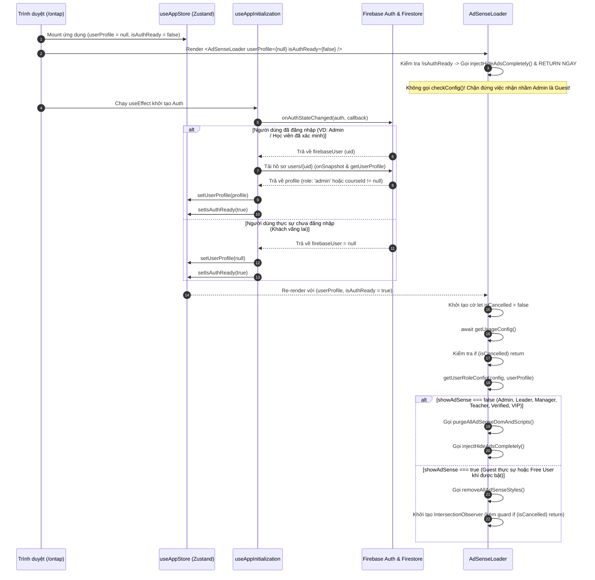
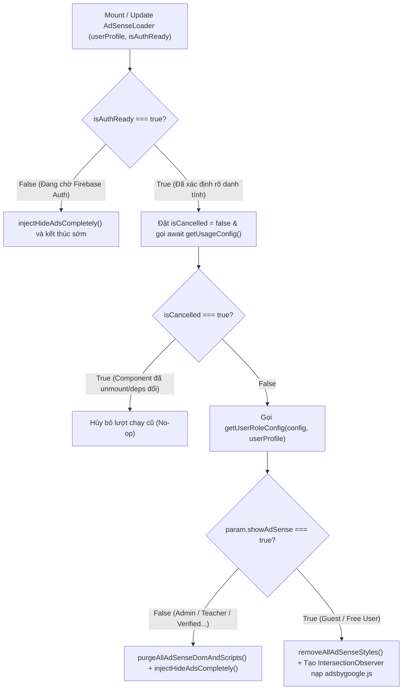

# DESIGN SPECIFICATION: Loại bỏ nút "Thoát" trên TopNavbar & Khắc phục triệt để lỗi hiển thị AdSense sai đối tượng

> **Plan ID:** `261109-0950-remove-navbar-logout-button`
> **Workflow Step:** `[Bước 03] /design` (Solution Architect & API/State Contract)
> **Ngày thiết kế:** 2026-11-09
> **Áp dụng:** `ontap-web` (`stores/useAppStore.ts`, `hooks/useAppInitialization.ts`, `components/TopNavbar.tsx`, `components/AdSenseLoader.tsx`, `routes/AppRoutes.tsx`, `services/usageService.ts`, `services/adBlockerStyles.ts`)

---

## Phần 1: Data & State Contract (API/Store Contract First)

### 1.1. Interface `AppStore` trong [useAppStore.ts](file:///d:/Antigravity/TNDNB/ontap-web/stores/useAppStore.ts)
Bổ sung cờ đồng bộ trạng thái khởi tạo xác thực `isAuthReady` vào Zustand Store để làm chốt chặn (Gatekeeper) cho toàn bộ các tác vụ phụ thuộc vào danh tính người dùng (đặc biệt là `AdSenseLoader`).

```ts
export interface AppStore {
    // ... (existing state properties)

    // System State
    resumeSessionAvailable: boolean;
    setResumeSessionAvailable: (available: boolean) => void;
    isMobileApp: boolean;
    setIsMobileApp: (isMobile: boolean) => void;

    /**
     * Cờ xác nhận tiến trình khởi tạo Firebase Auth (onAuthStateChanged)
     * và tải hồ sơ người dùng (userProfile từ Firestore/Cache) lần đầu đã hoàn tất.
     * - Default: false (khi ứng dụng vừa mount)
     * - Chuyển thành true: Sau khi xác định chắc chắn người dùng là Guest (firebaseUser === null)
     *   hoặc sau khi đã nạp xong userProfile của người dùng đăng nhập.
     */
    isAuthReady: boolean;
    setIsAuthReady: (ready: boolean) => void;
}
```

### 1.2. JSON Contract của `UsageConfig` & `RoleConfig` trong [adminConfigService.ts](file:///d:/Antigravity/TNDNB/ontap-web/services/adminConfigService.ts)
Cấu trúc dữ liệu cấu hình hiển thị quảng cáo và giới hạn lượt thi theo từng vai trò (lưu trữ tại Cloudflare D1 `usage_config` & Firestore `settings/usage_config`):

```ts
export interface RoleConfig {
    limit: number;
    period: 'daily' | 'weekly';
    isEnabled: boolean;
    showAds: boolean;       // Master/Legacy toggle
    showAdSense: boolean;   // Bật/Tắt Google AdSense (Auto-Ads, Anchor, Vignette, Banner)
    showAdsterra: boolean;  // Bật/Tắt Adsterra (Social Bar, Popunder)
    showMonetag: boolean;   // Bật/Tắt Monetag (Direct Link, In-Page Push, Vignette)
    message: string;
    preventCopy?: boolean;
}

export interface UsageConfig {
    guest: RoleConfig;         // Khách vãng lai (chưa đăng nhập)
    free_user: RoleConfig;     // Học viên tự do (đã đăng nhập, chưa vào lớp/khóa học)
    verified_user: RoleConfig; // Học viên chính thức (đã xác minh hoặc đã gán lớp/khóa học)
    vip_user: RoleConfig;      // Tài khoản VIP
    teacher: RoleConfig;       // Giáo viên (giao_vien)
    manager: RoleConfig;       // Quản lý đào tạo (quan_ly)
    leader: RoleConfig;        // Ban lãnh đạo (lanh_dao)
    admin: RoleConfig;         // Quản trị viên (admin)
}
```

### 1.3. Bảng Ánh Xạ `getUserRoleConfig(config, userProfile)` Chính Xác 100% Cho 8 Nhóm Vai Trò
Hàm phân loại tại [usageService.ts](file:///d:/Antigravity/TNDNB/ontap-web/services/usageService.ts) phải tuân thủ thứ tự ưu tiên từ cao xuống thấp và trả về đúng kiểu:

```ts
export type ResolvedRoleType =
    | 'guest'
    | 'free'
    | 'verified'
    | 'vip'
    | 'teacher'
    | 'manager'
    | 'leader'
    | 'admin';

export const getUserRoleConfig = (
    config: UsageConfig,
    userProfile: any | null
): { param: RoleConfig; type: ResolvedRoleType }
```

| Thứ tự ưu tiên | Nhóm đối tượng | Điều kiện khớp (`userProfile`) | Config trả về (`param`) | Mã định danh (`type`) | Mặc định `showAdSense` |
| :---: | :--- | :--- | :--- | :--- | :---: |
| **1** | **Khách vãng lai (`guest`)** | `!userProfile` (Chỉ hợp lệ khi `isAuthReady === true`) | `config.guest` | `'guest'` | `true` (tùy Admin bật) |
| **2** | **Quản trị viên (`admin`)** | `userProfile.role === 'admin'` | `config.admin` | `'admin'` | `false` |
| **3** | **Ban lãnh đạo (`leader`)** | `userProfile.role === 'lanh_dao'` | `config.leader \|\| config.manager` | `'leader'` | `false` |
| **4** | **Quản lý đào tạo (`manager`)** | `userProfile.role === 'quan_ly'` | `config.manager` | `'manager'` | `false` |
| **5** | **Giáo viên (`teacher`)** | `userProfile.role === 'giao_vien'` | `config.teacher` | `'teacher'` | `false` |
| **6** | **Học viên VIP (`vip_user`)** | `Boolean(userProfile.isVip)` | `config.vip_user` | `'vip'` | `false` |
| **7** | **Học viên chính thức (`verified_user`)** | `(userProfile.class && userProfile.class.length > 0) \|\| Boolean(userProfile.isVerified) \|\| Boolean(userProfile.courseId)` | `config.verified_user` | `'verified'` | `false` |
| **8** | **Học viên tự do (`free_user`)** | Đã đăng nhập nhưng không thỏa mãn mục 2–7 | `config.free_user` | `'free'` | `true` (tùy Admin bật) |

---

## Phần 2: Design Context & UI System (`Impeccable v4.8.0` + `Taste-Skill v2.5.0`)

### 2.1. Mode Vận Hành Chủ Đạo: `Operate` (SaaS EdTech Dashboard & Exam Platform)
- **Triết lý thẩm mỹ:** Giao diện công cụ học tập & sát hạch cần sự tĩnh lặng thị giác (Visual Calm), không gây nhiễu (Zero Cognitive Friction) trên thanh điều hướng, và tuyệt đối không để các phần tử quảng cáo nổi (Floating Auto-Ads Pill) che khuất vùng thao tác của Quản trị viên / Giáo viên / Học viên chính thức.

### 2.2. Thiết Kế Vùng Bên Phải `TopNavbar.tsx` (Desktop & Mobile)
- **Trước khi sửa:** Cụm bên phải hiển thị cả nút thông tin tài khoản (`Xin chào, Nguyễn Tiến Hưng 👑`), vách ngăn dọc (`h-6 w-[1px] bg-border`), nút `[Thoát]` màu đỏ nằm lộ thiên trên thanh bar VÀ nút Hamburger Menu `[≡]` (bên trong menu này cũng có nút `Đăng xuất`). Việc lặp lại 2 nút thoát cạnh nhau gây rối mắt và dễ bấm nhầm.
- **Thiết kế mới chuẩn hóa:**
  1. **Trên thanh `TopNavbar` (ngoài menu):** Chỉ hiển thị **User Account Badge/Button** (`Xin chào, [Họ tên]`) dẫn tới trang Tài khoản (`onNavigate('account')`) và nút **Hamburger Menu `[≡]`** (`min-h-[40px] min-w-[40px]`).
  2. **Loại bỏ hoàn toàn:** Vách ngăn dọc `<div className="h-6 w-[1px] bg-border mx-1 hidden md:block"></div>` và nút `<button title="Đăng xuất">...<span>Thoát</span></button>` ngoài thanh bar.
  3. **Bên trong Hamburger Menu (`showHamburgerMenu`):** Bảo toàn 100% nút `Đăng xuất` ở cuối danh sách menu (`min-h-[44px]`, màu `text-destructive hover:bg-destructive/10`), đảm bảo luồng thoát tài khoản nhất quán trên cả Desktop và Mobile.

```text
[TRƯỚC KHI SỬA - DESKTOP]
+--------------------------------------------------------------------------------------------------+
| [Logo] Ôn Tập TNDNB  |  Trang chủ  Thi thử  Lớp học  |  [👑 Nguyễn Tiến Hưng] | [🚪 Thoát] [ ≡ ] |
+--------------------------------------------------------------------------------------------------+

[SAU KHI SỬA - DESKTOP & MOBILE NHẤT QUÁN]
+--------------------------------------------------------------------------------------------------+
| [Logo] Ôn Tập TNDNB  |  Trang chủ  Thi thử  Lớp học  |             [👑 Nguyễn Tiến Hưng]   [ ≡ ] |
+--------------------------------------------------------------------------------------------------+
                                                                                               |
                                                                      +------------------------+
                                                                      | 👤 Tài khoản của tôi   |
                                                                      | 📜 Lịch sử cập nhật    |
                                                                      | ---------------------- |
                                                                      | 🚪 Đăng xuất           |
                                                                      +------------------------+
```

### 2.3. Đặc Tả CSS Phòng Thủ `ADSENSE_HIDE_ALL_CSS` & Hàm `purgeAllAdSenseDomAndScripts()`
Google AdSense Auto-Ads tự động chèn các phần tử nổi (như pill `✕ Ứng dụng ôn tập` ở góc dưới màn hình điện thoại) với class `.adsbygoogle-noablate`, `.google-auto-placed`, `div[id^="google-anno"]` kèm thuộc tính inline `style="display: block !important"`. Theo chuẩn W3C CSS Specificity, inline `!important` thắng stylesheet `<style> { display: none !important } </style>`.

Để triệt tiêu hoàn toàn 100% khả năng hiển thị của Auto-Ads khi `showAdSense === false` (hoặc khi `isAuthReady === false`), hệ thống áp dụng **Phòng thủ 2 tầng (Dual-Layer Defense)**:

#### Tầng 1: Multi-Property CSS Suppression (`ADSENSE_HIDE_ALL_CSS` trong [adBlockerStyles.ts](file:///d:/Antigravity/TNDNB/ontap-web/services/adBlockerStyles.ts))
Sử dụng tổ hợp các thuộc tính hình học và hiển thị mà Google Auto-Ads không đặt inline `!important` (`visibility`, `opacity`, `pointer-events`, `max-height`, `max-width`, `transform: scale(0)`, `z-index: -9999`):

```css
.adsbygoogle,
ins.adsbygoogle,
.adsbygoogle-noablate,
.google-auto-placed,
[data-ad-client],
[data-ad-status],
div[id^="google-anno"],
div[id^="google_ads"],
iframe[id^="google_ads"],
iframe[id^="aswift"],
#google-vignette {
    display: none !important;
    visibility: hidden !important;
    opacity: 0 !important;
    pointer-events: none !important;
    height: 0 !important;
    max-height: 0 !important;
    width: 0 !important;
    max-width: 0 !important;
    overflow: hidden !important;
    z-index: -9999 !important;
    transform: scale(0) !important;
}
```

#### Tầng 2: Physical DOM & Script Purge (`purgeAllAdSenseDomAndScripts()` trong [AdSenseLoader.tsx](file:///d:/Antigravity/TNDNB/ontap-web/components/AdSenseLoader.tsx))
Khi `showAdSense === false`, ngoài việc tiêm `ADSENSE_HIDE_ALL_CSS`, hàm `purgeAllAdSenseDomAndScripts()` trực tiếp gỡ bỏ toàn bộ thẻ `<script>` và các node DOM quảng cáo khỏi cây HTML:

```ts
const purgeAllAdSenseDomAndScripts = () => {
    ['adsense-script', 'adsterra-script', 'monetag-script'].forEach(id => {
        const el = document.getElementById(id);
        if (el) el.remove();
    });
    document.querySelectorAll(
        'script[src*="adsbygoogle"], .adsbygoogle, ins.adsbygoogle, .adsbygoogle-noablate, .google-auto-placed, [data-ad-client], [data-ad-status], div[id^="google-anno"], div[id^="google_ads"], iframe[id^="google_ads"], iframe[id^="aswift"], iframe[src*="googlesyndication"], #google-vignette'
    ).forEach(el => el.remove());
};
```

---

## Phần 3: Luồng Hoạt Động & State Machine (Mermaid Sequence / Flowchart)

### 3.1. Sequence Diagram: Chặn Đứng Race Condition Khi Khởi Tạo Phiên Đăng Nhập



### 3.2. Flowchart: State Machine Xử Lý Quảng Cáo Trong `AdSenseLoader.tsx`



---

## Phần 4: Acceptance Criteria (Tiêu chí Nghiệm thu) & Invariants

### 4.1. Các Bất Biến Hệ Thống (Mandatory Invariants)
1. **Bảo toàn tuyệt đối `ExamQuizScreen.tsx`:** Tệp [ontap-web/components/ExamQuizScreen.tsx](file:///d:/Antigravity/TNDNB/ontap-web/components/ExamQuizScreen.tsx) phải có `0 bytes diff` (`git diff ontap-web/components/ExamQuizScreen.tsx` trống hoàn toàn).
2. **Bảo toàn chức năng Đăng xuất trong Hamburger Menu:** Nút `Đăng xuất` nằm ở cuối menu xổ xuống (`showHamburgerMenu`) trong [TopNavbar.tsx](file:///d:/Antigravity/TNDNB/ontap-web/components/TopNavbar.tsx) vẫn hoạt động nguyên vẹn trên cả Desktop và Mobile.
3. **Bảo toàn doanh thu quảng cáo hợp lệ:** Khách vãng lai thực sự (`firebaseUser === null` sau khi `isAuthReady === true`) và Học viên tự do (`free_user`) vẫn tải và hiển thị AdSense bình thường khi Admin bật `showAdSense: true` cho 2 nhóm này.

### 4.2. Checklist Nghiệm Thu (Desktop & Mobile)
- [ ] **Desktop (`>= 768px`):** Trên thanh `TopNavbar`, bên phải nút thông tin tài khoản (`Xin chào, ...`) không còn vách ngăn dọc và không còn nút `[Thoát]` màu đỏ nằm lộ thiên. Khi bấm vào biểu tượng `[≡]`, nút `Đăng xuất` hiển thị rõ ràng ở cuối menu.
- [ ] **Mobile (`< 768px`):** Khi đăng nhập tài khoản Admin (`Nguyễn Tiến Hưng 👑`), Lãnh đạo, Quản lý, Giáo viên hoặc Học viên đã vào lớp (`courseId` / `class` / `isVerified`), tuyệt đối không xuất hiện pill nổi `✕ Ứng dụng ôn tập` hay bất kỳ banner AdSense Auto-Ads nào ở góc dưới màn hình, kể cả khi F5 tải lại trang trên mạng 3G/4G chậm.
- [ ] **Role Mapping:** Tài khoản có `role === 'lanh_dao'` đọc đúng cấu hình `config.leader` (fallback `config.manager`), và học viên có `courseId` được nhận diện chính xác là `verified_user`.

---

## Phần 5: Test Cases Design (SDD Given-When-Then)

Đặc tả chi tiết 3 kịch bản kiểm thử tự động bổ sung vào [scripts/portal-console-and-tinymce-fix.test.ts](file:///d:/Antigravity/TNDNB/scripts/portal-console-and-tinymce-fix.test.ts):

### `TC-32`: `ontap-web/components/TopNavbar.tsx` must NOT render standalone desktop "Thoát" button outside Hamburger Menu
- **Given:** Mã nguồn của component thanh điều hướng [ontap-web/components/TopNavbar.tsx](file:///d:/Antigravity/TNDNB/ontap-web/components/TopNavbar.tsx).
- **When:** Phân tích cấu trúc JSX vùng bên phải thanh điều hướng (`RIGHT: User Info & Logout`) và vùng menu xổ xuống (`showHamburgerMenu`).
- **Then:**
  1. Không còn comment `'Standalone Logout Button (Desktop)'` và không còn phần tử `<span className="font-bold text-sm">Thoát</span>` ngoài thanh điều hướng.
  2. Vẫn giữ nguyên nút `Đăng xuất` (`<span>Đăng xuất</span>`) kèm sự kiện `onClick={() => { setShowHamburgerMenu(false); onLogout(); }}` bên trong `showHamburgerMenu`.

### `TC-33`: `ontap-web/components/AdSenseLoader.tsx` must guard with `isAuthReady`, use `isCancelled` cleanup flag, and purge Auto-Ads DOM elements when disabled
- **Given:** Mã nguồn của [ontap-web/components/AdSenseLoader.tsx](file:///d:/Antigravity/TNDNB/ontap-web/components/AdSenseLoader.tsx), [ontap-web/routes/AppRoutes.tsx](file:///d:/Antigravity/TNDNB/ontap-web/routes/AppRoutes.tsx), [ontap-web/stores/useAppStore.ts](file:///d:/Antigravity/TNDNB/ontap-web/stores/useAppStore.ts) và [ontap-web/hooks/useAppInitialization.ts](file:///d:/Antigravity/TNDNB/ontap-web/hooks/useAppInitialization.ts).
- **When:** Kiểm tra luồng khởi tạo xác thực và vòng đời `useEffect` của `AdSenseLoader`.
- **Then:**
  1. `useAppStore.ts` định nghĩa `isAuthReady: boolean` (mặc định `false`) và `setIsAuthReady`.
  2. `useAppInitialization.ts` gọi `setIsAuthReady(true)` sau khi xác định xong `userProfile` trong `onAuthStateChanged`.
  3. `AppRoutes.tsx` truyền `isAuthReady={isAuthReady}` vào `<AdSenseLoader />`.
  4. `AdSenseLoader.tsx` chặn không chạy `checkConfig()` khi `!isAuthReady` (đồng thời gọi `injectHideAdsCompletely()`), sử dụng cờ `isCancelled` để hủy kết quả bất đồng bộ cũ sau `await getUsageConfig()`, và gọi `purgeAllAdSenseDomAndScripts()` để xóa sạch `.adsbygoogle-noablate`, `.google-auto-placed`, `div[id^="google-anno"]` khi `showAdSense` tắt.

### `TC-34`: `ontap-web/services/adBlockerStyles.ts` & `ontap-web/services/usageService.ts` must enforce strict Auto-Ads hiding and accurate role mapping (`leader` & `courseId`)
- **Given:** Mã nguồn của [ontap-web/services/adBlockerStyles.ts](file:///d:/Antigravity/TNDNB/ontap-web/services/adBlockerStyles.ts) và [ontap-web/services/usageService.ts](file:///d:/Antigravity/TNDNB/ontap-web/services/usageService.ts).
- **When:** Kiểm tra hằng số CSS `ADSENSE_HIDE_ALL_CSS` và hàm `getUserRoleConfig(config, userProfile)`.
- **Then:**
  1. `ADSENSE_HIDE_ALL_CSS` bao phủ các selector `.adsbygoogle-noablate`, `.google-auto-placed`, `div[id^="google-anno"]`, `iframe[id^="aswift"]` và chứa các thuộc tính cưỡng bức `opacity: 0 !important`, `pointer-events: none !important`, `max-height: 0 !important`, `transform: scale(0) !important`.
  2. `getUserRoleConfig` tách riêng `role === 'lanh_dao'` sang `config.leader || config.manager` (type `'leader'`) và kiểm tra `Boolean(userProfile.courseId)` trong điều kiện phân loại `verified_user`.
