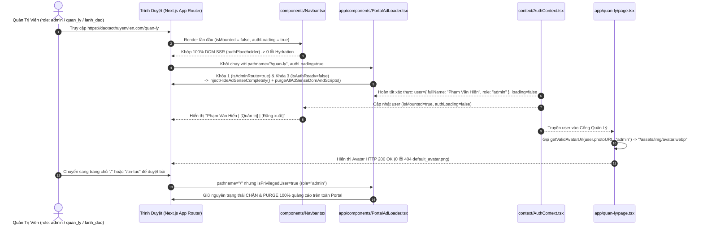
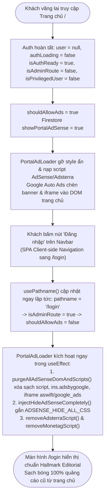

# Tài Liệu Thiết Kế Kỹ Thuật & Luật Thẩm Mỹ (Technical Design & Aesthetic Specification — SDD & AWF v4.0)
## Kế Hoạch: Chặn Quảng Cáo Theo Vai Trò (Role Gate) & Tuyến Đường (Route Gate) Cổng Quản Trị, Dọn Sạch Lỗi Console & Hydration Mismatch (`261110-1015-portal-ad-role-gating-and-management`)

> **Dự án:** Cổng Thông Tin & Hệ Thống Quản Trị Đào Tạo Thuyền Viên Ninh Bình (TNDNB)  
> **Mã kế hoạch:** `261110-1015-portal-ad-role-gating-and-management`  
> **Ngày cập nhật:** 10/11/2026  
> **Tiêu chuẩn áp dụng:** `AWF v4.0` + `Impeccable v4.8.0 (62-Rule Craft Floor)` + `Taste-Skill v2.5.0` + `Hallmark Editorial`  
> **Tài liệu liên quan:**
> - Kế hoạch tổng thể: [`plan.md`](file:///d:/Antigravity/TNDNB/docs/plans/261110-1015-portal-ad-role-gating-and-management/plan.md)
> - Living To-Do List: [`task.md`](file:///d:/Antigravity/TNDNB/docs/plans/261110-1015-portal-ad-role-gating-and-management/task.md)
> - Single Source of Truth toàn dự án: [`docs/DESIGN.md`](file:///d:/Antigravity/TNDNB/docs/DESIGN.md)

---

## Phần 1: Data Schema & State Contracts (API/Firestore Contract First)

### 1.1 Cấu Trúc Tài Liệu Firestore `settings/usage_config`
Tài liệu cấu hình tại đường dẫn `settings/usage_config` trên Cloud Firestore đóng vai trò trung tâm điều khiển trạng thái quảng cáo và khiên bảo vệ click tặc (IVT Shield) của toàn bộ hệ thống Portal Next.js (`daotaothuyenvien.com`).

```typescript
/**
 * Hợp đồng dữ liệu Firestore: doc(db, 'settings', 'usage_config')
 * Được lắng nghe thời gian thực qua onSnapshot() trong app/components/PortalAdLoader.tsx
 */
export interface PortalUsageConfigDocument {
  /** Cờ kế thừa (Legacy fallback) cho các trường quảng cáo Portal. Mặc định: true */
  showPortalAds?: boolean;

  /** Bật/tắt Google AdSense Auto Ads trên Portal (chỉ áp dụng khi vượt qua 3 lớp Gate). Mặc định: data.showPortalAds ?? true */
  showPortalAdSense: boolean;

  /** Bật/tắt script quảng cáo Adsterra trên Portal. Mặc định: data.showPortalAds ?? true */
  showPortalAdsterra: boolean;

  /** Bật/tắt script quảng cáo Monetag trên Portal. Mặc định: false */
  showPortalMonetag: boolean;

  /** Số lần click tối đa vào quảng cáo AdSense trong khung thời gian cooldown trước khi kích hoạt IVT Shield. Mặc định: 2 */
  adsenseMaxClicks: number;

  /** Thời gian khóa click (phút) của IVT Shield sau khi chạm ngưỡng adsenseMaxClicks. Mặc định: 30 */
  adsenseCooldownMinutes: number;
}
```

| Tên trường (Field) | Kiểu dữ liệu (Type) | Giá trị mặc định (Default) | Ý nghĩa nghiệp vụ & Phạm vi tác động |
| :--- | :--- | :--- | :--- |
| `showPortalAdSense` | `boolean` | `true` *(fallback qua `showPortalAds ?? true`)* | Điều khiển việc nạp script `adsbygoogle.js` cho khách vãng lai & học viên ngoài trang tin tức công cộng. Bị vô hiệu hóa 100% nếu vi phạm `shouldAllowAds`. |
| `showPortalAdsterra` | `boolean` | `true` *(fallback qua `showPortalAds ?? true`)* | Điều khiển việc nạp script Adsterra (`effectivegatecpm.com`). Bị vô hiệu hóa 100% nếu vi phạm `shouldAllowAds`. |
| `showPortalMonetag` | `boolean` | `false` | Điều khiển việc nạp script Monetag (`quge5.com/88/tag.min.js`). Bị vô hiệu hóa 100% nếu vi phạm `shouldAllowAds`. |
| `adsenseMaxClicks` | `number` | `2` | Ngưỡng click tối đa lưu trong `localStorage['portal_adsense_click_tracker']` trước khi bật `ADSENSE_SELECTIVE_BLOCK_CSS` (`pointer-events: none`). |
| `adsenseCooldownMinutes` | `number` | `30` | Chu kỳ thời gian (tính bằng phút, quy đổi `adsenseCooldownMinutes * 60 * 1000` ms) để tự động làm mới bộ đếm click IVT Shield. |

---

### 1.2 Hợp Đồng Dữ Liệu Xác Thực (`AuthContextType` & `AuthUser`)
Được cung cấp bởi [`context/AuthContext.tsx`](file:///d:/Antigravity/TNDNB/context/AuthContext.tsx#L10-L33) và truy xuất thông qua hook `useAuth()`:

```typescript
/**
 * Hợp đồng thông tin người dùng đã xác thực từ Firebase Auth + Firestore collection `users/{uid}`
 */
export interface AuthUser {
  /** Định danh duy nhất từ Firebase Authentication */
  uid: string;
  /** Địa chỉ email đăng nhập */
  email: string | null;
  /** Vai trò phân quyền RBAC trên toàn hệ thống */
  role: 'hoc_vien' | 'giao_vien' | 'lanh_dao' | 'admin' | 'quan_ly';
  /** Họ và tên hiển thị trên Navbar & Cổng Quản Lý */
  fullName?: string;
  phoneNumber?: string;
  birthDate?: string;
  class?: string;
  courseId?: string;
  courseName?: string;
  isVerified?: boolean;
  cccd?: string;
  cccdDate?: string;
  cccdPlace?: string;
  address?: string;
  /** Đường dẫn ảnh đại diện (có thể là URL ngoài, đường dẫn nội bộ hoặc chuỗi legacy lỗi '/default_avatar.png') */
  photoURL?: string;
}

/**
 * Hợp đồng State của AuthContext
 */
export interface AuthContextType {
  /** Đối tượng người dùng hiện tại; bằng null nếu là khách vãng lai hoặc chưa xác thực xong */
  user: AuthUser | null;
  /** Cờ trạng thái khởi tạo phiên Firebase Auth + đọc hồ sơ Firestore (true khi đang tải, false khi đã hoàn tất) */
  loading: boolean;
}
```

---

### 1.3 Công Thức Đại Số Boolean Quyết Định Nạp/Chặn Quảng Cáo (Triple-Lock Gating Algebra)
Mọi quyết định nạp script hoặc dọn sạch DOM quảng cáo trong [`app/components/PortalAdLoader.tsx`](file:///d:/Antigravity/TNDNB/app/components/PortalAdLoader.tsx) bắt buộc tuân thủ hệ phương trình đại số Boolean 3 khóa bảo vệ (Triple-Lock Gating):

```typescript
// Đầu vào từ Next.js App Router & AuthContext:
const pathname = usePathname(); // string | null
const { user, loading: authLoading } = useAuth();

// 1. KHÓA TUYẾN ĐƯỜNG (Route Gate): Chặn tuyệt đối trên toàn bộ phân hệ Quản trị và Đăng nhập
const isAdminRoute: boolean = Boolean(
  pathname?.startsWith('/quan-ly') || pathname?.startsWith('/login')
);

// 2. KHÓA VAI TRÒ (Role Gate - RBAC Exemption): Miễn trừ 100% quảng cáo cho Quản trị viên, Quản lý, Lãnh đạo
const isPrivilegedUser: boolean = Boolean(
  user && ['admin', 'quan_ly', 'lanh_dao'].includes(user.role)
);

// 3. KHÓA SẴN SÀNG XÁC THỰC (Auth Ready Guard - Chống FOUA): Chặn quảng cáo khi Firebase Auth còn đang tải
const isAuthReady: boolean = !authLoading;

// BIỂU THỨC TỔNG HỢP QUYẾT ĐỊNH CHO PHÉP QUẢNG CÁO:
const shouldAllowAds: boolean = isAuthReady && !isAdminRoute && !isPrivilegedUser;
```

#### Bảng Chân Trị Nghiệp Vụ (Truth Table)
| `isAuthReady` (`!authLoading`) | `isAdminRoute` (`/quan-ly*`, `/login*`) | `isPrivilegedUser` (`admin`, `quan_ly`, `lanh_dao`) | Kết quả `shouldAllowAds` | Hành động cưỡng chế của `PortalAdLoader` |
| :---: | :---: | :---: | :---: | :--- |
| `false` *(Đang tải Auth)* | Bất kỳ | Bất kỳ | **`false`** | **Chống FOUA:** Gọi ngay `injectHideAdSenseCompletely()`, tạm dừng nạp mọi script cho đến khi `authLoading === false`. |
| `true` | `true` *(Trang quản trị/login)* | Bất kỳ | **`false`** | **Route Gate Block:** Gọi `purgeAllAdSenseDomAndScripts()`, `injectHideAdSenseCompletely()`, gỡ bỏ Adsterra & Monetag. |
| `true` | `false` *(Trang tin tức/công cộng)* | `true` *(Cán bộ/Admin)* | **`false`** | **Role Gate Block:** Gọi `purgeAllAdSenseDomAndScripts()`, `injectHideAdSenseCompletely()`, gỡ bỏ Adsterra & Monetag trên toàn site. |
| `true` | `false` *(Trang tin tức/công cộng)* | `false` *(Khách / Học viên / Giáo viên)* | **`true`** | **Cho phép theo cấu hình Firestore:** Đọc `adSenseEnabled`, `adsterraEnabled`, `monetagEnabled` để hiển thị kèm khiên bảo vệ `IVT Shield`. |

---

## Phần 2: Design Context & Aesthetic Constitution (`Impeccable v4.8.0` + `Hallmark Editorial`)

### 2.1 Phân Loại Chế Độ Giao Diện (`Operate` Mode vs `Read` Mode)
Theo chuẩn **4 Modes Classification (`AWF v4.0` & `Impeccable v4.8.0`)**:
- **Chế độ `Operate` Mode (`/quan-ly`, `/quan-ly/*`, `/login`):**
  - **Mục tiêu thị giác & điều hành:** Mật độ thông tin điều hành cao (6 tab nghiệp vụ: *Tổng quan, Lớp của tôi, Quản lý Khóa học, Quản lý Tài khoản, Quản lý Bài viết, Kết quả Ôn tập*), tốc độ phản hồi tức thì, độ chính xác dữ liệu tuyệt đối.
  - **Quy tắc Không Gian Làm Việc Tinh Khiết (0% Intrusive Ads):** Tuyệt đối không có bất kỳ banner Google AdSense (như banner *"Mở và đọc file PDF - WPS PDF"*), hộp thoại vignette hay popunder nào được phép chèn vào đầu trang, giữa các thẻ KPI hoặc đè lên bảng điều khiển. Không có hiện tượng dịch chuyển bố cục tích lũy (`CLS = 0.00`) do iframe quảng cáo đẩy thanh tiêu đề *"Cổng Quản Lý & Bảng Điều Khiển"* xuống dưới.
- **Chế độ `Read` Mode (`/`, `/bai-viet/[postId]`, `/danh-muc/[categoryId]`):**
  - Khi người dùng là **Cán bộ Quản trị / Quản lý / Lãnh đạo** (`isPrivilegedUser === true`) duyệt các trang đọc tin tức để kiểm duyệt nội dung bài viết mới đăng, chế độ hiển thị tự động nâng cấp lên trạng thái **Editorial Review Cleanliness** (0% quảng cáo), giữ nguyên vẹn nhịp điệu typography của bài viết.

### 2.2 Bảng Màu & Typography Chuẩn `Hallmark Editorial`
Toàn bộ các thành phần giao diện chịu tác động (`components/Navbar.tsx`, `app/quan-ly/page.tsx`, `components/ProtectedRoute.tsx`) sử dụng nghiêm ngặt hệ thống Design Tokens tại `:root` của [`app/globals.css`](file:///d:/Antigravity/TNDNB/app/globals.css):

| Token CSS | Giá trị Chuẩn | Vai trò Thẩm mỹ trên Cổng Quản Lý & Navbar |
| :--- | :--- | :--- |
| `--color-paper` | `#FAF9F6` | Nền giấy ấm tổng thể của trang điều hành, chống mỏi mắt khi cán bộ làm việc nhiều giờ liên tục. |
| `--color-surface` | `#FFFFFF` | Nền thẻ thông tin người dùng (`userCard`), khung bảng dữ liệu và thanh điều hướng. |
| `--color-ink` | `#0B132B` | Màu chữ chính độ tương phản AAA (`> 15:1` trên nền giấy), dùng cho họ tên cán bộ và số liệu. |
| `--color-accent` | `#003566` | Xanh Hải quân / Đường thủy chủ đạo cho nút *"Quản trị"*, viền khung avatar và trạng thái tab đang chọn. |
| `--color-gold` | `#D4AF37` | Điểm nhấn huy hiệu vai trò `[QUẢN TRỊ]` / `[LÃNH ĐẠO]`. |
| `--color-signal` | `#B91C1C` | Màu cảnh báo hoặc hành động nhạy cảm (Đăng xuất, xóa dữ liệu). |
| `--color-rule` | `#CBD5E1` | Đường kẻ viền `1px solid` phân tách chuẩn biên tập báo chí chính thống. |
| `--font-sans` | `'Be Vietnam Pro', sans-serif` | Phông chữ giao diện duy nhất cho nhãn điều hướng, bảng biểu và badge vai trò, bật `font-variant-numeric: tabular-nums` cho mọi con số thống kê. |

### 2.3 Đặc Tả CSS Chống Google Auto-Ads Inline `!important` & DOM Purge Selectors
Khi Google AdSense Auto Ads chạy, script của Google thường chèn trực tiếp thuộc tính inline `style="display: block !important; height: 280px !important;"` vào thẻ `<ins class="adsbygoogle adsbygoogle-noablate">` hoặc `<div class="google-auto-placed">`. Để đánh bại hoàn toàn cơ chế inline `!important` này ngay ở tầng Render Tree của trình duyệt:

1. **Stylesheet Cưỡng Chế Ẩn Toàn Diện (`ADSENSE_HIDE_ALL_CSS` từ [`ontap-web/services/adBlockerStyles.ts`](file:///d:/Antigravity/TNDNB/ontap-web/services/adBlockerStyles.ts)):**
   - Được gắn vào `<head>` qua thẻ `<style id="portal-adsense-hide-style">` mỗi khi `!shouldAllowAds`.
   - Khóa đồng thời 8 thuộc tính vật lý của hộp phần tử (Box Model & Stacking Context):
     ```css
     .adsbygoogle,
     ins.adsbygoogle,
     .adsbygoogle-noablate,
     .google-auto-placed,
     [data-ad-client],
     [data-ad-status],
     div[id^="google-anno"],
     div[id^="google_ads"],
     iframe[id^="google_ads"],
     iframe[id^="aswift"],
     #google-vignette {
       display: none !important;
       visibility: hidden !important;
       opacity: 0 !important;
       pointer-events: none !important;
       max-height: 0 !important;
       max-width: 0 !important;
       height: 0 !important;
       width: 0 !important;
       overflow: hidden !important;
       margin: 0 !important;
       padding: 0 !important;
       border: none !important;
       transform: scale(0) !important;
       z-index: -9999 !important;
     }
     ```
2. **Danh Mục Bộ Chọn DOM Purge (`purgeAllAdSenseDomAndScripts`):**
   - **Nhóm Script IDs nội bộ:** `#portal-adsense-script`, `#portal-adsterra-script`, `#portal-monetag-script`, `#adsense-script`, `#adsterra-script`, `#monetag-script`.
   - **Nhóm Script bên thứ 3 tự sinh:** `script[src*="adsbygoogle"]`, `script[src*="googlesyndication"]`, `script[src*="doubleclick"]`, `script[src*="effectivegatecpm.com"]`, `script[src*="quge5.com"]`, `script[src*="monetag"]`.
   - **Nhóm Container & Iframe AdSense:** `.adsbygoogle`, `ins.adsbygoogle`, `.adsbygoogle-noablate`, `.google-auto-placed`, `[data-ad-client]`, `[data-ad-status]`, `div[id^="google-anno"]`, `div[id^="google_ads"]`, `iframe[id^="google_ads"]`, `iframe[id^="aswift"]`, `iframe[src*="googlesyndication"]`, `iframe[src*="doubleclick"]`, `#google-vignette`.
   - **Nhóm Container & Iframe Adsterra / Monetag:** `[id^="adsterra"]`, `[class*="adsterra"]`, `#pl28592472`, `iframe[src*="quge5"]`, `iframe[src*="monetag"]`, `[id*="monetag"]`, `[class*="monetag"]`.

---

## Phần 3: Đặc Tả Component & Màn Hình Tác Động

### 3.1 Component [`app/components/PortalAdLoader.tsx`](file:///d:/Antigravity/TNDNB/app/components/PortalAdLoader.tsx)
- **Vị trí trong cây Component:** Được đặt bên trong `<AuthProvider>` tại [`app/layout.tsx`](file:///d:/Antigravity/TNDNB/app/layout.tsx) để truy cập trực tiếp `useAuth()` và `usePathname()`.
- **Hợp đồng Dependencies & Hooks:**
  ```tsx
  import { usePathname } from 'next/navigation';
  import { useAuth } from '../../context/AuthContext';
  ```
- **Luồng thực thi `useEffect` hợp nhất (Gating + Firestore + Route Change Purge):**
  1. Ngay khi mount hoặc khi `pathname`, `authLoading`, `user?.role` thay đổi:
     - Nếu `!isAuthReady` (`authLoading === true`): Gọi `injectHideAdSenseCompletely()` ngay lập tức để khóa hiển thị chống FOUA, sau đó `return` (không nạp bất kỳ script nào).
     - Nếu `isAdminRoute || isPrivilegedUser` (`!shouldAllowAds`): Gọi ngay `purgeAllAdSenseDomAndScripts()`, `injectHideAdSenseCompletely()`, `removeAdsterraScript()`, `removeMonetagScript()`, sau đó `return`.
  2. Chỉ khi `shouldAllowAds === true`:
     - Với **Google AdSense**: Kiểm tra `adSenseEnabled`. Nếu `true`, kiểm tra tiếp `isAdSenseBlocked` (IVT Shield) để chọn giữa `injectSelectiveBlockStyle()` hoặc `removeAllAdSenseStyles() + loadAdSenseScript()`. Nếu `adSenseEnabled === false`, gọi `purgeAllAdSenseDomAndScripts()` và `injectHideAdSenseCompletely()`.
     - Với **Adsterra**: Chỉ gọi `loadAdsterraScript()` khi `shouldAllowAds && adsterraEnabled === true`, ngược lại gọi `removeAdsterraScript()`.
     - Với **Monetag**: Chỉ gọi `loadMonetagScript()` khi `shouldAllowAds && monetagEnabled === true`, ngược lại gọi `removeMonetagScript()`.

---

### 3.2 Màn Hình [`app/quan-ly/page.tsx`](file:///d:/Antigravity/TNDNB/app/quan-ly/page.tsx) & Hệ Thống Avatar Fallback 3 Tầng
- **Vấn đề gốc rễ:** Một số tài khoản trong Firestore lưu `photoURL: "/default_avatar.png"` hoặc `null`, trong khi code cũ tại dòng 127 viết `src={user.photoURL || '/assets/img/default-avatar.png'}` dẫn tới lỗi `GET https://daotaothuyenvien.com/default_avatar.png 404 (Not Found)`.
- **Thiết kế Phòng Thủ 3 Tầng (Triple-Layer Avatar Defense):**
  1. **Tầng 1 — Hàm chuẩn hóa đường dẫn `getValidAvatarUrl`:**
     ```typescript
     export const getValidAvatarUrl = (photoURL?: string | null, role?: string): string => {
       const defaultByRole =
         role === 'hoc_vien' ? '/assets/img/avatar1.webp' : '/assets/img/avatar.webp';

       if (!photoURL || typeof photoURL !== 'string') {
         return defaultByRole;
       }

       const trimmed = photoURL.trim();
       if (
         trimmed === '' ||
         trimmed.includes('default_avatar.png') ||
         trimmed.includes('default-avatar.png')
       ) {
         return defaultByRole;
       }

       if (
         trimmed.startsWith('http://') ||
         trimmed.startsWith('https://') ||
         trimmed.startsWith('/assets/img/')
       ) {
         return trimmed;
       }

       return defaultByRole;
     };
     ```
  2. **Tầng 2 — Bắt sự kiện `onError` trên Component `<Image>` tại `app/quan-ly/page.tsx`:**
     - Sử dụng state `const [avatarError, setAvatarError] = useState(false);` (reset về `false` khi `user?.photoURL` thay đổi).
     - Thuộc tính ảnh đại diện:
       ```tsx
       <Image
         src={
           avatarError
             ? (user.role === 'hoc_vien' ? '/assets/img/avatar1.webp' : '/assets/img/avatar.webp')
             : getValidAvatarUrl(user.photoURL, user.role)
         }
         alt="Avatar"
         width={80}
         height={80}
         className={styles.avatar}
         onError={() => setAvatarError(true)}
       />
       ```
  3. **Tầng 3 — Cung cấp 3 tệp ảnh vật lý dự phòng trong `public/`:**
     - Tạo đầy đủ 3 tệp vật lý hợp lệ từ ảnh gốc để bảo đảm mọi request tĩnh hoặc cache trình duyệt cũ đều trả về `HTTP 200 OK`:
       - [`public/default_avatar.png`](file:///d:/Antigravity/TNDNB/public/default_avatar.png)
       - [`public/assets/img/default-avatar.png`](file:///d:/Antigravity/TNDNB/public/assets/img/default-avatar.png)
       - [`public/assets/img/default_avatar.png`](file:///d:/Antigravity/TNDNB/public/assets/img/default_avatar.png)

---

### 3.3 Component [`components/Navbar.tsx`](file:///d:/Antigravity/TNDNB/components/Navbar.tsx) & [`components/ProtectedRoute.tsx`](file:///d:/Antigravity/TNDNB/components/ProtectedRoute.tsx) (Chống Hydration Mismatch `#418`, `#423`)
- **Nguyên nhân Hydration Mismatch:** Trên môi trường SSR của Next.js, `user` từ `useAuth()` luôn là `null` nên Server kết xuất nút `<Link href="/login">Đăng nhập</Link>`. Khi xuống Client, nếu phiên người dùng đã được cache, lần render đầu tiên có thể trả về khối `<div className={styles.userActions}>` hoặc lệch cấu trúc DOM với SSR, kích hoạt lỗi React `#418` và `#423`.
- **Hợp đồng State `isMounted` trong `components/Navbar.tsx`:**
  ```tsx
  const { user, loading: authLoading } = useAuth();
  const [isMounted, setIsMounted] = useState(false);

  useEffect(() => {
    setIsMounted(true);
  }, []);
  ```
- **Quy tắc Render Đồng Nhất SSR $\rightarrow$ CSR tại `div.metaRight`:**
  ```tsx
  <div className={styles.metaRight}>
    {!isMounted || authLoading ? (
      <span className={styles.authPlaceholder} aria-hidden="true" />
    ) : user ? (
      <div className={styles.userActions}>
        <span className={styles.welcomeText}>
          <i className="fas fa-user-circle"></i> {user.fullName || user.email}
        </span>
        <Link href="/quan-ly" className={styles.manageBtn}>
          Quản trị
        </Link>
        <button onClick={handleLogout} className={styles.logoutBtn}>
          Đăng xuất
        </button>
      </div>
    ) : (
      <Link href="/login" className={styles.loginBtn}>
        <i className="fas fa-sign-in-alt"></i> Đăng nhập
      </Link>
    )}
  </div>
  ```
  - Trong lần render SSR trên máy chủ và lần Hydration đầu tiên trên trình duyệt (`isMounted === false`), cả Server và Client đều tạo ra **chính xác cùng 1 node `<span className={styles.authPlaceholder} aria-hidden="true" />`**.
  - Ngay sau khi Hydration hoàn tất (`useEffect` kích hoạt `setIsMounted(true)`), React chuyển sang cập nhật Client-side hợp lệ sang nút *"Đăng nhập"* hoặc khối *"Quản trị"*, triệt tiêu 100% lỗi React `#418` và `#423`.

---

## Phần 4: Luồng Hoạt Động (User Journeys & Mermaid Sequence/Flowchart)

### 4.1 Hành Trình 1: Quản Trị Viên / Cán Bộ Quản Lý Đăng Nhập Và Làm Việc Trên `/quan-ly` & Portal


---

### 4.2 Hành Trình 2: Khách Vãng Lai Xem Tin Tức Tại `/` Chuyển Sang `/login` (SPA Navigation Purge)


---

## Phần 5: Acceptance Criteria & SDD Test Cases (`TC-GATE01` $\rightarrow$ `TC-GATE06`)

Toàn bộ 6 kịch bản kiểm thử dưới đây được tự động hóa trong tệp [`scripts/portal-ad-gate.test.ts`](file:///d:/Antigravity/TNDNB/scripts/portal-ad-gate.test.ts) và thực thi qua lệnh `npx vitest run scripts/portal-ad-gate.test.ts`:

### `TC-GATE01`: Route Gate Trong `PortalAdLoader.tsx`
- **Given:** Component [`app/components/PortalAdLoader.tsx`](file:///d:/Antigravity/TNDNB/app/components/PortalAdLoader.tsx) được nhúng trong layout gốc của Portal Next.js và cấu hình Firestore đang bật `showPortalAdSense: true`.
- **When:** Người dùng (bất kể đã đăng nhập hay chưa) truy cập vào đường dẫn bắt đầu bằng `/quan-ly` (ví dụ `/quan-ly`, `/quan-ly/dang-bai`, `/quan-ly/tai-khoan`) hoặc `/login`.
- **Then:**
  1. `PortalAdLoader.tsx` bắt buộc phải import và gọi `usePathname()` từ `next/navigation`.
  2. Biến `isAdminRoute` nhận giá trị `true` khi `pathname?.startsWith('/quan-ly') || pathname?.startsWith('/login')`.
  3. Biểu thức `shouldAllowAds` trả về `false`, kích hoạt `purgeAllAdSenseDomAndScripts()` và `injectHideAdSenseCompletely()`, đồng thời không nạp bất kỳ script AdSense, Adsterra hay Monetag nào.

### `TC-GATE02`: Role Gate (RBAC Exemption) Trong `PortalAdLoader.tsx`
- **Given:** Người dùng đã đăng nhập thành công vào hệ thống với tài khoản có `user.role` thuộc danh sách cán bộ quản lý/lãnh đạo: `['admin', 'quan_ly', 'lanh_dao']`.
- **When:** Người dùng truy cập bất kỳ trang nào trên toàn bộ cổng thông tin (bao gồm cả trang chủ `/`, trang bài viết `/bai-viet/[postId]`, hoặc trang quản trị `/quan-ly`).
- **Then:**
  1. `PortalAdLoader.tsx` bắt buộc phải import và gọi `useAuth()` từ `context/AuthContext`.
  2. Biến `isPrivilegedUser` nhận giá trị `true` khi `user && ['admin', 'quan_ly', 'lanh_dao'].includes(user.role)`.
  3. Biểu thức `shouldAllowAds` trả về `false`, vô hiệu hóa và dọn sạch 100% quảng cáo trên mọi tuyến đường của Portal.

### `TC-GATE03`: Auth Ready Guard Chống FOUA (Flash of Unwanted Ads)
- **Given:** Quản trị viên nhấn F5 tải lại trang trên trình duyệt, trong khoảng 300ms–800ms đầu tiên khi Firebase Authentication đang khôi phục phiên đăng nhập (`loading === true`).
- **When:** `PortalAdLoader.tsx` thực thi chu kỳ kiểm tra đầu tiên trước khi biết danh tính người dùng.
- **Then:**
  1. `PortalAdLoader.tsx` đọc cờ `loading` (đặt bí danh `authLoading`) từ `useAuth()` và tính toán `isAuthReady = !authLoading`.
  2. Khi `!isAuthReady` (`authLoading === true`), component gọi ngay `injectHideAdSenseCompletely()` và dừng lại (`return`), tuyệt đối không gọi `loadAdSenseScript()`, `loadAdsterraScript()` hay `loadMonetagScript()` cho tới khi xác thực hoàn tất.

### `TC-GATE04`: Động Cơ Purge DOM & Phong Tỏa CSS (`purgeAllAdSenseDomAndScripts` & `ADSENSE_HIDE_ALL_CSS`)
- **Given:** Trang web đang có các phần tử quảng cáo tự sinh của Google AdSense (`ins.adsbygoogle`, `.google-auto-placed`, `iframe[id^="aswift"]`, `iframe[id^="google_ads"]`, `#google-vignette`) hoặc người dùng chuyển hướng SPA từ trang tin tức vào `/quan-ly`.
- **When:** Trạng thái chuyển sang `!shouldAllowAds` hoặc admin tắt cờ quảng cáo.
- **Then:**
  1. Hàm `purgeAllAdSenseDomAndScripts()` được định nghĩa và gọi thực thi, xóa bỏ toàn bộ thẻ `<script>` quảng cáo và gọi `.remove()` trên tất cả các bộ chọn `.adsbygoogle`, `.adsbygoogle-noablate`, `.google-auto-placed`, `iframe[id^="google_ads"]`, `iframe[id^="aswift"]`, `#google-vignette`.
  2. Hàm `injectHideAdSenseCompletely()` chèn thẻ `<style id="portal-adsense-hide-style">` chứa `ADSENSE_HIDE_ALL_CSS` vào `document.head`.

### `TC-GATE05`: Tệp Ảnh Tĩnh Dự Phòng & Avatar Resolver An Toàn Trên `/quan-ly`
- **Given:** Tài khoản người dùng có trường `user.photoURL` trong Firestore bị rỗng (`null`/`undefined`) hoặc chứa giá trị cũ `/default_avatar.png`, `/assets/img/default-avatar.png`.
- **When:** Người dùng mở trang [`app/quan-ly/page.tsx`](file:///d:/Antigravity/TNDNB/app/quan-ly/page.tsx) hoặc trình duyệt gửi request tải ảnh mặc định.
- **Then:**
  1. Ba tệp ảnh vật lý [`public/default_avatar.png`](file:///d:/Antigravity/TNDNB/public/default_avatar.png), [`public/assets/img/default-avatar.png`](file:///d:/Antigravity/TNDNB/public/assets/img/default-avatar.png) và [`public/assets/img/default_avatar.png`](file:///d:/Antigravity/TNDNB/public/assets/img/default_avatar.png) tồn tại thực tế trên ổ đĩa với kích thước `> 0 bytes`.
  2. `app/quan-ly/page.tsx` sử dụng hàm `getValidAvatarUrl(user.photoURL, user.role)` và sự kiện `onError` để tự động chuyển hướng sang `/assets/img/avatar.webp` (cho cán bộ/giáo viên) hoặc `/assets/img/avatar1.webp` (cho học viên), đảm bảo 0 lỗi 404 trên Console F12.

### `TC-GATE06`: Chống React Hydration Mismatch (`#418`, `#423`) Trên `Navbar.tsx`
- **Given:** Người dùng đã có phiên đăng nhập trên trình duyệt thực hiện tải trang hoặc F5 tại `/quan-ly` hoặc `/`.
- **When:** Next.js thực hiện quá trình Hydration đối chiếu cây DOM kết xuất từ Server (SSR) với cây DOM lần render đầu tiên trên Client (CSR) tại [`components/Navbar.tsx`](file:///d:/Antigravity/TNDNB/components/Navbar.tsx).
- **Then:**
  1. `components/Navbar.tsx` khai báo state `const [isMounted, setIsMounted] = useState(false)` và cập nhật `setIsMounted(true)` bên trong `useEffect`.
  2. Khối hành động người dùng (`styles.metaRight`) kiểm tra `!isMounted` để render cấu trúc DOM đồng nhất tuyệt đối giữa Server và Client trong frame đầu tiên, loại bỏ hoàn toàn lỗi React Hydration `#418` và `#423`.
