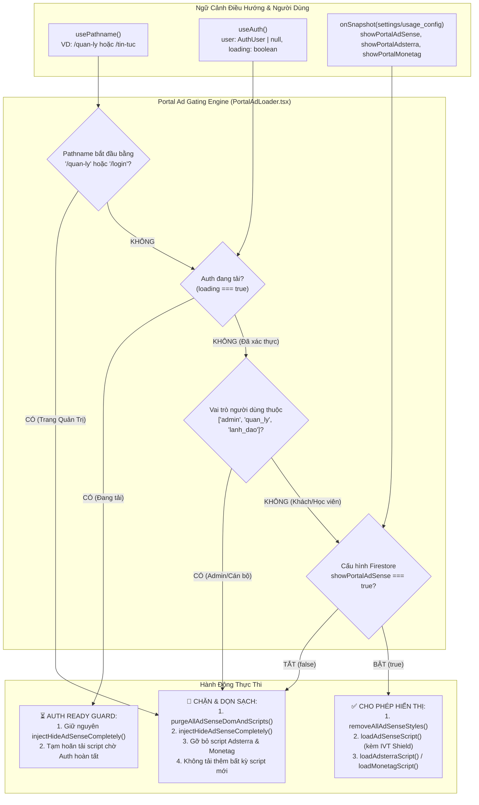

# Kế Hoạch Chặn Quảng Cáo Theo Vai Trò (Role Gate) & Tuyến Đường (Route Gate) Cổng Quản Trị, Dọn Sạch Lỗi Console & Hydration Mismatch

> **Dự án**: Cổng thông tin & Hệ thống Quản trị Đào tạo Thuyền viên Ninh Bình (TNDNB)  
> **Mã kế hoạch**: `261110-1015-portal-ad-role-gating-and-management`  
> **Người lập**: Senior Product Manager & System Architect  
> **Ngày phê duyệt**: 10/11/2026  
> **Phân loại**: `Critical Bug Fix & Architecture Alignment` (Sửa lỗi trọng yếu & Đồng bộ kiến trúc phân quyền quảng cáo)  
> **Trạng thái**: Đã sẵn sàng trình duyệt & thực thi `[Bước 06] /code`  

---

## 1. Bối Cảnh Nghiệp Vụ & Phân Tích Vấn Đề (PRD Overview)

### 1.1 Phản ánh thực tế từ người dùng & Bằng chứng chụp màn hình
- **Phản ánh người dùng**:
  1. *"Plan fix tính năng quản lý cài đặt quảng cáo mới làm cho mỗi trang ôn tập à"*
  2. *"Trong ảnh là trang portal đang đăng nhập tài khoản quản lý vẫn thấy hiện quảng cáo"*
- **Bằng chứng thực tế tại `daotaothuyenvien.com/quan-ly`**:
  - Tài khoản **"Phạm Văn Hiển"** mang vai trò **[QUẢN TRỊ]** (`admin`) đang đăng nhập.
  - Ngay trên đầu trang **"Cổng Quản Lý & Bảng Điều Khiển"** xuất hiện banner quảng cáo Google AdSense kích thước lớn (*"Mở và đọc file PDF - WPS PDF"*).
  - Màn hình Console F12 ghi nhận:
    + Lỗi React Hydration Mismatch: `Error #418` ("Hydration failed because the initial UI does not match what was rendered on the server") và `Error #423` ("There was an error while hydrating. Because the error happened outside of a Suspense boundary, the entire root will switch to client rendering").
    + Lỗi 404: `GET https://daotaothuyenvien.com/default_avatar.png 404 (Not Found)`.

### 1.2 Phân tích nguyên nhân kỹ thuật gốc rễ (Root Cause Analysis)
1. **Thiếu Route Gate & Role Gate trong `app/components/PortalAdLoader.tsx`**:
   - `app/layout.tsx` gọi `<PortalAdLoader />` toàn cục cho toàn bộ Portal Next.js.
   - `PortalAdLoader.tsx` hiện chỉ lắng nghe cờ global `showPortalAdSense` từ Firestore `settings/usage_config`.
   - Component hoàn toàn **KHÔNG** đọc `pathname` (`usePathname()`), **KHÔNG** kết nối `useAuth()`, không kiểm tra `user.role`, và không kiểm tra trạng thái đang tải `loading`.
   - Khi cờ `showPortalAdSense === true` (cấu hình cho khách xem tin tức ngoài trang chủ), Google AdSense Auto Ads được kích hoạt trên **mọi URL**, tự động quét DOM và chèn banner quảng cáo vào đầu trang Quản trị viên (`/quan-ly`).
2. **Thiếu cơ chế Purge DOM & Script AdSense trên Portal**:
   - Khác với `ontap-web/components/AdSenseLoader.tsx` đã có hàm `purgeAllAdSenseDomAndScripts()` và stylesheet `ADSENSE_HIDE_ALL_CSS`, `PortalAdLoader.tsx` chỉ gỡ mỗi thẻ script mà không tiêu diệt các phần tử iframe (`iframe[id^="aswift"]`, `iframe[id^="google_ads"]`), thẻ chứa `ins.adsbygoogle`, và các lớp tự sinh của Google (`.google-auto-placed`).
3. **Hiện tượng FOUA (Flash of Unwanted Ads)**:
   - Trong khoảng thời gian 300ms–1000ms đầu khi Firebase Auth đang khởi tạo (`loading: true`), hệ thống chưa biết người dùng là Admin hay Khách. Do thiếu **Auth Ready Guard**, script quảng cáo vẫn kích hoạt và tải về, gây chớp giật quảng cáo khó chịu trước mặt Quản trị viên.
4. **Lỗi Avatar Fallback 404 (`default_avatar.png`)**:
   - Trong `app/quan-ly/page.tsx:127`, mã nguồn viết: `src={user.photoURL || '/assets/img/default-avatar.png'}`.
   - Tuy nhiên, trong thư mục `public/assets/img/`, chỉ tồn tại `avatar.webp` và `avatar1.webp`, hoàn toàn **không có** file `default-avatar.png` hay `default_avatar.png`.
   - Nếu tài khoản trong Firestore có `photoURL` trỏ tới `/default_avatar.png` hoặc khi fallback kích hoạt, trình duyệt sẽ bắn lỗi 404 Not Found.
5. **Lỗi React Hydration Mismatch (`#418`, `#423`)**:
   - `components/Navbar.tsx` truy cập trực tiếp `user` từ `useAuth()`. Trên SSR Server, `user` luôn là `null` (hiển thị nút *"Đăng nhập"*). Trên Client, khi có phiên đăng nhập, cây DOM chuyển thành cụm avatar và nút *"Quản trị"*. Sự bất đồng bộ giữa cây DOM SSR và Client trong lần render đầu tiên gây ra lỗi vỡ Hydration (#418, #423).

---

## 2. Mục Tiêu Sản Phẩm & Chỉ Số Nghiệm Thu (Product Objectives & KPIs)

| Mục tiêu | Hiện trạng | Mục tiêu sau khi hoàn thành | Đo lường |
|---|---|---|---|
| **Route Gate** | Quảng cáo hiện trên `/quan-ly` | **0% quảng cáo** trên toàn bộ route `/quan-ly` và `/quan-ly/*` | Kiểm tra DOM không tồn tại bất kỳ iframe/ins quảng cáo nào |
| **Role Gate** | Admin / Cán bộ quản lý vẫn thấy quảng cáo | **100% tài khoản Quản trị, Quản lý, Lãnh đạo không thấy quảng cáo** ở bất kỳ trang nào | Đăng nhập tài khoản `admin` duyệt web, 0 request tới `googlesyndication` |
| **Chống FOUA** | Quảng cáo nhấp nháy trước khi Auth tải xong | **Tuyệt đối không chớp quảng cáo** trong thời gian Auth đang tải (`loading: true`) | Kích hoạt `ADSENSE_HIDE_ALL_CSS` ngay từ frame đầu tiên |
| **Console Cleanliness** | 404 `default_avatar.png`, React #418, #423 | **0 lỗi console F12** trên trang `/quan-ly` | Console sạch 100%, HTTP 200 cho toàn bộ assets ảnh |
| **Regression Prevention** | Chưa có test kiểm soát Portal Ads | **Bộ test TDD tự động 100% PASS** trong `scripts/` | `npx vitest run scripts/portal-ad-gate.test.ts` |

---

## 3. Các Ràng Buộc Bất Biến Tuyệt Đối (Invariants)

> [!CAUTION]
> **Ràng Buộc Bất Biến 1 (Zero-Ad Tolerance on Administrative Routes):**  
> Tuyệt đối không để bất kỳ banner, popup, popunder hay script quảng cáo nào (Google AdSense, Adsterra, Monetag) được phép tải hoặc tồn tại trong DOM khi người dùng truy cập các đường dẫn quản trị: `/quan-ly`, `/quan-ly/*`, `/login`.

> [!CAUTION]
> **Ràng Buộc Bất Biến 2 (Strict RBAC Exemption for Staff):**  
> Bất kể cấu hình Firestore `showPortalAdSense` đang BẬT (`true`), nếu tài khoản đã đăng nhập có vai trò `admin`, `quan_ly`, hoặc `lanh_dao`, toàn bộ quảng cáo phải bị vô hiệu hóa, dọn sạch DOM (`purge`) và bị phong tỏa bằng `ADSENSE_HIDE_ALL_CSS`.

> [!CAUTION]
> **Ràng Buộc Bất Biến 3 (Zero Regression on Exam Systems & Portal Build):**  
> Không can thiệp làm thay đổi hành vi của hệ thống thi [`ontap-web/components/ExamQuizScreen.tsx`](file:///d:/Antigravity/TNDNB/ontap-web/components/ExamQuizScreen.tsx). Quá trình đóng gói `npm run build:portal` và `cd ontap-web; npm run build` phải thành công 100% không cảnh báo lỗi.

---

## 4. Kiến Trúc Kỹ Thuật (Architecture & Gating Logic)

---

## 5. Lộ Trình 3 Phases Triển Khai (Phased Implementation Roadmap)

| Phase | Tên Giai Đoạn | Tệp Tin Tác Động Chính | Kết Quả Đầu Ra & Nghiệm Thu | Trạng Thái |
|---|---|---|---|---|
| **Phase 01** | Thiết lập Role Gate, Route Gate & Động cơ Dọn sạch DOM/CSS | [`app/components/PortalAdLoader.tsx`](file:///d:/Antigravity/TNDNB/app/components/PortalAdLoader.tsx), [`app/layout.tsx`](file:///d:/Antigravity/TNDNB/app/layout.tsx) | Tuyệt đối chặn quảng cáo trên `/quan-ly`, chặn tài khoản Quản trị/Lãnh đạo, loại bỏ FOUA, purge toàn bộ iframe/ins | ✅ Đã hoàn thành |
| **Phase 02** | Dọn sạch Console F12: Khắc phục 404 Avatar Fallback & React Hydration Mismatch | [`app/quan-ly/page.tsx`](file:///d:/Antigravity/TNDNB/app/quan-ly/page.tsx), [`components/Navbar.tsx`](file:///d:/Antigravity/TNDNB/components/Navbar.tsx), [`components/ProtectedRoute.tsx`](file:///d:/Antigravity/TNDNB/components/ProtectedRoute.tsx), [`public/default_avatar.png`](file:///d:/Antigravity/TNDNB/public/default_avatar.png), [`public/assets/img/default-avatar.png`](file:///d:/Antigravity/TNDNB/public/assets/img/default-avatar.png) | 0 lỗi 404 ảnh avatar, 0 lỗi React Hydration Mismatch #418 & #423 trên `/quan-ly` | ✅ Đã hoàn thành |
| **Phase 03** | Bộ Kiểm Thử TDD Tự Động, Đảm Bảo Invariants & Đóng Gói Nghiệm Thu | [`scripts/portal-ad-gate.test.ts`](file:///d:/Antigravity/TNDNB/scripts/portal-ad-gate.test.ts), Toàn bộ Test Suite `scripts/` | 100% tests PASS, zero regression, `npm run build:portal` thành công 57 routes | ✅ Đã hoàn thành |

---

## 6. Danh Mục Tài Liệu Kế Hoạch Chi Tiết (Plan Documentation Matrix)

- 📘 **Kế hoạch tổng thể chính thức**: [`plan.md`](file:///d:/Antigravity/TNDNB/docs/plans/261110-1015-portal-ad-role-gating-and-management/plan.md)
- 📋 **Living Task Checklist (TDD)**: [`task.md`](file:///d:/Antigravity/TNDNB/docs/plans/261110-1015-portal-ad-role-gating-and-management/task.md)
- 🔒 **Đặc tả kỹ thuật Phase 01**: [`phase-01-core-ad-role-and-route-gating.md`](file:///d:/Antigravity/TNDNB/docs/plans/261110-1015-portal-ad-role-gating-and-management/phase-01-core-ad-role-and-route-gating.md)
- 🎨 **Đặc tả kỹ thuật Phase 02**: [`phase-02-console-and-ui-hygiene.md`](file:///d:/Antigravity/TNDNB/docs/plans/261110-1015-portal-ad-role-gating-and-management/phase-02-console-and-ui-hygiene.md)
- 🧪 **Đặc tả kỹ thuật Phase 03**: [`phase-03-tdd-tests-and-build-verification.md`](file:///d:/Antigravity/TNDNB/docs/plans/261110-1015-portal-ad-role-gating-and-management/phase-03-tdd-tests-and-build-verification.md)
