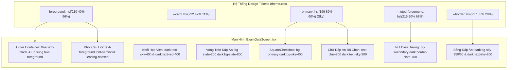
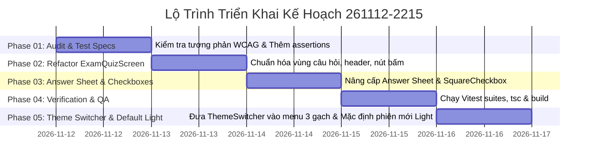

# Kế Hoạch Chuẩn Hóa Màu Sắc & Tương Phản Dark Mode Màn Hình Thi Sát Hạch

> **Dự án**: Cổng thông tin & Hệ thống Quản trị Đào tạo Thuyền viên Ninh Bình (TNDNB)  
> **Mã kế hoạch**: `261112-2215-exam-dark-mode-color-contrast`  
> **Tác giả**: Senior Product Manager & Lead Architect  
> **Ngày lập**: 12/11/2026 (Cập nhật Phase 05: 13/11/2026)  
> **Trạng thái**: Phases 01–05 ✅ Hoàn thành & Đã nghiệm thu (`/code` + Review Toàn Nhánh + Browser Check)  
> **Tiêu chuẩn chất lượng**: WCAG 2.1 AA (Tỷ lệ tương phản tối thiểu 4.5:1 cho văn bản thông thường, 3:1 cho tiêu đề lớn/giao diện người dùng)

---

## 1. Bối Cảnh Nghiệp Vụ & Phản Hồi Trải Nghiệm Người Dùng (PRD)

### 1.1 Hiện Trạng & Phản Hồi Người Dùng
Trong quá trình sử dụng chế độ nền tối (Dark Mode `[data-theme='dark']`) trên module ôn tập và sát hạch thuyền viên ([`ontap-web/components/ExamQuizScreen.tsx`](file:///d:/Antigravity/TNDNB/ontap-web/components/ExamQuizScreen.tsx) và [`ontap-win/components/ExamQuizScreen.tsx`](file:///d:/Antigravity/TNDNB/ontap-win/components/ExamQuizScreen.tsx)), người dùng và học viên phản ánh hiện tượng chìm màu, mất chữ và tương phản cực kỳ kém:

1. **Khối câu hỏi bị "đen kịt" trên nền xanh đen**: Khung ngoài bao quanh bị ép cứng `text-black` (dòng 176), trong khi nội dung câu hỏi `
{currentQuestion.text}
` không có class màu riêng. Khi chuyển sang Dark Mode, thẻ cha `bg-card` có màu nền xanh thẫm `hsl(222, 47%, 11%)` (#0f172a), khiến toàn bộ chữ câu hỏi đen kịt trên nền đen, học viên không thể đọc được đề thi.
2. **Tiêu đề "Nội dung câu hỏi" chìm đen**: Thẻ tiêu đề kế thừa màu chữ `text-black` từ container cha và đường gạch đứt `border-gray-400` thiếu tương phản.
3. **Thông tin học viên và câu số vi phạm chuẩn tiếp cận WCAG 2.1 AA**:
   - Tên học viên dùng `text-blue-700` (#1d4ed8) trên nền `bg-card` (#0f172a) cho tỷ lệ tương phản chỉ **2.2:1** (thất bại hoàn toàn so với chuẩn tối thiểu **4.5:1**).
   - Số câu hỏi `text-red-600` (#dc2626) trên nền đen có độ tương phản **3.4:1** (dưới ngưỡng 4.5:1).
   - Nhãn hạng bằng sử dụng nền `bg-red-50` tạo thành mảng trắng lóa chói mắt giữa giao diện tối.
4. **Vòng tròn đáp án (A, B, C, D) bị lóa chữ trắng trên nền xám**:
   - Vòng tròn đáp án chưa chọn dùng `bg-gray-200 text-foreground`. Trong Dark Mode, `text-foreground` là màu trắng ngà `hsl(210, 40%, 96%)`, đặt trên nền xám nhạt `bg-gray-200` (#e5e7eb) tạo thành chữ trắng trên nền xám nhạt (tương phản cực thấp ~1.3:1), làm mờ lóa không nhìn thấy ký tự A, B, C, D.
   - Khi đáp án được chọn, văn bản đáp án dùng `text-blue-700` lại bị chìm vào nền xanh thẫm.
5. **Bảng đáp án (Answer Sheet) và ô checkbox tick bị chìm hoặc chói lóa**:
   - Hàng câu hỏi đang làm dùng `bg-cyan-200` tạo dải màu sáng chói lóa tương phản gắt với tổng thể dark mode.
   - Ô vuông checkbox `SquareCheckbox` khi được chọn lại dùng `bg-[#333]` (màu xám đen than củi) chìm nghỉm vào nền card dark mode, khiến học viên không thể phân biệt được ô nào đã tick và ô nào chưa tick.
6. **Nút điều hướng "Câu trước" lệch tông**:
   - Nút dùng cứng `bg-gray-100 text-black border-gray-300`, sáng rực rỡ như một khối trắng lạc lõng trong theme tối.

### 1.2 Yêu Cầu Mở Rộng Trải Nghiệm Người Dùng (Phase 05 — Bổ Sung 13/11/2026)
Sau khi hoàn thành chuẩn hóa tương phản Dark Mode ở Phases 01–04, người dùng tiếp tục phản hồi 2 điểm bất tiện về vị trí nút chuyển giao diện và trạng thái mặc định:
1. **Nút đổi Sáng/Tối nổi ở góc dưới phải gây vướng & đè chữ trên Mobile**:
   - [`ontap-web/App.tsx`](file:///d:/Antigravity/TNDNB/ontap-web/App.tsx#L485-L487) đang đặt `
<ThemeSwitcher />
` nổi cố định ở góc dưới bên phải cho cả Desktop và Mobile. Trên màn hình thi [`ExamQuizScreen.tsx`](file:///d:/Antigravity/TNDNB/ontap-web/components/ExamQuizScreen.tsx#L406), nút này đè trực tiếp lên chỉ số `100%` của [`ZoomBar.tsx`](file:///d:/Antigravity/TNDNB/ontap-web/components/ZoomBar.tsx).
   - **Yêu cầu mới #1**: *"Giấu nút đổi sáng tối cho cả mobile và desktops vào 3 gạch ở góc trên bên phải"* — gỡ nút nổi góc dưới phải, đưa công tắc vào dropdown menu 3 gạch `<Menu />` trong [`ontap-web/components/TopNavbar.tsx`](file:///d:/Antigravity/TNDNB/ontap-web/components/TopNavbar.tsx) (dùng chung cho Desktop & Mobile Web) và menu mở rộng của [`ontap-web/components/MobileBottomNav.tsx`](file:///d:/Antigravity/TNDNB/ontap-web/components/MobileBottomNav.tsx) (cho Capacitor `isMobileApp`).
2. **Phiên mới bị tự chuyển sang Dark Mode theo hệ điều hành hoặc cache cũ**:
   - [`ontap-web/contexts/ThemeContext.tsx`](file:///d:/Antigravity/TNDNB/ontap-web/contexts/ThemeContext.tsx#L17-L27) hiện đang đọc `localStorage` (`ontap_theme` / `theme`) và fallback `window.matchMedia('(prefers-color-scheme: dark)').matches`, làm cho người dùng bật Dark Mode trên hệ điều hành hoặc từng lỡ chọn Dark Mode bị kẹt ở nền tối khi mở phiên mới.
   - **Yêu cầu mới #2**: *"mặc định tất cả phiên mới là theme sáng nhé"* — bỏ tự động theo `prefers-color-scheme: dark`, chuyển lưu trạng thái theo phiên (`sessionStorage` key `ontap_theme_session`) để mọi phiên mới/tab mới luôn khởi tạo `'light'` (nhưng vẫn giữ được Dark Mode khi nhấn F5 trong cùng phiên) và dọn sạch key `localStorage` cũ.

#### Quyết Định Frontier Đã Chốt Cho Phase 05:
- **Quyết định 1 (Cơ chế phiên mới mặc định sáng) — ✅ Đã chốt Phương án 1A**: Dùng **`sessionStorage` (`ontap_theme_session`) + bỏ `prefers-color-scheme: dark` + dọn key `localStorage` cũ (`ontap_theme`, `theme`)** (khớp chính xác 100% yêu cầu *"tất cả phiên mới là theme sáng"*, trong cùng phiên bấm F5 vẫn giữ theme vừa chọn; bọc `try/catch` chịu lỗi `SecurityError`).
- **Quyết định 2 (Phạm vi `ontap-web` vs `ontap-win` Desktop) — ✅ Đã chốt Phương án 2A**: Tập trung **`ontap-web` (Web Desktop + Web Mobile qua [`ontap-web/components/TopNavbar.tsx`](file:///d:/Antigravity/TNDNB/ontap-web/components/TopNavbar.tsx) + Capacitor App qua [`ontap-web/components/MobileBottomNav.tsx`](file:///d:/Antigravity/TNDNB/ontap-web/components/MobileBottomNav.tsx))**, giữ nguyên `ontap-win` Electron Desktop (8 themes riêng).

---

## 2. Mục Tiêu Dự Án & Tiêu Chuẩn Tiếp Cận (WCAG 2.1 AA)

| Hạng mục | Hiện trạng (Lỗi Dark Mode) | Độ tương phản cũ | Giải pháp mới (Semantic Tokens) | Độ tương phản mới (Target) |
|---|---|---|---|---|
| **Văn bản câu hỏi** | `text-black` trên `#0f172a` | **1.1:1** (Liệt) | `text-foreground` (`hsl(210, 40%, 96%)`) | **14.8:1** (Đạt AAA) |
| **Tiêu đề câu hỏi** | `text-black` | **1.1:1** (Liệt) | `text-foreground` + `border-border dark:border-slate-700` | **14.8:1** (Đạt AAA) |
| **Tên học viên** | `text-blue-700` | **2.2:1** (Hỏng) | `text-blue-700 dark:text-sky-400` | **7.5:1** (Đạt AAA) |
| **Số câu hỏi** | `text-red-600` | **3.4:1** (Hỏng) | `text-red-600 dark:text-red-400` | **5.8:1** (Đạt AA) |
| **Nhãn hạng bằng** | `bg-red-50 text-red-600` | Mảng lóa chói | `bg-red-50 text-red-600 dark:bg-red-950/40 dark:text-red-300 dark:border-red-800` | **6.1:1** (Đạt AA) |
| **Vòng tròn A, B, C, D** | `bg-gray-200 text-foreground` | **1.3:1** (Mờ lóa) | `bg-slate-200 text-slate-800 dark:bg-slate-800 dark:text-slate-200` | **8.2:1** (Đạt AAA) |
| **Chữ đáp án đã chọn** | `text-blue-700` | **2.2:1** (Hỏng) | `text-blue-700 dark:text-sky-300 font-bold` | **9.2:1** (Đạt AAA) |
| **Thẻ đáp án đã chọn** | `bg-blue-50 dark:bg-blue-900/20` | Viền nhạt | `border-blue-500 bg-blue-50 dark:border-sky-500 dark:bg-sky-950/30` | Chuẩn UI hiện đại |
| **Nút "Câu trước"** | `bg-gray-100 text-black` | Lệch tông tối | `bg-secondary text-secondary-foreground border border-border dark:border-slate-700` | **11.5:1** (Đạt AAA) |
| **Hàng active Answer Sheet** | `bg-cyan-200 text-black` | Chói mắt | `bg-sky-100 dark:bg-sky-950/60 text-blue-800 dark:text-sky-200` | **7.8:1** (Đạt AAA) |
| **Checkbox SquareCheckbox** | `bg-[#333]` (Xám đen) | **1.4:1** (Vô hình) | `bg-primary dark:bg-sky-400 border-primary dark:border-sky-400` | **8.5:1** (Đạt AAA) |

---

## 3. Kiến Trúc Kỹ Thuật (Architecture & Tokens Mapping)

### 3.1 Quy Tắc Bất Biến (Invariant Constraints)
1. **Bảo toàn 100% Test Assertions hiện có**:
   - Bộ kiểm thử [`scripts/ontap-dual-theme-and-sidebar.test.ts`](file:///d:/Antigravity/TNDNB/scripts/ontap-dual-theme-and-sidebar.test.ts) kiểm tra nghiêm ngặt:
     - `hidden md:flex justify-between items-start` (Header Desktop)
     - `Số báo danh`
     - `bg-[#f0ad4e]` (Hộp cam thông tin thời gian thi)
     - `flex md:hidden items-center justify-between` (Mobile Exam Header)
     - `handleBackWithConfirm`
     - `tabular-nums`
   - Bộ kiểm thử [`scripts/portal-console-and-tinymce-fix.test.ts`](file:///d:/Antigravity/TNDNB/scripts/portal-console-and-tinymce-fix.test.ts) (`TC-31`):
     - Không được thay đổi tên hàm hoặc bỏ các class phản hồi trên.
2. **Đồng bộ song song Web & Electron**:
   - [`ontap-web/components/ExamQuizScreen.tsx`](file:///d:/Antigravity/TNDNB/ontap-web/components/ExamQuizScreen.tsx)
   - [`ontap-win/components/ExamQuizScreen.tsx`](file:///d:/Antigravity/TNDNB/ontap-win/components/ExamQuizScreen.tsx)

---

## 4. Phân Kì Thực Hiện (Phased Execution)

### Tổng Quan 5 Giai Đoạn:
- **Phase 01**: [`phase-01-audit-and-tokens.md`](file:///d:/Antigravity/TNDNB/docs/plans/261112-2215-exam-dark-mode-color-contrast/phase-01-audit-and-tokens.md) - Rà soát chi tiết mã màu cứng, thiết lập bảng tính tương phản WCAG 2.1 AA, cập nhật test assertions cho dark mode.
- **Phase 02**: [`phase-02-exam-quiz-screen-refactor.md`](file:///d:/Antigravity/TNDNB/docs/plans/261112-2215-exam-dark-mode-color-contrast/phase-02-exam-quiz-screen-refactor.md) - Bóc tách và thay thế toàn bộ mã màu cố định tại Khối câu hỏi, Desktop Header, Mobile Header và Khối nút điều hướng sang Semantic Tokens.
- **Phase 03**: [`phase-03-answer-sheet-and-checkboxes.md`](file:///d:/Antigravity/TNDNB/docs/plans/261112-2215-exam-dark-mode-color-contrast/phase-03-answer-sheet-and-checkboxes.md) - Chuẩn hóa bảng Answer Sheet bên phải, hàng câu hỏi active, và tái thiết kế ô `SquareCheckbox` nổi bật trên Dark Mode. Đồng bộ cho `ontap-win`.
- **Phase 04**: [`phase-04-verification-and-qa.md`](file:///d:/Antigravity/TNDNB/docs/plans/261112-2215-exam-dark-mode-color-contrast/phase-04-verification-and-qa.md) - Chạy toàn bộ Vitest test suites, TypeScript type-checking `tsc --noEmit`, kiểm thử build `ontap-web` và Portal.
- **Phase 05**: [`phase-05-theme-switcher-menu-and-default-light.md`](file:///d:/Antigravity/TNDNB/docs/plans/261112-2215-exam-dark-mode-color-contrast/phase-05-theme-switcher-menu-and-default-light.md) - Gỡ nút nổi góc dưới phải (`ontap-web/App.tsx`), tích hợp `ThemeSwitcher` (`variant="menu-item"`) vào menu 3 gạch góc trên phải (`TopNavbar.tsx` cho Desktop & Mobile Web, `MobileBottomNav.tsx` cho Capacitor App), và thiết lập mặc định tất cả phiên mới là Theme Sáng qua `sessionStorage` (bỏ `prefers-color-scheme: dark`, dọn key `localStorage` cũ).

---

## 5. Bảng Theo Dõi Tiến Độ (Living Status Board)

| Phase | Trọng Tâm | Tệp Tác Động Chính | Trạng Thái | Người Phụ Trách |
|---|---|---|:---:|---|
| **Phase 01** | Audit mã màu & Viết Test Dark Mode | [`scripts/ontap-dual-theme-and-sidebar.test.ts`](file:///d:/Antigravity/TNDNB/scripts/ontap-dual-theme-and-sidebar.test.ts) | ✅ Hoàn thành | Lead Architect |
| **Phase 02** | Refactor Câu hỏi & Header & Nút | [`ontap-web/components/ExamQuizScreen.tsx`](file:///d:/Antigravity/TNDNB/ontap-web/components/ExamQuizScreen.tsx) | ✅ Hoàn thành | Senior Frontend Dev |
| **Phase 03** | Answer Sheet & SquareCheckbox Sync | [`ontap-web/components/ExamQuizScreen.tsx`](file:///d:/Antigravity/TNDNB/ontap-web/components/ExamQuizScreen.tsx) [`ontap-win/components/ExamQuizScreen.tsx`](file:///d:/Antigravity/TNDNB/ontap-win/components/ExamQuizScreen.tsx) | ✅ Hoàn thành | Senior Frontend Dev |
| **Phase 04** | Kiểm thử Vitest Suites & Build QA | Toàn bộ dự án | ✅ Hoàn thành | QA Expert |
| **Phase 05** | Đưa ThemeSwitcher vào menu 3 gạch & Mặc định Light | [`ontap-web/contexts/ThemeContext.tsx`](file:///d:/Antigravity/TNDNB/ontap-web/contexts/ThemeContext.tsx) [`ontap-web/components/ThemeSwitcher.tsx`](file:///d:/Antigravity/TNDNB/ontap-web/components/ThemeSwitcher.tsx) [`ontap-web/components/TopNavbar.tsx`](file:///d:/Antigravity/TNDNB/ontap-web/components/TopNavbar.tsx) [`ontap-web/components/MobileBottomNav.tsx`](file:///d:/Antigravity/TNDNB/ontap-web/components/MobileBottomNav.tsx) [`ontap-web/App.tsx`](file:///d:/Antigravity/TNDNB/ontap-web/App.tsx) | ✅ Hoàn thành | Senior Frontend Dev & QA |

---

## 6. Tiêu Chí Nghiệm Thu (Acceptance Criteria)

1. **Hiển thị Dark Mode hoàn hảo**:
   - Khi bật Dark Mode (`[data-theme='dark']`), toàn bộ chữ đề bài, tiêu đề câu hỏi, số thứ tự câu hiển thị rõ ràng với độ tương phản $\ge$ 4.5:1.
   - Vòng tròn A, B, C, D hiển thị ký tự sắc nét, không bị hiện tượng chữ trắng chìm trên nền xám nhạt.
   - Khi chọn đáp án, chữ đáp án đổi sang màu `dark:text-sky-300`, nền đổi sang `dark:bg-sky-950/30` nổi bật và tinh tế.
2. **Answer Sheet & Checkbox rõ ràng**:
   - Ô `SquareCheckbox` khi được tích (checked) hiển thị ô vuông màu xanh `dark:bg-sky-400` tương phản cao, dễ nhìn từ khoảng cách xa.
   - Hàng câu hỏi đang làm hiển thị nền dịu mắt `dark:bg-sky-950/60`, viền `dark:border-slate-700`.
3. **Bảo toàn tính năng & giao diện Light Mode**:
   - Trong chế độ Light Mode (`[data-theme='light']`), giao diện thi sát hạch truyền thống vẫn giữ nguyên tính thân thuộc với người dùng.
4. **Kiểm thử tự động 100% Pass**:
   - `npx vitest run scripts/` đạt 15/15 test suites passed (bao gồm `TC-36`, `TC-37`).
   - `npx tsc --noEmit` và `npx tsc -p ontap-web/tsconfig.json --noEmit` không phát sinh bất kỳ lỗi kiểu dữ liệu nào.
   - Bản build `cd ontap-web && npm run build` và `npm run build:portal` thành công.
5. **Vị trí nút Sáng/Tối gọn gàng trong menu 3 gạch (Phase 05)**:
   - Không còn nút nổi `fixed bottom-4 right-4` che thanh `ZoomBar` `100%` trên Mobile hay vướng góc màn hình Desktop.
   - Công tắc đổi Sáng/Tối nằm gọn trong dropdown menu 3 gạch ở góc trên bên phải (`TopNavbar.tsx`) trên cả Desktop & Mobile Web, và trong menu mở rộng `MobileBottomNav.tsx` trên Capacitor App (`isMobileApp === true`).
6. **Mặc định Theme Sáng cho mọi phiên mới (Phase 05)**:
   - Mọi tab mới / phiên làm việc mới luôn mở bằng Theme Sáng (`data-theme="light"`), bỏ qua `prefers-color-scheme: dark` của hệ điều hành và dọn key `localStorage` cũ (`ontap_theme`, `theme`), đồng thời vẫn giữ được theme đã chọn khi F5 trong cùng phiên qua `sessionStorage`.
